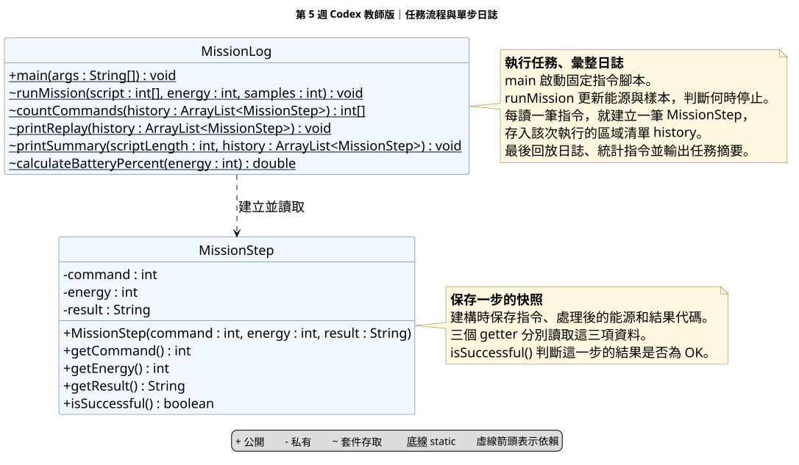

<!-- _class: lead by-claude -->

# 第五週｜把任務日誌設計成物件

## 類別、建構子、封裝與設計責任

AI 協作：從需求寫出**可驗證**的類別設計

物件導向程式設計（與 AI 協作）｜115 學年度第 1 學期
資訊管理學系 二年級｜授課教師：胡碩誠

<!--
講者備註：本份投影片依 week05/codex版本 的講義、作業、範例與教師筆記製作，由 Claude 撰寫；codex 原投影片 week05_slides_codex.md 保留不動，可擇一使用。
本份分成兩部分：先只用 examples/ 教概念，再用 starter/ 說明作業；teacher/ 只出現在教師用附錄。
-->

---

<!-- _class: by-claude small -->

## 關於這份投影片

- 每頁右上角 <span class="tag">claude</span>：本投影片由 Anthropic Claude（Claude Code）依 **codex版本教材** 製作，教師審閱後使用。
- 程式、講義題號、TODO 與預期輸出全部沿用 `week05/codex版本/`；投影片不新增學生作業。
- 左上角標籤是該頁對應的 Java 檔（路徑以 `week05/codex版本/` 為起點）：

| 標籤 | 資料夾 | 在本投影片的角色 |
|---|---|---|
| <span class="tag blue">examples/…</span> | `examples/` | **第一部分：範例教學**——課堂示範與觀察 |
| <span class="tag green">starter/…</span> | `starter/` | **第二部分：作業說明**——學生要完成的 TODO |
| <span class="tag gray">teacher/…</span> | `teacher/` | **附錄：教師用**——完整答案與檢查工具，不發給學生 src |

<!--
講者備註：Codex 版另有一份 47 頁投影片（week05_slides_codex.md）。這份頁碼與 codex 教師筆記的頁碼對照表不同，帶課時以講義題號（A–H）為準。
-->

---

<!-- _class: by-claude small -->

<div class="ex"><span>../../week04/codex版本/teacher/MissionLog.java</span></div>

## 上週的日誌：三條清單靠「同一個索引」配對

<div class="cols-60">
<div>

```java
ArrayList<Integer> commandLog = new ArrayList<>();
ArrayList<Integer> energyLog  = new ArrayList<>();
ArrayList<String>  resultLog  = new ArrayList<>();
...
commandLog.add(command);
energyLog.add(energy);    // 假設第 2 步漏了這行
resultLog.add(result);
```

路線 `{1,1,2}`：探索→探索→掃描，能源 14、8、6。

</div>
<div>

| 索引 | command | result | energy（漏記後） |
|---|---:|---|---|
| 0 | 1 | 成功 | 14 |
| 1 | 1 | 成功 | **6 ← 其實是第 3 步** |
| 2 | 2 | 成功 | **不存在 → 越界** |

</div>
</div>

> 同一步的三個資料分散在三個地方，**誰都沒有保證它們屬於同一步**。
> 本週的作業：一步 = 一個 `MissionStep` 物件，再放進一條 `history` 清單。

<!--
講者備註：講義 A2–A3。這是「假設漏加」的錯誤示意，不是上週答案本身有錯。漏記後 energyLog = [14, 6]：索引 1 錯配到第 3 步的 6，索引 2 讀 energyLog 會拋 IndexOutOfBoundsException。
用這個問題當動機，但先不碰作業程式：要先學會「自己寫類別」的工具。
-->

---

<!-- _class: by-claude small -->

## 本週流程：先用範例學工具，再用到作業上

<div class="cols">
<div class="box blue">

**第一部分｜範例教學** <span class="tag blue">examples/</span>
講義 A–D，約 70 分鐘

- StepCard：類別、建構子、this、getter
- RoverBattery：封裝、受控修改
- ReferenceDemo：參考與傳值
- SnapshotDemo：快照、ArrayList 存參考

只觀察、預測、執行，**不改作業檔**。

</div>
<div class="box green">

**第二部分｜作業說明** <span class="tag green">starter/</span>
講義 E–H，課堂開始、課後完成

- MissionStep：TODO 1–3
- MissionLog：TODO 4–6
- E3 六條路線驗收
- F 設計卡、AI 審查、反例
- 繳交與保存

</div>
</div>

| 第 1 節 | 第 2 節 | 第 3 節 |
|---|---|---|
| A 取回 10｜B 類別與建構 25｜C 封裝 15 | D 參考與快照 20｜**E 作業實作 30** | **F 設計與反例 30**｜G 檢核 5｜H 保存 15 |

<span class="note">休息另計；這是備課配置，尚未學生試教。</span>

<!--
講者備註：若 D 的 IDE 操作卡住，改由教師帶看，保留 E 的實作時間；學生 GUI 部分標「待補」。
-->

---

<!-- _class: lead by-claude -->
<!-- footer: '物件導向程式設計｜Week 05｜第一部分 範例教學（examples/）' -->

# 第一部分｜範例教學

## 用 `examples/` 學會類別、封裝、參考與快照

講義 A–D｜四個執行入口、兩個合作類別

<!--
講者備註：第一部分只使用 examples 六檔；作業的 starter 等第二部分才打開。
-->

---

<!-- _class: by-claude small -->

## 範例檔案與執行入口

| 講義 | 執行入口（有 main） | 合作的類別（無 main） | 觀察重點 |
|---|---|---|---|
| B | `examples/CreateStepDemo.java` | `examples/StepCard.java` | 兩個 new、建構子、getter |
| C | `examples/BatteryDemo.java` | `examples/RoverBattery.java` | 私有能源、拒絕與封頂 |
| D1 | `examples/ReferenceDemo.java` | `examples/RoverBattery.java` | 共用參考、傳值 |
| D2–D3 | `examples/SnapshotDemo.java` | `StepCard.java`、`RoverBattery.java` | 每步新快照 |

把 examples **六檔**複製到 `115_1_Java/YYYY_MM_DD/java-05/src/`，終端機開在 `java-05`：

```powershell
java -version
javac -version
javac -encoding UTF-8 -d out src/*.java
java -cp out CreateStepDemo      # 換活動就換類別名，不加 .java
```

<span class="note">JDK 不限定版本，記錄本人 java／javac 版本。StepCard、RoverBattery 沒有 main，不要直接執行它們。</span>

<!--
講者備註：starter 兩檔可以先複製進 src（README 的學生操作），但第一部分不打開。teacher 同名檔不放 src。
-->

---

<!-- _class: by-claude -->

<div class="ex"><span>examples/StepCard.java</span></div>

## B｜你早就用過物件，這週換你設計

<div class="cols">
<div>

**以前：使用現成類別**

```java
// 第四週
ArrayList<Integer> energyLog = new ArrayList<>();
energyLog.add(14);
```

```csharp
// C# WinForms
Button ok = new Button();
```

</div>
<div>

**本週：自己決定**

- 要保存**哪些資料**？→ 欄位
- 建立時**一定要給什麼**？→ 建構子
- 外部**可以讀什麼、改什麼**？→ 方法與存取權

會用 `new Button()` ≠ 會寫一個類別。

</div>
</div>

<!--
講者備註：先肯定學生已有的物件經驗，再界定本週新增能力：自己定義欄位、建構子與查詢方法。
-->

---

<!-- _class: by-claude -->

<div class="ex"><span>examples/CreateStepDemo.java</span><span>examples/StepCard.java</span></div>

## B1｜一行程式，三個角色

```java
StepCard   first   =   new StepCard(1, 14);
//  型態    參考變數       建立物件並呼叫建構子
```

<div class="refdiag">
  <div class="var">first<small>參考變數</small></div>
  <div class="arrow">──────▶</div>
  <div class="obj"><b>StepCard 物件</b><code>command = 1</code><code>energy = 14</code></div>
</div>

- **類別** `StepCard`：規定物件有哪些欄位與方法，也當作變數的型態。
- **`new`**：真正建立一份資料，欄位存進 1 與 14。
- **`first`**：保存「找得到那個物件」的參考值，不是把整個物件裝進去。

只寫 `StepCard first;` → 只有變數，**還沒有物件**。

<!--
講者備註：講義 B1。先追蹤右側 new，再看指定。不要把 first 畫成裝整個物件的盒子。
-->

---

<!-- _class: by-claude small -->

<div class="ex"><span>examples/StepCard.java</span></div>

## B1｜StepCard 全貌：欄位、建構子、getter

<div class="cols-60">
<div>

```java
public class StepCard {
    private int command;          // ① 欄位
    private int energy;

    public StepCard(int command,  // ② 建構子
                    int energy) {
        this.command = command;
        this.energy = energy;
    }

    public int getCommand() {     // ③ getter
        return command;
    }

    public int getEnergy() {
        return energy;
    }
}
```

</div>
<div>

**① 欄位**：寫在 class 內、方法外；跟著物件存在，建構結束後值仍保留。（區域變數方法結束就消失。）

**② 建構子**：名稱與類別相同、**沒有回傳型態**；`new` 時執行一次，只保存傳入值——不會因 指令=1 就去探索扣電。

**③ getter**：`public` 他人可呼叫、`int` 回傳整數、`()` 不需參數；只回傳資料，**不印、不改**。

</div>
</div>

<!--
講者備註：建構子前面誤加 void 就變成一般方法，new StepCard(1,14) 會編譯失敗。getter 是命名慣例，不是 C# 屬性語法，Java 沒有 { get; }。
-->

---

<!-- _class: by-claude -->

<div class="ex"><span>examples/StepCard.java</span></div>

## B1｜`this` 分辨欄位與同名參數

```java
this.energy = energy;
```

| 左邊 `this.energy` | 右邊 `energy` |
|---|---|
| **目前這個物件**的 energy 欄位 | 這次呼叫傳進來的**參數** |

`new StepCard(1, 14)`：參數 energy = 14 → 存入新物件的欄位。

**常見錯誤**

```java
energy = energy;   // 參數指定給自己，欄位還是預設值 0
```

<span class="note">int 欄位預設 0、String 欄位預設 null。this 指「目前實例」，不是全域變數，也不是類別本身。</span>

<!--
講者備註：這個錯誤只靠單一物件可能看不出來；第二個物件、不同數值會揭露問題。
-->

---

<!-- _class: by-claude -->

<div class="ex"><span>examples/CreateStepDemo.java</span></div>

## B2｜先預測：兩次 new 會發生什麼？

```java
StepCard first = new StepCard(1, 14);
StepCard second = new StepCard(2, 12);
System.out.println("第一次=" + first.getCommand() + "/" + first.getEnergy());
System.out.println("第二次=" + second.getCommand() + "/" + second.getEnergy());
System.out.println("同一個物件=" + (first == second));
```

| 時間點 | first 的 command／energy | second 的 command／energy |
|---|---|---|
| 第一個 new 完成 | ？ | 尚未建立 |
| 第二個 new 完成 | ？ | ？ |

**三行輸出？寫在講義 B2 再執行。**

<!--
講者備註：先讓學生寫預測，再用 VS Code 執行。重點：建立 second 之後再讀 first，first 不被覆蓋。答案在下一頁。
-->

---

<!-- _class: by-claude -->

<div class="ex"><span>examples/CreateStepDemo.java</span><span>examples/StepCard.java</span></div>

## B2–B3｜答案，以及兩個刻意的編譯錯誤

<div class="cols">
<div>

**實際輸出**

```text
第一次=1/14
第二次=2/12
同一個物件=false
```

兩次 `new` = 兩個物件，各有自己的欄位。
即使參數相同，也是不同物件。

</div>
<div>

**B3 二選一（在副本取消註解）**

```java
// first.energy = 99;
// StepCard empty = new StepCard();
```

- 第一行：`energy` 是 private → 其他類別不能直接存取。
- 第二行：已宣告有參數建構子 → 編譯器**不再自動補**無參數版。

</div>
</div>

預測 → 編譯 → 記下關鍵訊息與原因 → **恢復正確程式**。

<!--
講者備註：編譯訊息依 JDK 語系不同，驗收看「原因」，不要求逐字抄訊息。故意的錯誤只在副本，不放進正式 src。
本週不教建構子過載、this(...) 串接、super。
-->

---

<!-- _class: by-claude small -->

<div class="ex"><span>examples/StepCard.java</span><span>examples/CreateStepDemo.java</span></div>

## static 成員屬於類別，實例成員屬於物件

| 成員 | 屬於誰 | 在範例中 |
|---|---|---|
| `public static void main` | 類別 | 不必先 new CreateStepDemo，JVM 直接從這裡開始 |
| `command`／`energy` 欄位 | 每個物件 | first 存 1/14、second 存 2/12，各一份 |
| `getEnergy()` 實例方法 | 每個物件 | `first.getEnergy()` 指定讀哪一個物件 |

```java
private static int energy;   // 若誤加 static：所有 StepCard 共用同一格
```

先 new first(1,14)、再 new second(2,12) → 加了 static 後，`first.getEnergy()` 也會得到 **12**（後寫覆蓋前寫）。

<span class="note">本週只需分辨 static 流程與實例資料；不教 static 計數器。作業的 F3 選項 1 會在 MissionStep 上重現這個錯誤。</span>

<!--
講者備註：學生常因為「main 是 static，呼叫不到」而把所有東西加 static，這頁先打預防針。可在教師副本示範，觀察後恢復。
-->

---

<!-- _class: by-claude small -->

<div class="ex"><span>examples/RoverBattery.java</span><span>examples/BatteryDemo.java</span></div>

## C｜封裝：讓「改值的規則」集中在一個地方

<div class="cols">
<div>

```java
public class RoverBattery {
    private int energy;   // 0..20

    public boolean explore() {
        if (energy < 6) {
            return false;   // 拒絕：不改值
        }
        energy -= 6;
        return true;
    }

    public boolean charge() {
        if (energy == 20) {
            return false;   // 已滿：不改值
        }
        energy += 5;
        if (energy > 20) { energy = 20; } // 封頂
        return true;
    }
}
```

<style scoped>pre { font-size: 17px; line-height: 1.3; }</style>

</div>
<div>

外部**不能**直接寫 `energy`，只能透過 `explore()`、`charge()` 改變。

扣電、封頂規則只寫一次，不必要求每個呼叫端都記得。

**想一想**：如果開放 `setEnergy(999)`，誰要負責檢查？

<span class="note">private 只限制存取位置，**不會自動檢查範圍**；建構前提 0..20 仍要靠契約與程式維護。</span>

</div>
</div>

<!--
講者備註：講義 C。這是初步的責任集中，不宣稱已教完 SOLID。投影片把封頂判斷縮成一行，原始檔 examples/RoverBattery.java 為分行寫法，邏輯相同。
-->

---

<!-- _class: by-claude -->

<div class="ex"><span>examples/BatteryDemo.java</span></div>

## C｜預測 BatteryDemo：拒絕時不變，充電時封頂

| 呼叫順序 | 回傳值 | 能源 |
|---|---|---:|
| `low` 從 5 開始，`explore()` | false | 5 |
| `low.charge()` | true | 10 |
| `low.explore()` | true | 4 |
| `edge` 從 19 開始，`charge()` | true | 20 |
| `edge` 再 `charge()` | false | 20 |

```text
探索=false, 能源=5
充電=true, 能源=10
探索=true, 能源=4
充至上限=true, 能源=20
已充滿=false, 能源=20
```

<!--
講者備註：先遮住右兩欄與輸出讓學生預測。RoverBattery 只管電池；能源 0 的電池仍可 charge，但作業的任務 能源=0 已經停止，兩者責任不同。
-->

---

<!-- _class: by-claude small -->

<div class="ex"><span>examples/StepCard.java</span><span>examples/CreateStepDemo.java</span></div>

## C1｜C# 習慣搬到 Java：欄位省略修飾字不一樣

| 類別裡的欄位 | C# | Java |
|---|---|---|
| 明寫 `private int energy;` | 只有類別內可用 | 只有類別內可用 |
| 省略修飾字 `int energy;` | **預設 private** | **套件存取：同一套件都能讀寫** |
| 外部讀、內部改 | `public int Energy { get; private set; }` | `private` 欄位 + `getEnergy()` + `explore()`／`charge()` |

**教師副本示範**
1. 保留 `private`，取消 `first.energy = 99;` 的註解 → 編譯失敗。
2. 改成 `int energy;`（刪掉 private）→ **編譯成功，值被改成 99**。
3. 觀察後恢復 private 與原註解。

StepCard 與 CreateStepDemo 都在預設套件，所以第 2 步打開了保護缺口。
<span class="note">本表只比較「類別裡的欄位」，不談最外層類別的預設可見性；不要把 C# 屬性語法貼進 Java。</span>

<!--
講者備註：C1 約 3 分鐘，口頭對照加教師副本展示。不展開套件設計。
-->

---

<!-- _class: by-claude -->

<div class="ex"><span>examples/RoverBattery.java</span><span>examples/StepCard.java</span></div>

## C｜「目前狀態」和「歷史紀錄」需求不同

| 類別 | 資料代表 | 對外操作 |
|---|---|---|
| RoverBattery | **現在**有多少能源 | 探索、充電、讀取 |
| StepCard | **某一步**發生了什麼 | 建立後只讀 |

電池從 14 充到 19，**先前記下的 14 仍應保留**。
→ 歷史類別不提供 setter；目前狀態透過守規則的方法改變。

<span class="note">「不提供 setter」是這次需求的選擇，不是所有類別都禁止 setter。</span>

<!--
講者備註：清單本身仍可以 add 新紀錄；「紀錄只讀」與「清單可變」是兩件事，分開講。作業的 MissionStep 會沿用 StepCard 的只讀設計。
-->

---

<!-- _class: by-claude -->

<div class="ex"><span>examples/ReferenceDemo.java</span></div>

## D1｜兩個參考，指向同一個物件

<div class="cols">
<div>

```java
RoverBattery first = new RoverBattery(20);
RoverBattery alias = first;
RoverBattery other = new RoverBattery(20);
alias.explore();
```

```text
建立別名後=14/20
同一個參考=true
```

</div>
<div>

```text
first ──┐
        ├──▶ [ 電池 A  能源=14 ]
alias ──┘

other ─────▶ [ 電池 B  能源=20 ]
```

`alias = first` 複製的是**參考值**，不是電池。
`first == alias` → true；`first == other` → false。

</div>
</div>

**數值相同 ≠ 同一個物件**；兩次 `new` 才是兩個物件。

<!--
講者備註：講義 D1。請學生在紙上畫箭頭。輸出第一行是 first/other 的能源。
-->

---

<!-- _class: by-claude small -->

<div class="ex"><span>examples/ReferenceDemo.java</span></div>

## D1｜傳進方法的，是「參考值的副本」

<div class="cols">
<div>

```java
static void spend(RoverBattery battery) {
    battery.explore();          // 改同一顆電池
}

static void replaceLocal(RoverBattery battery) {
    battery = new RoverBattery(1); // 只改區域變數
    System.out.println("方法內新物件的能源="
        + battery.getEnergy());
}
```

</div>
<div>

接續上一頁，first 的能源為 14：

| 呼叫後 | first 的能源 |
|---|---:|
| `spend(first)` | **8** |
| `replaceLocal(first)` 內部 | 印出 1 |
| `replaceLocal(first)` 返回 | 仍是 **8** |

</div>
</div>

**Java 一律傳值**：物件參數拿到的是參考值的副本。
透過副本修改物件 → 呼叫端看得到；把副本改指別的物件 → 呼叫端不受影響。

<!--
講者備註：不要寫「Java 傳參考」。完整輸出：建立別名後=14/20、同一個參考=true、扣除能源後=8、方法內新物件的能源=1、重新指定參考後=8。
-->

---

<!-- _class: by-claude small -->

<div class="ex"><span>examples/SnapshotDemo.java</span><span>examples/RoverBattery.java</span><span>examples/StepCard.java</span></div>

## D2｜三個檔案合作 → 加入 IntelliJ IDEA

<div class="cols">
<div>

| 檔案 | 角色 |
|---|---|
| SnapshotDemo | main：啟動與顯示 |
| RoverBattery | 目前能源與合法動作 |
| StepCard | 某一步的指令與能源 |

單一程式用 VS Code；**超過兩個程式檔**再加入 IDEA。兩套 IDE 開**同一份** `java-05/src`，不逐題重做。

</div>
<div>

1. 開啟 `java-05`；一般 Java、IntelliJ build system，用已安裝 JDK。**不勾** Create Git repository、不加 Maven／Gradle。
2. File → Project Structure：確認 Project SDK；`src` 是 Sources Root。
3. 從 **SnapshotDemo 的 main** 執行，不選 StepCard 或 RoverBattery。
4. 沒有 Run？依序查 SDK、來源根、編譯錯誤、是否混入 teacher。

</div>
</div>

<span class="note">維持傳統 public class + public static void main，不改成新版 compact source。沒實際用 GUI 操作就寫「待補」，不能拿終端機結果代替。</span>

<!--
講者備註：講義 D2。選單位置可能隨 IDEA 版本變動，教室版本請先核對。
-->

---

<!-- _class: by-claude -->

<div class="ex"><span>examples/SnapshotDemo.java</span></div>

## D3｜每一步 new 一個新快照

```java
RoverBattery battery = new RoverBattery(20);
ArrayList<StepCard> history = new ArrayList<>();
battery.explore();                                  // 20 → 14
history.add(new StepCard(1, battery.getEnergy()));  // 存 14
battery.charge();                                   // 14 → 19
history.add(new StepCard(3, battery.getEnergy()));  // 存 19
```

```text
指令=1, 能源=14
指令=3, 能源=19
目前能源=19
各自獨立的紀錄=true
```

**快照** = 建立當時的數值。`new StepCard` 複製了當下的 int，之後充電不會把 14 改成 19。

<!--
講者備註：講義 D3。ArrayList 保存的是參考，add 不會自動複製物件；這裡安全是因為每步都 new 了新的 StepCard。
-->

---

<!-- _class: by-claude small -->

<div class="ex"><span>examples/SnapshotDemo.java</span><span>examples/StepCard.java</span></div>

## D3｜new 建立紀錄、add 存參考、get 取回同一個物件

| 操作 | 實際做的事 |
|---|---|
| `new StepCard(...)` | 建立一個新物件，存入當下的指令與能源 |
| `history.add(...)` | 把這個物件的**參考**放到清單尾端（**不複製物件**） |
| `history.get(i)` | 取回索引 i 的參考，指向原物件，**不會再 new** |

SnapshotDemo 執行完兩次 add 後：

| 索引 | 指向的紀錄 |
|---|---|
| 0 | 指令=1、能源=14 |
| 1 | 指令=3、能源=19 |

`history.get(0).getEnergy()` → 先 get 找到物件，再讀它的欄位，得到 14。

**想一想（講義 D3）**：如果兩次 add 的是**同一顆電池**，清單會自動幫你複製嗎？

<!--
講者備註：`ArrayList<StepCard>` 只規定元素型態；建立空清單不會產生任何 StepCard。最後一問留給作業 F3 選項 3 實測。
-->

---

<!-- _class: by-claude small -->

## 第一部分小結：範例學到的工具，作業要用在哪裡

| 範例學到的工具 | 範例 <span class="tag blue">examples/</span> | 作業要用在 <span class="tag green">starter/</span> |
|---|---|---|
| private 欄位＋有參數建構子＋this | StepCard | MissionStep **TODO 1** |
| getter 只回傳、不印不改 | StepCard | MissionStep **TODO 2** |
| 物件方法回答「是否…」 | RoverBattery 的 boolean 回傳 | MissionStep **TODO 3** `isSuccessful()` |
| 每步 new 新快照，add 進清單 | SnapshotDemo | MissionLog **TODO 4** |
| get 取物件，再讀欄位 | SnapshotDemo | MissionLog **TODO 5、6** |
| 資料欄位不加 static、歷史不給 setter | StepCard、static 頁 | MissionStep 整體設計 |

範例只需執行與觀察；**接下來打開 starter，開始作業。**

<!--
講者備註：這頁是兩部分的橋樑。E 段之前確認學生 B–D 的預測表至少完成 B2、D3。
-->

---

<!-- _class: lead part2 by-claude -->
<!-- footer: '物件導向程式設計｜Week 05｜第二部分 作業說明（starter/）' -->

# 第二部分｜作業說明

## 從三條清單到 MissionStep

講義 E–H｜`starter/MissionStep.java`、`starter/MissionLog.java`

<!--
講者備註：從這裡開始只看 starter；teacher 的完整答案不投影。
-->

---

<!-- _class: by-claude small -->

<div class="ex"><span class="st">starter/MissionStep.java</span><span class="st">starter/MissionLog.java</span></div>

## 作業目標與必做項目

行動規則與停止時機沿用第四週。回放資料改由 MissionStep 保存，報表沿用第四週的繁體中文欄位。

| # | 必做 | 講義 |
|---|---|---|
| 1 | 完成 starter 兩檔 TODO 1–6 | E1–E2 |
| 2 | 兩物件檢查＋六條路線完整輸出 | E1、E3 |
| 3 | 編譯錯誤二選一；B–D 觀察表與 C1 對照 | B3、B–D |
| 4 | 樣本運送盒設計卡、至少四項 AI 偏差＋改寫 Prompt | F1、F2 |
| 5 | 模擬錯誤三選一：重現→修正→重測；反思 | F3、F4 |
| 6 | 用自己的話解釋：建構順序、this、private、C#／Java 差異、static、共用參考與快照、歷史為何不需 setter | LAB_REPORT |

<span class="note">目前狀態仍由 energy、samples、actionCount 三個區域變數保存；不要求完整 Rover、正式 UML、繼承、record、例外處理或 JUnit。</span>

<!--
講者備註：依 assignment.md「目標與必做」。截止與繳交平台由教師公告。
-->

---

<!-- _class: by-claude small -->

<div class="ex"><span class="st">starter/MissionStep.java</span><span class="st">starter/MissionLog.java</span></div>

## 把需求翻成 MissionStep

範例的 StepCard 有兩欄；作業的 MissionStep 再加上結果 `result`。

| 需求語句 | 類別設計 |
|---|---|
| 指令、行動後能源、結果要一起保存 | `private int command`、`private int energy`、`private String result` |
| 一建立就有完整資料 | 單一的三參數建構子 |
| 歷史建立後只讀 | 三個 getter，**不提供 setter** |
| 想知道這一步是否成功 | `public boolean isSuccessful()` |
| 控制中心顯示報表 | 由 **MissionLog** 負責輸出，MissionStep 不印字 |

MissionStep 只保存與查詢；**扣電、計樣本、停止判斷仍在 MissionLog**。

<span class="note">建構契約：energy 0..20、result 為既有代碼之一且非 null、command 可為任何 int。建構子只存值，合法性由呼叫端維護。</span>

<!--
講者備註：由需求推設計，而不是把名詞都變成類別。result 代碼：成功、能源不足、能源已滿、返回、無效指令。
-->

---

<!-- _class: by-claude small -->

<div class="ex"><span class="st">starter/MissionStep.java</span></div>

## E1｜TODO 1–3：建構、讀值、判斷成功

<div class="cols-60">
<div>

```java
public MissionStep(int command, int energy,
                   String result) {
    // TODO 1：以 this 保存三個參數
}

// TODO 2：取代佔位回傳值
public int getCommand()   { return 0; }
public int getEnergy()    { return 0; }
public String getResult() { return "待處理"; }

public boolean isSuccessful() {
    // TODO 3：以內容比較判斷 result 是否為 成功
    return false;
}
```

</div>
<div>

| TODO | 要做的事 | 參考範例 |
|---|---|---|
| 1 | 用 `this` 把三個參數存進三個欄位 | StepCard 建構子 |
| 2 | 三個 getter 回傳本物件的欄位 | StepCard getter |
| 3 | result **內容**為 成功 才回傳 true | 第二週 equals |

三個欄位已提供，**不要加 static**。

`isSuccessful()` 只判斷**這一步**是不是 成功，不代表整個任務已收集 5 份樣本。

</div>
</div>

<span class="note">starter 能編譯、安全結束，但佔位值不代表完成。先完成這個小類別並用下一頁驗證，再改 MissionLog。</span>

<!--
講者備註：先完成小類別、用兩筆資料驗證，再碰 MissionLog 的 TODO 4–6，避免同時重寫整個任務。
-->

---

<!-- _class: by-claude small -->

<div class="ex"><span class="st">starter/MissionLog.java</span></div>

## E1｜兩個物件都建好，再一起檢查

暫時放在自己的 `MissionLog.main` 最前面；記錄後**移除**。

```java
MissionStep first = new MissionStep(1, 14, new String("成功"));
MissionStep second = new MissionStep(2, 12, "能源不足");
System.out.println(first.getCommand() + "/" + first.getEnergy()
        + "/" + first.getResult() + "/" + first.isSuccessful());
System.out.println(second.getCommand() + "/" + second.getEnergy()
        + "/" + second.getResult() + "/" + second.isSuccessful());
```

<div class="cols-60" style="grid-template-columns: 0.8fr 1.4fr;">
<div>

```text
1/14/成功/true
2/12/能源不足/false
```

</div>
<div>

| 這組測試在抓什麼 | 若出錯，先查 |
|---|---|
| 建立 second 後，first 是否被覆蓋 | 欄位是否誤加 static |
| `new String("成功")` 內容相同、參考不同 | 是否用 `==` 比字串 |
| 讀到 0／null／待處理 | `energy = energy`、getter 仍是佔位 |

</div>
</div>

<!--
講者備註：這兩筆是獨立查詢資料，不代表連續兩步任務；12 搭配 能源不足 只是人工測資。new String 只為了製造「內容相同、參考不同」。
-->

---

<!-- _class: by-claude small -->

<div class="ex"><span class="st">starter/MissionLog.java</span></div>

## E2｜TODO 4：行動**之後**，才建立並加入紀錄

```java
ArrayList<MissionStep> history = new ArrayList<>();   // 已提供，不要重複宣告
for (int i = 0; i < script.length && running && energy > 0 && samples < 5; i++) {
    int command = script[i];
    String result;
    switch (command) {
        case 1: ...   // 探索：扣 6 能源、得 2 樣本，或 能源不足
        ...
        default: result = "無效指令"; break;
    }
    // TODO 4 ↓ 放在 switch 之後
    history.add(new MissionStep(command, energy, result));
}
```

- 和 SnapshotDemo 一樣：**行動完成後**才 new 快照——result 才有值，energy 才是行動後的能源。
- **每一筆已讀的指令**都要記：成功、拒絕、無效、返回都算；停止後的指令不讀也不記。
- 首次探索後，這筆紀錄是 指令=1、能源=14、結果="成功"。

<!--
講者備註：搬到 switch 前，result 未指定會編譯失敗；若只在 成功 分支 add，{3,9,0} 的摘要與 counts 都會錯。
-->

---

<!-- _class: by-claude -->

<div class="ex"><span class="st">starter/MissionLog.java</span></div>

## E2｜TODO 5：回放——先取物件，再讀欄位

```java
static void printReplay(ArrayList<MissionStep> history) {
    System.out.println("=== 任務回放 ===");
    // TODO 5：用索引 for 迴圈，i 從 0 到 history.size() - 1
    //   MissionStep step = history.get(i);
    //   再用 step.getCommand()、getResult()、getEnergy() 組出一行
}
```

步號顯示 `i + 1`；本週回放的中文格式如下。

```text
=== 任務回放 ===
步驟 1: 指令=1, 結果=成功, 能源=14
步驟 2: 指令=1, 結果=成功, 能源=8
步驟 3: 指令=2, 結果=成功, 能源=6
```

<!--
講者備註：迴圈與 println 由學生自己組合，投影片不給完整程式。get 的用法回扣 D3 的 new/add/get 頁。
-->

---

<!-- _class: by-claude small -->

<div class="ex"><span class="st">starter/MissionLog.java</span></div>

## E2｜TODO 6：用物件查詢做摘要

<div class="cols-60">
<div>

```java
int ok = 0;
int returned = 0;
// TODO 6：走訪 history，
//   isSuccessful() 為 true → ok++
//   getResult() 內容為 "返回" → returned++
int steps = history.size();          // 以下已提供
int rejected = steps - ok - returned;
int ignored = scriptLength - steps;
```

</div>
<div>

| 數字 | 意思 |
|---|---|
| steps | 已讀並記錄的指令數 |
| ok | 結果為 成功 的筆數 |
| rejected | 拒絕＋無效（不含 返回） |
| ignored | 停止後沒讀到的指令數 |

`{3,9,0}`：已滿拒絕、無效、返回
→ 步數=3、成功=0、returned=1、**拒絕=2**

`{1,1,1,1}`：第 3 筆就達標
→ 步數=3、**略過=1**

</div>
</div>

<span class="note">返回 單獨計：不算成功，也不算拒絕。countCommands 已提供；因為清單元素不再是 Integer，它先 step.getCommand() 再計數。</span>

<!--
講者備註：迴圈本體由學生寫；字串內容比較用 equals。
-->

---

<!-- _class: by-claude small -->

<div class="ex"><span class="st">starter/MissionLog.java</span></div>

## 最低能源：已提供的支援碼，不是新 TODO

```java
if (history.isEmpty()) {
    System.out.println("最低能源=無紀錄");      // 空清單不能讀第 0 筆
} else {
    int lowest = history.get(0).getEnergy();      // 用首筆當起點
    for (MissionStep step : history) {
        if (step.getEnergy() < lowest) {
            lowest = step.getEnergy();
        }
    }
    System.out.println("最低能源=" + lowest);
}
```

| 為什麼不再用 `Collections.min(...)`？ | 為什麼起點不用 0？ |
|---|---|
| 第四週的 energyLog 裝 Integer；現在清單裝 **MissionStep**，它沒有定義「誰比較小」。本週不引入 Comparator。 | 能源 14、8、6 都大於 0，起點 0 會錯算成 0。 |

<!--
講者備註：讀懂即可，不要求學生重寫。
-->

---

<!-- _class: by-claude small -->

<div class="ex"><span class="st">starter/MissionLog.java</span></div>

## E3｜驗收：用同一路線比對數值與停止時機

每列從 能源=20、樣本數=0 獨立執行；改 main 的 `int[] script` 後重新編譯。

| script | 能源／樣本／成功行動 | 任務結果 | 步數／成功／拒絕／略過 | 指令次數[0..3] | 最低能源 |
|---|---|---|---|---|---|
| **{1,1,2}** | 6/5/3 | 任務成功 | 3/3/0/0 | [0,2,1,0] | 6 |
| **{3,9,0}** | 20/0/0 | 已返回 | 3/0/2/0 | [1,0,0,1] | 20 |
| {0} | 20/0/0 | 已返回 | 1/0/0/0 | [1,0,0,0] | 20 |
| {2,2,2,2,2} | 10/5/5 | 任務成功 | 5/5/0/0 | [0,0,5,0] | 10 |
| {1,1,1,1} | 2/6/3 | 任務成功 | 3/3/0/1 | [0,3,0,0] | 2 |
| {2,1} | 12/3/2 | 任務未完成 | 2/2/0/0 | [0,1,1,0] | 12 |

- **課堂先過粗體兩條**，其餘四條課後補齊本人實測。
- counts 算已讀的合法指令（含被拒絕的）；actionCount 只算成功行動。
- 貼**完整輸出**（回放、counts、摘要、最低能源、終態、battery），不能只看最後的 任務成功。繳交前 script 恢復 `{1,1,2}`。

<!--
講者備註：battery 百分比：{1,1,2} 為 30.0、{3,9,0} 為 100.0。主作業不讀 args。
-->

---

<!-- _class: by-claude -->

## F1｜換個情境：先設計「樣本運送盒」

> 建造時決定容量，範圍為 1～8；超出時改為最接近的合法值。新盒子為空。
> 每次存入的份數要大於 0；若剩餘空間不夠，**整批拒絕**且存量不變。呼叫者要知道是否存入成功。
> 可以查目前存量與剩餘空間，但**不能任意改寫存量**。
> 返航時可一次卸空，並取得卸下的份數；卸空盒子應回傳 0。

**目標：只從需求決定欄位、建構子與方法。**
產出是講義 F1 的設計卡，接著用它審查 AI 建議（F2）。

<span class="note">這段沒有 starter 檔：必做是紙上設計與判讀；完整 Java 實作是課後選做，不接進 MissionLog。</span>

<!--
講者備註：F1 共 8 分鐘。先讓學生自己設計，不投影教師參考答案。
-->

---

<!-- _class: by-claude -->

## F1｜設計卡：每個決定都要對到一句需求

| 設計卡欄位 | 要回答的問題 |
|---|---|
| 類別名稱與一句責任 | 它管什麼？不管什麼？ |
| 欄位、型態、可見性 | 哪些要保存？哪些能從別的值算出來？ |
| 建構子 | 初始存量？容量 0 或 9 怎麼辦？ |
| 公開方法 | 參數、回傳型態、拒絕時狀態變不變？ |
| 不提供的方法、恆成立條件 | 哪些操作會破壞規則？ |
| 測試呼叫 | 預期回傳值與存量 |

**以容量 3 寫出預期**：存 2 → 再存 2 → 存 1 → 卸空 → 再卸空。

<span class="note">暫名 SampleCase，可自取名稱，但設計卡、Prompt、呼叫例子要一致。</span>

<!--
講者備註：參考答案：存 2 true（2/剩 1）；再存 2 false 仍 2；存 1 true 剛好滿；卸空回傳 3；再卸空回傳 0。紙上預期不是已執行證據。教師參考在 teacher/SampleCase.java，學生完成設計與審查後才使用。
-->

---

<!-- _class: by-claude small -->

## F2｜審查一段「模擬 AI 建議」

<div class="cols">
<div>

```java
public class SampleCase {
    public int capacity;
    public int count;
    public SampleCase(int capacity) {
        this.capacity = capacity;
    }
    public void store(int amount) {
        count += amount;
    }
    public int getCount() {
        return count;
    }
}
```

<span class="note">教師自編的錯誤建議，不是真實 AI 對話，也不是答案；不要放進正式 src。</span>

</div>
<div>

**示範一項：**
容量 3，連續 `store(2)` 兩次 → count 變 4。
需求：第二次應**整批拒絕**，存量保持 2。

**換你：用設計卡逐條核對，找出至少四項偏差。**

| 偏差 | 違反哪句需求 | 哪個呼叫看得出來 |
|---|---|---|
| … | … | … |

不能只寫「封裝不好」——每項都要有**具體呼叫**。

</div>
</div>

<!--
講者備註：F2 共 8 分鐘。可找到的偏差：欄位 public（box.count = -1）、建構不修正容量（new SampleCase(0)）、未拒絕非正數（store(-1) 讓存量變少）、未檢查剩餘空間、store 回傳 void（boolean ok = box.store(1) 無法編譯）、缺 unload 與剩餘空間查詢。學生選四項即可。
-->

---

<!-- _class: by-claude small -->

## F2｜把設計卡與反例寫成「可驗收」的 Prompt

方括號是待填內容，不是 Java 程式：

```text
請設計 [類別名稱]，責任是 [一句話]。
建構規則：[容量修正方式、初始存量]。
公開方法：[名稱、參數、回傳值、拒絕時狀態是否改變]。
不要提供：[任意改寫存量的方法、輸出方法]。
限制：本週一般 Java class、單一建構子，不用 record／繼承／Lambda／例外處理。
請列出測試呼叫與預期：[填滿、超量拒絕、非正數、卸空、容量修正、兩盒獨立]。
不得聲稱我已經實測。
```

- 把疑問改成規格：「容量 0 怎麼辦？」→「容量小於 1 時設為 1」。
- 可用紙上推論，但要**標明未實測**；不要求登入 AI 服務，也不要求完成 SampleCase 程式。

<!--
講者備註：參考 Prompt 在教師筆記 F 段。提出測試呼叫不等於已執行。
-->

---

<!-- _class: by-claude small -->

<div class="ex"><span class="st">starter/MissionStep.java</span><span>examples/SnapshotDemo.java</span></div>

## F3｜模擬錯誤三選一：重現 → 修正 → 重測

先保存正確版，把 src 複製到**學期 repo 以外**的練習目錄；錯誤只放副本。

| # | 模擬建議 | 在副本這樣改 | 用什麼抓 | 錯誤副本會看到 |
|---|---|---|---|---|
| 1 | 「加 static 到處都好讀」 | 自己的 MissionStep 三欄加 static | E1 兩物件 | 第一筆變 `2/12/能源不足/false` |
| 2 | 「固定代碼用 == 就好」 | `return result == "成功";` | E1 的 `new String("成功")` | 第一筆 isSuccessful 變 **false** |
| 3 | 「把電池本身存進清單」 | 範例 SnapshotDemo 改存同一顆電池 | 逐筆讀能源 | `19/19`、同一個物件=true |

**修正後一律重測**：同一個反例 ＋ 自己 MissionLog 的 `{1,1,2}` 與 `{3,9,0}`。
講義 F3 證據表：選項與預測、錯誤結果、最小修正與理由、修正後結果、兩條路線完整輸出。

<span class="note">選項 1、2 改的是你完成的 MissionStep；選項 3 改的是範例 SnapshotDemo 的副本。選項 2 只測字串常值可能「碰巧通過」，所以刻意用 new String。</span>

<!--
講者備註：三選一，不累加成三份必做。10 分鐘先完成預測與一輪操作，完整紀錄可課後補。選項 1 回扣第一部分的 static 頁。
-->

---

<!-- _class: by-claude small -->

<div class="ex"><span>examples/SnapshotDemo.java</span></div>

## F3 選項 3｜最後能源一樣，歷史卻錯了

<div class="cols-60">
<div>

副本只替換 main 大括號內的內容，保留 import：

```java
RoverBattery battery = new RoverBattery(20);
ArrayList<RoverBattery> history = new ArrayList<>();
battery.explore();
history.add(battery);
battery.charge();
history.add(battery);
System.out.println(history.get(0).getEnergy() + "/"
        + history.get(1).getEnergy());
System.out.println("同一個物件="
        + (history.get(0) == history.get(1)));
```

</div>
<div>

| 保存方式 | 第 1 筆 | 第 2 筆 |
|---|---:|---:|
| 同一顆電池存兩次 | **19** | 19 |
| 每步 new StepCard | 14 | 19 |

清單有兩筆，但兩個索引指向**同一顆電池**；add 不會複製物件。

兩種寫法的目前電池都是 19——**只看最後能源抓不到這個錯**。

修正：恢復原 SnapshotDemo，確認 1/14、3/19、各自獨立的紀錄=true。

</div>
</div>

<!--
講者備註：先遮住右側表格讓學生預測。這是第一部分 D3「想一想」的實測答案。這個反例不需要完整 Rover，也不改主任務規則。
-->

---

<!-- _class: by-claude -->

<div class="ex"><span class="st">starter/MissionStep.java</span><span class="st">starter/MissionLog.java</span></div>

## F4｜private 管得住存取，管不住「時機」

| 類別 | 能不能改資料？ | 為什麼 |
|---|---|---|
| MissionStep | 建立後只讀 | 已發生的歷史沒有改寫需求 |
| SampleCase（F1） | 可以，但只能經過存入／卸空 | 存量本來就會變，規則集中在方法裡 |

**反例**：探索**前**就記下能源 20，接著才扣到 14。
值在合法範圍、欄位也是 private——**歷史仍然記錯**。

→ 呼叫端（MissionLog）要在**行動完成後**，用當步結果建立 MissionStep。

**反思三題（講義 F4）**：只讀 vs 可改各符合什麼需求？只測最後能源能證明快照都對嗎？誰負責傳入值與建立時機？

<!--
講者備註：類別封裝不會自動驗證三欄語意一致。「歷史只讀」不等於所有類別都不能有修改操作。
-->

---

<!-- _class: by-claude -->

<div class="ex"><span class="st">starter/MissionStep.java</span><span class="st">starter/MissionLog.java</span><span>examples/RoverBattery.java</span></div>

## G｜課末檢核（5 分鐘）

1. `MissionStep step` 和 `new MissionStep(...)` 差在哪？
2. `this.energy` 與參數 `energy` 差在哪？
3. 為什麼 main 是 static，但 MissionStep 的資料**不用** static？
4. `history.add` 同一個物件兩次，會產生兩個新物件嗎？
5. 用一句話說出 MissionStep、MissionLog、RoverBattery 的責任。

<span class="note">答不出來，回到第一部分：1–2 → B1、3 → static 頁、4 → D3 與 F3 選項 3。第 5 題的責任表留給下週轉成 UML 類別圖。</span>

<!--
講者備註：參考答案：宣告變數不等於建立物件；this 指目前實例；資料欄位不 static 才能各自保存；add 不複製物件，同一物件兩個索引。責任：MissionStep 保存一筆已發生的紀錄；MissionLog 推進腳本、保存歷史、產生報表；RoverBattery 管理能源及受控變更（本週示範，主任務的 energy／samples 仍在 MissionLog）。
-->

---

<!-- _class: by-claude small -->

<div class="ex"><span class="st">starter/MissionLog.java</span></div>

## H｜繳交與保存（15 分鐘）

1. 正式 src 保留正確版：欄位不加 static、用 equals；main 的 script 恢復 `{1,1,2}`；**移除 E1 暫時輸出**。
2. 重新編譯執行；新副本應看到回放能源 14、8、6，終態 `6/5/3 任務成功`，`電量百分比=30.0`。
3. GitHub Desktop：檢查差異 → commit → push → 到遠端核對；另取回新副本重編譯。

| 位置 | 繳交內容 |
|---|---|
| `java-05/src/` | examples 6 檔＋完成的 MissionStep、MissionLog（共 **8 個 Java 檔**） |
| `java-05/README.md` | 類別責任、main 入口、版本、編譯執行方式、完成／未完成項目 |
| 日期目錄 `LAB_REPORT.md` | A–H 題號、預測與本人操作、E1／E3 完整輸出、F1–F3 證據 |
| 日期目錄 `AI_USAGE.md` | 本週範本，記真實情況；未用 AI 也要完成程式測試 |

**不提交**：`teacher/` 同名檔、`out/`、`.class`、`.idea/`、`*.iml`、錯誤副本。

<!--
講者備註：推送失敗先找老師，並把檔案存到不會被還原的位置。未操作的 GUI／遠端步驟據實寫「待補」，虛構範例不能當成個人紀錄。
-->

---

<!-- _class: by-claude -->

## 評分與選做

| 項目 | 配分 | 觀察重點 |
|---|---:|---|
| 類別與封裝 | 30 | 實例資料、建構、this、正確查詢、合理方法責任 |
| 物件日誌整合 | 30 | 每步新物件、行動後快照、回放、計數與邊界 |
| 本人驗證與診斷 | 25 | E1、六路線、編譯錯誤與 F3 的前後證據 |
| 說明與保存 | 15 | F1 設計卡、F2 審查與 Prompt、AI 揭露、Git 保存 |

**選做**（不取代必做、不列入必交 8 檔）
- 依 F1 設計卡在獨立專案實作 SampleCase 與測試。
- 用 getter 寫「只顯示成功步驟」的報表，保留原 history。
- 提出 Rover 類別責任表，留待第六週 UML 討論。

<!--
講者備註：這是當週作業內配分，不變更課綱總評比例。截止與繳交平台由教師公告。
-->

---

<!-- _class: lead part3 by-claude -->
<!-- footer: '物件導向程式設計｜Week 05｜附錄 教師用（teacher/）' -->

# 附錄｜教師用

## `teacher/`：完整答案、檢查工具與下週預告

不發給學生 src；與 starter 同名的類別不可混在一起編譯

<!--
講者備註：學生完成作業前不投影 teacher 程式內容；以下兩頁只示範工具操作與 UML 預告。
-->

---

<!-- _class: by-claude small -->

<div class="ex"><span class="tc">teacher/FixedScriptMission.java</span><span class="tc">teacher/MissionStepCheck.java</span><span class="tc">teacher/MissionLogCheck.java</span></div>

## 教師示範：改初始狀態看停止邊界，再跑檢查工具

在 `week05/codex版本` 目錄執行，與學生 src 分開：

```powershell
javac -encoding UTF-8 -d out-teacher teacher/*.java
java -cp out-teacher FixedScriptMission 2 4 2     # 能源 2、樣本 4、指令 {2}
java -cp out-teacher MissionStepCheck            # 8 項物件檢查
java -cp out-teacher MissionLogCheck             # 15 組完整輸出回歸
```

| 初始能源/樣本；script | 參數 | 結果 |
|---|---|---|
| 5/0；{1,3,0} | `5 0 1 3 0` | 10/0/1 已返回，3 筆，最低 5 |
| 2/4；{2} | `2 4 2` | 0/5/1 **任務成功**（達標優先於耗盡），1 筆 |
| 0/0；{3,1} | `0 0 3 1` | 能源耗盡，**0 筆**（一開始就停止） |
| 20/5；{1} | `20 5 1` | 任務成功，0 筆 |
| 20/0；{} | `20 0` | 任務未完成，最低 無紀錄 |

<span class="note">學生只記錄終態與筆數，不另寫命令列介面或檢查器；Check 驗的是 teacher 答案，不代表學生 src 已完成。</span>

<!--
講者備註：FixedScriptMission 是「給一組初始狀態並顯示結果」；Check 是「比對預先寫好的期望」。教師工具也可搭配學生完成的 MissionStep／MissionLog，只取那一組，不與 teacher 同名答案一起編譯。
-->

---

<!-- _class: by-claude small -->

<div class="ex"><span class="tc">teacher/MissionLog.java</span><span class="tc">teacher/MissionStep.java</span></div>

## 預告第六週：教師版 UML 類別圖

<div class="center">



</div>

`+` 公開　`-` 私有　`~` 套件存取　<u>底線</u> static　虛線箭頭：MissionLog **建立並讀取** MissionStep（依賴）

<!--
講者備註：這張是教師版類別圖（diagrams/mission_log_and_step.svg，依 teacher 程式核對），在學生繳交後或第六週開場使用，不要求學生本週畫。可請學生對照：三個 private 欄位、一個建構子、四個方法都在圖上哪裡？為什麼 MissionLog 的方法都有底線？
不要因為 MissionLog 有 ArrayList<MissionStep> 就直接宣稱成立 UML 組合關係。
-->

---

<!-- _class: by-claude small -->

## 來源

- Deitel, *Java How to Program, Early Objects* 11e（本專案 EPUB）：§3.2–3.5 為主；§8.3、8.4、8.6、8.7 補充。
- Oracle Java Tutorials：[建構子](https://docs.oracle.com/javase/tutorial/java/javaOO/constructors.html)、[this](https://docs.oracle.com/javase/tutorial/java/javaOO/thiskey.html)、[存取控制](https://docs.oracle.com/javase/tutorial/java/javaOO/accesscontrol.html)。
- [VS Code Java](https://code.visualstudio.com/docs/java/java-tutorial)、[IntelliJ IDEA 第一個 Java 專案](https://www.jetbrains.com/help/idea/creating-and-running-your-first-java-application.html)。
- [Microsoft C# 存取修飾詞](https://learn.microsoft.com/en-us/dotnet/csharp/programming-guide/classes-and-structs/access-modifiers)、[屬性存取子限制](https://learn.microsoft.com/en-us/dotnet/csharp/programming-guide/classes-and-structs/restricting-accessor-accessibility)。
- 本週 README、student_lab、assignment、teacher_notes、verification。

<span class="note">情境與活動為 codex 教材自編；本投影片由 Claude 依該教材編排。JDK 不鎖定版本，實際測試範圍見 verification.md。</span>

<!--
講者備註：Oracle 頁面以 JDK 8 撰寫，只引用穩定的傳統 class 概念。IDE 文件核對不代表教室 GUI 已驗證。
-->
