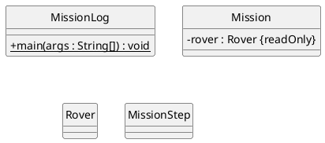
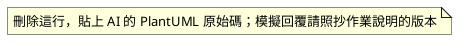

<!--
DESIGN.md 範本（第 6 週，claude 版本）：由 Anthropic Claude（Claude Code）生成。
複製到 115_1_Java/YYYY_MM_DD/java-06/，改名為 DESIGN.md，再刪除這段註解。
每個 plantuml 區塊推上 GitHub 後，裝了「PlantUML for GitHub」擴充功能的瀏覽器會顯示成圖。
-->

# 第 6 週設計文件

學號／姓名：
最後更新日期：

## 練習區（講義 A3）

```plantuml
@startuml
skinparam classAttributeIconSize 0
hide circle

class Flashlight {
  ' 依照 src/Flashlight.java 寫出欄位與方法
}
@enduml
```



## 1. 任務系統類別圖（TODO 7）

必須和 `src/` 裡完成後的 `Rover`、`MissionStep`、`Mission`、`MissionLog` 一致。



| 類別 | 知道什麼（欄位） | 負責做什麼 | 合作對象 |
|---|---|---|---|
| `Rover` | | | |
| `MissionStep` | | | |
| `Mission` | | | |
| `MissionLog` | | | |

## 2. 樣本艙整合設計（講義 E 段）

### 2.1 責任表與四個問題

| 類別 | 知道什麼（欄位） | 負責做什麼 | 合作對象 |
|---|---|---|---|
| `Rover` | | | |
| `SampleBay` | | | |

1. `samples` 欄位還需要嗎：
2. 已送回樣本數放在哪裡：
3. 箭頭方向與多重性：
4. 「放不下就拒絕」由誰檢查、在扣能源之前或之後：

### 2.2 我的類別圖

```plantuml
@startuml
skinparam classAttributeIconSize 0
hide circle

note "刪除這行，在這裡畫你的類別圖" as TODO
@enduml
```



### 2.3 模擬 AI 類別圖的問題（E2）

| # | 問題（圖上哪裡） | 違反哪一句需求或哪個原則 | 會造成什麼錯 |
|---|---|---|---|
| 1 | | | |
| 2 | | | |
| 3 | | | |
| 4 | | | |

### 2.4 我的設計 Prompt（E3）

```text

```

## 3. 社團器材借用（作業）

需求原文見作業說明第 3 節。

### 3.1 責任表

| 類別 | 知道什麼（欄位） | 負責做什麼 | 合作對象 |
|---|---|---|---|
| | | | |

### 3.2 我的第一版類別圖（給 AI 之前畫）


### 3.3 AI 的類別圖

來源：真實 AI（工具名稱：　　）／教師模擬回覆（擇一，並在 `AI_USAGE.md` 記錄）



### 3.4 逐項比對

| # | 不同之處或問題 | 對應的需求句子 | 情境：照 AI 的設計會發生什麼事 | 採納／不採納與理由 |
|---|---|---|---|---|
| 1 | | | | |
| 2 | | | | |
| 3 | | | | |
| 4 | | | | |

### 3.5 最終類別圖與修改說明


和第一版相比改了什麼、為什麼：
