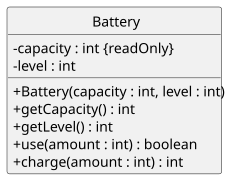
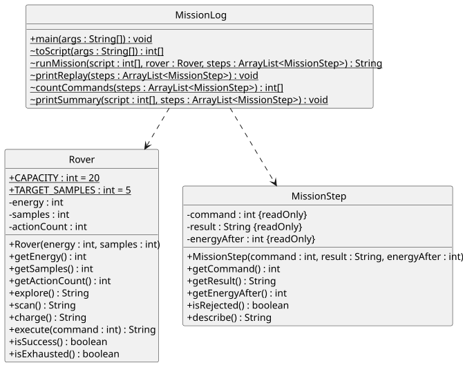
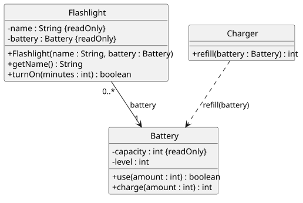
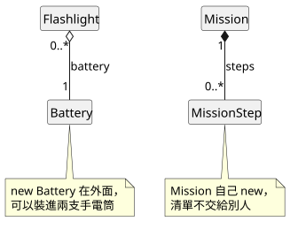
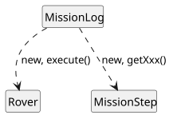
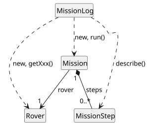
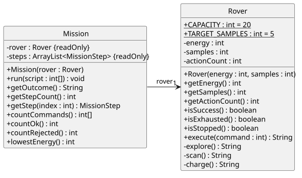
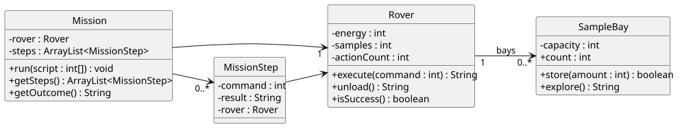

<!-- _class: lead by-claude -->

# 第 6 週
# 類別與物件設計(II)：UML 類別圖與物件導向設計思維

## AI 輔助系統設計練習

物件導向程式設計（與 AI 協作）｜115 學年度第 1 學期
資訊管理學系 二年級｜授課教師：胡碩誠

<!--
講者備註：本週延續第五週 claude 版的探測車任務。開場先問上週課後選做：「能源 0 的探測車被呼叫 charge() 會怎樣？」
-->

---

<!-- _class: by-claude -->

## 關於這份教材

- 每頁右上角 <span style="background:#c96442;color:#fff;padding:2px 10px;border-radius:10px;font-size:0.8em">claude</span>：初稿由 Anthropic Claude 生成，教師審閱後使用
- 參考書：Deitel, *Java How to Program, Early Objects* 11e
  - 1.5.10–1.5.11（物件導向分析與設計、UML）
  - 3.2.4、3.3–3.4（`Account` 的 UML 類別圖）、8.8（組合）、8.11（static 成員）
- 搭配檔案：`week06_實作講義_claude.md`、`week06_作業說明_claude.md`、`DESIGN_範本_claude.md`、`code/`、`diagrams/`

**本週不教**：繼承與介面的圖示（第 7–9 週）、循序圖等其他 UML 圖、設計模式（第 15 週）

---

<!-- _class: by-claude -->

<div class="ex">範例：week05 Rover.java、MissionLog.java</div>

## 上週留下的三個問題

```java
Rover r = new Rover(0, 0);        // 能源已經耗盡
System.out.println(r.charge());   // ？
```

1. 上面會印出什麼？任務規則說耗盡就結束，**誰**該擋下它？
2. `MissionLog` 讀參數、跑迴圈、判斷結果、計數、印輸出……**全部自己來**
3. 課末檢核第 5 題的方框草圖：誰用到誰？線該怎麼畫？

→ 本週：先把設計**畫出來**，討論**誰該負責什麼**，再照圖搬家

<!--
講者備註：現場用第五週版跑 new Rover(0, 0).charge()，印出 OK、能源變 5。第五週是 MissionLog.runMission 在迴圈開頭擋住，直接呼叫就擋不住。
-->

---

<!-- _class: by-claude -->

## 本週學習目標

1. 把類別寫成 UML 類別圖：可見性、`名稱 : 型態`、static、唯讀
2. 只看類別圖，判斷哪些呼叫能編譯
3. 分辨**關聯**（欄位）與**相依**（參數、區域變數），寫出**多重性**
4. 用責任表分配規則：資料在誰身上，規則就放誰身上
5. 依新的類別圖重構，輸出與第 5 週逐字相同，並讓圖和程式一致
6. 用需求與自己的設計，**檢查 AI 給的類別圖**

---

<!-- _class: by-claude -->

## 今日流程（150 分鐘）

| 時間 | 段落 | 產出 |
|---|---|---|
| 0–10 | 取回 repo、裝擴充功能、上週問題 | `java-06` 專案、`DESIGN.md` |
| 10–30 | A. 讀與畫類別圖 | A1 對照表、A2 預測 |
| 30–50 | B. 關係與多重性 | `RelationDemo` 預測表、修正草圖 |
| 50–65 | C. 責任與設計思維 | 責任表 |
| 65–105 | D. 依新圖重構 TODO 1–7 | `RoverTry`、五條測試、任務系統類別圖 |
| 105–130 | E. AI 輔助系統設計 | 樣本艙設計、AI 圖問題表、設計 Prompt |
| 130–135 | F. 課末檢核 | |
| 135–150 | G. 保存、push、在 GitHub 看圖 | GitHub 紀錄 |

---

<!-- _class: by-claude -->

## 範例檔與投影片對照

| 段落 | 檔案 | 執行或查看 |
|---|---|---|
| A 類別方框 | `examples/Battery.java`、`diagrams/battery_claude.svg` | 對照閱讀 |
| B 關係 | `examples/Flashlight.java`、`Charger.java`、`RelationDemo.java` | `java -cp out RelationDemo` |
| D Rover | `starter/Rover.java`、`RoverTry.java` | `java -cp out RoverTry` |
| D 任務 | `starter/Mission.java`、`MissionLog.java`、`MissionStep.java` | `java -cp out MissionLog 3 9 0` |
| D 類別圖 | `DESIGN.md` 第 1 節 | 推上 GitHub 看圖 |
| E AI 設計 | `diagrams/samplebay_ai_claude.svg` | 講義 E2 |

各頁左上角的藍色標籤標出對應的檔案；解答在 `code/teacher/`，**不要**複製到 `src/`

---

<!-- _class: by-claude -->

## 準備：PlantUML for GitHub 擴充功能

- 類別圖用 **PlantUML 文字**寫在 `DESIGN.md` 的 ```` ```plantuml ```` 區塊
- 推上 GitHub 後，瀏覽器擴充功能把原始碼**顯示成圖**
  - PlantUML 官方發布，Chrome、Firefox 都有
  - 在瀏覽器內產生圖，不把內容送到伺服器
  - 標題列可以切換「圖」與「原始碼」
- 沒裝擴充功能：GitHub 只顯示原始碼（正常，不是錯誤）
- GitHub Desktop、VS Code 預覽**不會**顯示 PlantUML 圖

為什麼用文字畫圖？可以 commit、可以 diff，也能和 AI 產生的 PlantUML **逐行比對**

<!--
講者備註：課前請先在教室電腦確認能否安裝擴充功能；不能安裝時，學生仍可交原始碼，教師以原始碼批改，回家再看圖。
-->

---

<!-- _class: by-claude -->

## A｜為什麼要畫圖？

<div class="cols">
<div>

- 程式碼回答「**怎麼做**」：每一行的執行細節
- 類別圖回答「**誰負責什麼**」：
  - 有哪些類別
  - 各自知道什麼（欄位）
  - 能做什麼（方法）
  - 和誰合作（線）
- 先畫圖再寫程式：改一條線比改十個檔案便宜

</div>
<div>

C# 經驗對照：

- Visual Studio 的「類別圖」與「方案總管」
- WinForms 的 `Form1` 裡塞滿事件處理，所有邏輯都在一個類別

→ 程式變大後，**先討論設計**才不會越寫越亂

</div>
</div>

<!--
講者備註：UML（Unified Modeling Language）有十多種圖，本課程只用類別圖；Deitel 1.5.11 有簡介。
-->

---

<!-- _class: by-claude -->

<div class="ex">範例：code/examples/Battery.java、diagrams/battery_claude.svg</div>

## A｜一個類別方框：三格

<div class="cols-wide">
<div>



</div>
<div>

| 位置 | 內容 |
|---|---|
| 第一格 | 類別名稱 |
| 第二格 | 欄位：`- level : int` |
| 第三格 | 建構子與方法：`+ use(amount : int) : boolean` |

- **名稱在前、型態在後**（Java／C# 相反）
- 參數也是 `名稱 : 型態`，回傳型態寫在最後
- `{readOnly}`：`final` 欄位

</div>
</div>

---

<!-- _class: by-claude -->

## A｜可見性與 static

| 符號 | 意義 | Java |
|---|---|---|
| `+` | public | `public` |
| `-` | private | `private` |
| `~` | 套件存取 | **不寫修飾字**（第 5 週：不是 private！） |
| `#` | protected | 第 7 週繼承再談 |
| 底線 | static | `static`（PlantUML 寫 `{static}`） |

```text
+ {static} CAPACITY : int = 20        → public static final int CAPACITY = 20;
- energy : int                        → private int energy;
~ {static} toScript(args : String[]) : int[]  → static int[] toScript(String[] args)
```

<!--
講者備註：第五週的 MissionLog.toScript 沒有寫 public，是套件存取，圖上要用 ~。這是批改時最常錯的地方。
-->

---

<!-- _class: by-claude -->

## A｜PlantUML 寫法

```text
@startuml
skinparam classAttributeIconSize 0
hide circle

class Battery {
  - capacity : int {readOnly}
  - level : int
  + Battery(capacity : int, level : int)
  + use(amount : int) : boolean
}
@enduml
```

- 前兩行設定：`+`、`-` 顯示成符號，隱藏類別名稱旁的圓形標記（每張圖照抄）
- 放進 `.md` 時，外面包 ```` ```plantuml ```` 與 ```` ``` ````
- 常見錯誤：少了 `@startuml`／`@enduml`、大括號不成對

---

<!-- _class: by-claude -->

## A｜只看圖，能不能編譯？（講義 A2）

<div class="cols">
<div>

```text
Rover
  + CAPACITY : int = 20   （底線）
  - energy : int
  + Rover(energy : int, samples : int)
  + explore() : String
```

</div>
<div>

| 程式 | 能／不能？ |
|---|---|
| `rover.energy = 5;` | ? |
| `rover.explore();` | ? |
| `int max = Rover.CAPACITY;` | ? |
| `Rover.explore();` | ? |
| `Rover r = new Rover();` | ? |

</div>
</div>

**先預測**，全班舉手；類別圖就是類別對外的**合約**

<!--
答案：不能（private）；能；能（public static）；不能（不是 static，要透過物件）；不能（唯一的建構子要兩個參數）。
-->

---

<!-- _class: by-claude -->

<div class="ex">範例：diagrams/week05_mission_claude.svg</div>

## A｜第 5 週程式的類別圖

<div class="cols-big">
<div>



</div>
<div class="small">

- `MissionLog` 全有底線：static
- `toScript` 等是 `~`：沒寫修飾字
- `Rover` 行動都是 `+`：誰都能呼叫 `charge()`
- `MissionLog` 沒有欄位：線是虛線

→ 虛線的意思：B 段

</div>
</div>

---

<!-- _class: by-claude -->

<div class="ex">範例：code/examples/Flashlight.java、Charger.java</div>

## B｜兩種「用到」

<div class="cols">
<div>

```java
public class Flashlight {
    private final String name;
    private final Battery battery;
    ...
    public boolean turnOn(int minutes) {
        return battery.use(minutes);
    }
}
```

電池存在**欄位**：手電筒一直帶著它

</div>
<div>

```java
public class Charger {
    public int refill(Battery battery) {
        return battery.charge(
            battery.getCapacity());
    }
}
```

電池只是**參數**：充完就不再保留

</div>
</div>

---

<!-- _class: by-claude -->

<div class="ex">範例：diagrams/relations_claude.svg</div>

## B｜關聯與相依

<div class="cols">
<div>



</div>
<div>

| 程式 | 關係 | 畫法 |
|---|---|---|
| 存在欄位 | 關聯 | 實線 `-->` |
| 參數、區域變數、`new` 後不保存 | 相依 | 虛線 `..>` |

- 箭頭從「用的人」指向「被用的」
- 問自己：**它存在欄位裡嗎？**

</div>
</div>

---

<!-- _class: by-claude -->

## B｜多重性

```text
Flashlight "0..*" --> "1" Battery : battery
```

- 從 `Flashlight` 讀：一支手電筒連到 **1** 顆電池
- 從 `Battery` 讀：一顆電池可以被 **0 到多支**手電筒使用
- 數字寫在**被連到的那一端**

| 寫法 | 意思 |
|---|---|
| `1` | 恰好一個 |
| `0..1` | 沒有或一個 |
| `0..*`（或 `*`） | 零到多個 |
| `1..*` | 至少一個 |
| `0..2` | 最多兩個 |

---

<!-- _class: by-claude -->

<div class="ex">範例：code/examples/RelationDemo.java</div>

## B｜先預測：共用一顆電池

```java
Battery shared = new Battery(10, 10);
Flashlight a = new Flashlight("A", shared);
Flashlight b = new Flashlight("B", shared);
Flashlight c = new Flashlight("C", new Battery(10, 10));

System.out.println("A on 6 min: " + a.turnOn(6));
System.out.println("B on 6 min: " + b.turnOn(6));
System.out.println("C on 6 min: " + c.turnOn(6));
System.out.println("shared level: " + shared.getLevel());
Charger charger = new Charger();
System.out.println("refill shared: +" + charger.refill(shared));
System.out.println("B on 6 min: " + b.turnOn(6));
```

把七行輸出寫在講義 B 段，再執行 `java -cp out RelationDemo`

<!--
答案：true、false、true、4、+6、true、4。a、b 的欄位指向同一個 Battery 物件，在黑板畫兩條箭頭指向同一個方框。
-->

---

<!-- _class: by-claude -->

<div class="ex">範例：diagrams/whole_part_claude.svg</div>

## B｜認識即可：聚合與組合

<div class="cols-wide">
<div>



</div>
<div>

| 畫法 | 名稱 | 判斷 |
|---|---|---|
| 空心菱形 `o--` | 聚合 | 部分在外面建立後交進來，可被共用 |
| 實心菱形 `*--` | 組合 | 整體自己 `new`，不交給別人擁有 |

- Java **沒有**「組合」關鍵字：看**誰 new、存在哪、有沒有交出去**
- 分不清楚時：普通實線關聯＋多重性就是對的

</div>
</div>

---

<!-- _class: by-claude -->

<div class="ex">範例：diagrams/week05_overview_claude.svg</div>

## B｜修正上週的草圖

<div class="cols">
<div class="center">



</div>
<div>

- 第 5 週 `MissionLog` 沒有欄位
- `rover`、`steps` 都是 `main` 的區域變數，再當參數傳給 static 方法
- 所以兩條都是**虛線**相依
- `Rover` 與 `MissionStep` 互相不知道對方

</div>
</div>

講義 B4：把你在 0 段抄下的草圖改正

---

<!-- _class: by-claude -->

## C｜責任：誰該負責什麼？

畫類別圖不只是翻譯程式，更是在**決定責任**。三個檢查原則：

1. **資料在誰身上，規則就放誰身上**
   能源是 `Rover` 的欄位 → 「耗盡後不能行動」由 `Rover` 檢查
2. **一個類別一種主要工作**
   方法都在處理同一件事，才好讀、好改
3. **只公開別人需要的**
   多一個 public 方法，就多一條繞過規則的路

---

<!-- _class: by-claude -->

## C｜第 5 週的 `MissionLog` 做了幾種事？

假設下學期要把輸出改成 **WinForms 視窗**，哪些程式**完全不用改**？

| 工作 | 換成視窗要改嗎？ |
|---|---|
| 把命令列參數轉成 `int[]` | ? |
| 依腳本執行並記錄 | ? |
| 判斷 SUCCESS／EXHAUSTED／RETURNED／UNFINISHED | ? |
| 計算 counts、ok、rejected、最低能源 | ? |
| 把結果印到螢幕 | ? |

不用改的，屬於**任務本身** → 搬到新類別 `Mission`

<!--
答案：中間三項不用改。轉參數與印輸出屬於命令列介面，換成視窗就要改。大一 WinForms 把所有邏輯寫在 Form1 的事件處理裡，正是這個問題。
-->

---

<!-- _class: by-claude -->

## C｜新設計的責任表

| 類別 | 知道什麼 | 負責做什麼 | 合作對象 |
|---|---|---|---|
| `Rover` | 能源、樣本、行動次數 | 行動規則；判斷成功、耗盡、**停止** | 無 |
| `MissionStep` | 指令、結果、執行後能源 | 記錄一步，提供回放文字 | 無 |
| `Mission` | `rover`、`steps` | 執行並記錄、判斷結果、計算摘要 | `Rover`、`MissionStep` |
| `MissionLog` | 無 | 讀參數、建立物件、**印出** | `Mission`、`Rover`、`MissionStep` |

講義 C3：先自己填，再對照

---

<!-- _class: by-claude -->

<div class="ex">範例：diagrams/week06_overview_claude.svg</div>

## C｜新設計的類別圖（只看關係）

<div class="cols">
<div class="center">



</div>
<div>

- `Mission` 用**欄位**保存 `rover`、`steps` → 實線
- `Mission` 自己 `new` 每筆紀錄、不交出清單 → 實心菱形
- `MissionLog` 只在方法裡用 → 虛線
- `getStep(i).describe()` 也讓 `MissionLog` 用到 `MissionStep`

</div>
</div>

<!--
講者備註：Mission 到 Rover 不畫菱形：Rover 是 MissionLog 建立後交進來的，MissionLog 自己也還拿著它，最後一行要讀 rover.getEnergy()。
-->

---

<!-- _class: by-claude -->

<div class="ex">範例：diagrams/week06_changes_claude.svg（完整圖：week06_mission_claude.svg）</div>

## C｜新類別圖：有變動的兩個類別

<div class="cols-img">
<div>



</div>
<div>

和第 5 週比，變了什麼？

- 新類別 `Mission`
- `Rover` 多了 `isStopped()`
- 三個行動由 `+` 改成 `-`
- `Mission` **沒有** `getSteps()`
- `MissionLog` 只剩 4 個方法

這就是 D 段的施工圖

</div>
</div>

---

<!-- _class: by-claude -->

## C｜先預測：兩個地方都要擋嗎？

`Rover.execute` 停止後回傳 `"STOPPED"`、不改狀態。
那 `Mission.run` 的迴圈還要檢查 `rover.isStopped()` 嗎？

```java
for (int command : script) {
    if (rover.isStopped()) {   // 拿掉這三行會怎樣？
        break;
    }
    ...
}
```

寫下預測（講義 C4），D5 實測

<!--
答案在 D5：要。拿掉後 1 1 1 1 會多記一筆 step 4: result=STOPPED，摘要變 steps=4, rejected=1。停止後不讀不記是任務日誌的規則，STOPPED 保護的是探測車狀態。
-->

---

<!-- _class: by-claude -->

## D｜IntelliJ IDEA 開 `java-06`

- 本週 9 個檔案、3 個 `main`（`MissionLog`、`RoverTry`、`RelationDemo`）
- File → Open 選 `java-06`；`src` 為 Sources Root；SDK 選已安裝的 JDK
- 詢問建立 Git repository 時選**否**
- 新技巧：在方法名稱上按 **Alt＋F7**（Find Usages）：誰呼叫了它？

起始碼可執行，但任務一步都沒跑：

```text
=== replay ===
counts[0..3]=[0, 0, 0, 0]
steps=0, ok=0, rejected=0, ignored=3
final energy=20, samples=0, actionCount=0 -> UNFINISHED
```

---

<!-- _class: by-claude -->

## D｜TODO 一覽

| TODO | 檔案 | 內容 | 方式 |
|---|---|---|---|
| 1 | `Rover` | `isStopped()`：成功或耗盡 | 跟做 |
| 2 | `Rover` | `execute` 開頭擋下停止；三個行動改 `private` | 跟做 |
| 3 | `Mission` | `run`：第 5 週 `runMission` 的迴圈搬過來 | 跟做 |
| 4 | `Mission` | `getOutcome`：四段判斷搬過來 | 模仿 |
| 5 | `Mission` | `countOk`、`countRejected` | 模仿 `countCommands` |
| 6 | `Mission` | `lowestEnergy`：沒有紀錄回傳 -1 | 獨立 |
| 7 | `DESIGN.md` | 類別圖與完成後的程式一致 | 獨立 |

`MissionStep`、`MissionLog`、`RoverTry` 已完成，不必修改

---

<!-- _class: by-claude -->

<div class="ex">範例：code/starter/Rover.java、RoverTry.java</div>

## D｜TODO 1–2：把停止規則收回 `Rover`

```java
public boolean isStopped() {      // TODO 1
    return false;
}

public String execute(int command) {
    // TODO 2：已停止就回傳 "STOPPED"，不進入 switch
    switch (command) { ... }
}

public String explore() { ... }   // TODO 2：改成 private（scan、charge 也是）
```

先執行 `RoverTry`：有幾行 `DIFF`？為什麼 `done`（一開始就有 5 份樣本）會變成 `14/7/1`？
完成後再執行，每一行都要是 `OK`

<!--
答案：6 行 DIFF。done 已達標，但起始碼沒有停止檢查，探索照樣扣 6 得 2。改成 private 後，外部唯一入口是 execute，而檢查就在它的第一行。
-->

---

<!-- _class: by-claude -->

<div class="ex">範例：code/starter/Mission.java</div>

## D｜TODO 3–4：照圖搬家

```java
// 第 5 週：MissionLog
static String runMission(int[] script, Rover rover, ArrayList<MissionStep> steps)

// 第 6 週：Mission
private final Rover rover;
private final ArrayList<MissionStep> steps;
public Mission(Rover rover) { this.rover = rover; this.steps = new ArrayList<>(); }
public void run(int[] script)          // TODO 3
public String getOutcome()             // TODO 4
```

- `rover`、`steps` 變成**欄位**：物件自己記得，不必再傳
- 執行（`run`）和查詢結果（`getOutcome`）分成兩個方法
- 判斷順序不變：SUCCESS > EXHAUSTED > RETURNED > UNFINISHED

---

<!-- _class: by-claude -->

<div class="ex">範例：code/starter/Mission.java</div>

## D｜TODO 5–6：為什麼沒有 `getSteps()`？

```java
public int getStepCount()              // 已提供
public MissionStep getStep(int index)  // 已提供：單筆紀錄不可變，交出去安全
public int countOk()                   // TODO 5
public int countRejected()             // TODO 5
public int lowestEnergy()              // TODO 6：沒有紀錄回傳 -1
```

如果提供 `public ArrayList<MissionStep> getSteps()`：

```java
mission.getSteps().clear();   // 任務紀錄被外人清空
```

→ 欄位 private 卻交出清單的參考，**等於公開**

---

<!-- _class: by-claude -->

## D｜必做測試（和第 5 週完全相同）

| 參數 | 最後一行 |
|---|---|
| （無） | `final energy=6, samples=5, actionCount=3 -> SUCCESS` |
| `2 2 2 2 2` | `final energy=10, samples=5, actionCount=5 -> SUCCESS` |
| `3 9 0` | `final energy=20, samples=0, actionCount=0 -> RETURNED` |
| `1 1 1 1` | `final energy=2, samples=6, actionCount=3 -> SUCCESS` |
| `2 1` | `final energy=12, samples=3, actionCount=2 -> UNFINISHED` |

重構的定義：**外部行為不變**，內部結構變好
摘要行見作業說明；`RoverTry` 全部 `OK`

---

<!-- _class: by-claude -->

<div class="ex">範例：code/starter/Mission.java</div>

## D5｜實測：拿掉 `run` 的停止檢查

先 commit，註解掉三行，執行 `java -cp out MissionLog 1 1 1 1`：

```text
step 3: command=1, result=OK, energy=2
step 4: command=1, result=STOPPED, energy=2
counts[0..3]=[0, 4, 0, 0]
steps=4, ok=3, rejected=1, ignored=0
```

- `STOPPED` 守住了**探測車的狀態**（最後一行仍是 `2/6/3 SUCCESS`）
- 「停止後不讀、不記」是**任務日誌的規則** → 由 `Mission` 負責
- 每個類別守**自己的資料**；做完記得還原那三行

<!--
講者備註：預設腳本 1 1 2 剛好在達標時用完，看不出差異，所以用 1 1 1 1。教師投影示範一次即可。
-->

---

<!-- _class: by-claude -->

## D｜TODO 7：讓圖跟程式一致

在 `DESIGN.md` 第 1 節完成任務系統類別圖，逐項檢查：

- [ ] 每個欄位、建構子、方法都在圖上；圖上沒有程式不存在的東西
- [ ] `+`、`-`、`~` 與修飾字一致；static 有 `{static}`；`final` 欄位有 `{readOnly}`
- [ ] 欄位保存用實線，只在方法裡用到用虛線
- [ ] `Mission` 的兩條關聯有多重性

圖和程式不一致時，**以程式為準**修正圖；或者，先改圖、討論後再改程式

<!--
講者備註：常錯：toScript、printReplay、printSummary 是套件存取，要用 ~；漏掉 MissionLog ..> MissionStep。
-->

---

<!-- _class: by-claude -->

## E｜AI 輔助系統設計的流程

<div class="cols">
<div>

1. 讀需求
2. **自己先做**責任表與類別圖
3. 請 AI 畫類別圖（附上需求與你的責任表）
4. 逐項比對：每個差異對應哪一句需求？
5. 決定採納什麼，寫下理由

</div>
<div>

- 先自己設計，才有東西能**檢查** AI
- AI 的圖看起來很完整，不代表符合需求
- 判斷依據：**需求句子**＋**具體情境**

> 「如果照 AI 的設計，呼叫 ___ 時會發生 ___」

</div>
</div>

---

<!-- _class: by-claude -->

## E｜新需求：探測車加裝樣本艙

> 1. 探索得 2 份、掃描得 1 份，樣本存進**樣本艙**（第 5 週的 `SampleBay`，容量 4）。能源不足回 `NOT_ENOUGH_ENERGY`；放不下回 `BAY_FULL`。拒絕時任何狀態都不變。
> 2. 新指令 4「卸貨」：艙內樣本全部送回基地，耗能 1、行動 +1；艙空時回 `BAY_EMPTY`，不耗能。
> 3. 成功改為「已送回基地的樣本」累計達 5 份。
> 4. 任務中心能查詢能源、艙內樣本數、已送回樣本數、行動次數，但不能直接修改。
> 5. 任務日誌與停止規則照舊。

E1（10 分鐘，先在紙上）：`samples` 還要嗎？已送回數放誰？誰知道誰、多重性？「放不下」在扣能源之前還是之後檢查？

---

<!-- _class: by-claude -->

<div class="ex">範例：diagrams/samplebay_ai_claude.svg</div>

## E2｜模擬 AI 的類別圖：找出至少四處問題

有同學只輸入「幫我畫探測車加樣本艙的類別圖」，下面是**教師設計的模擬回覆**，不是真實對話：



鄰座兩人一組 10 分鐘，填講義 E2 的表：**問題**在圖上哪裡、**違反**哪一句需求或原則、會造成什麼錯的**情境**

<!--
答案見教師筆記 E2：public count、1 對 0..* 艙、Rover 仍有 samples、SampleBay 有 explore、getSteps 交出清單、MissionStep 存 Rover、沒有已送回樣本數。找到任四項並有情境即可。
-->

---

<!-- _class: by-claude -->

## E3｜設計用的 Prompt

模糊：「幫我畫探測車加樣本艙的類別圖」

具體：

```text
請依下列需求與責任表，畫出 PlantUML 類別圖。
需求：（貼上需求 1–5 原文）
責任表：（貼上我在 E1 做的表）
要求：
1. 欄位一律 private；static 用 {static}，final 欄位標 {readOnly}
2. 欄位保存用實線關聯，只在方法中使用用虛線相依，關聯標多重性
3. 不使用繼承、介面、抽象類別
4. 圖之後說明每條關係的理由，並列出需求中你不確定的地方
```

用真實 AI 時記錄在 `AI_USAGE.md`；模擬回覆不可寫成真實對話

---

<!-- _class: by-claude -->

## F｜課末檢核

1. 圖上同時有 `- steps : ArrayList<MissionStep>` 和 `+ getSteps() : ArrayList<MissionStep>`，封裝出了什麼問題？
2. 實線與虛線箭頭，在程式上各對應什麼寫法？
3. `Mission --> "1" Rover` 的 `1` 是什麼意思？
4. 本週哪一條規則換了位置？從哪裡搬到哪裡？為什麼？
5. 「重型探測車」探索一次得 3 份，其他都和 `Rover` 一樣：複製一份改成 `HeavyRover` 會有什麼麻煩？

<!--
答案：1 交出參考等於公開；2 實線＝欄位，虛線＝參數、區域變數、使用回傳的物件；3 一個 Mission 連到恰好一台 Rover；4 停止規則從 MissionLog.runMission 搬到 Rover.execute，因為資料在 Rover；5 兩份幾乎相同的程式，改規則要改兩處，第 7 週用繼承解決。
-->

---

<!-- _class: by-claude -->

## G｜保存、推送、在 GitHub 看圖（最後 15 分鐘）

```text
115_1_Java/
└─ YYYY_MM_DD/
   ├─ LAB_REPORT.md
   ├─ AI_USAGE.md
   └─ java-06/
      ├─ README.md
      ├─ DESIGN.md
      └─ src/  Battery  Flashlight  Charger  RelationDemo
               Rover  MissionStep  Mission  MissionLog  RoverTry   （.java）
```

- [ ] 重新編譯；不交 `out/`、`.class`、`.idea/`、`*.iml`；commit 前綴 `[manual]`、`[AI]`、`[fix]`、`[doc]`
- [ ] Push → 在 GitHub 打開 `java-06/DESIGN.md`，確認圖能顯示
- [ ] 另一個路徑全新 clone，重跑 `3 9 0` 與 `RoverTry`

---

<!-- _class: by-claude -->

## 作業與 AI 使用紀錄

- 作業說明：`week06_作業說明_claude.md`
- **程式**：TODO 1–6，五條測試＋`RoverTry`
- **設計**（`DESIGN.md`）：
  1. 任務系統類別圖（TODO 7）
  2. 樣本艙設計：四個問題、責任表、類別圖、模擬 AI 的問題、設計 Prompt
  3. **社團器材借用**（新系統，只設計不寫程式）：先畫第一版並 commit，再和 AI（或教師模擬回覆）的圖逐項比對，交出最終版
- `AI_USAGE.md`：沒有使用 AI 也要交

> 你可以用 AI 畫圖，但你要能說明圖上每一條線的理由。

---

<!-- _class: by-claude -->

## 下週預告：繼承

```text
Rover          探索：耗 6 得 2
HeavyRover     探索：耗 6 得 3    其他全部相同
```

- 複製整個類別？改一條規則要改兩份
- 第 7 週：讓 `HeavyRover` **繼承** `Rover`，類別圖用空心三角形箭頭
- 想一想：`explore` 現在是 `private`，子類別看得到嗎？

→ 第 7 週：繼承(I)：類別繼承基礎
