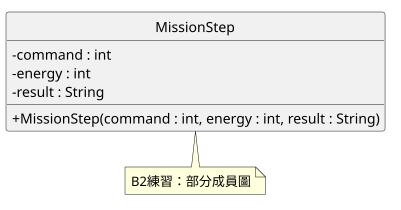
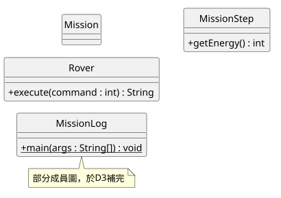
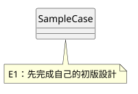

# 第六週設計文件（學生另存 DESIGN.md）

學號／姓名：待填。最後更新：待填。來源說明：此骨架由Codex生成；學生填本人設計與驗證。

圖的原始碼在diagrams/*.puml，改完後立即重新產生同名SVG。保留人工初版commit，再比較模擬或真實AI回覆。下面三張圖初始均是待完成骨架，不是教師答案。

## 1. 第一張類別圖（B2–B3）

原始碼：[practice.puml](diagrams/practice.puml)。新增的兩個方法與Java位置：待填。預覽方式／實際看見的內容：待填。未產圖就寫待補，不把教師圖算成本人作品。

## 2. 任務責任與關係（D1、D3）

| 類別 | 保存什麼 | 負責什麼 | 不負責什麼 |
|---|---|---|---|
| Rover | 待填 | 待填 | 待填 |
| MissionStep | 待填 | 待填 | 待填 |
| Mission | 待填 | 待填 | 待填 |
| MissionLog | 待填 | 待填 | 待填 |

原始碼：[task_template.puml](diagrams/task_template.puml)。這是「責任與部分成員圖」，不是完整API清單。

- Mission三個欄位與run／countOk／lowestEnergy已補齊：待填。
- Mission到Rover與MissionStep的線、多重性及程式證據：待填。
- MissionLog的三條相依與程式證據：待填。
- 最後一次重新產圖與實際預覽：待填。

## 3. SampleCase人工初版與修正版（E）

需求：容量1..8（建構時修正）、初始空盒、正數且放得下才整批存入，拒絕不改值；查詢容量／存量／剩餘空間；卸空並回傳份數，空盒回傳0。

人工初版commit／保存時間：待填。在看AI圖前完成；修正版改同一檔，版本差異保留在Git，不必重抄三份大圖。

原始碼：[samplecase_initial.puml](diagrams/samplecase_initial.puml)。

| AI圖的問題（至少3項） | 對應需求 | 呼叫反例或結果 | 採納／拒絕與修正 |
|---|---|---|---|
| 待填 | 待填 | 待填 | 待填 |
| 待填 | 待填 | 待填 | 待填 |
| 待填 | 待填 | 待填 | 待填 |

我的設計Prompt：待填。需包含需求、人工設計、型態、限制、拒絕時狀態、測試，以及要求AI說明不確定處。

E3程式反例與重測記錄位置：待填（可引用LAB_REPORT E3）。最終圖修改了哪些地方：待填。圖支持設計意圖；真正執行結果仍須看編譯／測試。
