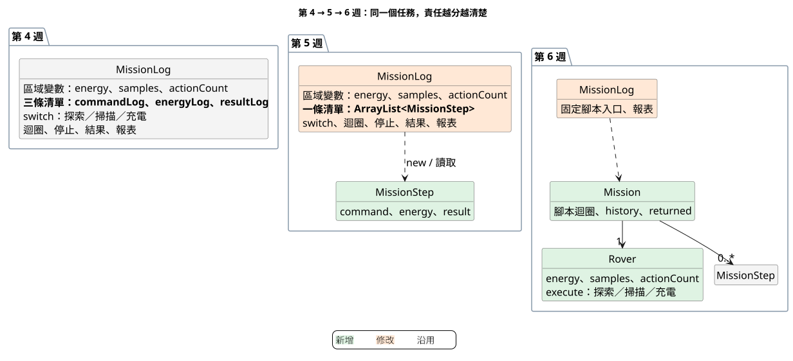
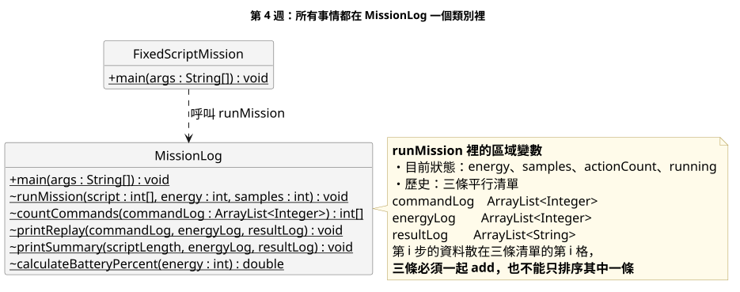
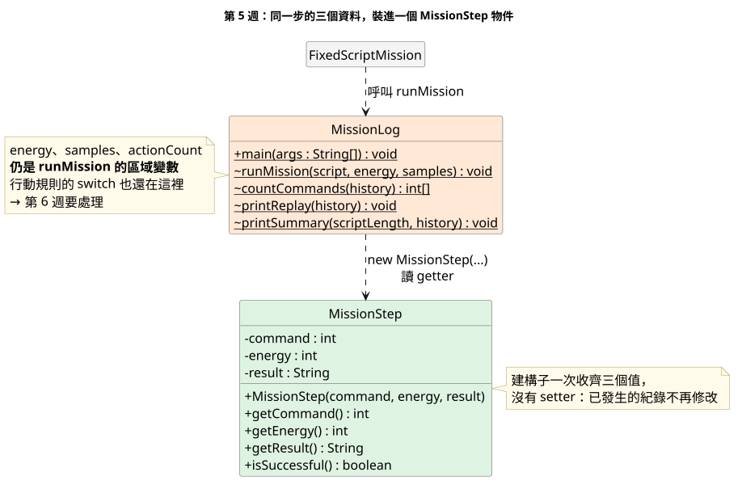
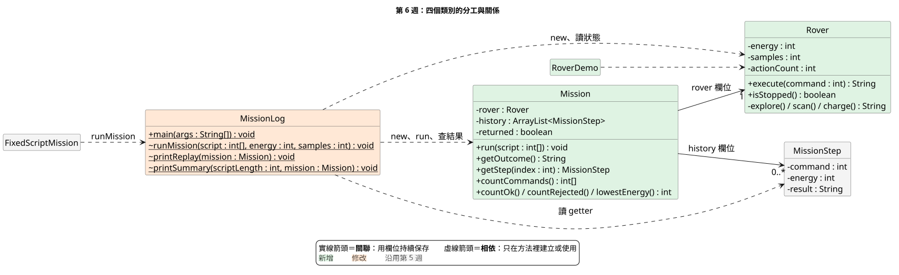
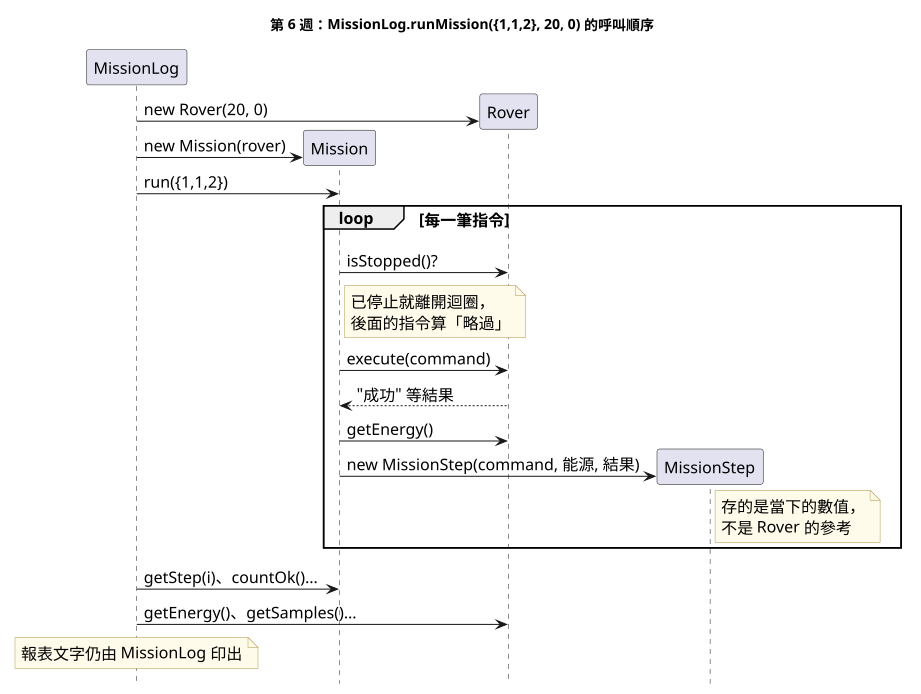

<!-- _class: lead by-claude -->

# 第 4–6 週程式關聯

## 同一個探測車任務，程式怎麼一步步長成四個類別

從三條清單 → 一個紀錄物件 → 狀態、流程、紀錄各歸其位

物件導向程式設計（與 AI 協作）｜115 學年度第 1 學期
資訊管理學系 二年級｜授課教師：胡碩誠

<!--
講者備註：本份為補充投影片，依 week04、week05、week06 的 codex版本 teacher 程式實際內容製作，由 Claude 撰寫。codex 已有 week06_program_relationships_codex.md（第 5–6 週），本份往前延伸到第 4 週，並把三週放在同一條線上比較。可在第 6 週開場或第 7 週前複習使用。
-->

---

<!-- _class: by-claude small -->

## 關於這份投影片

- 每頁右上角 <span class="tag">claude</span>：本投影片由 Anthropic Claude（Claude Code）依 **week04–06 的 codex版本程式**製作，教師審閱後使用。
- 只用各週 `teacher/` 的完成版程式比較（檢查工具 `MissionLogCheck` 等只用來確認輸出一致）。
- 左上角標籤是該頁對應的檔案：

| 標籤 | 位置 |
|---|---|
| <span class="tag blue">week04/…</span> | `week04/codex版本/` |
| <span class="tag green">week05/…</span> | `week05/codex版本/` |
| <span class="tag purple">week06/…</span> | `week06/codex版本/` |
| <span class="tag brown">diagrams/…</span> | `week06/codex版本/diagrams/`，`*_claude` 為本份新繪 |

**閱讀重點**：每一週都只解決**一個**上週留下的問題，任務規則和輸出結果則保持不變。

<!--
講者備註：本份不新增學生作業，也不改動任何週次的程式。
-->

---

<!-- _class: by-claude small -->

<div class="ex"><span class="dg">diagrams/w04_06_overview_claude.svg</span></div>

## 一張圖看三週



<!--
講者備註：先讓學生看三個框的「大小變化」：第 4 週一個類別包辦所有事；第 5 週拆出 MissionStep；第 6 週再拆出 Mission 與 Rover，MissionLog 只剩入口與報表。顏色：綠＝該週新增、橘＝該週修改、灰＝沿用。
-->

---

<!-- _class: by-claude small -->

## 每一週要解決的問題

| 週 | 上週留下的問題 | 本週的做法 | 學到的 Java 能力 |
|---|---|---|---|
| **第 4 週** | 第 3 週只留下**最後狀態**，看不出走過哪條路線 | 用陣列存固定腳本，用三條 `ArrayList` 逐步記錄 | 陣列、`ArrayList`、`Collections` |
| **第 5 週** | 同一步的資料散在**三條清單**，必須一起新增、不能單獨排序 | 把同一步的三個值裝進一個 `MissionStep` 物件 | 類別、建構子、`this`、`private`、getter |
| **第 6 週** | `MissionLog` 同時管**目前狀態、行動規則、流程、紀錄、報表** | 拆成 `Rover`（狀態與行動）、`Mission`（流程與紀錄） | UML 類別圖、關聯與相依、責任分配 |

> 三週的任務規則都相同：探索耗 6 格得 2 份、掃描耗 2 格得 1 份、充電加 5 格（最多 20），樣本達 5 份就成功。

<!--
講者備註：來源為三週的 README 與 handoff。第 4 週 handoff 的「第五週入口」與第 5 週 handoff 的「交給第六週的問題」正好就是下一週的動機。
-->

---

<!-- _class: lead w4 by-claude -->
<!-- footer: '物件導向程式設計｜第 4–6 週程式關聯｜第 4 週' -->

# 第 4 週

## 用三條清單記下每一步

`week04/codex版本/teacher/MissionLog.java`

---

<!-- _class: by-claude small -->

<div class="ex"><span class="dg">diagrams/w04_mission_log_claude.svg</span><span>week04/teacher/MissionLog.java</span></div>

## 第 4 週：所有事情都在一個類別裡



<!--
講者備註：第 4 週沒有自訂的資料類別。MissionLog 只有 static 方法，目前狀態與三條清單都是 runMission 裡的區域變數。FixedScriptMission 是教師工具，讓教師指定初始能源、樣本與指令。
-->

---

<!-- _class: by-claude small -->

<div class="ex"><span>week04/teacher/MissionLog.java</span></div>

## 第 4 週：每一步要寫進三條清單

<div class="cols" style="grid-template-columns: 1.1fr 1fr;">
<div>

```java
ArrayList<Integer> commandLog = new ArrayList<>();
ArrayList<Integer> energyLog  = new ArrayList<>();
ArrayList<String>  resultLog  = new ArrayList<>();
...
// 每讀一筆指令，執行後：
commandLog.add(command);
energyLog.add(energy);
resultLog.add(result);
```

回放時用**同一個索引** `i` 去三條清單各取一格：

```java
commandLog.get(i)  resultLog.get(i)  energyLog.get(i)
```

</div>
<div class="box blue">

**這個設計的弱點**

- 第 i 步的資料散在三個地方，只靠「索引相同」把它們湊在一起。
- 只要**漏了一條 `add`**，之後每一步都會對錯行。
- 如果**只排序其中一條**（例如能源由小到大），三條就對不起來了。

→ 第 5 週的問題：能不能讓同一步的資料**待在一起**？

</div>
</div>

<!--
講者備註：第 4 週 handoff：學生應能解釋「三條清單必須同時 add」及「不能單獨排序其中一條」。這兩點就是第 5 週引入 MissionStep 的理由。
-->

---

<!-- _class: lead w5 by-claude -->
<!-- footer: '物件導向程式設計｜第 4–6 週程式關聯｜第 5 週' -->

# 第 5 週

## 把同一步的三個值裝進一個物件

`week05/codex版本/teacher/MissionLog.java`、`MissionStep.java`

---

<!-- _class: by-claude small -->

<div class="ex"><span class="dg">diagrams/w05_mission_log_claude.svg</span><span class="w5">week05/teacher/MissionStep.java</span></div>

## 第 5 週：新增 `MissionStep` 類別



<!--
講者備註：MissionStep 有三個 private 欄位、一個三參數建構子、三個 getter 和 isSuccessful()，沒有 setter。MissionLog 用 new 建立它，再用 getter 讀；兩者之間是「相依」（第 6 週才正式教這個名詞）。
-->

---

<!-- _class: by-claude small -->

<div class="ex"><span>week04/teacher/MissionLog.java</span><span class="w5">week05/teacher/MissionLog.java</span></div>

## 第 4 週 → 第 5 週：三條清單變成一條

<div class="cols">
<div>

**第 4 週**

```java
commandLog.add(command);
energyLog.add(energy);
resultLog.add(result);
```

</div>
<div>

**第 5 週**

```java
// 每讀一筆就建立一個新物件，
// 記錄行動執行後的快照。
history.add(new MissionStep(command, energy, result));
```

</div>
</div>

| 第 4 週怎麼取 | 第 5 週怎麼取 | 意思沒變 |
|---|---|---|
| `commandLog.get(i)` | `history.get(i).getCommand()` | 第 i+1 筆讀到的指令 |
| `energyLog.get(i)` | `history.get(i).getEnergy()` | 那一步**執行後**的能源 |
| `resultLog.get(i)` | `history.get(i).getResult()` | 那一步的結果 |
| `Collections.frequency(resultLog, "OK")` | 迴圈 ＋ `step.isSuccessful()` | 成功的筆數 |
| `Collections.min(energyLog)` | 迴圈 ＋ `getEnergy()` 找最小值 | 最低能源 |

<!--
講者備註：對照表來自第 5 週 handoff「從第四週承接」。建構子一次收齊三個值，所以不可能只記到一半。
-->

---

<!-- _class: by-claude small -->

<div class="ex"><span class="w5">week05/teacher/MissionLog.java</span></div>

## 第 5 週還沒解決的事

`runMission` 裡仍然有：

```java
int actionCount = 0;          // 目前狀態仍是區域變數
boolean running = true;
for (int i = 0; i < script.length && running && energy > 0 && samples < 5; i++) {
    switch (command) {
        case 1:                // 探索、掃描、充電的規則也還在這裡
            if (energy >= 6) { energy -= 6; samples += 2; actionCount++; result = "成功"; }
            ...
```

- **目前狀態**（能源、樣本、行動次數）和**行動規則**都還在 `MissionLog` 的一個方法裡。
- 想讓「另一台車」執行同樣的任務？得把整段 `switch` 複製一份。

→ 第 6 週的問題：這些責任應該交給**誰**？

<!--
講者備註：第 5 週 handoff「交給第六週的問題」：比較目前狀態與歷史資料應各由誰維護，再討論是否引入 Rover。第 5 週刻意不同時搬成 Rover 類別，避免一次加太多負擔。
-->

---

<!-- _class: by-claude small -->

<div class="ex"><span class="w5">week05/examples/RoverBattery.java</span><span class="w5">week05/examples/SnapshotDemo.java</span></div>

## 第 5 週範例的伏筆：「目前狀態」和「歷史紀錄」不一樣

<div class="cols" style="grid-template-columns: 1.15fr 1fr;">
<div>

```java
RoverBattery battery = new RoverBattery(20);
ArrayList<StepCard> history = new ArrayList<>();
battery.explore();
history.add(new StepCard(1, battery.getEnergy()));
battery.charge();
history.add(new StepCard(3, battery.getEnergy()));
```

```text
指令=1, 能源=14
指令=3, 能源=19
目前能源=19
```

</div>
<div>

- `RoverBattery`：**會變**的目前能源。
- `StepCard`：建立時**抄下當下的數值**，之後不再改變。
- 電池後來充到 19，第一筆紀錄仍是 **14**。

這正是第 6 週的分工：

**`Rover`** ＝ 會變的目前狀態
**`MissionStep`** ＝ 不再改變的歷史紀錄

</div>
</div>

<!--
講者備註：輸出為 JDK 22 實測。若紀錄存的是 RoverBattery 的參考而不是數值，兩筆都會顯示 19（第 5 週 F3 反例）。
-->

---

<!-- _class: lead w6 by-claude -->
<!-- footer: '物件導向程式設計｜第 4–6 週程式關聯｜第 6 週' -->

# 第 6 週

## 狀態、流程、紀錄、報表各歸其位

`week06/codex版本/teacher/`：`MissionLog`、`Mission`、`Rover`、`MissionStep`

---

<!-- _class: by-claude small -->

<div class="ex"><span class="dg">diagrams/w06_relations_claude.svg</span><span class="w6">week06/teacher/</span></div>

## 第 6 週：四個類別的分工與關係



<!--
講者備註：先看箭頭的線型：實線兩條都從 Mission 出發，虛線多從 MissionLog 出發。下一頁用文字整理。
-->

---

<!-- _class: by-claude -->

<div class="ex"><span class="w6">week06/teacher/</span></div>

## 第 6 週：誰負責什麼、誰連到誰

<div class="cols" style="grid-template-columns: 1fr 1fr; gap: 28px;">
<div>

| 類別 | 負責 |
|---|---|
| `MissionLog` | 固定腳本入口、印報表 |
| `Mission` | 依序執行腳本、保存紀錄、算結果 |
| `Rover` | 目前狀態、行動規則 |
| `MissionStep` | 一步的紀錄（沿用第 5 週） |
| `FixedScriptMission` | 教師工具：自訂初始狀態與腳本 |
| `RoverDemo` | 只示範 `Rover`，不經過任務 |

</div>
<div>

<div class="box purple">

**實線＝關聯**：用**欄位**一直記著對方

- `Mission` → `Rover`：**1**（每個任務連一台車）
- `Mission` → `MissionStep`：**0..\***（零到多筆紀錄）

</div>

<div class="box" style="margin-top: 16px;">

**虛線＝相依**：只在**方法裡** new 或讀取

- `MissionLog` → `Mission`、`Rover`、`MissionStep`
- `FixedScriptMission` → `MissionLog`
- `RoverDemo` → `Rover`

</div>

</div>
</div>

<!--
講者備註：第 6 週 handoff 類別圖契約：Mission→Rover 為 1，Mission→MissionStep 為 0..*，MissionLog 畫三條相依；主線不用菱形。RoverDemo 是只示範 Rover 的獨立入口。
-->

---

<!-- _class: by-claude small -->

<div class="ex"><span class="w5">week05/teacher/MissionLog.java</span><span class="w6">week06/teacher/Rover.java</span><span class="w6">week06/teacher/Mission.java</span></div>

## 第 5 週 `MissionLog` 的工作，第 6 週搬到哪裡？

| 第 5 週 `MissionLog.runMission` 裡的工作 | 第 6 週的位置 |
|---|---|
| `energy`、`samples`、`actionCount` 區域變數 | `Rover` 的 `private` 欄位 |
| `switch` 裡的探索、掃描、充電 | `Rover.execute()` 與三個 `private` 行動方法 |
| `for` 迴圈、停止條件、`history`、`running` | `Mission.run()` 與 `history`、`returned` 欄位 |
| 結果判斷（任務成功、能源耗盡……） | `Mission.getOutcome()` |
| 指令次數、成功／拒絕筆數、最低能源 | `Mission.countCommands()`、`countOk()`、`countRejected()`、`lowestEnergy()` |
| 回放與摘要的**文字輸出** | 仍在 `MissionLog.printReplay()`、`printSummary()` |

**行動規則和輸出都沒變**，改變的只是「哪個類別負責哪件事」。

<!--
講者備註：逐項對照 week05 與 week06 的 teacher/MissionLog.java、Rover.java、Mission.java。電量百分比仍由 MissionLog 計算並印出，屬於呈現；不要教成「所有計算都離開了 MissionLog」。
-->

---

<!-- _class: by-claude small -->

<div class="ex"><span class="w5">week05/teacher/MissionLog.java</span><span class="w6">week06/teacher/MissionLog.java</span></div>

## 對照：第 5 週和第 6 週的 `runMission`

<div class="cols" style="grid-template-columns: 1fr 1fr;">
<div>

**第 5 週**（約 70 行，只節錄開頭）

```java
static void runMission(int[] script,
        int energy, int samples) {
    int actionCount = 0;
    boolean running = true;
    ArrayList<MissionStep> history = ...;
    for (...) {
        switch (command) { ... }
        history.add(new MissionStep(...));
    }
    String outcome; if (...) ...
    printReplay(history);
    ...
```

</div>
<div>

**第 6 週**（完整）

```java
static void runMission(int[] script,
        int energy, int samples) {
    Rover rover = new Rover(energy, samples);
    Mission mission = new Mission(rover);
    mission.run(script);
    printReplay(mission);
    // …接著印指令次數、摘要、
    //   最終狀態、電量百分比
}
```

方法的**名稱和參數完全相同**，所以 `FixedScriptMission` 一個字都不用改。

</div>
</div>

<!--
講者備註：runMission(int[], int, int) 從第 4 週一路保留，是教師工具 FixedScriptMission 與檢查工具 MissionLogCheck 的共同入口。
-->

---

<!-- _class: by-claude small -->

<div class="ex"><span class="dg">diagrams/w06_run_sequence_claude.svg</span><span class="w6">week06/teacher/</span></div>

## 第 6 週：一次任務的呼叫順序



<!--
講者備註：讓學生用手指著圖追一遍 {1,1,2}：第 3 筆（掃描）執行後樣本達 5，下一輪 isStopped() 為 true，迴圈結束。MissionStep 建構時抄下當下能源，所以之後 Rover 再改變也不影響舊紀錄。指令 0 的情況：先記錄，再把 returned 設為 true 並離開迴圈（圖中省略）。
-->

---

<!-- _class: by-claude small -->

<div class="ex"><span class="w6">week06/examples/</span><span class="w6">week06/teacher/</span></div>

## 第 6 週範例：電池與燈，對應任務程式

| 範例（`examples/`） | 關係 | 對應主線（`teacher/`） |
|---|---|---|
| `Lamp` 用**欄位**保存 `Battery` | **關聯**（實線） | `Mission` 用欄位保存 `Rover`、`history` |
| `Charger.refill(battery)` 只在**參數**中使用 | **相依**（虛線） | `MissionLog` 在方法裡 new `Mission`、`Rover` |
| 兩盞燈收到**同一顆**電池 | 共用同一個物件 | 一個 `Mission` 只連一台 `Rover`（1） |

```text
燈具 A=true
燈具 B=false     ← A、B 共用同一顆 8 格電池
燈具 C=true
共用電池能源=2
```

<!--
講者備註：RelationDemo 輸出為 JDK 22 實測。此頁含 RelationDemo 結果，請在學生完成講義 C 的預測之後再投影。
-->

---

<!-- _class: lead by-claude -->
<!-- footer: '物件導向程式設計｜第 4–6 週程式關聯｜三週對照' -->

# 三週對照

## 檔案、輸出、能力怎麼延續

---

<!-- _class: by-claude small -->

## 檔案在三週的變化

| 檔案 | 第 4 週 | 第 5 週 | 第 6 週 |
|---|---|---|---|
| `MissionLog` | **新增**：全部邏輯 | 修改：改用 `MissionStep` 清單 | 修改：只剩入口與報表 |
| `FixedScriptMission` | 新增（教師工具） | 只把訊息改成中文 | **與第 5 週完全相同** |
| `MissionStep` | — | **新增** | **與第 5 週完全相同** |
| `Rover`、`Mission` | — | — | **新增** |
| `RoverDemo` | — | — | 新增：單獨觀察 `Rover` |
| `MissionLogCheck`（15 項） | 新增（英文標籤） | 同 15 項，改中文 | **與第 5 週完全相同** |
| `SampleCase` | — | `teacher/` 教師參考 | 移到 `examples/`，邏輯相同 |

**三週都沒有 `extends`**：這是把責任**拆開**，不是繼承。繼承從第 7 週開始。

<!--
講者備註：「完全相同」為本份以 cmp 比對的結果（week05 與 week06 的 teacher/MissionStep.java、FixedScriptMission.java、MissionLogCheck.java）。SampleCase 第 6 週版本在 2026-11-12 補了說明容量限制的註解，程式邏輯與第 5 週相同。
-->

---

<!-- _class: by-claude small -->

<div class="ex"><span>week04/teacher/</span><span class="w5">week05/teacher/</span><span class="w6">week06/teacher/</span></div>

## 輸出：數字三週都一樣

`MissionLog`（腳本 `{1, 1, 2}`、能源 20、樣本 0）：

<div class="cols">
<div>

**第 4 週**

```text
=== replay ===
step 1: command=1, result=OK, energy=14
step 2: command=1, result=OK, energy=8
step 3: command=2, result=OK, energy=6
counts[0..3]=[0, 2, 1, 0]
steps=3, ok=3, rejected=0, ignored=0
lowest energy=6
final energy=6, samples=5,
  actionCount=3 -> SUCCESS
battery=30.0
```

</div>
<div>

**第 5 週、第 6 週**（兩週逐字相同）

```text
=== 任務回放 ===
步驟 1: 指令=1, 結果=成功, 能源=14
步驟 2: 指令=1, 結果=成功, 能源=8
步驟 3: 指令=2, 結果=成功, 能源=6
指令次數[0..3]=[0, 2, 1, 0]
步數=3, 成功=3, 拒絕=0, 略過=0
最低能源=6
最終能源=6, 樣本數=5,
  行動次數=3 -> 任務成功
電量百分比=30.0
```

</div>
</div>

<span class="note">第 5 週起輸出改為繁體中文；數值不變。三週的 `MissionLogCheck` 都通過同樣的 15 個案例（JDK 22 實測）。</span>

<!--
講者備註：這頁說明「重構」的驗收方式：結構改了，但用同一組案例跑出同樣的結果。第 4→5 週只有文字翻譯，第 5→6 週輸出逐字相同。
-->

---

<!-- _class: by-claude small -->

## 能力一層一層疊上去

| | **第 4 週** | **第 5 週** | **第 6 週** |
|---|---|---|---|
| 主題 | 陣列與集合 | 類別與物件（I） | 類別與物件（II）：UML |
| 新學的 Java | 陣列、索引、加強版 `for`、`ArrayList`、`Collections.min`／`frequency` | 類別、建構子、`this`、`private` 欄位、getter、物件清單 | 讀寫 UML 類別圖、關聯與相依、多重性 |
| 新的觀念 | 陣列參考的複製 vs 修改元素 | 數值快照 vs 共用同一個物件 | 責任分配：狀態、流程、紀錄、報表 |
| 學生 TODO | 5 個：清單的新增、計數、回放、摘要、最低值 | 6 個：`MissionStep` 建構與 getter、清單新增與回放 | 3 個：`Mission` 的 `run`、`countOk`、`lowestEnergy` |
| 交給下週 | 三條清單要一起維護 | 狀態與規則還在一個方法裡 | 重型車要「沿用」Rover |

<!--
講者備註：TODO 數依各週 starter 實際內容：第 4 週 MissionLog 的 TODO 1–5；第 5 週 MissionStep 的 TODO 1–3 與 MissionLog 的 TODO 4–6；第 6 週 Mission 的 TODO 1–3。第 6 週的 Rover 是教師提供的銜接，不是第 5 週學生已完成的能力。
-->

---

<!-- _class: by-claude small -->

## 往第 7 週：下一個問題

<div class="cols" style="grid-template-columns: 1.1fr 1fr;">
<div>

第 6 週結束時，任務程式已經分工清楚。新需求來了：

> **重型探測車**：其他行為都和一般車一樣，**另外**能鑽探（耗 8 格得 3 份）。

- 複製整個 `Rover` 再改？兩份程式要一起維護。
- `Rover` 的 `energy`、`samples` 是 `private`，別的類別改不到。

→ 第 7 週：用 `extends` 讓 `HeavyRover` **沿用** `Rover`，只寫新增的部分。

</div>
<div class="box">

**第 4–6 週留下的基礎**

- `Rover` 把狀態和行動**集中在一處** → 才有東西可以「繼承」
- `Mission` 只透過 `Rover` 的公開方法操作 → 換成子類別也能用
- `MissionStep`、報表都不必改

</div>
</div>

<!--
講者備註：第 6 週 handoff：HeavyRover「探索一次得 3 份」是動機，不是第 6 週已交付的功能；第 7 週先教子類別新增能力（drill），改變探索產量留到第 8 週覆寫。
-->

---

<!-- _class: by-claude small -->

## 來源與驗證

<div class="cols">
<div>

**依據的檔案**（皆為 codex版本）

- 第 4 週：`teacher/MissionLog.java`、`FixedScriptMission.java`、`handoff.md`
- 第 5 週：`teacher/MissionLog.java`、`MissionStep.java`、`examples/SnapshotDemo.java`、`handoff.md`
- 第 6 週：`teacher/` 六個程式、`examples/RelationDemo.java`、`handoff.md`
- Codex 的第 5–6 週補充投影片：`week06_program_relationships_codex.md`

</div>
<div>

**本份實測**（OpenJDK 22）

- 三週 `MissionLog`、`FixedScriptMission 5 0 1 3 0` 各自編譯執行
- 三週 `MissionLogCheck` 皆 15/15 通過
- 第 5 週 `SnapshotDemo`、第 6 週 `RelationDemo`、`RoverDemo`
- `cmp` 比對第 5、6 週的 `MissionStep`、`FixedScriptMission`、`MissionLogCheck`

**未驗證**：教室投影、學生試教。

</div>
</div>

<!--
講者備註：本份只讀取各週程式，沒有修改任何程式檔。
-->
