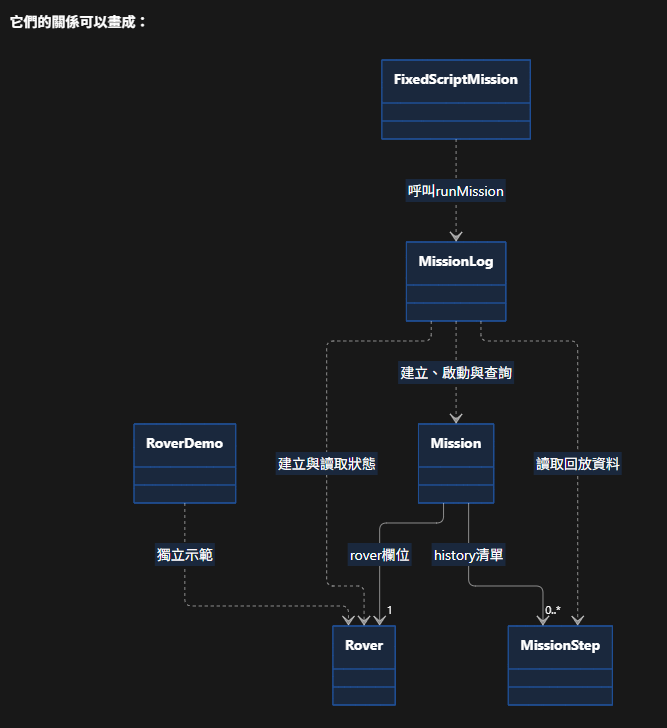
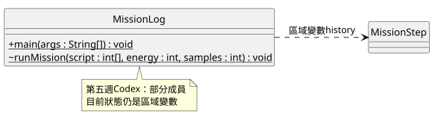

<!-- _class: lead -->
## 第六週程式關聯
## 與第五週的銜接

Codex教師程式｜獨立補充投影片

**第六週teacher程式彼此的關係，以及與第五週的對照。**

<!-- 教師提示：本簡報依week05與week06的codex版本實際原始碼製作，不含XXXCheck.java。 -->

---

## 第六週的六個非Check程式

| 類別 | 角色 | 有main？ |
|---|---|---|
| MissionLog | 固定腳本入口、建立物件、輸出報表 | 有 |
| Mission | 任務流程與歷史清單 | 無 |
| Rover | 探測車目前狀態與行動 | 無 |
| MissionStep | 一步行動後的記錄 | 無 |
| FixedScriptMission | 教師自訂初始狀態與腳本的入口 | 有 |
| RoverDemo | 只示範Rover的操作 | 有 |

<!-- 教師提示：來源week06/codex版本/teacher。main入口不代表只需一個檔案；仍須編譯相依類別。三個入口擇一執行，不是依序全部啟動。 -->

---

<!-- _class: diagram -->

## 六個程式的完整關係

由上往下看：

- **入口**：FixedScriptMission、MissionLog。
- **流程中心**：Mission。
- **目前狀態**：Rover。
- **歷史記錄**：MissionStep。
- **獨立示範**：RoverDemo。

虛線：呼叫、建立或讀取。  
實線：以欄位持續保存連結。

<!-- 教師提示：使用者提供的完整關係原圖，原始PNG未裁切或改畫。圖中的虛線表示相依，實線表示本例欄位關聯；不表示繼承。以下兩頁沿同一張圖分別解釋主任務與輔助入口。 -->

---

<!-- _class: diagram -->

## 看圖中央與下方

**MissionLog → Mission**  
建立任務、啟動執行、查詢結果。

**Mission → Rover**  
透過rover欄位保存一台車；呼叫execute處理行動。

**Mission → MissionStep**  
history清單保存0到多筆記錄，內容是指令、行動後能源與結果。

**MissionLog → Rover／MissionStep**  
讀取目前狀態與歷史，輸出報表。

<!-- 教師提示：對照teacher/MissionLog.java的runMission與printReplay、Mission.java欄位與run。1表示每個Mission連結一台Rover；0..*表示可有零筆或多筆歷史。MissionStep保存數值，不指向Rover，因此目前狀態改變不會改掉舊記錄。 -->

---

<!-- _class: diagram -->

## 看圖上方與左側

**FixedScriptMission → MissionLog**  
接收教師指定的初始狀態與腳本，再呼叫runMission。

**MissionLog → Rover**  
建立探測車；任務結束後讀取狀態。

**RoverDemo → Rover**  
獨立建立並操作探測車，不經過Mission，也不產生任務歷史。

三個main入口各有用途，擇一啟動。

<!-- 教師提示：對照teacher/FixedScriptMission.java、MissionLog.java與RoverDemo.java。FixedScriptMission呼叫的是MissionLog.runMission，不是main；MissionLog.main本身仍使用固定腳本。RoverDemo只有Rover相依，不呼叫完整任務。 -->

---

## 第五週：任務集中在MissionLog

runMission同時管理目前狀態、行動、腳本、歷史與結果。

MissionStep已把一步資料放在一起，但其他任務責任仍集中。

<!-- 教師提示：來源week05/codex版本/teacher/MissionLog.java第12–82行。第五週重點是三條清單改一條物件清單；完整Rover不是第五週已完成的共同先備。圖刻意只列部分成員。 -->

---

## 第五週功能搬到哪裡？

| 第五週MissionLog裡的工作 | 第六週位置 |
|---|---|
| energy、samples、actionCount區域變數 | Rover欄位 |
| switch裡的探索、掃描、充電 | Rover.execute與私有行動方法 |
| 腳本迴圈、history、返回控制 | Mission.run與欄位 |
| 終態、指令統計、OK／拒絕、最低值 | Mission查詢方法 |
| 回放與摘要文字 | 仍由MissionLog輸出 |

**行動規則與對外輸出保持，改變的是責任所在位置。**

<!-- 教師提示：逐項對照week05/codex版本/teacher/MissionLog.java與week06同名檔、Rover及Mission。MissionLog仍計算ignored與battery，屬呈現計算；不要教成所有計算都不在MissionLog。 -->

---

## 沿用、新增與保留介面

| 程式 | 第五週到第六週的變化 |
|---|---|
| MissionStep | 檔案相同，仍保存一步快照 |
| FixedScriptMission | 檔案相同，仍呼叫runMission |
| MissionLog | 保留runMission介面與輸出，內部改成物件合作 |
| Rover、Mission | 本週新增，用來承接原有狀態與流程 |
| RoverDemo | 本週新增，先單獨觀察Rover |

**這是責任重構，沒有extends；兩週程式各自完整。**

<!-- 教師提示：本次實際核對兩週MissionStep與FixedScriptMission的位元組相同。Rover/Mission為責任重構，不把第五週類別當父類別。繼承另在後續週次教。 -->

---

## SampleCase在兩週的位置

| 週次 | 位置與用途 |
|---|---|
| 第五週 | teacher/SampleCase.java：獨立樣本盒設計的教師參考 |
| 第六週 | examples/SampleCase.java：同份程式，搭配SampleCaseDemo |

第六週用它判讀AI設計、重現超量存入與修正。

**SampleCase沒有接入Rover、Mission或主任務歷史。**

<!-- 教師提示：本次核對第五週teacher/SampleCase與第六週examples/SampleCase位元組相同。這解釋為何第六週teacher找不到它；不要為了畫關係而杜撰Rover擁有SampleCase。不要混用Claude的SampleBay整合情境。 -->
