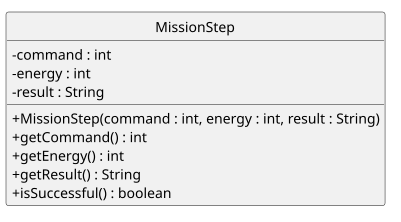
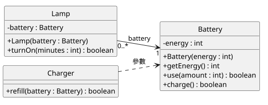
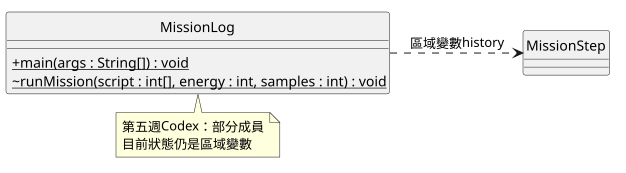
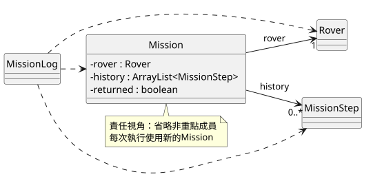
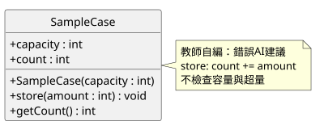

<!-- _class: lead -->
## 第六週｜用類別圖分配責任

類別與物件設計 II：UML 與物件合作

**先讀程式、畫責任，再驗證設計。**

資訊管理學系二年級｜胡碩誠

<!-- 教師提示：本週承接Codex第五週；完整Rover是本週提供的銜接，不是上週已教完。 -->

---
## 上週完成了資料，本週處理責任

| 第五週已做 | 第六週要問 |
|---|---|
| MissionStep保存一步資料 | 誰保管目前能源與樣本？ |
| ArrayList保存多筆歷史 | 誰決定何時讀、何時停止？ |
| MissionLog跑任務又印報表 | 換一種Java輸出介面，哪些邏輯能保留？ |

**類別圖幫我們說清楚「誰知道、誰負責、誰合作」。**

<!-- 教師提示：A。先問20/0跑1/1/2，別從變數語法重新教起。WinForms只作經驗對照，不承諾Java原碼移入.NET。 -->

---
## 本週能交出的成果

1. 從 Java 讀出類別圖，從圖判斷簡單呼叫。
2. 用程式證據解釋**關聯、相依與多重性**。
3. 完成 Mission 的三組 TODO，保留既有輸出。
4. 先畫自己的設計，再用需求與反例審查 AI 圖。

主線不要求完整 UML 系統、繼承或設計模式。

<!-- 教師提示：把可觀察成果講清楚。類別圖能表達設計，但不能代替編譯執行。 -->

---
## 三節，各50分鐘

| 第1節 | 第2節 | 第3節 |
|---|---|---|
| A 診斷10 | D1 責任與Rover15 | E 設計與AI審查25 |
| B 類別圖20 | D2 局部重構25 | F 修圖與檢核10 |
| C 關係20 | D3 行為比對10 | G 保存15 |

第一張圖就預覽；最後15分鐘保存，不挪作新內容。

<!-- 教師提示：這是備課配置，尚未學生試教。六路線的其餘測試與完整紀錄可課後補。 -->

---
## 今天要開哪些檔案？

| 活動 | 檔案／入口 |
|---|---|
| B 讀圖 | starter/MissionStep.java、diagrams/practice.puml |
| C 關係 | examples/RelationDemo.java（另需Battery、Lamp、Charger） |
| D 銜接 | starter/Rover.java、RoverDemo.java |
| D 主任務 | starter/Mission.java、MissionLog.java、MissionStep.java |
| E AI設計 | SampleCase、SampleCaseDemo、自己的設計圖 |

學生改 **Mission三組TODO**；不要把teacher同名答案放進src。

<!-- 教師提示：A。主任務四個類別，RoverDemo只是銜接入口；獨立範例不接入主任務。 -->

---
## A｜先備診斷：目前狀態與歷史

- MissionStep的energy是「現在」，還是「那一步之後」？
- 第五週的目前energy、samples、actionCount放哪裡？
- history.add(step)會複製整個物件嗎？
- `{1,1,2}`最後的三個數字與結果是什麼？

填講義A；我們保留既有規則，改變內部責任。

<!-- 教師提示：歷史快照；runMission區域變數；複製參考值；6/5/3 SUCCESS。這是診斷，不假定全班已熟練。 -->

---
## B｜一個類別的三格



名稱 → 欄位 → 建構子與方法；**不是執行順序圖**。

<!-- 教師提示：B1，並排starter/MissionStep.java。此頁是完整MissionStep參考圖；實作練習只補兩個方法。 -->

---
## B｜Java與圖，讀法不同

| Java | UML／PlantUML |
|---|---|
| private int energy | `- energy : int` |
| public int getEnergy() | `+ getEnergy() : int` |
| public MissionStep(int command, int energy, String result) | `+ MissionStep(command : int, energy : int, result : String)` |

**名稱在前、型態在後。** 建構子不寫void。

<!-- 教師提示：表格較密，先讀欄位和getter，再指出建構子沒有回傳型態。不要要求背所有PlantUML排版設定。 -->

---
## B｜可見性與static

| 符號 | 意義 | Java |
|---|---|---|
| + | public | 外部可呼叫 |
| - | private | 類別內使用 |
| ~ | 套件存取 | 不寫修飾字；不是private |
| 底線 | static | PlantUML寫`{static}` |

圖可省略非重點成員，**要註明這是部分成員圖**。

<!-- 教師提示：承接第五週C#存取差異。protected與繼承下一週再教，final只留教師補充。 -->

---
## B｜只看圖，能不能呼叫？

假設first已用三參數建構子建立：

| 程式 | 能／不能？理由？ |
|---|---|
| first.getEnergy() | 待填 |
| first.energy = 99 | 待填 |
| MissionStep.getEnergy() | 待填 |
| new MissionStep() | 待填 |

先填講義B1；推論與本人實測分開記錄。

<!-- 教師提示：能、不能private、不能非static、不能無此建構子。副本可測，正式src不要留刻意錯誤。 -->

---
## B｜第一張圖，現在就看

1. 開自己的 `diagrams/practice.puml`。
2. 補getEnergy與isSuccessful：可見性、參數、回傳型態。
3. 依README本機產圖，開practice.svg。
4. 看見本次新增的方法，修正後再產一次。

DESIGN.md嵌入自己的SVG；GitHub也能直接看圖片。

**puml是原始碼，SVG是產物。** 不只改其中一份。

<!-- 教師提示：B2–B3。課前備妥官方PlantUML jar；Smetana設定已提供。不要求Python或瀏覽器擴充功能。不可用舊圖或教師圖代替本人預覽。 -->

---
## C｜兩種「使用」

```java
// Lamp：用欄位一直保留
private Battery battery;

// Charger：只在這次呼叫中使用
public boolean refill(Battery battery) {
    return battery.charge();
}
```

前者畫**關聯實線**；後者畫**相依虛線**。

<!-- 教師提示：C2。本週實作圖的線索，不是把所有UML關係硬套成Java語法一對一。 -->

---
## C｜共享電池：先預測再執行

A、B共用8格電池；C有另一顆8格電池。

| 順序 | 預測 |
|---|---|
| A用6、B用6、C用6 | 哪些成功？ |
| 讀shared能源 | 剩幾格？ |
| shared充電+5 | 是否成功？ |
| B再用6，讀shared | 成敗與剩餘？ |

填講義C1，再跑RelationDemo。**C為何不受A影響？**

<!-- 教師提示：true/false/true、2、true、true/1。Battery是一般電池，沒有任務成功或停止規則。 -->

---
## C｜把程式證據畫成線



Lamp的battery欄位；Charger的battery參數。

<!-- 教師提示：C2。RelationDemo只在main用區域變數，所以到Lamp是相依。先問學生證據，再揭示圖。 -->

---
## C｜多重性不是這次建立幾個

```text
Lamp "0..*" --> "1" Battery
```

- 每支Lamp連到 **1顆** Battery（非null契約）。
- 一顆Battery可以被 **0到多支** Lamp使用。
- 這次shared被兩支使用，不代表上限永遠是2。

`1`、`0..1`、`0..*`、`1..*`：從一個物件讀另一端數量。

<!-- 教師提示：C3。Java欄位本身也能是null，數量1是模型契約，不是編譯器自動保證。 -->

---
## D｜第五週Codex的起點



目前狀態仍在runMission；日誌只是區域變數。

**所以不能假設上週已完成完整Rover。**

<!-- 教師提示：D1。這是部分成員圖；MissionLog無欄位，到MissionStep以相依呈現。不要混入Claude第五週API。 -->

---
## D｜先認識本週提供的Rover

```java
Rover rover = new Rover(20, 0);
String result = rover.execute(1);
System.out.println(rover.getEnergy());
```

- energy、samples、actionCount變成**物件欄位**。
- explore、scan、charge是private，外部經execute。
- 成功／耗盡後execute回STOPPED，不改狀態。

先在VS Code跑 **Rover＋RoverDemo兩檔**。

<!-- 教師提示：D1。Rover完整提供，學生讀出責任即可，不再加一份從零寫類別的任務。 -->

---
## D｜RoverDemo：三種狀態

| 操作 | 預期輸出 |
|---|---|
| 20/0探索一次 | OK/14/2/1 |
| 0/0直接充電 | STOPPED/0 |
| 20/5直接探索 | STOPPED/20 |

Rover保護自己的狀態；誰負責**停止讀腳本與記錄**？

<!-- 教師提示：先讓學生填D1預測，再揭示。返回流程由Mission記住，Rover不自行保管返回狀態。 -->

---
## D｜四個類別，各有主要工作

| 類別 | 保存／負責 |
|---|---|
| Rover | 目前狀態與行動規則 |
| MissionStep | 一步行動後的快照 |
| Mission | 腳本執行、歷史、返回與摘要數字 |
| MissionLog | 固定腳本、建立物件、格式化輸出 |

填DESIGN責任表；**MissionStep不負責推進任務。**

<!-- 教師提示：D1。資料在誰身上是起點；跨物件規則可由流程類別協調。MissionLog仍有ignored、battery等呈現計算。 -->

---
## D｜新圖：關係與責任視角



欄位保存用實線；MissionLog方法中使用用虛線。

<!-- 教師提示：D1。普通關聯即可，不依誰new就畫菱形。MissionStep數量允許0..*，Mission的Rover契約為非null的一個。 -->

---
## D｜四類別合作，加入IDEA

- 開同一份java-06；確認已安裝JDK、src來源根。
- 從 **MissionLog.main** 執行主任務。
- Mission、Rover、MissionStep沒有main。
- 不建新的Git repo，不混入teacher同名類別。
- VS Code仍可用，不要求每題雙IDE重做。

每次**編譯成功才執行**，不要把舊.class當本次成功。

<!-- 教師提示：D1。IDE實際版本與GUI是否操作由學生記錄；本機命令列不等於GUI驗證。 -->

---
## D｜只完成Mission三組TODO

| TODO | 方法 | 責任 |
|---|---|---|
| 1 帶做 | run | 停止檢查、執行、快照、返回 |
| 2 模仿 | countOk | 走訪history計算OK |
| 3 獨立 | lowestEnergy | 空清單-1；其他用迴圈找最低 |

其他檔案與方法已提供；starter可編譯不代表已完成功能。

<!-- 教師提示：D2。每個新Mission只run一次，配新Rover；不由外部另外操作同一Rover。保持教學契約小且明確。 -->

---
## D｜run的順序最重要

1. 先問rover是否已停止。
2. 讀下一筆command，交給execute。
3. 用**行動後能源**建立新的MissionStep並加入history。
4. 若command是0，先記returned，再離開。

**被拒絕、無效、返回也要記。**

建構順序沿用Codex：`command, energy, result`。

<!-- 教師提示：D2 TODO1。不要搬成Claude的command/result/energyAfter順序。先讀指令再判停會模糊規則，範例以索引迴圈先檢查再讀。 -->

---
## D｜計數與最低值

```java
for (MissionStep step : history) {
    // TODO 2：用step.isSuccessful()判斷
}
```

- 最低值：先判空，再取第一筆作初值。
- 空清單方法回-1，**報表印N/A**。
- getStep交出單筆；不提供內部可變history清單。

若有getHistory，外部clear會破壞什麼？

<!-- 教師提示：D2 TODO2、3。清單private但交出參考仍可被改；countCommands回新陣列，與交出內部清單不同。 -->

---
## D｜先讓兩條核心路線保持一致

| script | 最後狀態 | steps/ok/rejected/ignored |
|---|---|---|
| {1,1,2} | 6/5/3 SUCCESS | 3/3/0/0 |
| {3,9,0} | 20/0/0 RETURNED | 3/0/2/0 |

比對完整輸出：回放、counts、摘要、最低值、終態與battery。

其餘四路線課後補；最後恢復預設`{1,1,2}`。

<!-- 教師提示：D3。完整輸出期望沿用第五週15項回歸，不只看最後三個數字。 -->

---
## D｜兩層停止檢查，各守什麼？

副本拿掉Mission.run的停止檢查，跑`{1,1,1,1}`：

```text
step 4: command=1, result=STOPPED, energy=2
steps=4, ok=3, rejected=1, ignored=0
```

最終仍SUCCESS，但日誌錯了。

Rover守**狀態**；Mission守**停止後不讀、不記**。

<!-- 教師提示：D3教師示範。恢復後回3筆、ignored1。預設1/1/2用完剛好停止，不適合抓這個錯。示範與本人操作分開。 -->

---
## D｜自己的圖只補指定部分

開 `diagrams/task_template.puml`：

- Mission三欄：rover、history、returned。
- 三個方法：run、countOk、lowestEnergy。
- Mission的兩條關聯與目標端多重性。
- MissionLog到三個合作型別的相依。

標明**部分成員圖**；重新產SVG，更新DESIGN.md。

<!-- 教師提示：D3。不要求四個類別所有方法全抄，省下時間做責任判斷。未完成欄位課後補。 -->

---
## E｜只有一個完整AI設計活動

**獨立SampleCase樣本盒**，不接入主任務。

人工初版 → 保存 → 看AI圖 → 對照需求 → 反例 → 修正重測

- 上週完整實作是選做，本週重新提供需求。
- 先畫自己的欄位與方法，**再看AI的圖**。
- 用教師模擬回覆即可，不要求AI帳號或付費。

<!-- 教師提示：E1。學生先不看examples/SampleCase.java與教師參考圖，人工初版7分鐘含簡單預覽與commit。 -->

---
## E｜樣本盒需求

- 建構容量修正到 **1..8**；初始空盒。
- 只接受正數且放得下的**整批**，拒絕不改值。
- 呼叫端知道成敗；可查容量、存量與剩餘空間。
- 卸空並回傳份數；空盒卸空回0。
- 外部不能任意改寫存量。

容量3，先存2，再存2：**第二次應回什麼，存量多少？**

<!-- 教師提示：E1。false且2。不是把兩份中的一份塞進去，也不是默默截成3。 -->

---
## E｜模擬AI圖：找至少三項問題



每項都要寫：圖上哪裡、違反哪句需求、哪個呼叫會出問題。

<!-- 教師提示：E2教師自編，不是真實AI對話。public欄位、void無法告成敗、note直接累加、缺卸空與查詢等。先給學生判斷，不直接揭示參考圖。 -->

---
## E｜把一個錯誤變成可重現反例

副本中暫拿掉store的「超過剩餘空間」條件：

| 容量3、先存2再存2 | 第二次回傳／存量 |
|---|---|
| 錯誤建議 | true／4 |
| 恢復正確條件 | false／2 |

跑SampleCaseDemo完整輸出，再重測主任務兩路線。

**這只驗證超量檢查，不代表整張圖都已驗證。**

<!-- 教師提示：E3。只改副本、不改方法簽名；正式src最後保持正確。填預測、錯誤輸出、最小修正與恢復後結果。 -->

---
## E｜把需求與自己的設計放進Prompt

```text
請依需求與我的人工初版，輸出PlantUML並說明理由。
需求：容量1..8、初始空盒、整批存入與拒絕不改值……
我的初版：（貼本人puml）
請標出可見性、參數、回傳型態與不確定處。
不用繼承／介面／例外處理；提出呼叫反例與預期。
不能聲稱我已實測。
```

採納／拒絕要有依據；真實AI與教師模擬分開記錄。

<!-- 教師提示：E4。Prompt寫作3分鐘草稿，細節課後補；不要求當堂呼叫真實服務。 -->

---
## F｜修圖與五題檢核

1. MissionLog沒保管Rover欄位，為何仍有相依？
2. 為何MissionStep多重性不是寫死3？
3. Rover與Mission各守住什麼規則？
4. getter回內部可變清單，一定安全嗎？
5. HeavyRover探索得3份，複製整個Rover有何問題？

前5分鐘修圖並重新產SVG，後5分鐘回答。

<!-- 教師提示：F。從方法使用、模型允許數量、狀態與流程、暴露參考、重複維護回答。下一週才實作繼承。 -->

---
## 教師補充｜別把簡化口訣當定義

- **final參考**不能重新指派，清單內容仍可能add。
- **組合**需要所有權與生命週期契約，不能只看誰new。
- 圖可表達設計意圖，不能證明方法內部已實作正確。

本週主作業只需普通關聯與多重性。

<!-- 教師提示：時間不足略過此補充，非必考。可由tools/verify.py的final實驗證明；聚合與組合看OMG規範，不套用Java GC作刪除保證。 -->

---
## G｜最後15分鐘：保存可重現成果

```text
YYYY_MM_DD/
  LAB_REPORT.md、AI_USAGE.md
  java-06/
    README.md、DESIGN.md
    src/        （11個Java檔）
    diagrams/   （三份puml與各自SVG）
```

檢查差異 → commit → push → 遠端核對 → 新clone重編譯

不提交out、.class、IDE暫存或PlantUML jar。

<!-- 教師提示：G。圖可在GitHub直接顯示，無擴充功能依賴；圖片能顯示不代表設計正確。時間不足標待補，不編造操作成功。 -->

---
## 作業：完成核心，再選延伸

- Mission三組TODO、六路線完整輸出。
- 三張自己的圖、責任表、人工初版與修正理由。
- AI三項問題、超量反例與重測、個人紀錄。
- 新副本重編譯；主腳本恢復`{1,1,2}`。

選做：社團器材借用只畫責任與歷史多重性。

**能解釋自己的程式與圖，才算完成。**

<!-- 教師提示：配分35行為、25UML責任、25AI本人驗證、15保存說明。選做不取代必做，也不列下週共同先備。 -->

---
<!-- _class: lead -->
## 下一週｜繼承基礎

Rover探索得2份，HeavyRover希望得3份。

哪些可以共用？哪些需要擴充？

**先說清楚責任，再學新的語法。**

<!-- 教師提示：第七週extends/super與可見性，覆寫深度依第七八週安排。不要現在為子類別把狀態全部改public/protected。 -->
