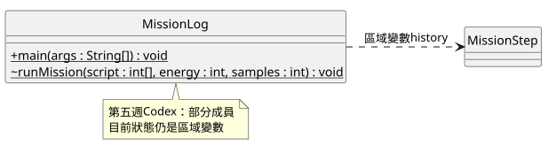
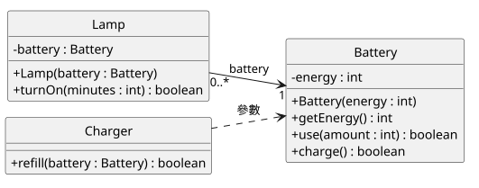
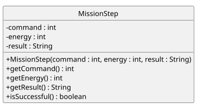
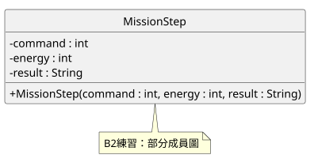
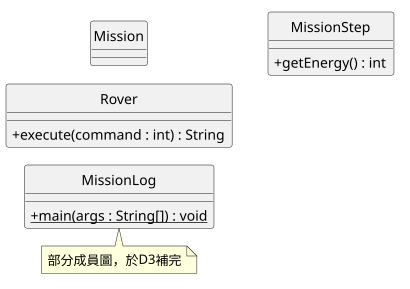
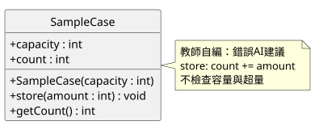
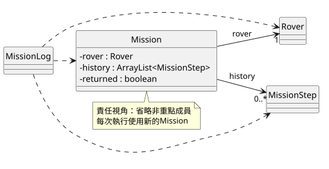
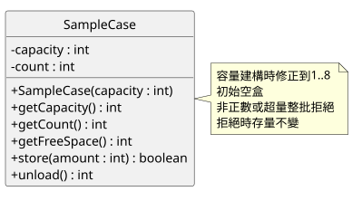
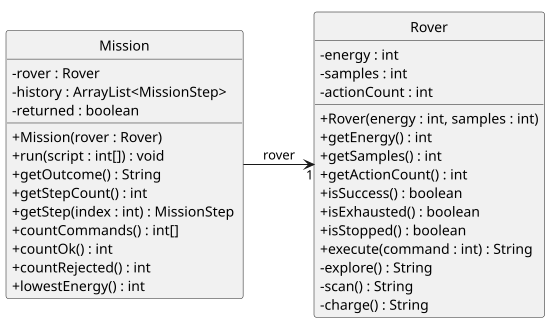

<!-- _class: lead by-claude -->

# 第六週｜用類別圖分配責任

## 類別與物件設計 II：UML 類別圖與物件導向設計思維

AI 協作：先畫自己的設計，再**用需求與反例**判讀 AI 類別圖

物件導向程式設計（與 AI 協作）｜115 學年度第 1 學期
資訊管理學系 二年級｜授課教師：胡碩誠

<!--
講者備註：本份投影片依 week06/codex版本 的講義、作業、範例、圖與教師筆記製作，由 Claude 撰寫；codex 原投影片 week06_slides_codex.md（37頁）與程式關聯補充投影片保留不動，可擇一使用。
本份分成兩部分：先只用 examples/ 教類別圖與關係，再用 starter/ 說明作業；teacher/ 與教師參考圖只出現在附錄。
-->

---

<!-- _class: by-claude small -->

## 關於這份投影片

- 每頁右上角 <span class="tag">claude</span>：本投影片由 Anthropic Claude（Claude Code）依 **codex版本教材** 製作，教師審閱後使用。
- 程式、講義題號（A–G）、TODO、圖與預期輸出全部沿用 `week06/codex版本/`；投影片不新增學生作業。
- 左上角標籤是該頁對應的檔案（路徑以 `week06/codex版本/` 為起點）：

| 標籤 | 資料夾 | 在本投影片的角色 |
|---|---|---|
| <span class="tag blue">examples/…</span> | `examples/` | **第一部分：範例教學**——讀圖、畫圖、關係與多重性 |
| <span class="tag green">starter/…</span> | `starter/` | **第二部分：作業說明**——Mission 三組 TODO 與設計作業 |
| <span class="tag gray">teacher/…</span> | `teacher/`、教師參考圖 | **附錄：教師用**——完整答案、檢查工具、參考圖 |

<span class="note">例外：E 段 SampleCase 的程式放在 examples/，但它是作業的一部分，所以放在第二部分；學生要先畫自己的設計，再打開它。</span>

<!--
講者備註：本份頁碼與 codex 教師筆記的時間表不同，帶課以講義題號 A–G 為準。
-->

---

<!-- _class: by-claude small -->

<div class="ex"><span>../../week05/codex版本/teacher/MissionLog.java</span></div>

## 上週停在哪裡：資料成了物件，但責任還擠在一起

<div class="cols-60">
<div>



第五週 Codex 版：`runMission` 裡同時有
- 目前狀態：`energy`、`samples`、`actionCount`（區域變數）
- 任務流程：讀腳本、判斷停止
- 歷史：`ArrayList<MissionStep> history`
- 輸出：回放、摘要

</div>
<div>

**A｜先備診斷（講義 A1–A4）**

1. `MissionStep` 保存的是目前狀態，還是已發生的某一步？
2. energy、samples、actionCount 原本在哪個方法裡？
3. `history.add(step)` 會複製整個物件嗎？
4. `{1,1,2}` 的最終能源／樣本／成功行動數與結果？

**本週：先畫責任，再改程式。**

</div>
</div>

<!--
講者備註：A 答案：A1 歷史快照；A2 MissionLog.runMission 的區域變數；A3 複製參考值，不複製物件；A4 6/5/3 任務成功。這張 before 圖只列部分成員。
-->

---

<!-- _class: by-claude small -->

## 本週流程：先用範例學讀圖，再用到作業上

<div class="cols">
<div class="box blue">

**第一部分｜範例教學** <span class="tag blue">examples/</span>
講義 B–C，約 40 分鐘

- 類別圖三格：名稱、欄位、操作
- `+ - ~` 與 static、從圖判斷能否呼叫
- PlantUML：`.puml` → `.svg` 立即預覽
- 共享電池：關聯、相依、多重性

</div>
<div class="box green">

**第二部分｜作業說明** <span class="tag green">starter/</span>
講義 B1–B3 練習、D–G

- 第一張圖：MissionStep
- 完整 Rover 銜接、四類別責任表
- **Mission 三組 TODO**、六條路線
- 任務關係圖、SampleCase 設計與 AI 審查
- 繳交與保存

</div>
</div>

| 第 1 節 | 第 2 節 | 第 3 節 |
|---|---|---|
| A 診斷 10｜B 類別圖 20｜C 關係 20 | D1 責任與 Rover 15｜**D2 TODO 25**｜D3 比對 10 | **E 設計／AI 審查 25**｜F 修圖檢核 10｜G 保存 15 |

<span class="note">休息另計；這是備課配置，尚未學生試教。B2–B3 的第一張圖在第 1 節當堂完成。</span>

<!--
講者備註：講義 B 段先用範例教讀圖規則（第一部分），接著學生用 MissionStep 做 B2–B3 練習（第二部分的作業項目）。D3 時間緊時先確認兩條路線，不要壓掉 E 的人工初版。
-->

---

<!-- _class: lead by-claude -->
<!-- footer: '物件導向程式設計｜Week 06｜第一部分 範例教學（examples/）' -->

# 第一部分｜範例教學

## 用 `examples/` 學會讀圖、畫圖、關聯與多重性

講義 B–C｜Battery、Lamp、Charger、RelationDemo

<!--
講者備註：第一部分只使用 Battery／Lamp／Charger／RelationDemo 四檔；SampleCase 兩檔留到作業 E 段，學生先畫初版再打開。
-->

---

<!-- _class: by-claude small -->

## 範例檔案與執行入口

| 檔案 | 有 main？ | 本週角色 | 使用時機 |
|---|---|---|---|
| `examples/Battery.java` | — | 管理能源：use、charge | 第一部分 |
| `examples/Lamp.java` | — | 以**欄位**保存一顆電池 | 第一部分 |
| `examples/Charger.java` | — | 只在**參數**中使用電池 | 第一部分 |
| `examples/RelationDemo.java` | ✓ | 建立共享電池並示範 | 第一部分 |
| `examples/SampleCase.java` | — | 樣本盒參考實作 | 作業 E（先別打開） |
| `examples/SampleCaseDemo.java` | ✓ | 樣本盒驗收 | 作業 E3 |

examples 六檔與 starter 五檔一起放進 `115_1_Java/YYYY_MM_DD/java-06/src/`（共 11 檔），在 `java-06` 執行：

```powershell
javac -encoding UTF-8 -d out src/*.java
java -cp out RelationDemo
```

<span class="note">JDK 不限定版本，先用 java -version、javac -version 記錄本人版本。不要複製 teacher/ 同名類別進 src。</span>

<!--
講者備註：Battery 是一般電池範例，沒有任務成功、返回或耗盡後停止的規則；不能拿它代替 Rover 任務規則。
-->

---

<!-- _class: by-claude small -->

<div class="ex"><span>examples/Battery.java</span><span>examples/Lamp.java</span><span>examples/Charger.java</span></div>

## B1｜類別圖回答「誰知道什麼、誰能做什麼」

<div class="cols-60">
<div>



</div>
<div>

每個類別框分三格：

1. **類別名稱**
2. **欄位**：名稱在前、型態在後
3. **操作**：建構子與方法，含參數與回傳型態

類別圖**不畫執行順序**；迴圈先後、哪一行先跑，仍要追蹤程式。

圖可以只列本次要討論的成員，但要**標明省略範圍**；圖上沒畫的方法，不能推論為不存在。

</div>
</div>

<!--
講者備註：先讓學生讀「能否呼叫」，再補圖，避免把 PlantUML 語法當整堂課。這張 relations 圖也會在 C2 再用一次看線。
-->

---

<!-- _class: by-claude small -->

<div class="ex"><span>examples/Battery.java</span><span>examples/RelationDemo.java</span></div>

## B1｜程式怎麼變成圖上的一行

| Java 程式 | 類別圖寫法 | 要讀懂的事 |
|---|---|---|
| `private int energy;` | `- energy : int` | `-` 是 private；名稱在前、型態在後 |
| `public Battery(int energy)` | `+ Battery(energy : int)` | 建構子**不寫回傳型態** |
| `public boolean use(int amount)` | `+ use(amount : int) : boolean` | 參數寫在括號，回傳型態寫最後 |
| `public static void main(String[] args)` | `+ {static} main(args : String[]) : void` | static 在圖上是**底線**；PlantUML 寫 `{static}` |
| 不寫修飾字，例如 `void spend()` | `~ spend() : void` | `~` 是套件存取（同一套件可用） |

| 符號 | `+` | `-` | `~` | 底線 |
|---|---|---|---|---|
| 意思 | public | private | 套件存取（不寫修飾字） | static |

<span class="note">examples 裡沒有套件存取的成員，最後一列是規則示意；作業裡的 MissionLog 方法就會出現 `~ {static}`。</span>

<!--
講者備註：學生常把型態寫在前面（C#／Java 習慣），提醒 UML 是「名稱 : 型態」。
-->

---

<!-- _class: by-claude -->

<div class="ex"><span>examples/Battery.java</span></div>

## B1｜只看圖，判斷能不能呼叫

已知 `Battery shared = new Battery(8);`，只看上一頁的 Battery 圖：

| 呼叫 | 能編譯嗎？理由（先預測） |
|---|---|
| `shared.getEnergy();` | ？ |
| `shared.energy = 99;` | ？ |
| `Battery.getEnergy();` | ？ |
| `new Battery();` | ？ |

**判斷依據只有圖**：可見性、是否 static、有哪些建構子。

<span class="note">這是圖文推論；沒有實際編譯就不能寫「已實測」。作業 B1 會用 MissionStep 圖做同樣的四題。</span>

<!--
講者備註：答案：能（public 實例方法）；不能（private 欄位）；不能（getEnergy 沒有底線、不是 static）；不能（圖上唯一的建構子要一個 int）。若要編譯驗證，用副本一次只測一行。
-->

---

<!-- _class: by-claude small -->

## PlantUML：圖是文字原始碼，產生 SVG 立刻看

<div class="cols">
<div>

```text
@startuml
!pragma layout smetana
skinparam classAttributeIconSize 0
hide circle
class Battery {
  - energy : int
  + Battery(energy : int)
  + getEnergy() : int
  + use(amount : int) : boolean
  + charge() : boolean
}
@enduml
```

</div>
<div>

- `.puml` 是**原始碼**，`.svg` 是**產出**；改圖就改 `.puml`，再重新產生。
- 開頭幾行排版設定照抄即可，不是本週必學。
- `!pragma layout smetana`：不必另裝 Graphviz。
- **不能只改 SVG**，讓原始碼與圖不同步。

</div>
</div>

在自己的 `java-06` 產圖（jar 位置換成教室實際位置）：

```powershell
cmd /c "java -jar C:\ClassTools\plantuml.jar -charset UTF-8 -tsvg -pipe < diagrams\practice.puml > diagrams\practice.svg"
```

<span class="note">`cmd /c` 讓 UTF-8 原樣轉送。失敗時看錯誤訊息（常見：缺 @enduml、大括號不成對），不能拿舊 SVG 當成果。</span>

<!--
講者備註：教師課前從 PlantUML 官方 GitHub Releases 準備 jar 並在教室位置測試。沒有 jar 時，教師以 tools/render_diagrams.py 當堂代產，學生記錄「教師代產、本人檢視」。
-->

---

<!-- _class: by-claude small -->

<div class="ex"><span>examples/RelationDemo.java</span><span>examples/Lamp.java</span><span>examples/Battery.java</span></div>

## C1｜先預測：兩支燈共用一顆電池

<div class="cols-60">
<div>

```java
Battery shared = new Battery(8);
Lamp a = new Lamp(shared);
Lamp b = new Lamp(shared);
Lamp c = new Lamp(new Battery(8));
System.out.println("燈具 A=" + a.turnOn(6));
System.out.println("燈具 B=" + b.turnOn(6));
System.out.println("燈具 C=" + c.turnOn(6));
System.out.println("共用電池能源=" + shared.getEnergy());
Charger charger = new Charger();
System.out.println("充電=" + charger.refill(shared));
System.out.println("燈具 B 再開啟=" + b.turnOn(6));
System.out.println("共用電池能源=" + shared.getEnergy());
```

</div>
<div>

| 輸出 | 預測 |
|---|---|
| A 用 6 格 | ？ |
| B 用 6 格 | ？ |
| C 用 6 格 | ？ |
| shared 剩幾格 | ？ |
| 充電是否成功 | ？ |
| B 再用 6 格 | ？ |
| shared 剩幾格 | ？ |

</div>
</div>

<span class="note">`use(amount)`：amount 大於能源就回傳 false、不扣；`charge()`：+5 封頂 20，已滿回傳 false。</span>

<!--
講者備註：講義 C1。先寫預測再執行 RelationDemo。答案在下一頁。
-->

---

<!-- _class: by-claude -->

<div class="ex"><span>examples/RelationDemo.java</span></div>

## C1｜答案：共享的是同一個物件

<div class="cols">
<div>

```text
燈具 A=true
燈具 B=false
燈具 C=true
共用電池能源=2
充電=true
燈具 B 再開啟=true
共用電池能源=1
```

</div>
<div>

- A、B 的欄位指向**同一顆** 8 格電池：A 用 6 剩 2，B 要 6 → **被拒絕**。
- C 有**另一顆**電池，不受影響。
- 充電 2 → 7，B 再用 6 → 剩 1。

</div>
</div>

**B 第一次失敗，不是 B 的燈壞了，而是它「知道」的電池已被 A 用掉。**

<span class="note">這是一般電池範例：沒有「能源 0 任務結束」的規則，不能拿來代替 Rover 的任務規則。</span>

<!--
講者備註：回扣第五週的共用參考：Lamp 建構時保存的是參考值，不是電池副本。
-->

---

<!-- _class: by-claude small -->

<div class="ex"><span>examples/Lamp.java</span><span>examples/Charger.java</span><span>examples/RelationDemo.java</span></div>

## C2｜用程式證據決定畫哪一種線

<div class="cols">
<div>

- **關聯** association：用**欄位**保留另一個物件，形成持續的連結 → `-->` 實線
- **相依** dependency：只在**方法參數、區域變數或呼叫**中使用，沒有存在欄位 → `..>` 虛線
- 箭頭指向「被知道／被使用」的那一方。

</div>
<div>


</div>
</div>

| 從 → 到 | 關係 | 證據 |
|---|---|---|
| Lamp → Battery | 關聯 | `private Battery battery;` 欄位 |
| Charger → Battery | 相依 | `refill(Battery battery)` 參數 |
| RelationDemo → Lamp | 相依 | main 裡的區域變數 a、b、c |

<span class="note">這是本課程範例的建模準則，不是 Java 語法對所有 UML 模型的一對一定律。</span>

<!--
講者備註：講義 C2 表格的答案就是下表三列，可先遮住讓學生填。relations 圖裡沒有畫 RelationDemo，請學生口頭補一條虛線。
-->

---

<!-- _class: by-claude small -->

<div class="ex"><span>examples/Lamp.java</span><span>examples/Battery.java</span></div>

## C3｜多重性：模型「允許」幾個，不是這次 new 了幾個

```text
Lamp "0..*" --> "1" Battery : battery
```

從一個起點物件出發，讀「能連到另一端幾個」：
- 一支 **Lamp** 連到 **1** 顆 Battery（數字寫在 Battery 那端）。
- 一顆 **Battery** 可被 **0..*** 支 Lamp 使用（數字寫在 Lamp 那端）。

| 寫法 | `1` | `0..1` | `0..*` | `1..*` |
|---|---|---|---|---|
| 意思 | 恰好一個 | 零或一個 | 零到多個 | 至少一個 |

- RelationDemo 這次 shared 剛好連到 2 支燈——**圖不應寫死 2**。
- 若改成「每支燈可裝 1 到 2 顆電池」，要改 Battery 那端為 `1..2`，**而且程式也要改**；只改圖不算實作。
- `1` 要靠「建構時傳入非 null 電池」的契約維持，Java 不會自動檢查。

<!--
講者備註：講義 C3。聚合／組合（菱形）本週只列教師補充，見附錄；誰 new 了物件不足以單獨決定菱形。
-->

---

<!-- _class: by-claude small -->

## 第一部分小結：範例學到的工具，作業要用在哪裡

| 範例學到的 <span class="tag blue">examples/</span> | 作業要用在 <span class="tag green">starter/</span> |
|---|---|
| 程式 ↔ 圖：`+ - ~`、static 底線、名稱 : 型態 | **B1–B2** 讀 MissionStep 圖、補兩個方法 |
| `.puml` → `.svg` 立即預覽 | **B3、D3、E1** 每次改圖都重新產生 |
| 欄位保存 → 關聯；參數／區域變數 → 相依 | **D3** Mission→Rover、MissionLog→三個類別 |
| 多重性讀法 `1`、`0..*` | **D3** 一個 Mission 能連幾個 Rover／MissionStep |
| 共享參考：Lamp 透過欄位操作同一顆電池 | **D1–D2** Mission 透過欄位操作交給它的 Rover |
| 規則放在知道資料的類別（Battery 管扣電） | **D1** Rover 管行動，Mission 管流程 |

範例只需執行與觀察；**接下來打開 starter，開始作業。**

<!--
講者備註：這頁是兩部分的橋樑。進入第二部分前，確認 C1 預測表與 C2 三列證據都已填。
-->

---

<!-- _class: lead part2 by-claude -->
<!-- footer: '物件導向程式設計｜Week 06｜第二部分 作業說明（starter/）' -->

# 第二部分｜作業說明

## 責任、類別圖與行為保持

講義 B1–B3 練習、D–G｜`starter/Mission.java` 三組 TODO

<!--
講者備註：從這裡開始看 starter 與三份練習圖；teacher 的完整答案與參考圖不投影。
-->

---

<!-- _class: by-claude small -->

<div class="ex"><span class="st">starter/Mission.java</span></div>

## 作業目標與必做項目

**只改責任配置，不改對外行為**：行動規則、停止時機、報表格式與第五週相同。

| # | 必做 | 講義 |
|---|---|---|
| 1 | 完成 `Mission.java` 的 TODO 1–3：run、countOk、lowestEnergy（其他四檔已完成） | D2 |
| 2 | 兩個方法的練習圖；共享電池追蹤；四類別責任表；指定成員的任務關係圖 | B、C、D1、D3 |
| 3 | 核心兩路線，再補完六條路線完整輸出 | D3 |
| 4 | SampleCase 人工初版（看 AI 圖前 commit）、至少三項問題、超量反例重測、Prompt | E1–E4 |
| 5 | 三份 puml 與 SVG 同步，DESIGN.md 引用自己的圖；F 檢核、G 保存 | F、G |

<span class="note">不新增 Scanner、命令列解析、例外處理、繼承、泛型設計或 JUnit。圖的語法正確、可顯示、設計符合需求、程式行為正確是四件不同的事。</span>

<!--
講者備註：依 assignment.md 必做 1–5。截止與繳交平台由教師公告。本週不沿用 Claude 版的命令列輸入或類別 API。
-->

---

<!-- _class: by-claude small -->

<div class="ex"><span class="st">starter/Mission.java</span><span class="st">starter/MissionLog.java</span><span class="st">starter/MissionStep.java</span><span class="st">starter/Rover.java</span><span class="st">starter/RoverDemo.java</span></div>

## 作業檔案：只有 Mission 要寫

| starter 檔案 | 狀態 | 角色 |
|---|---|---|
| `Mission.java` | **TODO 1–3** | 一次任務的流程與歷史 |
| `Rover.java` | 已完成（本週新提供） | 目前狀態與行動 |
| `MissionStep.java` | 已完成（同第五週） | 一步的只讀快照 |
| `MissionLog.java` | 已完成 | 固定腳本、建立物件、輸出報表；**執行入口** |
| `RoverDemo.java` | 已完成 | Rover 銜接示範入口 |

starter 能編譯、安全結束，但日誌是空的——**不算完成**：

```text
步數=0, 成功=0, 拒絕=0, 略過=3
最終能源=20, 樣本數=0, 行動次數=0 -> 任務未完成
```

<span class="note">另複製三份練習圖 practice、task_template、samplecase_initial（.puml＋.svg）；DESIGN_template.md 另存為 java-06/DESIGN.md。</span>

<!--
講者備註：starter 實測輸出最後還有 電量百分比=100.0 一行。不要把教師參考圖（step、relations 以外的 after、mission_focus、samplecase_ref）當自己的作答。
-->

---

<!-- _class: by-claude small -->

<div class="ex"><span class="st">starter/MissionStep.java</span></div>

## B1｜讀 MissionStep 圖：能不能呼叫？

<div class="cols">
<div>



<span class="note">本類別與第五週 Codex 版相同；這張圖列出全部成員。</span>

</div>
<div>

假設 `first` 已用正確建構子建立，**只看圖**判斷：

| 呼叫 | 能否編譯／理由 |
|---|---|
| `first.getEnergy();` | ？ |
| `first.energy = 99;` | ？ |
| `MissionStep.getEnergy();` | ？ |
| `new MissionStep();` | ？ |

和範例 Battery 的四題同一套規則。

</div>
</div>

<span class="note">紙上推論即可；若要編譯驗證，用副本一次只測一行，別把錯誤放進正式 src。</span>

<!--
講者備註：答案：能（public 實例方法）；不能（private）；不能（不是 static）；不能（沒有無參數建構子）。
-->

---

<!-- _class: by-claude small -->

<div class="ex"><span class="st">starter/MissionStep.java</span></div>

## B2–B3｜第一張自己的圖：補兩個方法，當場預覽

<div class="cols-60">
<div>

打開自己的 `diagrams/practice.puml`，依 Java 補入：

- `getEnergy`：可見性？參數？回傳型態？
- `isSuccessful`：可見性？參數？回傳型態？

保留原欄位與建構子；note 已標明這是**部分成員圖**（刻意省略 getCommand、getResult）。

**B3 立刻產生 SVG、打開檢查**：兩個方法、`+` 與回傳型態都出現了嗎？

</div>
<div>



<span class="note">起始圖：還沒有方法。</span>

</div>
</div>

| B3 紀錄（講義） | 內容 |
|---|---|
| 實際 jar 位置與產圖方式 | 本人或「教師代產、本人檢視」 |
| 第一次圖裡看見什麼、修正了什麼 | 沒改也說理由 |
| 重新產生與開啟的結果 | 不能拿舊 SVG 證明成功 |

<!--
講者備註：應補 + getEnergy() : int、+ isSuccessful() : boolean。B3 不預填學生成功；需看本人 SVG 裡確實出現新增的兩個方法。
-->

---

<!-- _class: by-claude small -->

<div class="ex"><span class="st">starter/Rover.java</span></div>

## D1｜本週提供的 Rover：目前狀態搬進物件

<style scoped>pre { font-size: 18px; } table { font-size: 18px; }</style>

<div class="cols-60" style="grid-template-columns: 500px 1fr;">
<div>

```java
private int energy;
private int samples;
private int actionCount;

public boolean isStopped() {
    return isSuccess() || isExhausted();
}

public String execute(int command) {
    if (isStopped()) { return "任務已停止"; }
    switch (command) {
        case 1: return explore();
        case 2: return scan();
        case 3: return charge();
        case 0: return "返回";
        default: return "無效指令";
    }
}
private String explore() { ... }
```

</div>
<div>

| 第五週 | 第六週 |
|---|---|
| runMission 的區域變數 | **Rover 的欄位** |
| switch 裡直接扣電 | **private** 行動方法 |
| 同一方法裡任意改 | 外部只走 **execute** |

成功或耗盡後 execute 回 **任務已停止**，不改狀態。

指令 0 只回 返回；「返回後不再讀腳本」是**任務流程**，交給 Mission。

</div>
</div>

<!--
講者備註：Rover 是本週新提供的銜接類別，不能寫成第五週共同能力。程式碼為節錄：省略建構子、getter、isSuccess（samples >= 5）、isExhausted（energy == 0），以及 scan、charge 兩個 private 行動。
-->

---

<!-- _class: by-claude -->

<div class="ex"><span class="st">starter/RoverDemo.java</span><span class="st">starter/Rover.java</span></div>

## D1｜先預測，再只編譯兩檔執行 RoverDemo

| 操作 | 預測：結果／energy（／samples／actionCount） |
|---|---|
| 初始 20/0，探索一次 | ？ |
| 初始 0/0，直接充電 | ？ |
| 初始 20/5，直接探索 | ？ |

```powershell
javac -encoding UTF-8 -d out src/Rover.java src/RoverDemo.java
java -cp out RoverDemo
```

```text
成功/14/2/1
任務已停止/0
任務已停止/20
```

能源 0（耗盡）或樣本 5（成功）時，Rover 自己拒絕行動——**電池範例的 Battery 沒有這條規則**。

<!--
講者備註：先遮住輸出讓學生預測。兩檔基本範例用 VS Code 即可；四個任務類別合作時再加入 IDEA。
-->

---

<!-- _class: by-claude small -->

<div class="ex"><span class="st">starter/Rover.java</span><span class="st">starter/MissionStep.java</span><span class="st">starter/Mission.java</span><span class="st">starter/MissionLog.java</span></div>

## D1｜四個類別的責任表（寫進 DESIGN.md）

| 類別 | 保存什麼 | 負責什麼 | 不負責什麼 |
|---|---|---|---|
| MissionStep | command、energy、result | 一步行動後的只讀資料、isSuccessful | 推進任務、輸出 |
| Rover | ？ | ？ | ？ |
| Mission | ？ | ？ | ？ |
| MissionLog | ？ | ？ | ？ |

**提示**
- 誰知道目前能源與樣本？→ 誰就守住「成功／耗盡後不再行動」。
- 誰知道腳本、歷史與「已返回」？→ 誰就守住「不再讀、不再記」。
- 輸出格式換成另一個 Java 介面時，哪些類別可以不動？

<span class="note">第一列是第五週已學過的示範。WinForms 只作 C# 經驗對照，不能直接執行 Java 類別。</span>

<!--
講者備註：參考答案在教師筆記 D 段表格：Rover 保存三個狀態、負責行動與停止防護；Mission 保存 rover、history、returned，負責執行腳本、記錄、返回與摘要數值；MissionLog 沒有物件欄位，負責預設腳本、建立物件、格式化輸出。
-->

---

<!-- _class: by-claude small -->

<div class="ex"><span class="st">starter/MissionLog.java</span></div>

## 四個類別合作 → 加入 IntelliJ IDEA

<div class="cols">
<div>

1. 用 IDEA 開同一個 `java-06`；Project SDK 選已安裝 JDK。
2. `src` 標為 **Sources Root**。
3. 從 **MissionLog 的 main** 啟動——MissionStep、Mission、Rover 都不是入口。
4. 不建立新 repo、不建 Maven／Gradle、不混入 teacher 同名類別。

</div>
<div>

| 入口 | 會做什麼 |
|---|---|
| `MissionLog` | 完整任務：建 Rover 與 Mission、run、印報表 |
| `RoverDemo` | 只示範 Rover，不啟動任務 |
| `RelationDemo` | 範例：共享電池 |
| `SampleCaseDemo` | 作業 E：樣本盒驗收 |

</div>
</div>

<span class="note">兩套 IDE 使用同一份來源，不逐題重做。選單依版本可能不同；CLI 成功不能當成 IDE GUI 成功，沒做就寫待補。</span>

<!--
講者備註：duplicate class 多半是混進 teacher 同名檔；找不到 main 多半是選了資料類別。
-->

---

<!-- _class: by-claude small -->

<div class="ex"><span class="st">starter/Mission.java</span></div>

## D2｜Mission：你要寫的類別

<div class="cols-60">
<div>

```java
public class Mission {
    private Rover rover;
    private ArrayList<MissionStep> history;
    private boolean returned;

    public Mission(Rover rover) {
        this.rover = rover;
        history = new ArrayList<>();
        returned = false;
    }

    public void run(int[] script) { }   // TODO 1
    public int countOk() { return 0; }  // TODO 2
    public int lowestEnergy() {         // TODO 3
        return -1;
    }
    // 已提供：getOutcome、getStepCount、
    //   getStep、countCommands、countRejected
}
```

</div>
<div>

**使用契約**
- 每個新 Mission 搭配一個**新的** Rover，只 run **一次**。
- script 非 null；初始 energy 0..20、samples 非負。
- run 期間與讀結果前，不從其他地方操作同一顆 Rover。

**getOutcome 優先順序（已提供）**
任務成功 → 能源耗盡 → 已返回 → 任務未完成

<span class="note">starter 的 0、-1 只是佔位，不算完成。</span>

</div>
</div>

<!--
講者備註：Mission 保存 rover 欄位，這就是第一部分學的「關聯」；MissionLog 只在方法裡用它，是「相依」。
-->

---

<!-- _class: by-claude small -->

<div class="ex"><span class="st">starter/Mission.java</span></div>

## D2｜TODO 1：run——每一輪的順序

| 順序 | 這一輪要做的事 | 為什麼 |
|---:|---|---|
| 1 | 先檢查 `rover.isStopped()`，已停止就離開迴圈 | 停止後的指令**不讀也不記** |
| 2 | 讀下一筆指令 | |
| 3 | `rover.execute(command)` 取得 result | 行動規則在 Rover |
| 4 | 用**行動後**的能源建立 `new MissionStep(...)`，加入 history | 拒絕、無效、返回**都要記** |
| 5 | 若指令是 0：`returned = true`，離開迴圈 | 0 **先記錄，再停** |

- MissionStep 建構參數順序仍是 `(command, energy, result)`，不要套用另一版本的順序。
- 完成後預設路線應有三筆，能源 **14、8、6**。

<span class="note">建立快照放在 execute 之前，歷史能源就會早一步；這和第五週 TODO 4 是同一個時機問題。</span>

<!--
講者備註：TODO 1 建議教師帶做；TODO 2 模仿；TODO 3 獨立。完整答案在 teacher/Mission.java，不投影。
-->

---

<!-- _class: by-claude small -->

<div class="ex"><span class="st">starter/Mission.java</span></div>

## D2｜TODO 2、3：模仿已提供的 countCommands

```java
public int[] countCommands() {              // 已提供：走訪 history 的寫法
    int[] counts = new int[4];
    for (MissionStep step : history) {
        int command = step.getCommand();
        if (command >= 0 && command < counts.length) { counts[command]++; }
    }
    return counts;
}
```

| TODO | 方法 | 規則 | 完成後應看見 |
|---|---|---|---|
| 2 | `countOk()` | 走訪 history，用 `isSuccessful()` 計數並回傳 | 預設 成功=3；`{3,9,0}` 成功=0 |
| 3 | `lowestEnergy()` | 空清單回傳 **-1**；非空先取第一筆，再走訪求最小 | 預設 6 |

<span class="note">-1 只是「沒有紀錄」的訊號，報表看到 0 筆時印 `最低能源=無紀錄`（MissionLog 已處理），不能把 -1 當成實際能源。起點也不能用 0。</span>

<!--
講者備註：countRejected 會呼叫 countOk，所以 TODO 2 沒完成時 rejected 也會錯。
-->

---

<!-- _class: by-claude -->

<div class="ex"><span class="st">starter/Mission.java</span></div>

## D2｜為什麼沒有 `getHistory()`？

```java
public MissionStep getStep(int index) { return history.get(index); }
public int[] countCommands() { int[] counts = new int[4]; ... return counts; }
```

- `getStep` 交出**單筆**只讀快照（MissionStep 沒有 setter）。
- `countCommands` 每次回傳**新陣列**，改它不影響 history。

**想一想（講義 D2）**：如果提供 `public ArrayList<MissionStep> getHistory()`，外部拿到清單後可以寫哪一行破壞資料？

<span class="note">有 public getter 不代表安全；要看交出去的東西能不能被改。</span>

<!--
講者備註：例如 mission.getHistory().clear()。本週沒有提供這個方法，這是「假設提供會怎樣」的反例。
-->

---

<!-- _class: by-claude small -->

<div class="ex"><span class="st">starter/MissionLog.java</span></div>

## D3｜行為比對：輸出要和第五週一樣

<style scoped>table { font-size: 18px; }</style>

每列從 20/0 獨立執行；改 `MissionLog.main` 的固定 script，重新編譯成功才執行；最後恢復 `{1,1,2}`。

| script | energy/samples/actionCount | 任務結果 | 步數／成功／拒絕／略過 | 指令次數[0..3] | 最低能源 | 電量百分比 |
|---|---|---|---|---|---|---|
| **{1,1,2}** | 6/5/3 | 任務成功 | 3/3/0/0 | [0,2,1,0] | 6 | 30.0 |
| **{3,9,0}** | 20/0/0 | 已返回 | 3/0/2/0 | [1,0,0,1] | 20 | 100.0 |
| {0} | 20/0/0 | 已返回 | 1/0/0/0 | [1,0,0,0] | 20 | 100.0 |
| {2,2,2,2,2} | 10/5/5 | 任務成功 | 5/5/0/0 | [0,0,5,0] | 10 | 50.0 |
| {1,1,1,1} | 2/6/3 | 任務成功 | 3/3/0/1 | [0,3,0,0] | 2 | 10.0 |
| {2,1} | 12/3/2 | 任務未完成 | 2/2/0/0 | [0,1,1,0] | 12 | 60.0 |

- **課堂先過粗體兩條**；其餘四條課後補。貼完整輸出（回放、counts、摘要、最低能源、終態、battery）。
- 正常任務日誌**不應出現 任務已停止**。

<!--
講者備註：{3,9,0} 的三筆 result 是 能源已滿、無效指令、返回，能源皆 20。
-->

---

<!-- _class: by-claude small -->

<div class="ex"><span class="st">starter/Mission.java</span><span class="st">starter/MissionLog.java</span></div>

## D3｜任務關係圖：只補指定部分

<div class="cols-60">
<div>



</div>
<div>

打開自己的 `diagrams/task_template.puml`，只補：

1. Mission 的**三個欄位**
2. Mission 的 `run`、`countOk`、`lowestEnergy`
3. **五條關係**：
   - Mission 的兩條**關聯**（標多重性：一個 Mission 能連到幾個 Rover？幾個 MissionStep？）
   - MissionLog 的三條**相依**

每條線都要說得出**程式證據**（哪個欄位、哪個區域變數）。

</div>
</div>

<span class="note">這是部分成員圖，不要求重抄所有 API；重新產 SVG、填進 DESIGN.md。未完成部分課後補。</span>

<!--
講者備註：答案在附錄 after 圖。提醒 0..* 不是預設腳本的 3。
-->

---

<!-- _class: by-claude small -->

<div class="ex"><span class="st">starter/Mission.java</span></div>

## D3｜教師反例：拿掉 run 的停止檢查

在副本刪掉停止檢查，跑 `{1,1,1,1}`（第 3 筆就達標，還剩 1 筆）：

<div class="cols">
<div>

**錯誤副本**
```text
步驟 3: 指令=1, 結果=成功, 能源=2
步驟 4: 指令=1, 結果=任務已停止, 能源=2
指令次數[0..3]=[0, 4, 0, 0]
步數=4, 成功=3, 拒絕=1, 略過=0
最終能源=2, 樣本數=6, 行動次數=3 -> 任務成功
```

</div>
<div>

**恢復後**
```text
步驟 3: 指令=1, 結果=成功, 能源=2
指令次數[0..3]=[0, 3, 0, 0]
步數=3, 成功=3, 拒絕=0, 略過=1
最終能源=2, 樣本數=6, 行動次數=3 -> 任務成功
```

</div>
</div>

- 最終狀態**一樣是 任務成功**——Rover 守住了狀態，但**日誌多了一筆 任務已停止**。
- Rover 管「停止後不再改狀態」；Mission 管「停止後不再讀、不再記」，**兩個檢查各有責任**。
- 預設 `{1,1,2}` 剛好用完，抓不到這個錯——反例要選**還有剩餘指令**的路線。

<!--
講者備註：講義 D3 最後一題。學生沒親自做就標「教師觀察」。輸出已節錄，省略前兩步與最低能源、battery。
-->

---

<!-- _class: by-claude -->

## E1｜樣本盒：先畫自己的設計（7 分鐘）

> 容量在建構時決定並修正到 1..8，新盒為空。只接受**正數且放得下**的整批樣本；拒絕不改存量，呼叫端要知道成敗。能查容量、存量與剩餘空間；一次卸空並回傳份數，空盒卸空回傳 0。外部**不能任意改寫存量**。

1. **先不要打開** `examples/SampleCase.java`。
2. 把自己的欄位、方法與回傳型態寫進 `diagrams/samplecase_initial.puml`，產生 SVG。
3. 填 DESIGN.md，**commit 人工初版**，再進 E2。

**先預測**：容量 3，存 2 後再存 2——成功還是失敗？存量是多少？

<span class="note">本週唯一的完整 AI 設計活動；獨立於探測車任務，不接進 Mission。上週選做沒做也沒關係，需求在這裡重新給。</span>

<!--
講者備註：初版要能回答 capacity／count 的可見性、store 的回傳、unload 的回傳。
-->

---

<!-- _class: by-claude small -->

## E2｜判讀「模擬 AI」類別圖（8 分鐘）

<div class="cols">
<div>



<span class="note">教師自編的錯誤建議，不是真實對話，也不是標準答案。</span>

</div>
<div>

用**需求句**和自己的初版逐條核對，找出**至少三項**問題：

| 問題 | 違反哪句需求 | 哪個呼叫／情境看得出來 |
|---|---|---|
| … | … | … |

**示範一項**：`store(...) : void`
→ 需求「呼叫端要知道成敗」
→ `boolean ok = box.store(2);` 無法編譯。

</div>
</div>

<span class="note">note 寫明「直接累加、不檢查」，所以可以用超量反例檢驗；只有欄位／方法的圖本身，不能證明方法內一定對或一定錯。決定採納／拒絕後，修**同一份** puml 並重新產圖。</span>

<!--
講者備註：其他可找到的問題：capacity／count 公開（box.count=-1）、note 說直接累加（容量 3 存 2 再存 2 變 4）、缺 unload、缺剩餘空間與容量查詢、建構沒有容量修正契約（需依 note 或實作說明依據）。
-->

---

<!-- _class: by-claude small -->

<div class="ex"><span>examples/SampleCase.java</span><span>examples/SampleCaseDemo.java</span></div>

## E3｜超量反例：重現 → 最小修正 → 重測

1. 保存正確 src，**另複製練習副本**；只改副本的 SampleCase.java。
2. 先跑 SampleCaseDemo，對照正確輸出。
3. 在 `store` 的條件暫刪 `|| amount > getFreeSpace()`，保留 `amount <= 0`；不改方法簽名。
4. 編譯副本、執行，看第二次存入是否還被拒絕。
5. 恢復條件、重跑；最後在正確版重跑 D3 兩條主任務路線。

<div class="cols">
<div>

**正確**
```text
第一次=true, 存量=2
超量存放=false, 存量=2
剛好裝滿=true, 存量=3
卸載=3
空盒卸載=0
```

</div>
<div>

**錯誤副本**
```text
第一次=true, 存量=2
超量存放=true, 存量=4
剛好裝滿=true, 存量=5
卸載=5
空盒卸載=0
```

</div>
</div>

<span class="note">這個實驗只檢驗「超量檢查」一項，不代表 AI 圖的所有問題都已測完。</span>

<!--
講者備註：證據表：錯誤前預測、錯誤副本完整輸出、需求缺口與最小修正、恢復後完整輸出、D3 兩條路線重測位置。
-->

---

<!-- _class: by-claude small -->

## E4｜把設計寫成可驗收的 Prompt

方括號是待填內容：

```text
請依下列需求與我的人工初版，輸出 PlantUML 類別圖，再列出設計理由與不確定處。
需求：[容量修正、初始空盒、整批存入與拒絕、查詢、卸空]。
設計：欄位 [可見性與型態]；方法 [名稱、參數、回傳型態、拒絕時狀態]；不新增任意 setter。
限制：不用繼承、介面、例外處理、record 或 Lambda。
請提出測試預期：[容量 3 先存 2 再存 2、剛好填滿、非正數、卸空、空盒]。
不能聲稱我已實測。我的初版：[貼本人 puml]
```

- 可用教師模擬回覆完成，不要求 AI 帳號或付費服務。
- 若真的送出，另記真實回覆與採納理由；沒呼叫服務就不能寫「真實 AI 已驗證」。

<!--
講者備註：教師筆記 E 段有完整參考 Prompt。細節可課後補。
-->

---

<!-- _class: by-claude -->

## F｜修圖與課末檢核（10 分鐘）

前 5 分鐘：重新產圖，對照本次修改的 Java，填 DESIGN.md。後 5 分鐘回答：

1. MissionLog 沒有 Rover 欄位，為什麼仍**相依**於 Rover？
2. 一個 Mission 對 MissionStep 是 `0..*`，為什麼不是預設腳本的 3？
3. 外部呼叫 execute 時，Rover 與 Mission **各守住什麼規則**？
4. 有 public getter 就一定安全嗎？回傳內部可變清單會怎樣？
5. 下週要加「探索一次得 3 份」的 HeavyRover，**複製整個 Rover** 會有什麼維護問題？

<span class="note">第 5 題是第七週繼承的動機，本週不實作。</span>

<!--
講者備註：參考答案：1 runMission 以區域變數建立與使用 Rover（不是欄位，所以是相依）；2 0..* 是所有合法任務允許的數量，空腳本可 0；3 Rover 保護成功／耗盡後狀態，Mission 守腳本停止、記錄與返回；4 外部可改值；5 重複規則、修一漏一。
-->

---

<!-- _class: by-claude small -->

## G｜繳交與保存（15 分鐘）

<div class="cols-60">
<div>

```text
115_1_Java/YYYY_MM_DD/
  LAB_REPORT.md      A–G 題號、預測、完整輸出
  AI_USAGE.md        真實情況；未用 AI 也要本人驗證
  java-06/
    README.md        四類別責任、入口、JDK、編譯執行
    DESIGN.md        圖、責任表、初版與採納理由
    src/             starter 五檔＋examples 六檔＝11 檔
    diagrams/        practice、task_template、
                     samplecase_initial 的 .puml＋.svg
```

</div>
<div>

- [ ] main 預設腳本恢復 `{1,1,2}`
- [ ] 改圖後都重新產生 SVG
- [ ] GitHub Desktop 檢查差異 → commit → push
- [ ] 遠端確認 DESIGN.md 的圖顯示正常
- [ ] 另一位置 clone，重編譯並跑 MissionLog 與 SampleCaseDemo

**不提交**：`out/`、`.class`、`.idea/`、`*.iml`、PlantUML jar、teacher 同名檔。

</div>
</div>

<span class="note">圖片顯示正常只證明可顯示，不證明類別圖正確。推送失敗先保留可讀副本，再請教師協助；沒做的步驟寫待補。</span>

<!--
講者備註：15 分鐘不足時先保存正確版與未完成清單，取回驗證課後補。
-->

---

<!-- _class: by-claude -->

## 評分與選做

| 項目 | 配分 | 重點 |
|---|---:|---|
| 行為保持與三組 TODO | 35 | 六路線、快照、返回／拒絕、停止與最低值 |
| UML 與責任 | 25 | 可見性、型態、指定成員、線與多重性有程式證據 |
| AI 判讀與本人驗證 | 25 | 人工初版、三項有情境的問題、反例／恢復／重測 |
| 可重現與說明 | 15 | 圖碼同步、README、AI 揭露與保存狀態 |

**選做｜社團器材借用**：設計 Member、Equipment、Loan、Club 的責任圖——每筆借用連一位社員與一件器材；同一器材不能同時借給兩人；社員同時最多兩件未歸還；歷史永久保留。只畫圖並用「借、還、再借」說明多重性，不要求 Java。

<!--
講者備註：當週內配分，不改課綱總評。圖的排版美觀不取代設計理由；聚合／組合與 final 不列必考。選做參考方向見教師筆記：「同時最多 2 筆未歸還」是行為約束，不是把歷史多重性寫成 0..2。
-->

---

<!-- _class: lead part3 by-claude -->
<!-- footer: '物件導向程式設計｜Week 06｜附錄 教師用（teacher/）' -->

# 附錄｜教師用

## `teacher/` 與教師參考圖：答案、檢查工具、補充

不發給學生 src；參考圖在學生完成初版與問題表後才揭示

<!--
講者備註：學生完成 D3 與 E2 前，不投影本附錄的參考圖。
-->

---

<!-- _class: by-claude small -->

<div class="ex"><span class="tc">teacher/FixedScriptMission.java</span><span class="tc">teacher/MissionLogCheck.java</span><span class="tc">teacher/MissionStateCheck.java</span></div>

## 教師示範：邊界狀態與檢查工具

在 `week06/codex版本` 目錄單獨編譯 teacher，與學生 src 分開：

```powershell
javac -encoding UTF-8 -d out-teacher teacher/*.java
java -cp out-teacher FixedScriptMission 2 4 2    # 能源 2、樣本 4、指令 {2}
java -cp out-teacher MissionLogCheck             # 15/15 項通過：沿用第五週完整輸出
java -cp out-teacher MissionStateCheck           # 16/16 項通過：狀態與停止檢查
```

| 參數 energy samples script… | 結果 |
|---|---|
| `0 0 3 1` | 能源耗盡，0 筆，最低 無紀錄（一開始就停止） |
| `20 5 1` | 任務成功，0 筆 |
| `2 4 2` | 0/5/1 **任務成功**（同時達標與耗盡，成功優先），1 筆 |
| `20 0` | 空腳本 任務未完成，0 筆 |

<span class="note">學生只記錄觀察，不另寫命令列介面或檢查器；Check 驗的是 teacher 答案，不代表學生 src 已完成。</span>

<!--
講者備註：教師工具可搭配學生完成的 Mission，只取那一組，不與 teacher 同名答案一起編譯。
-->

---

<!-- _class: by-claude small -->

<div class="ex"><span class="tc">teacher/Mission.java</span><span class="tc">teacher/MissionLog.java</span></div>

## 參考答案圖：D3 任務關係、E 樣本盒

<div class="cols">
<div>

**D3 責任視角（after）**



Mission→Rover `1`；Mission→MissionStep `0..*`；MissionLog 相依三者（runMission 以區域變數建立 Rover、Mission，經 getStep 讀 MissionStep）。

</div>
<div>

**E 樣本盒參考（samplecase_ref）**



freeSpace 由 capacity−count 算出，不另存欄位；拒絕語意寫在 note。

</div>
</div>

<span class="note">學生初版與 E2 問題表完成後才揭示。方法名稱可不同，但要與需求、呼叫一致。</span>

<!--
講者備註：after 圖省略非重點成員；Mission 與 Rover 完整成員見下一頁 mission_focus，供備課，不要求學生全抄。
-->

---

<!-- _class: by-claude small -->

<div class="ex"><span class="tc">teacher/Mission.java</span><span class="tc">teacher/Rover.java</span></div>

## 備課用：Mission 與 Rover 完整成員

<div class="center">



</div>

<!--
講者備註：Rover 的 explore／scan／charge 是 private（-），外部只能透過 execute。學生的 D3 圖只要求指定部分。
-->

---

<!-- _class: by-claude small -->

## 教師補充（選聽）：final 與聚合／組合

<div class="cols">
<div>

**final 參考 ≠ 物件不能變**

```java
final ArrayList<String> names = new ArrayList<>();
names.add("A");               // 合法：內容可變
names = new ArrayList<>();    // 編譯錯誤：不能改指向
```

final 只保證參考不重新指派，不保證集合內容不變。本週主線**不要求**新增 final 欄位。

</div>
<div>

**菱形不是看誰 new**

- 組合涉及「部分最多屬於一個整體」與生命週期責任，需另外建模契約。
- 自己 new 或由外面傳入，都**不足以單獨決定**菱形。
- Java GC 不是 UML 刪除語意的自動保證。

本週主圖用**普通關聯＋多重性**即可。

</div>
</div>

<!--
講者備註：依 OMG UML 2.5.1 與 JLS §4.12.4。補充深度由課堂餘裕決定，不列必考。
-->

---

<!-- _class: by-claude small -->

## 來源

- Deitel, *Java How to Program, Early Objects* 11e（本專案 EPUB）：§1.5、§3.2、§3.3；§8.8 Composition、§8.11 static Class Members 補充。
- [OMG UML 2.5.1](https://www.omg.org/spec/UML/2.5.1/PDF)：關聯、多重性、相依與聚合語意。
- [PlantUML 類別圖](https://plantuml.com/class-diagram)、[Smetana](https://plantuml.com/smetana02)、[PlantUML 發行頁](https://github.com/plantuml/plantuml/releases)。
- [Java 語言規範 §4.12.4](https://docs.oracle.com/javase/specs/jls/se22/html/jls-4.html#jls-4.12.4)：final 變數。
- [VS Code Java](https://code.visualstudio.com/docs/java/java-tutorial)、[IntelliJ IDEA 第一個 Java 專案](https://www.jetbrains.com/help/idea/creating-and-running-your-first-java-application.html)、[Windows Forms 概觀](https://learn.microsoft.com/en-us/dotnet/desktop/winforms/overview/)。
- 本週 README、student_lab、assignment、DESIGN_template、teacher_notes、verification。

<span class="note">情境、活動與圖為 codex 教材自編；本投影片由 Claude 依該教材編排。JDK 不鎖定版本，實際測試範圍見 verification.md。</span>

<!--
講者備註：文件核對只支持教學依據，不能代替 IDE／教室操作。
-->
