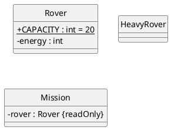
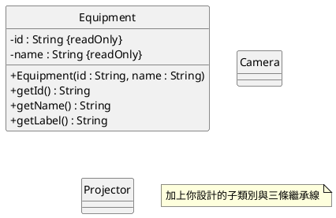

<!--
DESIGN.md 範本（第 7 週，claude 版本）：由 Anthropic Claude（Claude Code）生成。
複製到 115_1_Java/YYYY_MM_DD/java-07/，改名為 DESIGN.md，再刪除這段註解。
每個 plantuml 區塊推上 GitHub 後，裝了「PlantUML for GitHub」擴充功能的瀏覽器會顯示成圖。
-->

# 第 7 週設計文件

學號／姓名：
最後更新日期：

## 1. 重型探測車類別圖（TODO 5）

必須和 `src/` 裡完成後的 `Rover`、`HeavyRover` 一致。繼承寫成 `父類別 <|-- 子類別`；protected 用 `#`；子類別只列新增的成員。



| 類別 | 知道什麼（欄位） | 負責做什麼 | 給子類別用的方法 |
|---|---|---|---|
| `Rover` | | | |
| `HeavyRover` | | | （無） |

## 2. is-a 還是 has-a（講義 C 段）

| 兩個類別 | 判斷 | 理由（一句話） |
|---|---|---|
| `VipMember`、`Member` | is-a | VIP 會員是一種會員，會員能做的 VIP 都能做 |
| `HeavyRover`、`Rover` | | |
| `Flashlight`、`Battery` | | |
| `Mission`、`Rover` | | |
| `Mission`、`MissionStep` | | |
| `Camera`、`Equipment` | | |
| `Loan`、`Member` | | |

C2：`class Mission extends Rover` 會讓哪些奇怪的呼叫變成合法？

## 3. 社團器材的繼承

### 3.1 我新增的器材種類

- 器材種類與真實情境（一句話）：
- 新欄位與理由：
- 新方法與理由：
- is-a 測試：「＿＿＿是一種器材」，`Equipment` 能做的每件事它都能做嗎？

### 3.2 類別圖



## 4. AI 程式碼追蹤

### 4.1 講義 E 段：模擬 AI 的 HeavyRover

| 步驟 | 內容 |
|---|---|
| 預測：能否編譯、理由 | |
| 實際編譯錯誤（第一行） | |
| 最小修正 1（讓它能編譯） | |
| 修正後 `HeavyRoverTry` 的 DIFF 行 | |
| 物件裡有幾個 `energy`，`getEnergy()` 讀哪一個 | |
| 找到的問題（至少三項，含證據） | |
| 最終修正與重測結果 | |
| AI 回覆中最誤導人的一句話與理由 | |

更好的 Prompt（講義 E6）：

```text

```

### 4.2 作業第 3 部分：模擬 AI 的 Camera

| 步驟 | 內容 |
|---|---|
| 預測：能否編譯；`cam.checklist()` 印出什麼 | |
| 實際 `ShelfTry` 的 DIFF 行 | |
| 原因：`cam` 裡有幾個 `id`，`checklist()` 讀哪一個，為什麼 `getLabel()` 是對的 | |
| 最小修正 | |
| 重測結果 | |
