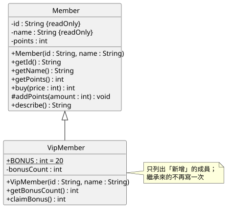
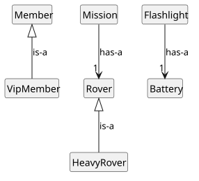
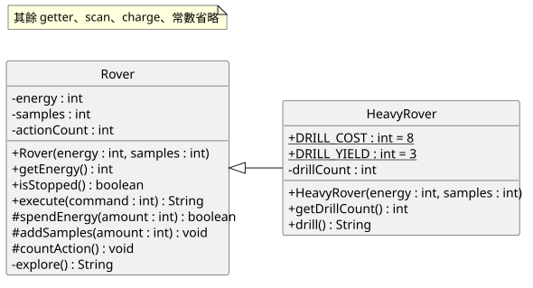
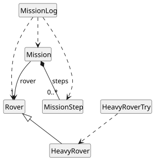
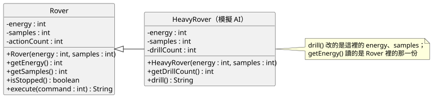
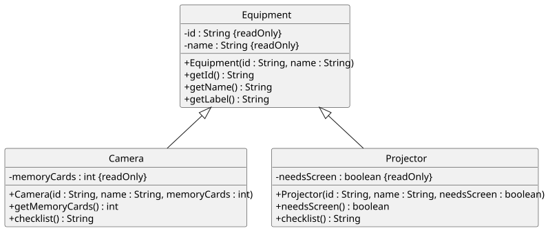

<!-- _class: lead by-claude -->

# 第 7 週
# 繼承(I)：類別繼承基礎

## AI 生成繼承程式碼閱讀與追蹤

物件導向程式設計（與 AI 協作）｜115 學年度第 1 學期
資訊管理學系 二年級｜授課教師：胡碩誠

<!--
講者備註：本週延續第六週 claude 版的探測車任務。開場先問上週課末檢核第 5 題：重型探測車要不要複製一份 Rover？
-->

---

<!-- _class: by-claude -->

## 關於這份教材

- 每頁右上角 <span style="background:#c96442;color:#fff;padding:2px 10px;border-radius:10px;font-size:0.8em">claude</span>：初稿由 Anthropic Claude 生成，教師審閱後使用
- 參考書：Deitel, *Java How to Program, Early Objects* 11e，第 9 章
  - 9.1–9.2 父類別與子類別、9.3 protected、9.4 父類別與子類別的關係
  - 9.5 子類別的建構子、9.6 `Object` 類別、9.7 組合與繼承的取捨
- 搭配檔案：`week07_實作講義_claude.md`、`week07_作業說明_claude.md`、`DESIGN_範本_claude.md`、`code/`、`diagrams/`

**本週不教**：覆寫（`@Override`、`toString`）與多型（第 8 週）、抽象類別與介面（第 9 週）

---

<!-- _class: by-claude -->

<div class="ex">範例：week06 Rover.java</div>

## 上週的問題：重型探測車

```text
Rover          探索：耗 6 得 2    掃描、充電、停止規則……
HeavyRover     ？？？
```

把 `Rover.java` 整份複製成 `HeavyRover.java`？

1. 100 多行一模一樣，改一條規則要改**兩處**
2. `Mission(Rover rover)` 只收 `Rover`，複製出來的類別和它**毫無關係**

本週分兩步：
- **第 7 週**：重型探測車的探索、掃描、充電都**一樣**，只是**多了**「鑽探」（耗 8 得 3）
- **第 8 週**：讓「探索」本身變得不一樣（覆寫）

<!--
講者備註：上週預告的是「探索得 3 份」，那要覆寫，屬於第 8 週。本週先把繼承的機制弄清楚：建構子、可見性、狀態只有一份。
-->

---

<!-- _class: by-claude -->

## 本週學習目標

1. 用 `extends` 寫出子類別，說出哪些成員可以直接用、哪些不行
2. 說明建構子的執行順序，正確使用 `super(...)`
3. 分辨 `private`、`protected`、`public`，知道 Java 與 C# 的 `protected` 不同
4. 用 is-a 測試判斷該用繼承還是欄位（has-a）
5. 在類別圖上畫繼承（空心三角形）與 `#`
6. **追蹤 AI 寫的子類別**：先預測、編譯、測試、找原因、最小修正

---

<!-- _class: by-claude -->

## 今日流程（150 分鐘）

| 時間 | 段落 | 產出 |
|---|---|---|
| 0–10 | 取回 repo、建 `java-07`、上週問題 | 10 個檔案、`DESIGN.md` |
| 10–30 | A. extends | `InheritDemo` 預測表 |
| 30–50 | B. 建構子、super、private 與 protected | 兩個錯誤訊息實驗 |
| 50–60 | C. is-a 還是 has-a、繼承的類別圖 | 判斷表 |
| 60–100 | D. 重型探測車 TODO 1–5 | `HeavyRoverTry` 全部 OK |
| 100–130 | E. AI 生成繼承程式碼閱讀與追蹤 | `ai-check/`、問題表 |
| 130–135 | F. 課末檢核 | |
| 135–150 | G. 保存、推送 | GitHub 紀錄 |

---

<!-- _class: by-claude -->

## 0｜準備

```text
115_1_Java/YYYY_MM_DD/java-07/
├─ DESIGN.md        ← DESIGN_範本_claude.md 改名
└─ src/
   ├─ Member  VipMember  InheritDemo                      （examples）
   └─ Rover  HeavyRover  Mission  MissionStep  MissionLog
      RoverTry  HeavyRoverTry                             （starter）
```

```powershell
javac -encoding UTF-8 -d out src/*.java
java -cp out MissionLog         # 與第 6 週相同
java -cp out HeavyRoverTry      # 有好幾行 DIFF
```

**先不要**複製 `starter/club/`（作業）、`ai/`（E 段）、`teacher/`

---

<!-- _class: lead by-claude -->

# A｜extends

Deitel 9.1–9.2、9.4

---

<!-- _class: by-claude -->

<div class="ex">範例：VipMember.java</div>

## 只寫「多出來的部分」

<div class="cols">
<div>

```java
public class VipMember extends Member {
    public static final int BONUS = 20;
    private int bonusCount;

    public VipMember(String id, String name) {
        super(id, name);
        this.bonusCount = 0;
    }

    public int claimBonus() {
        addPoints(BONUS);
        bonusCount++;
        return getPoints();
    }
}
```

</div>
<div>

- `Member`：**父類別**（superclass）
- `VipMember`：**子類別**（subclass）
- `id`、`name`、`points`、`buy`、`describe`……都從 `Member` **繼承**
- 子類別只寫新增的欄位與方法

讀法：**VipMember 是一種 Member**

</div>
</div>

---

<!-- _class: by-claude -->

<div class="ex">範例：diagrams/member_claude.svg</div>

## 繼承的類別圖

<div class="cols-img">
<div>



</div>
<div>

- **空心三角形**箭頭，指向父類別
- PlantUML：`Member <|-- VipMember`
- `#` = protected
- 子類別方框**只列新增的成員**

</div>
</div>

---

<!-- _class: by-claude -->

## 和 C# 對照

| | C# | Java |
|---|---|---|
| 繼承 | `class VipMember : Member` | `class VipMember extends Member` |
| 呼叫父類別建構子 | `: base(id, name)` 寫在標頭 | `super(id, name);` 寫在建構子內 |
| 父類別個數 | 1 | 1 |
| 共同祖先 | `System.Object` | `java.lang.Object` |
| `protected` | 只給子類別 | 子類別<b>＋同一套件所有類別</b> |

覆寫的差異（C# 的 `virtual`／`override`）留到第 8 週

---

<!-- _class: by-claude -->

<div class="ex">範例：InheritDemo.java</div>

## A1｜先預測，再執行

```java
System.out.println("new VipMember:");
VipMember bob = new VipMember("V001", "Bob");
System.out.println("amy buy 120 -> +" + amy.buy(120));
System.out.println("bob buy 85 -> +" + bob.buy(85));
System.out.println("bob bonus -> " + bob.claimBonus());
System.out.println(bob.describe());
System.out.println("parent of Member: " + amy.getClass().getSuperclass().getName());
```

- `new VipMember` 之後印出幾行？哪一行先？
- `bob.buy(85)` 得幾點？（第 2 週：整數除法）
- `bob.describe()` 會顯示加贈次數嗎？
- `Member` 的父類別是誰？

<!--
講者備註：答案在教師筆記 A 段。85/10 = 8。describe 是 Member 寫的，不知道 bonusCount。
-->

---

<!-- _class: by-claude -->

## A2｜哪些能編譯？

| 程式 | 預測 |
|---|---|
| `bob.buy(50);` | |
| `bob.claimBonus();` | |
| `amy.claimBonus();` | |
| `bob.points = 99;` | |

規則：子類別物件可以用父類別的 public／protected 方法；**父類別物件不會得到子類別的方法**；private 只有宣告它的類別能用名字存取

<!--
講者備註：答案：能、能、不能（cannot find symbol，amy 是 Member）、不能（points has private access in Member）。
-->

---

<!-- _class: lead by-claude -->

# B｜建構子、super、private 與 protected

Deitel 9.3–9.6

---

<!-- _class: by-claude -->

<div class="ex">範例：InheritDemo.java 的輸出</div>

## B1｜誰的建構子先執行？

```text
new VipMember:
  [Member constructor] V001
  [VipMember constructor] V001
```

- 子類別物件裡**有一份父類別的部分**，要先建好
- `super(id, name)`：「先請 `Member` 的建構子處理這兩個值」
- `Member` 沒寫 `super(...)`？Java 自動補上 `super()`，呼叫 `Object` 的建構子

```text
Object()  →  Member(id, name)  →  VipMember(id, name)
```

---

<!-- _class: by-claude -->

<div class="ex">實驗：VipMember.java</div>

## B2｜拿掉 super(id, name)

```java
public VipMember(String id, String name) {
    // super(id, name);
    this.bonusCount = 0;
```

```text
VipMember.java:8: error: constructor Member in class Member cannot be applied to given types;
  required: String,String
  found:    no arguments
```

- 沒寫 → Java 自動補 `super()` → `Member` **沒有**無參數建構子
- 本課程一律把 `super(...)` 寫在建構子**第一行**

<div class="small">

JDK 24 以前這是規則；JDK 25 起（JEP 513）可以在前面寫不使用 `this` 的敘述。寫在第一行在所有版本都正確。

</div>

---

<!-- _class: by-claude -->

<div class="ex">實驗：VipMember.java</div>

## B3｜子類別直接改 private 欄位

```java
public int claimBonus() {
    points += BONUS;          // 原本是 addPoints(BONUS);
```

```text
VipMember.java:20: error: points has private access in Member
```

- `bob` 物件裡**有** `points`（`getPoints()` 讀得到）
- 但 private 只允許 `Member` 自己的程式用名字存取
- 子類別要透過父類別提供的方法：`addPoints`、`getPoints`

---

<!-- _class: by-claude -->

## B4｜四種存取範圍

| 修飾字 | UML | 同類別 | 同套件 | 子類別 | 其他 |
|---|---|---|---|---|---|
| `private` | `-` | 可 | 不可 | 不可 | 不可 |
| （不寫） | `~` | 可 | 可 | 同套件才可 | 不可 |
| `protected` | `#` | 可 | **可** | 可 | 不可 |
| `public` | `+` | 可 | 可 | 可 | 可 |

- 本課程的類別都在同一個**預設套件** → `protected` 在這裡和「不寫」一樣寬
- 仍寫 `protected`：在程式和圖上說明「**這是給子類別用的**」

**為什麼 `points` 不直接改成 protected？** `addPoints` 擋掉負數；欄位開放出去，規則就守不住

---

<!-- _class: by-claude -->

## B5｜每個類別都繼承 Object

```java
System.out.println(amy);
```

```text
Member@1b6d3586        ← 數字每次可能不同
```

- 沒寫 `extends` → 自動 `extends Object`
- `getClass()`、`toString()` 都是從 `Object` 繼承來的
- 第 5 週的 `println(step)` 印出 `MissionStep@…` 也是這個原因

→ 要印出有意義的內容：第 8 週「覆寫 `toString()`」

---

<!-- _class: lead by-claude -->

# C｜is-a 還是 has-a

Deitel 9.7

---

<!-- _class: by-claude -->

<div class="ex">範例：diagrams/isa_hasa_claude.svg</div>

## 先說一句話測試

<div class="cols-img">
<div>



</div>
<div>

- **is-a**：「子類別**是一種**父類別」說得通，而且父類別能做的事它都能做、規則都成立 → 繼承
- **has-a**：只是「用到」或「擁有」 → 欄位（第 6 週的關聯）

C1：`Camera`／`Equipment`？`Loan`／`Member`？

C2：`class Mission extends Rover` 會怎樣？

</div>
</div>

<!--
講者備註：C2：mission.execute(1)、mission.getEnergy() 變成合法，任務自己變成一台探測車；也無法把 HeavyRover 交給任務。
-->

---

<!-- _class: lead by-claude -->

# D｜重型探測車

TODO 1–5

---

<!-- _class: by-claude -->

<div class="ex">範例：diagrams/heavy_focus_claude.svg（完整圖：heavy_claude.svg）</div>

## 施工圖

<div class="cols-big">
<div>



</div>
<div>

- 欄位仍是 `-`：子類別也不能直接改
- 新增三個 `#` 方法：子類別**只能透過它們**改狀態
- `HeavyRover` 只列新增的成員

</div>
</div>

---

<!-- _class: by-claude -->

## D｜TODO 表

| TODO | 檔案 | 內容 | 方式 |
|---|---|---|---|
| 1 | `Rover` | `spendEnergy`、`addSamples`、`countAction`（protected） | 跟做 |
| 2 | `Rover` | `explore`、`scan` 改用它們，結果不變 | 模仿 |
| 3 | `HeavyRover` | `drillCount`：宣告、建構子設 0、getter | 跟做 |
| 4 | `HeavyRover` | `drill()` | 模仿 `explore` |
| 5 | `DESIGN.md` | 類別圖與程式一致 | 獨立 |

IntelliJ：開啟 `java-07`，對 `HeavyRover` 按 **Ctrl＋H** 看繼承階層

動手前：`java -cp out HeavyRoverTry` 有幾行 `DIFF`？

---

<!-- _class: by-claude -->

<div class="ex">範例：Rover.java（TODO 1–2）</div>

## TODO 1–2｜規則只寫一次

<div class="cols">
<div>

```java
protected boolean spendEnergy(int amount) {
    if (amount <= 0 || amount > energy) {
        return false;
    }
    energy -= amount;
    return true;
}
protected void addSamples(int amount) { … }
protected void countAction() { … }
```

</div>
<div>

```java
private String explore() {
    if (!spendEnergy(6)) {
        return "NOT_ENOUGH_ENERGY";
    }
    addSamples(2);
    countAction();
    return "OK";
}
```

</div>
</div>

**重構**：改寫法、不改行為 → 跑五條必做測試與 `RoverTry`，必須和第 6 週**逐字相同**

---

<!-- _class: by-claude -->

<div class="ex">範例：HeavyRover.java（TODO 3–4）</div>

## TODO 3–4｜鑽探

<div class="cols">
<div>

```java
public class HeavyRover extends Rover {
    public static final int DRILL_COST = 8;
    public static final int DRILL_YIELD = 3;
    private int drillCount;

    public HeavyRover(int energy, int samples) {
        super(energy, samples);
        this.drillCount = 0;
    }

    public String drill() {
        // TODO 4
    }
}
```

</div>
<div>

規格：
- 已停止 → `STOPPED`
- 能源不足 → `NOT_ENOUGH_ENERGY`
- 成功：能源 −8、樣本 +3、行動 +1、鑽探 +1 → `OK`
- 被拒絕：狀態都不變

**`explore` 不必檢查停止，`drill` 卻一定要。為什麼？**

</div>
</div>

<!--
講者備註：explore 只能從 execute 進來，execute 第一行擋停止；drill 是新的公開入口，沒有人替它擋。
-->

---

<!-- _class: by-claude -->

## D4-2｜先追蹤，再執行

`HeavyRover h = new HeavyRover(20, 0);`

| 呼叫 | 回傳 | energy | samples | actionCount | drillCount |
|---|---|---|---|---|---|
| （建立後） | — | 20 | 0 | 0 | 0 |
| `h.drill()` | | | | | |
| `h.execute(1)` | | | | | |
| `h.drill()` | | | | | |

`execute` 是從 `Rover` 繼承來的：重型探測車照樣能探索、掃描、充電

<!--
講者備註：OK 12/3/1/1；OK 6/5/2/1；STOPPED 6/5/2/1。
-->

---

<!-- _class: by-claude -->

<div class="ex">實驗：MissionLog.java</div>

## D5｜protected 在 Java 裡有多寬

```java
// MissionLog.main 最後加一行
rover.spendEnergy(5);
```

能編譯嗎？

- **能**：`MissionLog` 和 `Rover` 在同一個套件
- C# 的 `protected` 不允許；Java 允許
- 本課程的 `protected` 是「說明意圖」：**給子類別用**，其他類別不該呼叫

試完**刪掉那一行**

---

<!-- _class: by-claude -->

<div class="ex">範例：diagrams/week07_overview_claude.svg</div>

## TODO 5｜讓圖跟程式一致

<div class="cols-img">
<div>



</div>
<div>

- [ ] `+`、`-`、`#` 與程式一致
- [ ] `HeavyRover` 不重複列出繼承來的成員
- [ ] 三角形指向父類別
- [ ] `Mission --> "1" Rover` 保留
- [ ] `Mission` 和 `HeavyRover` **不畫線**：`Mission` 的程式裡沒有出現 `HeavyRover`

</div>
</div>

---

<!-- _class: lead by-claude -->

# E｜AI 生成繼承程式碼閱讀與追蹤

先讀、先預測 → 編譯 → 測試 → 找原因 → 最小修正 → 重測

---

<!-- _class: by-claude -->

<div class="ex">範例：code/ai/HeavyRover.java（模擬 AI 回覆）</div>

## 模擬 AI 回覆（教師設計，不是真實對話）

<div class="cols">
<div>

```java
public class HeavyRover extends Rover {
    private int energy;
    private int samples;
    private int drillCount;

    public HeavyRover(int energy, int samples) {
        this.energy = energy;
        this.samples = samples;
        this.drillCount = 0;
    }

    public String drill() {
        if (energy < 8) {
            return "NOT_ENOUGH_ENERGY";
        }
        energy -= 8;
        samples += 3;
        drillCount++;
        return "OK";
    }
    // getDrillCount() 省略
}
```

</div>
<div>

> 因為 `Rover` 的 `energy` 和 `samples` 是 private，子類別存取不到，所以我在 `HeavyRover` 重新宣告了這兩個欄位……這段程式可以直接使用。

**E1 先預測**
1. 能編譯嗎？
2. `drill()` 之後 `getEnergy()` 是多少？

準備 `ai-check/`：你的 `Rover`、`HeavyRoverTry`＋這份 `HeavyRover`

</div>
</div>

---

<!-- _class: by-claude -->

## E2｜編譯

```text
HeavyRover.java:9: error: constructor Rover in class Rover cannot be applied to given types;
  required: int,int
  found:    no arguments
```

- 和 B2 同一種錯誤
- **最小修正**：建構子第一行加 `super(energy, samples);`

然後執行 `HeavyRoverTry`……能編譯不代表對

---

<!-- _class: by-claude -->

## E3｜測試：看起來成功，狀態卻沒變

```text
h.drill() -> OK  (expect OK) OK
h: 20/0/0 drill=1  (expect 12/3/1 drill=1) DIFF
h.isSuccess() -> false  (expect true) DIFF
h.drill() -> OK  (expect STOPPED) DIFF
exact.execute(3) -> OK  (expect STOPPED) DIFF
empty.drill() -> NOT_ENOUGH_ENERGY  (expect STOPPED) DIFF
```

<div class="small">（節錄 15 行中的 6 行）</div>

`h` 這**一個物件**裡有幾個 `energy`？`getEnergy()` 讀的是哪一個？

---

<!-- _class: by-claude -->

<div class="ex">範例：diagrams/ai_heavy_claude.svg</div>

## 兩份狀態：欄位遮蔽



<div class="cols">
<div>

```text
h ──> HeavyRover 物件
  Rover 的部分：     energy=20 samples=0
  HeavyRover 的部分：energy=12 samples=3
```

</div>
<div>

- `drill()` 改子類別那一份
- `getEnergy()`、`isStopped()`、`execute()` 用 `Rover` 那一份
- `Mission` 永遠看不到鑽探的成果

</div>
</div>

---

<!-- _class: by-claude -->

## E4–E5｜問題與修正

| 問題 | 證據 |
|---|---|
| 沒有 `super(...)` | 編譯錯誤 |
| 重複宣告 `energy`、`samples` | `h: 20/0/0 drill=1` |
| 沒有停止檢查 | 達標後 `drill() -> OK` |
| 沒有增加行動次數 | 鑽探後 actionCount 仍是 0 |

修正：
1. 刪掉重複的欄位 → `energy has private access in Rover`：**好的錯誤**，編譯器替你抓
2. 改用 `spendEnergy`、`addSamples`、`countAction`，補上 `isStopped()` 檢查
3. 重測到 `HeavyRoverTry` 全部 `OK`；先 `[AI]` commit 原文，再 `[fix]` commit 修正

**「存取不到」應該找父類別提供的方法，不是另建一份**

---

<!-- _class: by-claude -->

## E6｜更好的 Prompt

- 附上 `Rover` 的類別圖，含 `#` 方法
- 「**不可重新宣告**父類別已有的欄位」「只能用 `spendEnergy`、`addSamples`、`countAction` 改狀態」
- 寫出停止規則、拒絕時狀態不變
- 「不覆寫 `Rover` 的方法」
- 要求 AI 列出它認為該測的案例（已停止、能源剛好 8、能源 7）與不確定之處

> AI 說「可以直接使用」，不能代替編譯與測試

---

<!-- _class: by-claude -->

## F｜課末檢核

1. `HeavyRover` 物件裡有 `energy` 嗎？`HeavyRover` 的程式能寫 `energy -= 8` 嗎？
2. 為什麼 `HeavyRover` 的建構子一定要呼叫 `super(energy, samples)`？
3. Java 的 `protected` 和 C# 差在哪？
4. `class Loan extends Member` 對嗎？
5. `new Mission(new HeavyRover(20, 0))` 能編譯嗎？指令 1 得幾份樣本？

<!--
答案：1 有，但它是 Rover 的 private，要用 spendEnergy；2 Rover 沒有無參數建構子，且只有 Rover 能設定並檢查自己的欄位；3 Java 也開放給同一套件；4 不對，借用紀錄不是一種社員，應該是 Loan 有一個 Member；5 能，HeavyRover 是一種 Rover；仍得 2 份，第 8 週用覆寫處理。
-->

---

<!-- _class: by-claude -->

## G｜保存與推送（最後 15 分鐘）

```text
java-07/
├─ README.md   DESIGN.md
├─ src/        Member VipMember InheritDemo Rover HeavyRover Mission
│              MissionStep MissionLog RoverTry HeavyRoverTry   （.java）
└─ ai-check/   Rover HeavyRover HeavyRoverTry                  （.java）
```

- [ ] 重新編譯；不交 `out/`（`src`、`ai-check` 底下都不交）、`.class`、`.idea/`、`*.iml`
- [ ] commit 前綴 `[manual]`、`[AI]`、`[fix]`、`[doc]`；`ai-check` 先 `[AI]` 再 `[fix]`
- [ ] Push → GitHub 上看 `DESIGN.md` 的繼承圖
- [ ] 另一個路徑全新 clone，重跑 `HeavyRoverTry`

---

<!-- _class: by-claude -->

<div class="ex">範例：diagrams/club_claude.svg</div>

## 作業

<div class="cols-img">
<div>



</div>
<div>

1. **重型探測車**：TODO 1–4、五條測試、`RoverTry`、`HeavyRoverTry`
2. **社團器材**：依圖寫 `Camera`、`Projector`，`ShelfTry` 全部 OK
3. **追蹤模擬 AI 的 `Camera`**：能編譯，卻印出 `null null`？
4. **`DESIGN.md`**：繼承圖、is-a 表、自選一種器材設計子類別、兩份 AI 追蹤紀錄

`AI_USAGE.md`：沒有使用 AI 也要交

</div>
</div>

---

<!-- _class: by-claude -->

## 下週預告：覆寫

```java
Rover r = new HeavyRover(20, 0);
r.execute(1);     // 想要：重型探測車探索一次得 3 份
```

- 本週只能**新增**方法；`execute` 呼叫的仍是 `Rover` 的 `explore`
- 子類別要怎麼**換掉**父類別的做法？
- `bob.describe()` 怎麼顯示 VIP 的資料？`println(amy)` 怎麼印出有意義的文字？

→ 第 8 週：繼承(II)：覆寫、多型基礎與設計實務
