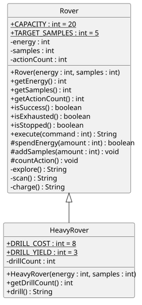

# 第 7 週實作講義：不要複製，要繼承（claude 版本）

> 本講義初稿由 Anthropic Claude（Claude Code）生成，教師審閱後使用。
> 主題：繼承(I)：類別繼承基礎——AI 生成繼承程式碼閱讀與追蹤。
> 參考書：Deitel, *Java How to Program, Early Objects* 11e，第 9 章 9.1–9.7（節次見各段）。

「待填」的地方請直接寫在本檔，課後複製到 `LAB_REPORT.md`。凡是要你**先預測**的題目，請先寫預測再執行；預測錯了不扣分，但不可事後修改預測。

## 0｜準備（10 分鐘）

1. 用 GitHub Desktop 取回學期 repo `115_1_Java`（還原過的電腦請重新 clone；已有副本請先 Fetch／Pull）。
2. 建立今天的資料夾：

   ```text
   115_1_Java/YYYY_MM_DD/java-07/src/
   ```

3. 把教師提供的檔案複製到 `src/`（共 10 個）：
   - `code/examples/` 的 `Member.java`、`VipMember.java`、`InheritDemo.java`
   - `code/starter/` 的 `Rover.java`、`HeavyRover.java`、`Mission.java`、`MissionStep.java`、`MissionLog.java`、`RoverTry.java`、`HeavyRoverTry.java`

   **先不要**複製 `code/starter/club/`（作業用）與 `code/ai/`（E 段用，放在另一個資料夾），也不要複製 `code/teacher/`。
4. 把 `DESIGN_範本_claude.md` 複製到 `java-07/`，改名為 `DESIGN.md`。
5. 在 `java-07` 內編譯並執行：

   ```powershell
   javac -encoding UTF-8 -d out src/*.java
   java -cp out MissionLog
   java -cp out HeavyRoverTry
   ```

   `MissionLog` 的輸出和第 6 週完全相同（`Rover`、`Mission` 是第 6 週的完成版）。`HeavyRoverTry` 有好幾行 `DIFF`，因為重型探測車還不會鑽探，D 段完成它。

上週課末檢核第 5 題：「重型探測車探索一次得 3 份樣本，其他規則都和 `Rover` 一樣。你會複製一份 `Rover` 改成 `HeavyRover` 嗎？」把你上週的答案抄在這裡：待填

本週先處理比較單純的版本：**重型探測車的探索、掃描、充電都和 `Rover` 一樣，只是多了一個新能力「鑽探」**（耗能 8、得 3 份樣本）。讓「探索」本身變得不一樣，是第 8 週的主題。

## A｜為什麼要繼承：extends（20 分鐘，Deitel 9.1–9.2、9.4）

如果把 `Rover.java` 整份複製成 `HeavyRover.java` 再加上 `drill()`：

- 兩個檔案有 100 多行一模一樣；之後改一條規則（例如容量改成 25），要記得改兩處。
- `Mission` 的欄位型態是 `Rover`，複製出來的 `HeavyRover` 和 `Rover` 毫無關係，`new Mission(heavy)` 編譯不過。

**繼承**（inheritance）讓新類別直接取得既有類別的欄位與方法，只寫「多出來的部分」：

```java
public class VipMember extends Member {   // VipMember 是一種 Member
    private int bonusCount;                // 只寫多出來的部分
    ...
}
```

| 名詞 | 意思 | 本週的例子 |
|---|---|---|
| 父類別（superclass） | 被繼承的類別 | `Member`、`Rover` |
| 子類別（subclass） | 用 `extends` 繼承的類別 | `VipMember`、`HeavyRover` |
| 繼承到的 | 父類別的 public／protected 方法可以直接呼叫；父類別的欄位也在子類別物件裡 | `bob.buy(85)`、`bob.getPoints()` |
| 拿不到的 | 父類別的 **private** 成員：資料還在物件裡，但子類別的程式不能用名字直接存取 | `points`、`energy` |

和 C# 對照（大一學過）：

| | C# | Java |
|---|---|---|
| 繼承寫法 | `class VipMember : Member` | `class VipMember extends Member` |
| 呼叫父類別建構子 | `: base(id, name)`（寫在建構子標頭） | `super(id, name);`（寫在建構子內） |
| 一個類別可以有幾個父類別 | 1 個 | 1 個 |
| 所有類別的共同祖先 | `System.Object` | `java.lang.Object` |
| `protected` | 只有子類別 | 子類別**以及同一套件的所有類別**（B 段） |

開啟 `Member.java`、`VipMember.java`、`InheritDemo.java`。

A1. **先預測** `java -cp out InheritDemo` 的輸出，再執行：

| 輸出行 | 預測 | 實際 |
|---|---|---|
| `new VipMember:` 之後的兩行 | 待填 | 待填 |
| `amy buy 120 -> ` | 待填 | 待填 |
| `bob buy 85 -> ` | 待填 | 待填 |
| `bob bonus -> ` | 待填 | 待填 |
| `bob` 的 `describe()` 那一行 | 待填 | 待填 |
| `parent of Member:` | 待填 | 待填 |

A2. 在 `InheritDemo` 的 `main` 裡寫下面這些程式，**先預測**能不能編譯，再一行一行試（試完刪掉）：

| 程式 | 預測：能／不能，理由 | 實際（不能的話抄錯誤訊息的第一行） |
|---|---|---|
| `bob.buy(50);` | 待填 | 待填 |
| `bob.claimBonus();` | 待填 | 待填 |
| `amy.claimBonus();` | 待填 | 待填 |
| `bob.points = 99;` | 待填 | 待填 |

A3. `VipMember.java` 裡沒有寫 `buy`，為什麼 `bob.buy(85)` 可以用？`bob` 的 `describe()` 為什麼沒有顯示加贈次數？（第二題第 8 週會處理，先寫你的猜測。）待填

## B｜建構子、super、private 與 protected（20 分鐘，Deitel 9.3–9.6）

### B1. 誰的建構子先執行

看 A1 的輸出：建立 `VipMember` 時，`[Member constructor]` 在 `[VipMember constructor]` **之前**。子類別物件裡有一份父類別的部分，必須先把父類別的部分建好（設定 `id`、`name`、`points`），子類別才能接著設定自己的欄位。`super(id, name);` 就是「先請父類別的建構子處理這兩個值」。

B1-1. `Member` 的建構子裡沒有寫 `super(...)`，它的父類別是誰？那一行隱含地呼叫了什麼？（提示：A1 最後一行。）待填

### B2. 實驗：拿掉 super

把 `VipMember` 建構子的 `super(id, name);` 註解掉，重新編譯：

- 錯誤訊息（抄第一行與 `required`、`found` 兩行）：待填
- 為什麼會說 `found: no arguments`？（提示：沒寫 `super(...)` 時，Java 自動補上什麼？`Member` 有那種建構子嗎？）待填

做完**還原**那一行。本課程一律把 `super(...)` 寫在建構子的**第一行**。

> 補充：JDK 24 以前，`super(...)` 必須是建構子的第一個敘述。JDK 25 起放寬（JEP 513），可以在它之前寫不使用物件本身（`this`）的程式，例如先檢查參數；不同 JDK 對同一段程式的編譯結果因此可能不同。寫在第一行在所有版本都正確。

### B3. 實驗：子類別直接改 private 欄位

把 `VipMember.claimBonus()` 裡的 `addPoints(BONUS);` 改成 `points += BONUS;`，重新編譯：

- 錯誤訊息：待填
- `bob` 這個物件裡有沒有 `points`？為什麼 `VipMember` 的程式卻不能用它？待填

做完**還原**。

### B4. 四種存取範圍

| 修飾字 | UML | 同一個類別 | 同一個套件 | 子類別 | 其他 |
|---|---|---|---|---|---|
| `private` | `-` | 可 | 不可 | 不可 | 不可 |
| （不寫） | `~` | 可 | 可 | 同套件才可 | 不可 |
| `protected` | `#` | 可 | **可** | 可 | 不可 |
| `public` | `+` | 可 | 可 | 可 | 可 |

本課程的類別都放在同一個資料夾、沒有寫 `package`，屬於同一個「預設套件」。所以在本課程裡，`protected` 其實和「不寫」一樣，連 `InheritDemo` 都能呼叫 `bob.addPoints(5)`。我們仍然寫 `protected`，是要在程式和類別圖上說清楚：**這個方法是給子類別用的**。這是和 C# 最不一樣的地方：C# 的 `protected` 只開放給子類別。

B4-1. `Member` 為什麼不直接把 `points` 改成 `protected`，而是保留 `private`，另外提供 `protected addPoints`？（提示：`addPoints(-100)` 會怎樣？如果 `points` 是 protected，子類別寫 `points = -100` 呢？）待填

### B5. 每個類別都繼承 Object

A1 最後一行顯示 `Member` 的父類別是 `java.lang.Object`：沒寫 `extends` 的類別，自動繼承 `Object`。`getClass()` 就是從 `Object` 繼承來的。

在 `InheritDemo` 最後暫時加一行 `System.out.println(amy);`，執行：印出了什麼？第 5 週的 `println(step)` 也印過類似的東西。待填

這行文字來自 `Object` 的 `toString()` 方法。讓它印出有意義的內容，要用第 8 週的「覆寫」。做完刪掉這行。

## C｜is-a 還是 has-a（10 分鐘，Deitel 9.7）

能不能用繼承，先說一句話測試：「**子類別是一種父類別**」（is-a）。說得通，而且父類別能做的每一件事，子類別也都能做、規則也都成立，才用繼承。只是「用到」或「擁有」另一個類別，就用欄位（has-a，第 6 週的關聯）。


類別圖的繼承畫成**空心三角形箭頭**，箭頭指向父類別。PlantUML 寫成 `父類別 <|-- 子類別`，protected 用 `#`。子類別的方框**只列出新增的成員**，繼承來的不必再寫一次（見 `diagrams/member_claude.svg`）。

C1. 判斷 is-a、has-a 或都不是。has-a 要寫出誰有誰：

| 兩個類別 | 判斷 | 理由（一句話） |
|---|---|---|
| `VipMember`、`Member` | is-a | VIP 會員是一種會員，會員能做的 VIP 都能做 |
| `HeavyRover`、`Rover` | 待填 | 待填 |
| `Flashlight`、`Battery` | 待填 | 待填 |
| `Mission`、`Rover` | 待填 | 待填 |
| `Mission`、`MissionStep` | 待填 | 待填 |
| `Camera`（相機）、`Equipment`（器材） | 待填 | 待填 |
| `Loan`（借用紀錄）、`Member`（社員） | 待填 | 待填 |

C2. 有人寫了 `public class Mission extends Rover`。這樣會讓哪些奇怪的呼叫變成合法？還能把重型探測車交給任務嗎？待填

## D｜重型探測車（40 分鐘）

本週專案有 10 個檔案、4 個 `main`，用 IntelliJ IDEA 開啟 `java-07` 資料夾（`src` 為 Sources Root、SDK 選已安裝的 JDK、詢問建立 Git repository 時選否）。VS Code 仍可使用。在 IntelliJ 對 `HeavyRover` 按 Ctrl＋H，可以看到它的繼承階層（Type Hierarchy）。



| TODO | 檔案 | 內容 | 方式 |
|---|---|---|---|
| 1 | `Rover` | 三個 protected 方法：`spendEnergy`、`addSamples`、`countAction` | 跟做 |
| 2 | `Rover` | `explore`、`scan` 改用 TODO 1 的方法，結果不變 | 模仿 |
| 3 | `HeavyRover` | 欄位 `drillCount`：宣告、建構子設為 0、`getDrillCount()` | 跟做 |
| 4 | `HeavyRover` | `drill()` | 模仿 `explore` |
| 5 | `DESIGN.md` | 類別圖與完成後的程式一致 | 獨立 |

`Mission`、`MissionStep`、`MissionLog`、`RoverTry`、`HeavyRoverTry` 已完成，不必修改。

D1. 動手前先執行 `java -cp out HeavyRoverTry`，有幾行 `DIFF`？`big` 那一行為什麼已經是 `OK`（`new HeavyRover(25, -1)` 變成 `20/0/0`）？是誰把 25 改成 20 的？待填

### D2. TODO 1–2：Rover 提供給子類別的方法（跟做＋模仿）

`HeavyRover` 不能直接改 `energy`、`samples`、`actionCount`（B3 的錯誤）。`Rover` 提供三個 protected 方法，子類別只能**透過它們**改變狀態，範圍規則仍由 `Rover` 守住：

| 方法 | 規格 |
|---|---|
| `protected boolean spendEnergy(int amount)` | `amount` 小於等於 0，或大於目前能源：回傳 `false`，能源不變。否則扣除並回傳 `true` |
| `protected void addSamples(int amount)` | `amount` 大於 0 才增加樣本 |
| `protected void countAction()` | 行動次數 +1 |

寫好後，把 `explore` 改成：

```java
private String explore() {
    if (!spendEnergy(6)) {
        return "NOT_ENOUGH_ENERGY";
    }
    addSamples(2);
    countAction();
    return "OK";
}
```

`scan` 照樣改寫（`charge` 是增加能源，維持原樣）。重新編譯，執行 `MissionLog` 的五條必做測試（作業說明第 1 節）與 `RoverTry`：結果必須和第 6 週**逐字相同**。這種「改了寫法、行為不變」的修改叫做**重構**，跑一次舊的測試就是確認沒改壞。

D2-1. 原本 `energy < 6` 時拒絕，改寫後是 `spendEnergy(6)` 回傳 `false` 時拒絕。這兩個條件在什麼情況下成立？是否完全相同？待填

D2-2. 為什麼 `spendEnergy` 要自己檢查「夠不夠」並回傳 `boolean`，而不是讓呼叫的人先用 `getEnergy()` 檢查、再無條件扣除？（提示：如果有人忘了檢查。）待填

### D3. TODO 3：子類別自己的欄位（跟做）

照 `HeavyRover.java` 裡的 TODO 3 宣告 `private int drillCount;`，在建構子的 `super(energy, samples);` **之後**設為 0，並讓 `getDrillCount()` 回傳它。

D3-1. 建構子為什麼要把 `energy`、`samples` 交給 `super(...)`，而不是自己寫 `this.energy = energy;`？待填

### D4. TODO 4：drill（模仿）

規格：已停止回傳 `STOPPED`；能源不足回傳 `NOT_ENOUGH_ENERGY`；成功時耗能 8、樣本 +3、行動次數 +1、鑽探次數 +1，回傳 `OK`。被拒絕時任何狀態都不變。

模仿 `explore`，用 `DRILL_COST`、`DRILL_YIELD` 兩個常數，不要寫死 8 和 3。

D4-1. `explore` 不必檢查停止，`drill` 卻**一定要**自己先呼叫 `isStopped()`。為什麼？（提示：誰呼叫 `explore`？誰呼叫 `drill`？）待填

D4-2. **先追蹤**再執行。`HeavyRover h = new HeavyRover(20, 0);` 之後依序呼叫，填寫每一步之後的狀態：

| 呼叫 | 回傳 | energy | samples | actionCount | drillCount |
|---|---|---|---|---|---|
| （建立後） | — | 20 | 0 | 0 | 0 |
| `h.drill()` | 待填 | 待填 | 待填 | 待填 | 待填 |
| `h.execute(1)` | 待填 | 待填 | 待填 | 待填 | 待填 |
| `h.drill()` | 待填 | 待填 | 待填 | 待填 | 待填 |

執行 `HeavyRoverTry` 核對，每一行都應是 `OK`。

### D5. 實驗：protected 在 Java 裡有多寬（3 分鐘）

**先預測**：在 `MissionLog` 的 `main` 最後加一行 `rover.spendEnergy(5);`，能編譯嗎？預測：待填

試完記下結果，然後**刪掉那一行**，重新編譯並跑一次預設腳本。結果與 B4 的表格一致嗎？這代表 `protected` 方法在本課程中還能被誰呼叫？待填

### D6. TODO 5：讓圖跟程式一致

在 `DESIGN.md` 第 1 節完成 `Rover` 與 `HeavyRover` 的類別圖，並畫出 `Mission` 與它們的關係：

- [ ] `Rover` 的欄位、建構子、方法都在圖上，`+`、`-`、`#` 與程式一致；static 常數有 `{static}`
- [ ] `HeavyRover` 只列新增的成員（常數、`drillCount`、建構子、`getDrillCount`、`drill`），沒有重複列出 `energy`、`execute` 等繼承來的成員
- [ ] 繼承用空心三角形 `Rover <|-- HeavyRover`，箭頭指向父類別
- [ ] `Mission --> "1" Rover` 保留；`Mission` 和 `HeavyRover` 之間**不畫**線（`Mission` 的程式裡沒有出現 `HeavyRover`）

## E｜AI 生成繼承程式碼閱讀與追蹤（30 分鐘）

流程：**先讀、先預測 → 編譯 → 執行測試 → 找出原因 → 最小修正 → 重測**。AI 說「可以直接使用」不能代替編譯與測試。

有位同學輸入以下 Prompt，以下是**教師設計的模擬 AI 回覆**（不是真實對話，刻意含錯），程式在 `code/ai/HeavyRover.java`：

> 幫我寫一個繼承 Rover 的 HeavyRover，多一個 drill 方法，耗能 8、得 3 份樣本，並記錄鑽探次數。

> （模擬 AI）好的！因為 `Rover` 的 `energy` 和 `samples` 是 private，子類別存取不到，所以我在 `HeavyRover` 重新宣告了這兩個欄位，並在建構子中初始化。`drill()` 會先檢查能源是否足夠，再更新能源與樣本，並累計鑽探次數。這段程式可以直接使用。

```java
public class HeavyRover extends Rover {
    private int energy;
    private int samples;
    private int drillCount;

    public HeavyRover(int energy, int samples) {
        this.energy = energy;
        this.samples = samples;
        this.drillCount = 0;
    }

    public int getDrillCount() {
        return drillCount;
    }

    public String drill() {
        if (energy < 8) {
            return "NOT_ENOUGH_ENERGY";
        }
        energy -= 8;
        samples += 3;
        drillCount++;
        return "OK";
    }
}
```

準備：在 `java-07` 裡另建資料夾 `ai-check/`（**不要**放進 `src/`，否則會有兩個 `HeavyRover`），複製三個檔案：你完成 TODO 1–2 的 `src/Rover.java`、`src/HeavyRoverTry.java`、`code/ai/HeavyRover.java`。在 `ai-check` 內編譯：

```powershell
javac -encoding UTF-8 -d out *.java
java -cp out HeavyRoverTry
```

### E1. 先讀、先預測（5 分鐘）

1. 這段程式能編譯嗎？如果不能，是哪一行、為什麼？待填
2. 假設能執行，`new HeavyRover(20, 0)` 呼叫 `drill()` 之後，`getEnergy()` 會回傳多少？待填

### E2. 編譯（5 分鐘）

- 實際的錯誤訊息（第一行）：待填
- 和 B2 的錯誤一樣嗎？原因是什麼？待填
- **最小修正**：只加一行讓它能編譯。加在哪裡、加什麼？待填

### E3. 執行測試、追蹤（10 分鐘）

修正後執行 `HeavyRoverTry`。

| 輸出行 | 預期 | 實際 | OK／DIFF |
|---|---|---|---|
| `h.drill() ->` | `OK` | 待填 | 待填 |
| `h:`（第一次） | `12/3/1 drill=1` | 待填 | 待填 |
| `h.drill() ->`（第二次） | `STOPPED` | 待填 | 待填 |
| `exact.execute(3) ->` | `STOPPED` | 待填 | 待填 |
| `empty.drill() ->` | `STOPPED` | 待填 | 待填 |

追蹤：`HeavyRover h = new HeavyRover(20, 0); h.drill();` 之後，`h` 這**一個物件**裡有幾個名叫 `energy` 的欄位？各是多少？`getEnergy()` 讀的是哪一個？畫出物件的樣子：

```text
待填
```

### E4. 找出問題（5 分鐘）

至少寫出三個問題，每個都要有證據（哪一行輸出或哪一行程式）：

| # | 問題 | 證據 | 後果（舉一個情境） |
|---|---|---|---|
| 1 | 沒有呼叫 `super(...)` | E2 的錯誤訊息 | 無法編譯 |
| 2 | 待填 | 待填 | 待填 |
| 3 | 待填 | 待填 | 待填 |
| 4 | 待填 | 待填 | 待填 |

### E5. 修正並重測（5 分鐘＋課後）

1. 刪掉 `HeavyRover` 重新宣告的 `energy`、`samples` 兩個欄位，以及建構子裡設定它們的兩行。重新編譯：出現什麼錯誤？為什麼這次是「好的錯誤」？待填
2. 改用 TODO 1 的 protected 方法，並補上停止檢查與行動次數。重測到 `HeavyRoverTry` 全部 `OK`。
3. 和你在 D 段寫的 `drill()` 比較，最後是否一樣？待填

AI 回覆裡哪一句話最誤導人？為什麼？待填

### E6. 寫一個更好的 Prompt（課後）

寫一個能避免上面問題的 Prompt。至少包含：`Rover` 的類別圖（含 `#` 方法）、「不可重新宣告父類別已有的欄位」、停止規則、拒絕時狀態不變、要求 AI 附上它認為該測的案例。

```text
待填
```

若你用真實 AI 工具送出這個 Prompt，請把回覆與你的判斷記在 `AI_USAGE.md`；不要把上面的模擬回覆寫成真實對話。

## F｜課末檢核（5 分鐘）

1. `HeavyRover extends Rover` 之後，`HeavyRover` 物件裡有 `energy` 嗎？`HeavyRover` 的程式能直接寫 `energy -= 8` 嗎？待填
2. 為什麼 `HeavyRover` 的建構子一定要呼叫 `super(energy, samples)`？待填
3. Java 的 `protected` 和 C# 的 `protected` 差在哪裡？待填
4. `class Loan extends Member`（借用紀錄繼承社員）對嗎？用 is-a 測試說明。待填
5. 下週預告：`new Mission(new HeavyRover(20, 0))` 能編譯嗎？任務裡的指令 1 會讓重型探測車得到幾份樣本？如果規格改成「重型探測車探索一次得 3 份」，只靠本週學的「新增方法」做得到嗎？待填

## G｜保存與推送（15 分鐘）

- [ ] 重新編譯，跑一次 `MissionLog 3 9 0`、`RoverTry`、`HeavyRoverTry`；`LAB_REPORT.md`、`AI_USAGE.md`、`java-07/README.md`、`java-07/DESIGN.md`、`src/`、`ai-check/` 的三個 `.java` 齊全；不交 `out/`（`src` 與 `ai-check` 底下都不交）、`.class`、`.idea/`、`*.iml`
- [ ] GitHub Desktop 檢查差異；commit 訊息使用 `[manual]`／`[AI]`／`[fix]`／`[doc]` 前綴。`ai-check/HeavyRover.java` 先用 `[AI]` commit 模擬回覆原文，修正後再用 `[fix]` commit，差異就是你的修正
- [ ] Push origin，在 GitHub 網頁打開 `java-07/DESIGN.md` 確認繼承圖（裝了 PlantUML for GitHub 擴充功能的瀏覽器）
- [ ] 在另一個路徑全新 clone，於 `java-07` 重新編譯並跑 `HeavyRoverTry`；不要刪除原本的副本

最新 commit 訊息與時間：待填
全新 clone 路徑與執行結果：待填
未完成事項（課後補）：待填

推送失敗時：先把整個 repo 複製到隨身碟或雲端，確認檔案打得開，再請教師協助；不要直接關機。

## 課後選做

- 設計「太陽能探測車」`SolarRover`：新增 `rest()`，未停止時能源 +2（封頂 20）、行動次數 +1；已停止回傳 `STOPPED`。`Rover` 目前的三個 protected 方法夠用嗎？要再加什麼？為什麼不乾脆把 `energy` 改成 `protected`？先在 `DESIGN.md` 畫圖再實作，並自己寫幾個像 `HeavyRoverTry` 的檢查。
- 在 IntelliJ 對 `Rover` 按 Ctrl＋H，再對 `Member` 按一次，比較兩個繼承階層；對 `HeavyRover` 的 `getEnergy()` 呼叫按 Ctrl＋B（Go to Declaration），看它跳到哪個檔案。
