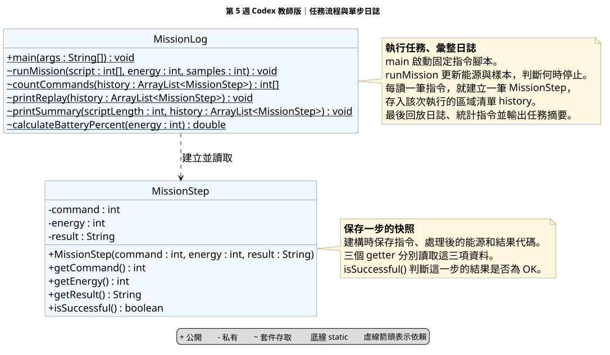
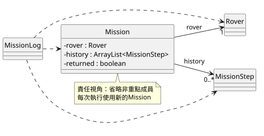
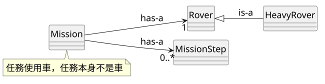

# 第 5–7 週｜同一個探測車任務如何演進

**Codex 版教師講解稿，約 15 分鐘。** 可在第 7 週講義 D1 前用作複習，或在學生完成鑽探後拿來逐段對照。投影時開啟 Markdown 預覽，並依段落切到各週 `teacher/` 的原始碼。

> 開場問學生：「如果三週都跑同一條任務路線，畫面會變嗎？如果畫面相同，我們要去哪裡找設計的變化？」

| 週次 | 要解決的問題 | 看哪一段程式 |
| --- | --- | --- |
| 第 5 週 | 如何把同一步的三項資料一起保存？ | `MissionLog.runMission()` 建立 `MissionStep` |
| 第 6 週 | 誰更新車況、誰跑任務、誰印報表？ | `MissionLog.runMission()` → `Mission.run()` → `Rover.execute()` |
| 第 7 週 | 怎麼讓重型車沿用原有行動，再增加鑽探？ | `HeavyRover extends Rover`、`super(...)`、`drill()` |

## 第 5 週（4 分鐘）｜用物件保存每一步的快照



1. 打開 [第 5 週 MissionLog.java](../../week05/codex版本/teacher/MissionLog.java)，指著 `runMission()` 裡的 `energy`、`samples`、`actionCount`。當時由同一個方法處理指令、更新目前狀態、保存日誌，再呼叫報表方法。
2. 指著 `history.add(new MissionStep(command, energy, result))`。這行在指令處理後執行，每讀一筆就建立一個物件，連被拒絕、返回或無效的指令也會記錄。`history` 是這次呼叫的區域變數，UML 用虛線表示 `MissionLog` 依賴 `MissionStep`。
3. 打開 [第 5 週 MissionStep.java](../../week05/codex版本/teacher/MissionStep.java)。建構子一次存下指令、處理後能源、結果。回放時用 getter 讀出當時的資料。`isSuccessful()` 看的是單步結果是否為 `成功`；整次任務是否成功要看樣本是否達標。

**先問再揭曉。**「初始能源 20，探索後剩 14，接著充電到 19。第一筆日誌的 `getEnergy()` 是多少？」答 14，因為第一個 `MissionStep` 在探索結束時已存下 14。

## 第 6 週（5 分鐘）｜把車況、流程和輸出交給不同類別



從同名的 [第 6 週 MissionLog.java](../../week06/codex版本/teacher/MissionLog.java) 開始點進方法，示範一次呼叫路線。

| 看這裡 | 對學生說 |
| --- | --- |
| `MissionLog.runMission()` | 建立一輛 `Rover`，交給 `Mission`，呼叫 `mission.run(script)`。跑完再讀取車況和歷史，印出與前週相同格式的報表。 |
| [Mission.run()](../../week06/codex版本/teacher/Mission.java) | 這裡決定何時讀下一筆。先檢查車子是否已停，然後呼叫 `rover.execute(command)`，記下這一步，遇到 `0` 就在記錄後結束。日誌查詢與統計也由 `Mission` 提供。 |
| [Rover.execute()](../../week06/codex版本/teacher/Rover.java) | 這裡處理一筆指令，依規則更新這輛車的 `energy`、`samples`、`actionCount`。原先散在任務方法中的目前狀態，現在是 `Rover` 的三個私有欄位。 |
| [MissionStep](../../week06/codex版本/teacher/MissionStep.java) | 仍然保存一次指令的歷史快照，教師版與第 5 週是同一份內容。 |

**對照圖中的兩條實線。** `Mission` 把呼叫端交進來的車存在 `rover` 欄位，所以一個任務關聯一輛車。它也把 `history` 存成欄位，可能有零至多筆紀錄。例如初始能源為 0 時，第一筆指令就不會讀取，歷史是空的。

**現場比一次。** 先請學生猜預設腳本 `{1,1,2}` 的三筆能源，再執行第 5、6 週的 `MissionLog`。兩週都印出 14、8、6，結束時有 5 份樣本、3 次成功行動、結果為 `任務成功`。把「輸出一樣」和「程式責任搬家」分開指給學生看。

## 第 7 週（5 分鐘）｜讓重型車沿用原有行動並新增鑽探



1. 打開 [HeavyRover.java](teacher/HeavyRover.java)，指出 `extends Rover` 和 `super(energy, samples)`。空心三角箭頭指向父類別。一輛重型車是一種探測車（is-a），而一個任務使用一輛探測車（has-a）。建構時由父類別初始化車況，子類別另外初始化自己的 `drillCount`。
2. 在 [第 7 週 Rover.java](teacher/Rover.java) 找到三個 `protected` 方法。`spendEnergy()` 檢查並扣能源，`addSamples()` 增加樣本，`countAction()` 計一次成功行動。重型車透過這些方法操作父類別維護的同一組私有車況。
3. 回到 `drill()`。它是新的公開行動入口，先檢查是否已停止，再嘗試扣 8 格能源。扣除成功才加 3 份樣本、1 次成功行動、1 次鑽探。`HeavyRoverTry` 直接呼叫它，主線 `MissionLog` 仍建立普通 `Rover`。本週的 `execute(1)` 仍是探索、取得 2 份樣本。鑽探由 `drill()` 示範，腳本中的整數 4 仍走無效指令分支。

**先預測再跑 [HeavyRoverTry.java](teacher/HeavyRoverTry.java)。** 投影時先只顯示左欄，請學生用紙筆算一次，再揭曉結果。起點是 `new HeavyRover(20, 0)`，四個數值依序為能源、樣本、成功行動次數、成功鑽探次數。

| 呼叫順序 | 回傳值 | 呼叫後的四欄 |
| --- | --- | --- |
| `h.drill()` | `成功` | `12 / 3 / 1 / 1` |
| `h.execute(1)` | `成功` | `6 / 5 / 2 / 1` |
| `h.drill()` | `任務已停止` | `6 / 5 / 2 / 1` |

問第二次鑽探為何回 `任務已停止`。這時樣本已達 5 份，`drill()` 先檢查停止，還沒進到能源檢查。若要單獨看能源不足，用新的 `HeavyRover(7, 0)`，會回 `能源不足` 並保留 `7 / 0 / 0 / 0`。

最後切回第 7 週的 [MissionLog.java](teacher/MissionLog.java)。`MissionLog`、`Mission`、`MissionStep` 三個檔案直接沿用第 6 週，可用同一條 `{1,1,2}` 路線複查輸出。新增鑽探的程式集中在 `HeavyRover`，共用的車況更新則集中在 `Rover`。

## 收尾（1 分鐘）

請一位學生依序指出「第一筆能源快照」、「目前能源」、「鑽探次數」各放在哪一類別。依序是 `MissionStep`、`Rover`、`HeavyRover`。再請學生指出第 6 週起誰負責持有整份歷史，答案是 `Mission`。

## 教師課前執行卡

分別進入第 5、6、7 週各自的 `codex版本` 資料夾，再編譯該週 `teacher/`。每週有同名 Java 類別，必須分開編譯。

```powershell
javac -encoding UTF-8 -d out-teacher teacher/*.java
java -cp out-teacher MissionLog
java -cp out-teacher MissionLogCheck
```

| 選用示範 | 在對應週次的 `codex版本` 執行 | 應觀察到 |
| --- | --- | --- |
| 第 6 週單獨看車況 | `java -cp out-teacher RoverDemo` | 探索後 `成功/14/2/1`，另外兩輛車分別因零能源及已達標回 `任務已停止` |
| 第 7 週追蹤鑽探 | `java -cp out-teacher HeavyRoverTry` | 15 行檢查都以 「相符」結尾 |
| 任一週回顧快照與返回 | `java -cp out-teacher FixedScriptMission 20 0 1 3 0 2` | 探索、充電、返回三筆能源為 14、19、19，最後的掃描沒讀取。最低能源 14，最終能源 19，`略過=1`，結果 `已返回` |

課前可另開[第 6 週程式關聯補充投影片](../../week06/codex版本/week06_program_relationships_codex.html)或[第 7 週繼承成員圖](diagrams/heavy_reference.svg)，需要看個別入口或 `protected` 成員時再切換。
