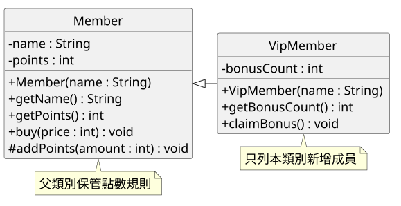
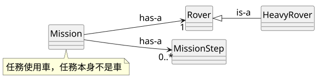
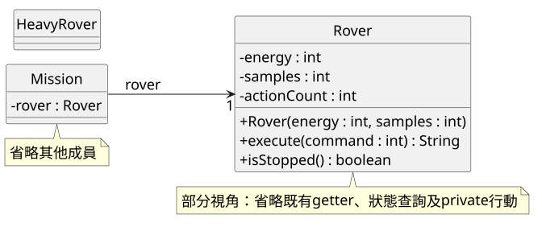
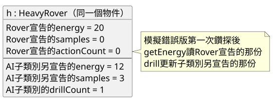

<!-- _class: lead -->
# 第七週｜繼承與新增能力

繼承 I：類別繼承基礎

AI 生成繼承程式碼閱讀與追蹤

資訊管理學系二年級　胡碩誠

<!-- 教師提示：承接第六週Codex。先確認學生能說明四類別責任，不從變數語法重新教起。 -->

---
## 重型探測車的需求

上週已把目前狀態放進 Rover，流程與歷史放進 Mission。

重型探測車需要保留探索、掃描與充電，再增加鑽探。

- 本週：新增 drill，耗 8 格、得 3 份
- 第八週：改變探索的產量，學習覆寫

**本週探索仍然耗 6 格、得 2 份。**

<!-- 教師提示：A。複製整份Rover會形成兩份維護來源，但僅為消除重複不足以判定該繼承，要再看is-a。 -->

---
## 本週學習成果

- 用 extends 與 super(...) 建立子類別
- 分辨 private 狀態、繼承方法與新增方法
- 用 protected 方法擴充，驗證狀態規則
- 完成三組主線 TODO 與一個課後小型遷移
- 從實際反例判讀模擬 AI 回覆

<!-- 教師提示：覆寫、父類別參考的多型操作與抽象類別留到後續週。本週每個重點都有學生操作，不能只看教師展示。 -->

---
## 課堂配置

| 第1節50分 | 第2節50分 | 第3節50分 |
|---|---|---|
| A 診斷10 | D1 關係與圖10 | E AI追蹤25 |
| B 會員範例25 | D2–D4 實作30 | F 修圖檢核10 |
| C 建構與存取15 | D5 檢查10 | G 保存15 |

課後補其餘路線及一個獨立子類別。

<!-- 教師提示：150分鐘是備課估計而非已試教證據。進度落後先減文字抄寫，不刪AI重測或保存時間。 -->

---
## 檔案與執行入口

| 活動 | 相依類別 | main入口 |
|---|---|---|
| B–C 會員 | Member、VipMember | MemberDemo |
| D 主線 | Rover、HeavyRover | HeavyRoverTry |
| D 舊任務 | Rover、Mission、MissionStep | MissionLog |
| E AI副本 | ai-check三檔分開編譯 | HeavyRoverTry |

src 先放 examples 三檔及 starter 六檔。

<!-- 教師提示：A。九個學生Java檔；不把teacher、ai和正式src混編。IntelliJ開同一java-07，確認SDK、src來源根與main入口，不建新repo。 -->

---
## A｜先備診斷

1. Rover、Mission、MissionStep、MissionLog 各做什麼？
2. 目前能源和某一步的能源，為何可能不同？
3. 20 格、0 份跑 `{1,1,2}`，最後是什麼狀態？
4. 起始碼能跑舊任務，代表鑽探已完成嗎？

記錄本人實際 java／javac 版本。

<!-- 教師提示：答案見教師筆記A。6/5/3 SUCCESS；HeavyRoverTry會有DIFF。JDK不鎖定，不把歷史22當教室要求。 -->

---
## B｜父類別與子類別

```java
public class VipMember extends Member {
    // 只寫本類別增加的狀態與行為
}
```

| C# 經驗 | Java 寫法 |
|---|---|
| class VipMember : Member | class VipMember extends Member |
| : base(name) | 建構子內 super(name); |

一般自訂類別只能繼承一個直接父類別。

<!-- 教師提示：檔案examples/VipMember.java。學生有C#基礎不代表已熟繼承，請先用具體物件說明再比較語法。 -->

---
## 會員類別圖



繼承三角形指向父類別，`#` 表示 protected。

<!-- 教師提示：檔案diagrams/member.puml，對照examples兩個類別。只要求讀成員與關係，不抄完整圖。private欄位不被繼承。 -->

---
## 建構子與自己的狀態

```java
public VipMember(String name) {
    super(name);
    bonusCount = 0;
    System.out.println("VipMember constructor: " + name);
}
```

Member 建構子處理姓名與點數。
VipMember 建構子再設定加贈次數。

**這是一個物件，含父類別與子類別宣告的狀態。**

<!-- 教師提示：檔案examples/VipMember.java。super先給課堂統一寫法；建構子印訊息只為觀察，不當作一般產品慣例。建構子不被繼承。 -->

---
## B1｜先預測再執行

MemberDemo 建立 Amy 與 Bob，再購買及領點。

| 項目 | 預測 | 實際 |
|---|---|---|
| 建立 Bob 時的兩行順序 | 先填 | 執行後填 |
| Amy 買 120 的點數 | 先填 | 執行後填 |
| Bob 買 85 再領 20 點 | 先填 | 執行後填 |
| Bob 加贈次數 | 先填 | 執行後填 |

<!-- 教師提示：檔案examples/MemberDemo.java。答案12、28、1，Member constructor: Bob先於VipMember。請學生追蹤85/10=8。 -->

---
## B2｜呼叫判讀

amy 是 Member，bob 是 VipMember。

```java
bob.buy(50);
bob.claimBonus();
amy.claimBonus();
bob.points = 99;
```

每次只測一行，先解釋能否編譯，再看實際結果。

<!-- 教師提示：前兩行可以；第三行Member無該方法；第四行private。副本隔離，不讓刻意錯誤留在正式src。 -->

---
## private 狀態與繼承方法

- VipMember 繼承 buy、getPoints 等可繼承方法
- points 是 Member 的 private 成員，不由子類別繼承
- Bob 物件仍有 Member 宣告的 points
- getPoints 由 Member 的程式存取那份狀態

**不用為了讀不到 private 欄位而再宣告一份。**

<!-- 教師提示：對照examples/Member.java與VipMember.java。來源JLS8.2：https://docs.oracle.com/javase/specs/jls/se25/html/jls-8.html#jls-8.2。B4要求指出實際讀寫位置。 -->

---
## C1｜拿掉 super 的實驗

在 experiments 副本內註解 `super(name);`。

```java
public VipMember(String name) {
    // super(name);
    bonusCount = 0;
}
```

沒寫時隱含 super()，但 Member 沒有無參數建構子。

記錯誤第一行與 required／found，然後還原。

<!-- 教師提示：這個錯誤在各版本仍是缺無參數建構子的問題。本週super寫第一個敘述為慣例，Java25 flexible constructor bodies已放寬部分前置敘述，不將第一行規則誤教為所有版本限制。 -->

---
## C2｜直接改 private 的實驗

```java
// 原本
addPoints(20);

// 實驗改成
points += 20;
```

記下編譯錯誤，說明「物件有資料」與「此處可存取」的差別。

做完還原，重新編譯正確版。

<!-- 教師提示：檔案experiments/VipMember.java。points has private access in Member。不要把points改成protected解決這題。 -->

---
## C3｜protected 的範圍

| 修飾字 | 本例重點 |
|---|---|
| private | 本例只有宣告類別能直接存取 |
| 不寫 | 同套件可存取 |
| protected | 同套件可存取，跨套件子類別有受限存取 |
| public | 本課程對外公開入口 |

在 MemberDemo 暫加 bob.addPoints(5)，能編譯嗎？

<!-- 教師提示：可以，Bob最後33點。本例都在同一預設套件。不可把protected教成只有子類別。跨套件存取細節不列實作。來源JLS6.6：https://docs.oracle.com/javase/specs/jls/se25/html/jls-6.html#jls-6.6。 -->

---
## D1｜is-a 與 has-a

| 類別 | 判斷與理由 |
|---|---|
| HeavyRover、Rover | 重型探測車是一種探測車 |
| Mission、Rover | 任務使用一台探測車 |
| Mission、MissionStep | 任務保存多筆歷史 |

若寫 Mission extends Rover，會多出哪些不合理呼叫？

<!-- 教師提示：Mission.execute、getEnergy變合法，任務被當成車。能共用程式不等於is-a成立，要保持父類別原有規則與可用操作。 -->

---
## 繼承與物件合作



子類別新增能力，Mission 仍保存 Rover 的參考。

<!-- 教師提示：檔案diagrams/relationships.puml。此頁只講靜態關係，本週不要求父類別參考指向子類別的多型操作。 -->

---
## D｜三組主線實作

| TODO | 檔案 | 學生工作 |
|---|---|---|
| 1 | Rover | spendEnergy、探索跟做、掃描模仿 |
| 2 | HeavyRover | 自己的欄位、初始化、getter |
| 3 | HeavyRover | 獨立完成 drill |

Mission、MissionStep、MissionLog 保持第六週完成版。

起始碼安全可跑，NOT_READY 不算完成功能。

<!-- 教師提示：D2十二分、D3六分、D4十二分。老師只示範explore，避免把scan和drill都寫給學生抄。課後另有一個小型獨立遷移。 -->

---
## TODO 1｜扣能源的契約

`protected boolean spendEnergy(int amount)`

| 條件 | 回傳與狀態 |
|---|---|
| amount <= 0 | false，能源不變 |
| amount > energy | false，能源不變 |
| 其他 | 扣能源，回 true |

先完成它，再接上 explore、scan。

<!-- 教師提示：檔案starter/Rover.java。不要先扣再拒絕。補充它不判斷isStopped，也不加樣本或計次；行動入口還有責任。 -->

---
## 探索重構示範

```java
private String explore() {
    if (!spendEnergy(6)) { return "NOT_ENOUGH_ENERGY"; }
    addSamples(2);
    countAction();
    return "OK";
}
```

規則結果保持一致，更新細節透過方法集中。

<!-- 教師提示：檔案starter/Rover.java，講義D2。原本先檢查energy<6，改為扣能源方法回boolean。addSamples與countAction已提供。 -->

---
## 掃描模仿練習

自行改寫 scan，保留：

- 能源不足 2 格時拒絕，狀態不變
- 成功扣 2 格、加 1 份樣本、加 1 次行動
- 使用 spendEnergy、addSamples、countAction

舊寫法也可能通過輸出測試。
本題還要檢查你是否完成指定的重構。

<!-- 教師提示：不要此時展示完整scan。行為證據與結構要求分開檢查，教師批改需閱讀學生程式。 -->

---
## TODO 2｜子類別自己的狀態

HeavyRover 的建構子已提供 super(energy, samples)。

學生補：

- private int drillCount
- 建構子中設為 0
- getDrillCount 回傳這個欄位

energy、samples、actionCount 沿用父類別那份狀態。

<!-- 教師提示：檔案starter/HeavyRover.java。super先給以維持starter可編譯，C已做錯誤實驗，課後獨立遷移要親自寫另一個建構子。 -->

---
## TODO 3｜鑽探規格

| 條件 | 回傳 | 狀態 |
|---|---|---|
| 已停止 | STOPPED | 全部不變 |
| 能源不足8格 | NOT_ENOUGH_ENERGY | 全部不變 |
| 其餘 | OK | -8能源、+3樣本 |

成功時另加 1 次行動、1 次鑽探。
使用提供的 DRILL_COST、DRILL_YIELD。

<!-- 教師提示：檔案starter/HeavyRover.java。請學生先把條件排序，教師不要完整代寫。 -->

---
## 新入口的停止責任

```java
public String drill() {
    // 先檢查停止
    // 再嘗試扣能源
    // 成功才更新樣本與兩種次數
}
```

這是流程骨架，請回原檔完成回傳值。

execute 只替經過自己的行動檢查停止。
drill 是另一個入口，必須自己守住規則。

<!-- 教師提示：這是規格閱讀骨架，不是可直接替換的完整Java方法，請完成原starter。protected局部方法不自動保證整組規則。 -->

---
## D4｜先追蹤同一台車

從 HeavyRover(20,0) 開始。

| 呼叫 | 回傳 | energy/samples/actions/drills |
|---|---|---|
| drill() | 先預測 | 先預測 |
| execute(1) | 先預測 | 先預測 |
| drill() | 先預測 | 先預測 |

再執行 HeavyRoverTry，十五行都應為 OK。

<!-- 教師提示：答案依序OK 12/3/1/1，OK 6/5/2/1，STOPPED 6/5/2/1。另問7格、8格、初始0與初始5份，讓學生解釋拒絕與成功。 -->

---
## D5｜舊任務的行為保持

課堂先做 `{1,1,2}` 與 `{3,9,0}`。

- 改 MissionLog 內固定 script，重新編譯
- 比較回放、counts、摘要、最低值與 battery
- 其餘四路線課後補，最後恢復預設

**本版不讀命令列腳本。**

<!-- 教師提示：檔案starter/MissionLog.java保持原檔。原六路線與數字見assignment，不能混Claude命令列版本。direct drill測試與Mission不同台車。 -->

---
## 本人的繼承圖



補 # 方法、子類別與繼承線，再產 SVG 並立即開圖。

<!-- 教師提示：檔案diagrams/heavy_practice.puml，本頁是練習骨架而非完成參考。DESIGN引用本人SVG；圖已標示省略既有成員，不抄滿所有API。 -->

---
## E｜模擬 AI 的錯誤程式

```java
private int energy;
private int samples;

public String drill() {
    if (energy < 8) { return "NOT_ENOUGH_ENERGY"; }
    energy -= 8;
    samples += 3;
    drillCount++;
    return "OK";
}
```

完整原文在 ai/HeavyRover.java，建構子已呼叫 super。

<!-- 教師提示：此為教師設計模擬回覆的節錄，非真實對話。ai-check只放完成Rover、AI HeavyRover、HeavyRoverTry三檔，和src分開編譯。先預測再跑。 -->

---
## E2–E3｜回傳 OK，getter 卻沒變



請指出 drill 與 getEnergy 分別讀寫哪一份。

<!-- 教師提示：第一次鑽探後預期12/3/1/1，錯誤20/0/0/1。圖是一個物件，不是兩台車。兩個private同名欄位不由子類別繼承，不教成方法覆寫。 -->

---
## E4｜最小修正與重測

- 刪掉重複欄位與建構子內對它們的設定
- 改用父類別提供的方法
- 補停止檢查與成功行動次數
- 重測正常、7格不足、8格剛好、已停止

保留 [AI] 原文與 [fix] 修正兩個 commit。
記錄模擬來源，十五行重新全部 OK。

<!-- 教師提示：不靠AI宣稱或只看一次OK驗收。講義E4五分鐘不夠時，E5 Prompt課後補，保留修正重測。 -->

---
## 自己的反例

除了教師案例，請自行提出一個。

| 要寫清楚 | 內容 |
|---|---|
| 操作 | 初始值、呼叫順序 |
| 預期 | 回傳與完整狀態 |
| 實際 | 本人執行結果 |
| 理由 | 它能抓到哪種錯誤？ |

說明「測到了什麼」，比多貼相同輸出更有用。

<!-- 教師提示：例如8/2鑽探同時成功與耗盡；20/0先鑽探兩次到4/6，再操作應停止。注意不要把契約外數值當必測輸入。 -->

---
## 課後獨立遷移

一個新子類別、一個測試入口。

可選 CargoRover：貨物容量 3，load(amount) 有拒絕規則。
裝貨不耗能源、不加樣本、不增加 actionCount。

也可自訂題目，須有新狀態與自己的規則。

親自寫 super、欄位與方法，驗證正常、邊界、拒絕及停止。

<!-- 教師提示：完整Cargo規格在assignment。最低固定、設計開放，避免只換鑽探數字。課堂F先記選題，實作課後做。不要求第二份AI除錯。 -->

---
## F｜課末檢核

1. private 成員不被繼承，getter 為何仍讀得到？
2. protected 是否自動保證停止和計次？
3. 建構子會被繼承嗎？
4. 同套件其他類別能否呼叫 spendEnergy？
5. 現在 HeavyRover 探索一次得到幾份？

同時檢查本人 puml、SVG 與程式的一致性。

<!-- 教師提示：答案見teacher_notes F；一物件父類別狀態、否、否、可以但違反課程使用約定、2份。 -->

---
## G｜保存與取回

- 編譯正確版，跑預設 MissionLog 與 HeavyRoverTry
- 檢查程式、LAB_REPORT、DESIGN、AI_USAGE 及 SVG
- GitHub Desktop 檢查差異、commit、push
- 在遠端核對本次內容
- 在新位置 clone 後重新編譯及執行

不提交 out、class、jar 或 IDE 暫存。

<!-- 教師提示：最後十五分鐘。日期repo只一個，IDE不另建repo。未完成寫待補，備份不等於push成功，作者驗證不能當本人操作。 -->

---
## 第八週入口

HeavyRover 已經多了鑽探。
探索仍沿用 Rover 的產量 2。

下一週：讓父類別流程保留，子類別改變指定行為。

**覆寫、多型基礎與 AI 繼承程式碼審查**

<!-- 教師提示：建議protected exploreYield回2，再以@Override回3；此API本週未提供。先不覆寫execute加指令4，以免同時改變指令計數及報表契約。 -->
