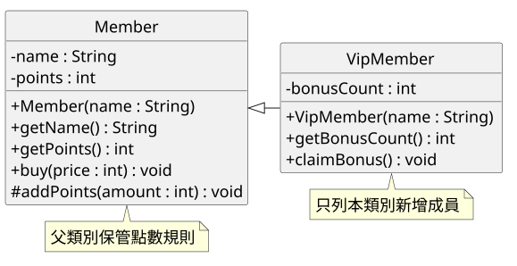
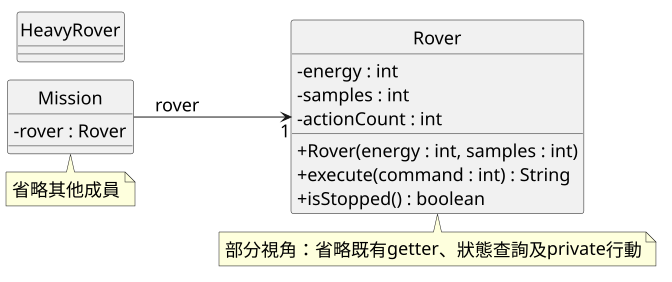
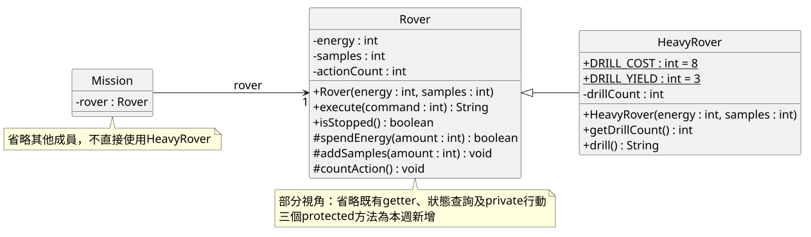
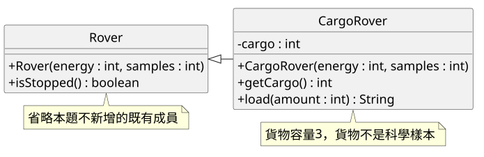

<!-- _class: lead by-claude -->

# 第七週｜繼承與新增能力

## 繼承(I)：類別繼承基礎

AI 協作：**追蹤** AI 生成的子類別，用反例找出「兩份狀態」

物件導向程式設計（與 AI 協作）｜115 學年度第 1 學期
資訊管理學系 二年級｜授課教師：胡碩誠

<!--
講者備註：本份投影片依 week07/codex版本 的講義、作業、範例、圖與教師筆記製作，由 Claude 撰寫；codex 原投影片 week07_slides_codex.md 保留不動，可擇一使用。
本份分兩部分：先只用 examples/ 的會員範例教繼承概念，再用 starter/ 說明作業；teacher/ 與教師參考圖只出現在附錄。
-->

---

<!-- _class: by-claude small -->

## 關於這份投影片

- 每頁右上角 <span class="tag">claude</span>：本投影片由 Anthropic Claude（Claude Code）依 **codex版本教材** 製作，教師審閱後使用。
- 程式、講義題號（A–G）、TODO、圖與預期輸出全部沿用 `week07/codex版本/`；投影片不新增學生作業。
- 左上角標籤是該頁對應的檔案（路徑以 `week07/codex版本/` 為起點）：

| 標籤 | 資料夾 | 在本投影片的角色 |
|---|---|---|
| <span class="tag blue">examples/…</span> | `examples/` | **第一部分：範例教學**——會員範例：extends、super、protected |
| <span class="tag green">starter/…</span> | `starter/` | **第二部分：作業說明**——Rover、HeavyRover 三組 TODO |
| <span class="tag purple">ai/…</span> | `ai/` | 作業 E 段：教師設計的**模擬 AI 錯誤回覆** |
| <span class="tag gray">teacher/…</span> | `teacher/`、教師參考圖 | **附錄：教師用**——完整答案、檢查工具、參考圖 |

<!--
講者備註：本份頁碼與 codex 教師筆記的時間表不同，帶課以講義題號 A–G 為準。
-->

---

<!-- _class: by-claude small -->

<div class="ex"><span>../../week06/codex版本/teacher/Rover.java</span></div>

## 上週留下的問題：重型探測車

> 下週要加「探索一次得 3 份」的 HeavyRover，**複製整個 Rover** 會有什麼維護問題？（第六週 F5）

<div class="cols">
<div>

**A｜先備診斷（講義 A1–A4）**

1. Rover、Mission、MissionStep、MissionLog 各負責什麼？
2. 目前的 energy 和某一步的 energy 為何可能不同？
3. 20 格、0 份跑 `{1,1,2}`，最後 energy/samples/actionCount/outcome？
4. 執行 MemberDemo、MissionLog、HeavyRoverTry：哪個已完整、哪個還沒完成？

</div>
<div class="box">

**本週的切法**

- 第七週：**新增**能力——HeavyRover 多一個 `drill`（耗 8 得 3）
- 探索仍是耗 6 得 2
- 第八週：**改變**探索行為（覆寫）

一次只學一件事：先學「沿用＋新增」，下週才學「改寫」。

</div>
</div>

<!--
講者備註：A 答案：A1 Rover 保存目前狀態與行動規則；Mission 處理腳本、停止與歷史；MissionStep 保存一筆快照；MissionLog 固定腳本與報表。A2 日誌是過去的快照。A3 6/5/3 任務成功。A4 MemberDemo、MissionLog 可跑；HeavyRoverTry 有 不符。
-->

---

<!-- _class: by-claude small -->

## 本週流程：先用範例學繼承，再用到作業上

<div class="cols">
<div class="box blue">

**第一部分｜範例教學** <span class="tag blue">examples/</span>
講義 B–C，約 40 分鐘

- 先看不用繼承的寫法：重複了什麼
- `extends`、is-a、C# 的 `:` 對照
- 建構順序與 `super(...)`
- 繼承的方法 vs. 新增的方法
- private 不被繼承、protected 同套件可用
- UML 繼承箭頭

</div>
<div class="box green">

**第二部分｜作業說明** <span class="tag green">starter/</span>
講義 D–G＋課後

- is-a／has-a 與繼承圖
- **TODO 1**：Rover 的 spendEnergy 與重構
- **TODO 2、3**：HeavyRover 的狀態與 drill
- E 模擬 AI：一個物件裡的兩份狀態
- 獨立遷移：CargoRover 或自訂子類別

</div>
</div>

| 第 1 節 | 第 2 節 | 第 3 節 |
|---|---|---|
| A 診斷 10｜B 會員範例 25｜C 建構與存取 15 | D1 關係與圖 10｜**D2–D4 TODO 30**｜D5 檢查 10 | **E 模擬 AI 25**｜F 修圖檢核 10｜G 保存 15 |

<span class="note">休息另計；這是備課配置，尚未學生試教。獨立遷移課後完成。</span>

<!--
講者備註：實作落後時，B3、E5 文字與四條非核心路線課後補；不要教師代寫 scan 或 drill。
-->

---

<!-- _class: lead by-claude -->
<!-- footer: '物件導向程式設計｜Week 07｜第一部分 範例教學（examples/）' -->

# 第一部分｜範例教學

## 用 `examples/` 的會員範例學會繼承

講義 B–C｜Member、VipMember、MemberDemo

<!--
講者備註：會員範例與主任務沒有程式相依，學生先在小範例看清楚規則，再回到探測車。
-->

---

<!-- _class: by-claude small -->

## 範例檔案與執行入口

| 檔案 | 有 main？ | 角色 |
|---|---|---|
| `examples/Member.java` | — | 一般會員：姓名、點數、`buy`、protected `addPoints` |
| `examples/VipMember.java` | — | `extends Member`；新增 `bonusCount`、`claimBonus` |
| `examples/MemberDemo.java` | ✓ | 建立 Amy、Bob，觀察建構順序與點數 |
| `examples/StandaloneVipMember.java` | — | **對照用**：功能同 VipMember，但**不用繼承** |
| `examples/CompareMemberDemo.java` | ✓ | **對照用**：兩種 VIP 並排執行（教師示範，不必放進 src） |

examples 前三檔與 starter 六檔一起放進 `115_1_Java/YYYY_MM_DD/java-07/src/`（共 9 檔），在 `java-07` 執行：

```powershell
javac -encoding UTF-8 -d out src/*.java
java -cp out MemberDemo
```

<span class="note">JDK 不限定版本，先用 java -version、javac -version 記錄本人版本。不要把 teacher/ 或 ai/ 的檔案放進同一個 src。三個以上檔案合作時，可示範 IntelliJ IDEA 開同一個 java-07。</span>

<!--
講者備註：buy 每滿 10 元得 1 點，非正數不加點；claimBonus 每次加 20 點、bonusCount 加 1，沒有次數或每日限制。
-->

---

<!-- _class: by-claude small -->

<div class="ex"><span>examples/Member.java</span><span>examples/StandaloneVipMember.java</span></div>

## 先看沒有繼承的寫法：要做一個 VIP 會員

<style scoped>pre { font-size: 17px; line-height: 1.28; margin: 0 0 8px; }</style>

已經有一般會員 `Member`。VIP 也有名字、點數、購物得點，**另外**能領取加贈。還不會繼承時，只能這樣寫：

<div class="cols">
<div>

**已有的** `Member`

```java
public class Member {
    private String name;
    private int points;
    public Member(String name) { ... }
    public String getName() { ... }
    public int getPoints() { ... }
    public void buy(int price) {
        if (price > 0) { addPoints(price / 10); }
    }
    protected void addPoints(int amount) {
        if (amount > 0) { points += amount; }
    }
}
```

</div>
<div>

**新寫的** `StandaloneVipMember`

```java
public class StandaloneVipMember {
    private String name;      // 和 Member 一樣
    private int points;       // 和 Member 一樣
    private int bonusCount;   // VIP 才有
    public StandaloneVipMember(String name) { ... }
    public String getName() { ... }    // 一樣
    public int getPoints() { ... }     // 一樣
    public void buy(int price) { ... } // 一樣
    private void addPoints(int amount) { ... } // 一樣
    public int getBonusCount() { ... } // VIP 才有
    public void claimBonus() {         // VIP 才有
        addPoints(20);
        bonusCount++;
    }
}
```

</div>
</div>

**請找找看**：右邊有哪幾行和左邊一模一樣？真正屬於 VIP 的只有哪幾行？

<!--
講者備註：本頁與下一頁的對照範例由 Claude 依教師要求新增（examples/StandaloneVipMember.java），先講「沒有繼承」的寫法，再進入 extends。答案：name、points 兩個欄位與 getName、getPoints、buy、addPoints 四個方法都是從 Member 複製；VIP 自己的只有 bonusCount、getBonusCount、claimBonus（建構子多設定一個 bonusCount）。
-->

---

<!-- _class: by-claude small -->

<div class="ex"><span>examples/StandaloneVipMember.java</span></div>

## 沒有繼承，會遇到什麼問題？

<div class="cols">
<div class="box">

**1. 同樣的程式寫了兩份**
2 個欄位、4 個方法從 `Member` 抄一份；`StandaloneVipMember` 共 57 行，真正屬於 VIP 的只有幾行。

**2. 規則改了，要改兩個地方**
商店把「每 10 元得 1 點」改成「每 5 元得 1 點」：
`Member.buy` 要改，`StandaloneVipMember.buy` **也要改**。
漏改一處，一般會員和 VIP 的點數算法就不一樣。

**3. 程式不知道 VIP 是一種會員**
兩個類別方法名稱都一樣，但對 Java 來說是**毫無關係**的兩個類別。

</div>
<div class="box green">

**我們真正想要的**

> VIP **就是**會員，只是**多了**加贈。

- 名字、點數、購物規則：**直接沿用** `Member` 已經寫好的
- 只寫**多出來的**：`bonusCount`、`claimBonus`
- 規則只放在**一個地方**，改一次就好

→ 這就是 **繼承**：`class VipMember extends Member`

</div>
</div>

<!--
講者備註：先讓學生說出「複製貼上」的麻煩，再引出 extends。第 3 點只點到為止，結尾的對照頁會用編譯實驗證明；用父類別型態的變數操作物件是第 8 週內容。
-->

---

<!-- _class: by-claude small -->

<div class="ex"><span>examples/Member.java</span><span>examples/VipMember.java</span></div>

## B｜`extends`：VIP **是一種**會員

<style scoped>pre { font-size: 17px; line-height: 1.28; margin: 0 0 10px; }</style>

<div class="cols" style="grid-template-columns: 540px 1fr;">
<div>

```java
public class Member {
    private String name;
    private int points;
    public Member(String name) { ... }
    public int getPoints() { return points; }
    public void buy(int price) {
        if (price > 0) { addPoints(price / 10); }
    }
    protected void addPoints(int amount) {
        if (amount > 0) { points += amount; }
    }
}
```

```java
public class VipMember extends Member {
    private int bonusCount;
    public VipMember(String name) { ... }
    public int getBonusCount() { ... }
    public void claimBonus() {
        addPoints(20);
        bonusCount++;
    }
}
```

</div>
<div>

Java：`class VipMember extends Member`
C#：`class VipMember : Member`

- VipMember **沿用** Member 的 `buy`、`getPoints`，不必像 `StandaloneVipMember` 那樣再抄一份。
- VipMember **新增** `bonusCount`、`claimBonus`。
- 繼承的理由要是 **is-a**：「VIP 是一種會員」成立，原有規則也適用。

**不能**只因為兩個類別有重複程式就用繼承。

</div>
</div>

<!--
講者備註：程式碼為節錄，建構子內容在下一頁。
-->

---

<!-- _class: by-claude -->

<div class="ex"><span>examples/MemberDemo.java</span><span>examples/VipMember.java</span></div>

## B1｜先預測：建立 Bob 時印出幾行？先後順序？

<div class="cols">
<div>

```java
Member amy = new Member("Amy");
VipMember bob = new VipMember("Bob");
amy.buy(120);
bob.buy(85);
bob.claimBonus();
```

```java
public VipMember(String name) {
    super(name);          // 先建父類別那部分
    bonusCount = 0;
    System.out.println(
      "VipMember 建構子: " + name);
}
```

</div>
<div>

| 項目 | 預測 |
|---|---|
| 建立 Bob 時的輸出與先後 | ？ |
| Amy 點數 | ？ |
| Bob 點數／加贈次數 | ？ |

<span class="note">Member 的建構子會印 `Member 建構子: 名字`。`price / 10` 是整數除法。</span>

</div>
</div>

<!--
講者備註：講義 B1。先寫預測再執行。答案在下一頁。
-->

---

<!-- _class: by-claude -->

<div class="ex"><span>examples/MemberDemo.java</span></div>

## B1｜答案：先父類別，再子類別

<div class="cols">
<div>

```text
Member 建構子: Amy
Member 建構子: Bob
VipMember 建構子: Bob
Amy 的點數=12
Bob 的點數=28
Bob 的獎勵次數=1
```

</div>
<div>

- 建立 Bob：`super(name)` 先執行 **Member 的建構子**，再回到 VipMember 設定自己的欄位。
- 這**不是** new 了兩個物件：只有**一個** Bob，Member 的建構子負責初始化它的「會員那部分」。
- Amy：120 / 10 = **12**。
- Bob：85 / 10 = 8，加贈 20 → **28**；bonusCount **1**。

</div>
</div>

**建構子不會被繼承**：VipMember 要寫自己的建構子，再用 `super(...)` 呼叫父類別的。

<!--
講者備註：建構子內印訊息只為課堂觀察順序，一般產品不必這樣做。
-->

---

<!-- _class: by-claude small -->

<div class="ex"><span>examples/VipMember.java</span><span>examples/Member.java</span></div>

## B2｜每一行單獨判斷：能不能編譯？

`amy` 是 Member，`bob` 是 VipMember。

| 呼叫 | 能否編譯／理由（先預測） |
|---|---|
| `bob.buy(50);` | ？ |
| `bob.claimBonus();` | ？ |
| `amy.claimBonus();` | ？ |
| `bob.points = 99;` | ？ |

**判斷規則**
- 子類別物件可以用**繼承來的**方法，也可以用**自己新增的**方法。
- 父類別物件**沒有**子類別新增的方法。
- private 欄位只有**宣告它的類別**能直接存取。

<span class="note">要每行單獨測：一行編譯錯誤會遮住其他行的判斷。驗證時用副本。</span>

<!--
講者備註：答案：能（繼承的 buy）；能（新增的方法）；不能（Member 沒有 claimBonus）；不能（points 是 Member 的 private 欄位）。
-->

---

<!-- _class: by-claude small -->

<div class="ex"><span>examples/VipMember.java</span><span>examples/Member.java</span></div>

## B3–B4｜照規格判斷，看清楚點數存在哪裡

<div class="cols">
<div class="box">

**B3｜加贈可以連領兩次嗎？**

全新 Bob：`buy(85)`，再連續 `claimBonus()` 兩次。

→ 8 + 20 + 20 = **48** 點，bonusCount **2**。

規格**沒有**「每天限一次」。不能自己補一條規則，再說程式錯了。

</div>
<div class="box">

**B4｜VipMember 沒寫 buy，為什麼能用？**

- `buy` 由 **Member** 實作，VipMember 繼承它。
- `buy` 更新的是 **Member 宣告的 points**。
- `points` 是 private，**不被** VipMember 繼承；但 Bob 這個物件**仍然有**這份點數，由 Member 的方法負責存取。

</div>
</div>

> **private 成員不被繼承** ≠ **子類別物件沒有那份資料**。
> 資料在物件裡，只是子類別的程式不能直接碰它。

<!--
講者備註：B4 是本週最重要的觀念，第二部分 E 段 AI 的錯就是誤解這一點。
-->

---

<!-- _class: by-claude small -->

## C｜三個隔離實驗：先建副本

在 `java-07` 另建 `experiments` 資料夾，複製三個會員檔，進入該目錄分開編譯；**錯誤副本不要放回 src**。

```powershell
javac -encoding UTF-8 -d out *.java
java -cp out MemberDemo
```

| 實驗 | 在副本這樣改 | 先預測 |
|---|---|---|
| C1 | 把 VipMember 的 `super(name);` 註解掉 | 能編譯嗎？錯誤說什麼？ |
| C2 | 把 claimBonus 的 `addPoints(20);` 換成 `points += 20;` | 能編譯嗎？ |
| C3 | 在 MemberDemo 兩次 buy 之前加 `bob.addPoints(5);` | 能編譯嗎？Bob 最後幾點？ |

每做完一個就**還原**，再做下一個。

<!--
講者備註：C1、C2 只編譯不執行；C3 教師帶測即可。
-->

---

<!-- _class: by-claude small -->

<div class="ex"><span>examples/VipMember.java</span></div>

## C1–C2｜兩個編譯錯誤在說什麼

**C1｜拿掉 `super(name);`**

```text
error: constructor Member in class Member cannot be applied to given types;
  required: String
  found:    no arguments
```

沒寫 super 時，編譯器自動補一個**無參數**的 `super()`；但 Member 只有 `Member(String)`，找不到可用的建構子。
→ 正確做法是寫回 `super(name)`，**不是**為了過編譯隨便替 Member 補一個無參數建構子。

**C2｜在子類別直接寫 `points += 20;`**

```text
error: points has private access in Member
```

物件**有**這份資料，不代表子類別的程式**能直接存取**。
→ 用 Member 提供的方法（`addPoints`），**不要**重複宣告 points，也不要把欄位改成 protected。

<!--
講者備註：錯誤訊息以 JDK 22 實測；其他 JDK 或中文語系訊息可能不同，看原因即可。
-->

---

<!-- _class: by-claude small -->

<div class="ex"><span>examples/MemberDemo.java</span><span>examples/Member.java</span></div>

## C3｜protected 不是「只有子類別能用」

```java
bob.addPoints(5);    // 在 MemberDemo 裡呼叫 protected 方法
bob.buy(85);
bob.claimBonus();
```

→ **能編譯**，Bob 最後 5 + 8 + 20 = **33** 點。MemberDemo 不是子類別，但和 Member 在**同一個套件**。

| 修飾字 | UML | 誰能直接存取（本課程情境） |
|---|---|---|
| `private` | `-` | 只有宣告它的類別 |
| 不寫 | `~` | 同一套件 |
| `protected` | `#` | 同一套件，**加上**子類別（跨套件子類別另有限制） |
| `public` | `+` | 公開給其他類別使用的入口 |

<span class="note">本課程所有類別都在同一預設套件，所以不要把 protected 教成「只有子類別能用」。C# 的 protected 只開放給衍生類別，Java 多了同套件。跨套件限制本週不操作。</span>

<!--
講者備註：測完還原。依 JLS §6.6。
-->

---

<!-- _class: by-claude small -->

<div class="ex"><span>examples/Member.java</span><span>examples/VipMember.java</span></div>

## UML 繼承：三角形指向父類別

<div class="cols-60">
<div>



</div>
<div>

- 空心三角形的實線：`Member <|-- VipMember`，**三角形指向父類別**。
- 子類別框**只列新增的成員**；繼承來的 buy、getPoints 不必再畫一次。
- `#` 是 protected。

**本課程的寫法約定**
- `super(...)` 寫在建構子**第一個敘述**。
- 沒寫 `extends` 的類別，父類別是 `Object`（知道即可）。

</div>
</div>

<span class="note">Java 25 已放寬 super 之前的部分前置敘述；本課程統一寫在第一行，不做「super 不在第一行必定錯」的實驗。</span>

<!--
講者備註：依 Oracle Java 25 flexible constructor bodies 說明。Object、toString 只簡介，覆寫留第八週。
-->

---

<!-- _class: by-claude small -->

## is-a 用繼承，has-a 用欄位

| 問句 | 成立時 | 範例 |
|---|---|---|
| A **是一種** B 嗎？（is-a） | 繼承：`A extends B` | VIP 是一種會員 |
| A **有一個／多個** B 嗎？（has-a） | 欄位：`private B b;` | 第六週：Mission 有一台 Rover、多筆 MissionStep |

**反例**：如果寫 `Mission extends Rover`
→ `mission.execute(1)`、`mission.getEnergy()` 都變成合法——但**任務不是一台車**。
→ 任務「使用」車，應該保留欄位合作（第六週的關聯）。

<span class="note">繼承會把父類別所有公開操作都帶進來；is-a 不成立時，子類別會多出不合理的操作。</span>

<!--
講者備註：這一頁的判斷會在作業 D1 套用到 HeavyRover／Rover、Mission／Rover、Mission／MissionStep。
-->

---

<!-- _class: by-claude small -->

<div class="ex"><span>examples/StandaloneVipMember.java</span><span>examples/VipMember.java</span></div>

## 回頭對照：繼承之後省去了什麼？

<style scoped>pre { font-size: 16px; line-height: 1.25; margin: 0 0 6px; }</style>

<div class="cols">
<div>

**之前：不用繼承** `StandaloneVipMember`（57 行）

```java
public class StandaloneVipMember {
    private String name;   // 從 Member 複製
    private int points;    // 從 Member 複製
    private int bonusCount;
    public StandaloneVipMember(String name) {
        this.name = name;  // 全部自己設定
        points = 0;
        bonusCount = 0;
        ...
    }
    getName、getPoints、buy、addPoints  // 從 Member 複製
    getBonusCount、claimBonus
}
```

</div>
<div>

**之後：使用繼承** `VipMember`（24 行）

```java
public class VipMember extends Member {
    private int bonusCount;
    public VipMember(String name) {
        super(name);     // 名字、點數交給 Member
        bonusCount = 0;
        ...
    }
    public int getBonusCount() { ... }
    public void claimBonus() {
        addPoints(20);   // 用 Member 的方法
        bonusCount++;
    }
}
```

</div>
</div>

**省去了**：2 個欄位、4 個方法，以及建構子裡設定名字和點數的部分。
**先預測**：`CompareMemberDemo` 讓兩位 VIP 都購物 85 元、領一次加贈。建構子訊息各印幾行？點數各是多少？

<!--
講者備註：本頁與後兩頁是開頭「先看沒有繼承的寫法」的收尾：學完 extends 之後，回頭比較兩種寫法。CompareMemberDemo 由 Claude 依教師要求新增，教師示範即可，學生不必放進 src。程式為節錄，完整程式每個成員都有註解標明「從 Member 複製」或「和 VipMember 相同」。
-->

---

<!-- _class: by-claude small -->

<div class="ex"><span>examples/CompareMemberDemo.java</span></div>

## 對照結果：輸出相同，程式不同

<div class="cols" style="grid-template-columns: 0.9fr 1.1fr;">
<div>

```text
--- 繼承版 VipMember ---
Member 建構子: Bob
VipMember 建構子: Bob
點數=28, 獎勵次數=1
--- 不用繼承版 StandaloneVipMember ---
StandaloneVipMember 建構子: Bob
點數=28, 獎勵次數=1
```

點數：85 ÷ 10 = 8（整數除法）＋ 加贈 20 ＝ **28**，兩種寫法相同。

</div>
<div>

| 比較 | 繼承版 | 不用繼承版 |
|---|---|---|
| 名字、點數欄位 | 由 `Member` 保存 | 自己**再宣告一份** |
| `buy`、`addPoints` 等 | 沿用 `Member` 的 | 自己**再寫一份** |
| 建構子訊息 | 2 行：先父、再子 | 1 行：沒有自訂父類別 |
| 是不是一種 `Member` | **是** | **不是** |

</div>
</div>

> 「結果一樣」不代表設計一樣好：**重複的程式碼，就是之後要一起維護的地方。**

<!--
講者備註：輸出為 JDK 22 實測。建構子少一行的原因：StandaloneVipMember 沒有 extends Member，直接父類別是 Object，不會執行 Member 的建構子。
-->

---

<!-- _class: by-claude small -->

<div class="ex"><span>examples/Member.java</span><span>examples/CompareMemberDemo.java</span><span>（在副本操作）</span></div>

## 對照實驗：只改 `Member` 一處，會發生什麼？

<div class="cols">
<div class="box blue">

**實驗 1：修改購物規則**

在副本把 `Member.java` 的

```java
addPoints(price / 10);   // 改成 price / 5
```

重新編譯執行 `CompareMemberDemo`，**先預測**兩位 VIP 的點數。

```text
繼承版      點數=37   ← 跟著新規則
不用繼承版  點數=28   ← 還是舊規則
```

複製的那份**不會自動跟著改**。

</div>
<div class="box">

**實驗 2：是不是一種 `Member`？**

`CompareMemberDemo` 末端有兩行註解，一次取消一行：

```java
Member asMember = inherited;   // 可以編譯
Member notMember = standalone; // 編譯錯誤
```

```text
error: incompatible types:
StandaloneVipMember cannot be
converted to Member
```

方法名稱都一樣也沒用：沒有 `extends`，編譯器就不承認「是一種 Member」。

</div>
</div>

<span class="note">用父類別型態的變數操作子類別物件，第 8 週會正式學；本週只用來說明 is-a。</span>

<!--
講者備註：兩個實驗都在副本操作，結束後還原。實驗 1 的 37 點：85 ÷ 5 = 17，加贈 20。兩個結果與錯誤訊息皆為 JDK 22 實測（錯誤訊息為英文語系輸出）。
-->

---

<!-- _class: by-claude small -->

## 第一部分小結：範例學到的，作業要用在哪裡

| 範例學到的 <span class="tag blue">examples/</span> | 作業要用在 <span class="tag green">starter/</span> |
|---|---|
| `extends` 與 is-a | **D1** HeavyRover extends Rover；Mission 不該 extends Rover |
| `super(...)` 先建父類別那部分 | **D3** HeavyRover 建構子（課後遷移要親自寫） |
| 子類別沿用父類別方法、新增自己的方法 | **D4** HeavyRover 沿用 explore，新增 `drill` |
| private 不被繼承，但物件有那份資料 | **D3、E** 不能重複宣告 energy、samples |
| 子類別透過 protected 方法改父類別狀態 | **D2、D4** `spendEnergy`、`addSamples`、`countAction` |
| UML：三角形指向父類別、`#` protected | **D1、D5** 補 heavy_practice 圖 |

範例只需執行與觀察；**接下來打開 starter，開始作業。**

<!--
講者備註：進入第二部分前，確認 B1 預測與 B2 四題都已填，C 段至少教師示範過 C1、C2。
-->

---

<!-- _class: lead part2 by-claude -->
<!-- footer: '物件導向程式設計｜Week 07｜第二部分 作業說明（starter/）' -->

# 第二部分｜作業說明

## 新增能力與驗證繼承

講義 D–G＋課後獨立遷移｜`starter/Rover.java`、`starter/HeavyRover.java`

<!--
講者備註：從這裡開始看 starter；teacher 的完整答案與參考圖不投影。
-->

---

<!-- _class: by-claude small -->

<div class="ex"><span class="st">starter/Rover.java</span><span class="st">starter/HeavyRover.java</span></div>

## 作業目標與必做項目

| # | 必做 | 講義 |
|---|---|---|
| 1 | **TODO 1**：Rover 的 `spendEnergy`，並用它重構 explore、scan | D2 |
| 2 | **TODO 2**：HeavyRover 自己的 `drillCount`；**TODO 3**：`drill()` | D3、D4 |
| 3 | HeavyRoverTry 十五行全 成功，再提出一個自己的反例 | D4、D5 |
| 4 | 六條舊路線完整輸出不變（課堂先做兩條） | D5 |
| 5 | 模擬 AI 追蹤：預測、不符 證據、兩份狀態圖、最小修正、重測 | E |
| 6 | **課後獨立遷移**：CargoRover 或自訂一個子類別＋測試入口 | 作業二 |
| 7 | 指定成員的繼承圖、DESIGN.md、F 檢核、G 保存 | D1、D5、F、G |

<span class="note">不重複宣告 energy／samples／actionCount、不新增 setter、不覆寫父類別方法、不增加指令 4、不讀命令列或 Scanner。</span>

<!--
講者備註：依 assignment.md。截止與繳交平台由教師公告。評量重點是能說明並驗證，不是行數。
-->

---

<!-- _class: by-claude small -->

<div class="ex"><span class="st">starter/Rover.java</span><span class="st">starter/HeavyRover.java</span><span class="st">starter/HeavyRoverTry.java</span></div>

## 作業檔案與起始狀態

<div class="cols">
<div>

| starter 檔案 | 狀態 |
|---|---|
| `Rover.java` | **TODO 1** |
| `HeavyRover.java` | **TODO 2、3** |
| `HeavyRoverTry.java` | 已提供：15 行檢查 |
| `Mission.java` | 已完成（同第六週） |
| `MissionStep.java` | 已完成（同第六週） |
| `MissionLog.java` | 已完成；任務入口 |

</div>
<div>

起始時 MissionLog 和上週完成版一樣：

```text
最終能源=6, 樣本數=5, 行動次數=3 -> 任務成功
```

但 HeavyRoverTry 出現 不符：

```text
鑽探: 尚未完成 （預期 成功） 不符
鑽探後: 20/0/0/0 （預期 12/3/1/1） 不符
...
```

</div>
</div>

**舊任務成功 ≠ 本週 TODO 完成。** 全部完成後，HeavyRoverTry 十五行都是 顯示「相符」。

<!--
講者備註：starter 只是安全起點。spendEnergy 目前回 false 但還沒接上 explore、scan，所以舊任務仍可執行。
-->

---

<!-- _class: by-claude small -->

<div class="ex"><span class="st">starter/HeavyRover.java</span></div>

## D1｜關係判斷，畫第一條繼承線

<div class="cols">
<div>

| 類別 | is-a 或 has-a？理由 |
|---|---|
| VipMember 與 Member | ？ |
| HeavyRover 與 Rover | ？ |
| Mission 與 Rover | ？ |
| Mission 與 MissionStep | ？ |

`Mission extends Rover` 會讓哪個不合理的呼叫變合法？

</div>
<div>



<span class="note">起始圖：還沒有繼承線與 HeavyRover 成員。</span>

</div>
</div>

打開自己的 `diagrams/heavy_practice.puml`，先補 `Rover <|-- HeavyRover`，**立刻產生 SVG 並開圖**：

```powershell
cmd /c "java -jar C:\ClassTools\plantuml.jar -charset UTF-8 -tsvg -pipe < diagrams\heavy_practice.puml > diagrams\heavy_practice.svg"
```

<!--
講者備註：答案：前兩組 is-a；Mission 有一台 Rover、多筆 MissionStep 是 has-a。jar 位置換成教室實際位置。
-->

---

<!-- _class: by-claude small -->

<div class="ex"><span class="st">starter/Rover.java</span></div>

## D2｜TODO 1：在父類別加一個扣能源的方法

<div class="cols-60">
<div>

```java
// TODO 1：只守住扣能源規則
protected boolean spendEnergy(int amount) {
    return false;   // 佔位
}

// 已提供
protected void addSamples(int amount) {
    if (amount > 0) { samples += amount; }
}
protected void countAction() {
    actionCount++;
}
```

</div>
<div>

**spendEnergy 的規則**

| 情況 | 回傳 | 狀態 |
|---|---|---|
| `amount <= 0` | false | 不變 |
| `amount` 超過目前能源 | false | 不變 |
| 其餘 | true | energy 扣掉 amount |

</div>
</div>

- 三個方法都只負責**一小塊**更新，**不會**自動檢查停止、自動加樣本或計次。
- 它們是 protected：子類別（和同套件）能用它們改 Rover 的 private 狀態，**不必**把欄位公開。

<!--
講者備註：D2-1：回 boolean 讓呼叫端知道是否成功；先檢查再扣，拒絕時才不會已經破壞能源。
-->

---

<!-- _class: by-claude small -->

<div class="ex"><span class="st">starter/Rover.java</span></div>

## D2｜TODO 1：跟著改 explore，自己改 scan

**教師示範 explore**（講義 D2 給出）：

```java
private String explore() {
    if (!spendEnergy(6)) { return "能源不足"; }
    addSamples(2);
    countAction();
    return "成功";
}
```

**你自己改 scan**：成本 2、產量 1，用同樣的三個方法。`charge` 不是扣能源，**不改**。

**D2-2 想一想**：scan 改完，任務輸出和改之前**一模一樣**。這能證明你真的改了嗎？

<span class="note">只把舊寫法留著也會讓測試通過；批改會直接讀 explore、scan 的程式結構。</span>

<!--
講者備註：輸出通過不是所有設計要求的證明；這是結構要求，要讀程式。
-->

---

<!-- _class: by-claude small -->

<div class="ex"><span class="st">starter/HeavyRover.java</span></div>

## D3｜TODO 2：HeavyRover 只加自己的狀態

```java
public class HeavyRover extends Rover {
    public static final int DRILL_COST = 8;     // 已提供
    public static final int DRILL_YIELD = 3;    // 已提供

    // TODO 2：在這裡補欄位（只有鑽探次數）

    public HeavyRover(int energy, int samples) {
        super(energy, samples);                 // 已提供
        // 在這裡初始化自己的欄位
    }

    public int getDrillCount() { return 0; }    // 改成回傳欄位
    public String drill() { return "尚未完成"; }   // TODO 3
}
```

- 新增 `private int drillCount`，建構子設 0，getter 回傳它。
- 說明：`super(energy, samples)` 傳進去的兩個值，**由誰保存**？

**D3-1**：為什麼**不能**另外宣告 `energy`、`samples` 來解決 private 存取問題？

<!--
講者備註：super 由 Rover 保存兩個值，不做自動修正。D3-1：重複宣告會形成兩份欄位，getter 和行動可能讀不同份——E 段 AI 的錯就是這個。
-->

---

<!-- _class: by-claude small -->

<div class="ex"><span class="st">starter/HeavyRover.java</span></div>

## D4｜TODO 3：依規格獨立寫 drill

| 條件 | 回傳 | 狀態 |
|---|---|---|
| `isStopped()` 為 true | `任務已停止` | 全部不變 |
| 未停止，但能源不足 8 | `能源不足` | 全部不變 |
| 未停止且能源足夠 | `成功` | energy −8、samples +3、actionCount +1、drillCount +1 |

- 用提供的 `DRILL_COST`、`DRILL_YIELD`。
- **先**檢查停止，**再**用 `spendEnergy`；只有成功才更新另外三項。
- `drill` 是新的公開入口，**不經過** `execute`——不能以「execute 已經檢查停止」為理由省略。

<span class="note">教師此時不展示完整方法。探索示範、掃描模仿、鑽探獨立。</span>

<!--
講者備註：常見錯誤：只回 成功 卻沒更新；漏 countAction；達標後仍可鑽探（漏停止檢查）；能源不足卻變負數（先扣後檢查）。
-->

---

<!-- _class: by-claude -->

<div class="ex"><span class="st">starter/HeavyRover.java</span></div>

## D4-1｜先追蹤，再執行

全新 `HeavyRover(20, 0)` 依序呼叫：

| 呼叫 | 回傳 | energy | samples | actionCount | drillCount |
|---|---|---:|---:|---:|---:|
| `drill()` | ？ | ？ | ？ | ？ | ？ |
| `execute(1)` | ？ | ？ | ？ | ？ | ？ |
| `drill()` | ？ | ？ | ？ | ？ | ？ |

**D4-2**：自己設計一個能抓到「**只回 成功 卻沒更新狀態**」的案例，寫預期、實際與理由。

<!--
講者備註：答案：drill 成功 12/3/1/1；execute(1) 探索 成功 6/5/2/1（樣本 5 已達標）；drill 任務已停止 6/5/2/1 不變。D4-2 可接受例：從 8/2 鑽探得 0/5/1/1（同時達標與耗盡），或第一次鑽探後查四個 getter。
-->

---

<!-- _class: by-claude small -->

<div class="ex"><span class="st">starter/HeavyRoverTry.java</span><span class="st">starter/MissionLog.java</span></div>

## D5｜行為與圖的檢查

1. 編譯 `src/*.java`，跑 **HeavyRoverTry**：十五行都要 `成功`，貼完整輸出。
2. 跑主任務 `{1,1,2}`、`{3,9,0}` 完整輸出（改 MissionLog 的固定 script、重編譯；做完恢復 `{1,1,2}`）。

<style scoped>table { font-size: 18px; }</style>

| script | energy/samples/actionCount | 任務結果 | 步數／成功／拒絕／略過 | 指令次數[0..3] | 最低能源 | 電量百分比 |
|---|---|---|---|---|---|---|
| **{1,1,2}** | 6/5/3 | 任務成功 | 3/3/0/0 | [0,2,1,0] | 6 | 30.0 |
| **{3,9,0}** | 20/0/0 | 已返回 | 3/0/2/0 | [1,0,0,1] | 20 | 100.0 |
| {0} | 20/0/0 | 已返回 | 1/0/0/0 | [1,0,0,0] | 20 | 100.0 |
| {2,2,2,2,2} | 10/5/5 | 任務成功 | 5/5/0/0 | [0,0,5,0] | 10 | 50.0 |
| {1,1,1,1} | 2/6/3 | 任務成功 | 3/3/0/1 | [0,3,0,0] | 2 | 10.0 |
| {2,1} | 12/3/2 | 任務未完成 | 2/2/0/0 | [0,1,1,0] | 12 | 60.0 |

3. 在 heavy_practice.puml 補 **三個 `#` 方法**、HeavyRover 的常數／欄位／建構子／兩個方法，重新產 SVG，DESIGN.md 引用。**不畫** Mission→HeavyRover（Mission 程式沒用到它）。

<!--
講者備註：粗體兩條課堂先做，其餘四條課後補。不能用命令列參數傳腳本。
-->

---

<!-- _class: by-claude small -->

<div class="ex"><span class="ai">ai/HeavyRover.java</span></div>

## E｜模擬 AI 回覆：可以編譯，但對嗎？

<style scoped>pre { font-size: 17px; line-height: 1.28; }</style>

<div class="cols-60">
<div>

```java
public class HeavyRover extends Rover {
    private int energy;
    private int samples;
    private int drillCount;
    public HeavyRover(int energy, int samples) {
        super(energy, samples);
        this.energy = energy;
        this.samples = samples;
        drillCount = 0;
    }
    public int getDrillCount() { return drillCount; }
    public String drill() {
        if (energy < 8) { return "能源不足"; }
        energy -= 8;
        samples += 3;
        drillCount++;
        return "成功";
    }
}
```

</div>
<div>

**模擬 Prompt**：「請繼承 Rover 新增 drill，耗 8 格得 3 份，並記鑽探次數。」

**模擬 AI 聲稱**：「父類別欄位是 private，所以子類別**重新宣告一份**，再更新它們即可。」

**E1（5 分）先預測**
- 能編譯嗎？
- 第一次 `drill()` 之後，`getEnergy()` 讀到多少？

先 commit 自己的 D 段完成碼與預測，再看結果。

</div>
</div>

<span class="note">教師設計的模擬回覆，不是真實 AI 對話，也不是參考答案。</span>

<!--
講者備註：這份程式有 super，可以編譯；不要和 C1 缺 super 的練習重複。
-->

---

<!-- _class: by-claude small -->

<div class="ex"><span class="ai">ai/HeavyRover.java</span><span class="st">starter/HeavyRoverTry.java</span></div>

## E2｜在 ai-check 實際執行：不符 證據

把**完成的 Rover**、HeavyRoverTry 和這份 **AI HeavyRover** 放進 `java-07/ai-check`，單獨編譯，**不混正式 src**。

<style scoped>pre { font-size: 17px; line-height: 1.25; } ul { margin: 6px 0; }</style>

```text
鑽探: 成功 （預期 成功） 相符
鑽探後: 20/0/0/1 （預期 12/3/1/1） 不符
探索: 成功 （預期 成功） 相符
探索後: 14/2/1/1 （預期 6/5/2/1） 不符
任務完成後鑽探: 成功 （預期 任務已停止） 不符
...
能源耗盡後無法充電: 成功 （預期 任務已停止） 不符
初始能源為零: 能源不足 （預期 任務已停止） 不符
初始已達標: 成功 （預期 任務已停止） 不符
```

- drill 回 **成功**，可是 getter 讀到的能源、樣本、行動數**都沒變**；行動數從沒加過。
- 8 格的車 drill 後，Rover 看到的能源仍是 8，所以 `execute(3)` 充電成功——本來應該已耗盡、回 任務已停止。
- 初始就達標（20/5）還能 drill——**沒有停止檢查**。

**E2**：至少保留 鑽探後、任務完成後鑽探、能源耗盡後無法充電 三行，寫下實際和你的預測差在哪。

<!--
講者備註：輸出為節錄，完整十五行有 9 行 不符。done drill 回 成功：Rover 那份是 14/2 未停止，而 AI 的 drill 檢查子類別那份 energy（12 格）。
-->

---

<!-- _class: by-claude small -->

<div class="ex"><span class="ai">ai/HeavyRover.java</span></div>

## E3–E5｜畫出兩份狀態、最小修正、補強 Prompt

**E3（5 分）**：畫**一個** HeavyRover 物件（不是兩台車）：
- Rover 宣告的 energy／samples 各是多少？
- AI 子類別**另外宣告**的 energy／samples 各是多少？
- `getEnergy()` 讀哪一份？`drill()` 改哪一份？

**E4（5 分）**：先用 `[AI]` commit 保留原文，再做最小修正，用 `[fix]` commit：
1. 刪掉重複的 energy、samples 欄位與建構子裡的設定。
2. drill 改用 `isStopped`、`spendEnergy`、`addSamples`、`countAction`。
3. 重測 HeavyRoverTry 十五行全 成功。

<span class="note">先刪欄位會看到 private 存取錯誤——這是提示你改用 protected 方法，不是要你把欄位改成 protected。</span>

**E5（3 分）**：用 3–5 句補強 Prompt：附父類別的 public／protected 方法、**狀態只有一份**、拒絕時不變、停止優先、不可覆寫、要求附反例。沒用真實 AI 就寫明來源是教師模擬。

<!--
講者備註：重複宣告同名 private 欄位形成兩份狀態，不要稱為覆寫。若進度落後，保留 E4 重測，E5 文字課後補；不加第二份 AI 程式。
-->

---

<!-- _class: by-claude -->

## F｜課末檢核（10 分鐘）

1. private 欄位不被繼承，為什麼 `getEnergy()` 仍讀得到父類別那份狀態？
2. protected 方法會自動保證 drill 遵守停止與計次嗎？
3. 子類別建構子會繼承父類別建構子嗎？
4. 同套件其他類別能呼叫 `spendEnergy` 嗎？課程為何限制它的使用位置？
5. `HeavyRover.execute(1)` 現在得到幾份？下週要改成 3 份，這週新增 drill 算不算達成？

**F2**：檢查自己的圖——三角形指父類別、`#` 與 protected 一致、子類別只列新增成員、Mission 仍關聯 Rover。
**F3**：課後獨立遷移選 CargoRover 或自訂？要加什麼狀態與規則？

<!--
講者備註：1 getter 是 Rover 的程式，存取自己宣告的狀態；2 不會；3 不會；4 能，但繞過行動流程會讓歷史、計次、停止不一致；5 仍 2 份，覆寫是第八週。
-->

---

<!-- _class: by-claude small -->

<div class="ex"><span class="st">starter/Rover.java</span></div>

## 課後獨立遷移（必做，自選題目）

目的：**親自**寫另一個子類別與 `super(...)`，離開 HeavyRover 範例。只做一題。

<div class="cols">
<div>

**路線 A｜CargoRover（規格完整）**
- `extends Rover`；建構子 `CargoRover(int energy, int samples)`，第一行 `super(...)`
- `private int cargo`，初始 0，`getCargo()`
- 容量固定 3；貨物不是科學樣本
- `String load(int amount)`：
  - 已停止 → `任務已停止`
  - `amount <= 0` 或超過剩餘貨位 → `已拒絕`
  - 其餘 → cargo 增加，回 `成功`
- **不耗能源、不加樣本、不加 actionCount**

</div>
<div>

| 呼叫 | 回傳／cargo |
|---|---|
| (20,0) `load(2)`、`load(2)`、`load(1)` | 成功/2、已拒絕/2、成功/3 |
| 接著 `load(0)` | 已拒絕/3 |
| 原有三個 getter | 20、0、0 |
| (0,0) `load(1)` | 任務已停止/0 |
| (20,5) `load(1)` | 任務已停止/0 |

另補一個負數或剛好滿載的案例。

**路線 B｜自訂**：同等規模——一個 private 新欄位、一個新方法、super 建構子、getter；有自己的規則，不只改鑽探的名字和數字。

</div>
</div>

<!--
講者備註：自行新建 CargoRover.java 與測試入口，不複製教師答案。規模以一個子類別與一個 main 為限。
-->

---

<!-- _class: by-claude small -->

## G｜繳交與保存（15 分鐘）

<div class="cols-60">
<div>

```text
115_1_Java/YYYY_MM_DD/
  LAB_REPORT.md     A–G 題號、預測、完整輸出
  AI_USAGE.md       教師模擬與真實 AI 分開填
  java-07/
    README.md       JDK、入口、完成度、執行方式
    DESIGN.md       圖、is-a 理由、遷移規格與測試
    src/            examples 3＋starter 6＋自己的 2
    diagrams/       heavy_practice.puml＋.svg
    ai-check/       完成的 Rover、修正後 AI HeavyRover、
                    HeavyRoverTry
```

</div>
<div>

- [ ] 重編譯，跑 MemberDemo、MissionLog、HeavyRoverTry；script 恢復預設
- [ ] puml 與 SVG 同步
- [ ] `[AI]` 原文與 `[fix]` 修正兩個 commit 可比較
- [ ] push 後在 GitHub 核對程式與 SVG
- [ ] 另一位置 clone，編譯並跑 HeavyRoverTry

**不提交**：`out/`、`.class`、jar、`.idea/`、`*.iml`、C 段 experiments 的錯誤副本、teacher 檔案。

</div>
</div>

<span class="note">src 與 ai-check 分開編譯（兩邊都有 HeavyRover）。網路失敗先另存完整備份；備份不能寫成 push 成功。</span>

<!--
講者備註：最後 15 分鐘不可挪用。
-->

---

<!-- _class: by-claude -->

## 評分與選做

| 項目 | 配分 | 驗收重點 |
|---|---:|---|
| 主線程式 | 35 | 三組 TODO、真正完成局部重構、十五行檢查與舊六路線 |
| 獨立遷移 | 25 | 自己的建構子、狀態與規則；正常／邊界／拒絕／停止案例 |
| AI 追蹤與修正 | 20 | 先預測、證據支持原因、最小修正與重測 |
| UML 與可重現 | 20 | 指定成員、箭頭、本人 SVG、README 與保存狀態 |

**選做**
- 在自訂子類別補一個有實際用途的新方法，明訂並測試規則。
- 設計 Equipment 與一個器材子類別，比較 is-a 與 has-a。
- Object 與 toString 只讀概念，覆寫實作留到第八週。

<!--
講者備註：當週內配分，不改課綱總評。程式行數或多寫題目不直接加分。
-->

---

<!-- _class: lead part3 by-claude -->
<!-- footer: '物件導向程式設計｜Week 07｜附錄 教師用（teacher/）' -->

# 附錄｜教師用

## `teacher/` 與教師參考圖：答案、檢查工具、參考圖

不發給學生 src；參考圖在學生完成自己的圖與 E3 後才揭示

<!--
講者備註：學生完成 D5 圖與 E3 前，不投影本附錄的參考圖。
-->

---

<!-- _class: by-claude small -->

<div class="ex"><span class="tc">teacher/InheritanceCheck.java</span><span class="tc">teacher/MissionLogCheck.java</span><span class="tc">teacher/MissionStateCheck.java</span></div>

## 教師檢查工具

在 `week07/codex版本` 目錄單獨編譯 teacher，與學生 src、ai-check 分開（Check 驗的是 teacher 答案，不代表學生 src 已完成）：

```powershell
javac -encoding UTF-8 -d out-teacher teacher/*.java
java -cp out-teacher HeavyRoverTry       # 十五行全 成功
java -cp out-teacher InheritanceCheck    # 45 項繼承檢查通過
java -cp out-teacher MissionLogCheck     # 15/15 項通過：沿用第五、六週完整輸出
java -cp out-teacher MissionStateCheck   # 16/16 項通過：狀態與停止規則
```

| 學生程式出現 | 優先檢查 |
|---|---|
| drill 回 成功 但 getter 沒變 | 是否另宣告同名狀態 |
| drill 成功但 actionCount 少 1 | 成功路徑是否 countAction |
| 達標後仍能鑽探 | 新入口沒檢查停止；execute 不會替它擋 |
| 舊輸出都對，但 TODO 1 未完成 | 讀 explore、scan 是否真的重構 |

<!--
講者備註：CargoRover 參考在 teacher/transfer，另行編譯（需搭配完成的 Rover）。其他常見錯誤：能源不足卻變負數（扣能源前要拒絕）；duplicate class（src、ai-check、teacher 混在一起編譯）。
-->

---

<!-- _class: by-claude small -->

<div class="ex"><span class="tc">teacher/Rover.java</span><span class="tc">teacher/HeavyRover.java</span></div>

## 參考圖：D5 繼承圖（heavy_reference）

<div class="center">



</div>

- Rover：三個 private 欄位、三個本週新增的 `#` 方法；其他成員省略並註明。
- HeavyRover：兩個 static 常數、`drillCount`、建構子、`getDrillCount`、`drill`。
- 三角形指向 Rover；Mission 仍只關聯 Rover，**不畫** Mission→HeavyRover。

<!--
講者備註：圖是部分視角，未畫的方法不能推論不存在。
-->

---

<!-- _class: by-claude small -->

<div class="ex"><span class="ai">ai/HeavyRover.java</span></div>

## 參考答案 E3：為什麼回傳「成功」，狀態卻沒變？

<style scoped>pre { font-size: 17px; line-height: 1.28; margin: 0 0 8px; } table { font-size: 19px; }</style>

<div class="cols" style="grid-template-columns: 0.85fr 1.15fr;">
<div>

模擬 AI 在子類別**又宣告了一次**同名欄位：

```java
public class HeavyRover extends Rover {
    private int energy;    // Rover 已經有一個 energy
    private int samples;   // Rover 已經有一個 samples
    ...
    public String drill() {
        if (energy < 8) { ... }
        energy -= 8;       // 改的是子類別這一份
        samples += 3;
        ...
```

結果：**一個** HeavyRover 物件裡，有**兩份** energy 和 samples——Rover 宣告的一份、子類別宣告的一份。

</div>
<div>

用 `HeavyRoverTry` 的第一台車 `new HeavyRover(20, 0)` 追蹤：

| 動作 | Rover 那份<br>能源/樣本/行動 | 子類別那份<br>能源/樣本 | getter 讀到 |
|---|---|---|---|
| 建立 | 20 / 0 / 0 | 20 / 0 | 20 / 0 / 0 |
| `drill()` | 20 / 0 / 0（沒動） | **12 / 3** | **20 / 0 / 0** |
| `execute(1)` 探索 | **14 / 2 / 1** | 12 / 3（沒動） | 14 / 2 / 1 |

- `getEnergy()`、`getSamples()` 寫在 Rover 裡，**只讀 Rover 那份**；`drill` 改的卻是子類別那份。
- 所以 drill 回傳「成功」，`HeavyRoverTry` 卻印 `鑽探後: 20/0/0/1 … 不符`。

> 子類別宣告同名欄位，**不會取代**父類別的欄位，而是**多出一份**。不是兩台車，也不是覆寫。

</div>
</div>

<!--
講者備註：學生 E3 完成後才揭示。表格數字為 JDK 22 實測（teacher/Rover.java＋ai/HeavyRover.java＋starter/HeavyRoverTry.java 一起編譯）。行動次數只在 Rover 那份：AI 版 drill 沒有呼叫 countAction，所以鑽探不會增加行動次數。
-->

---

<!-- _class: by-claude small -->

<div class="ex"><span class="ai">ai/HeavyRover.java</span><span class="tc">teacher/HeavyRover.java</span></div>

## 參考答案 E4：最小修正，改回只用一份狀態

<style scoped>pre { font-size: 17px; line-height: 1.28; margin: 0 0 8px; }</style>

<div class="cols" style="grid-template-columns: 1fr 1fr;">
<div>

**AI 版另外兩個問題**（`HeavyRoverTry` 也抓到）：

- **沒有檢查停止**：任務已達標或耗盡時再 drill，仍回「成功」（預期「任務已停止」）。
- **沒有計行動次數**：drill 成功後行動次數不變。

**最小修正四件事**

1. 刪掉子類別重複宣告的 `energy`、`samples`
2. 刪掉建構子裡 `this.energy = …`、`this.samples = …`
3. drill 改用 Rover 提供的 protected 方法：`spendEnergy`、`addSamples`、`countAction`
4. drill 最前面補上停止檢查

</div>
<div>

**修正後的 drill**（即 `teacher/HeavyRover.java`）

```java
public String drill() {
    // 1. 已停止就拒絕，什麼都不改
    if (isStopped()) { return "任務已停止"; }
    // 2. 扣能源；不夠就拒絕，什麼都不改
    if (!spendEnergy(DRILL_COST)) {
        return "能源不足";
    }
    // 3. 成功才更新：樣本、行動次數、鑽探次數
    addSamples(DRILL_YIELD);
    countAction();
    drillCount++;
    return "成功";
}
```

這三個 protected 方法改的都是 **Rover 那一份**狀態，getter 讀的也是同一份，所以不會再「各改各的」。

改完重編譯，`HeavyRoverTry` 十五行都應顯示「相符」。

</div>
</div>

<!--
講者備註：修正前後的程式不要放在同一個資料夾一起編譯（同名類別）。講義 E4 要求先用 [AI] commit 保存模擬原文，修正重測後再用 [fix] commit。實測：修正前 HeavyRoverTry 有 不符 行（含「任務完成後鑽探: 成功」），修正後十五行全部「相符」。E5 參考 Prompt 見教師筆記 E 段。
-->

---

<!-- _class: by-claude small -->

<div class="ex"><span class="tc">teacher/transfer/CargoRover.java</span><span class="tc">teacher/transfer/CargoRoverTry.java</span></div>

## 參考：獨立遷移 CargoRover

<div class="cols">
<div>



```java
public String load(int amount) {
    if (isStopped()) { return "任務已停止"; }
    if (amount <= 0 || amount > 3 - cargo) {
        return "已拒絕";
    }
    cargo += amount;
    return "成功";
}
```

</div>
<div>

CargoRoverTry 預期：

```text
成功/2
已拒絕/2
成功/3
已拒絕/3
20/0/0
任務已停止/0
任務已停止/0
```

- 用 `amount > 3 - cargo`，避免先相加再判斷。
- 自訂題依學生自己寫的規格驗收；只換鑽探數字不算完整遷移。

</div>
</div>

<!--
講者備註：cargo 不是 samples，load 不耗能源、不加 actionCount。
-->

---

<!-- _class: by-claude small -->

## 交給第八週與來源

**第八週建議入口**：先診斷三組 TODO、super、一份／兩份狀態、protected 同套件。再問「多了鑽探，探索為何仍得 2 份？」→ 在 Rover 設 `protected int exploreYield()` 回 2，HeavyRover 用 `@Override` 回 3，引入覆寫與動態方法選擇（建議，本週沒有此 API）。

**來源**
- Deitel, *Java How to Program, Early Objects* 11e（本專案 EPUB）：§9.2–9.5、§9.7；§9.6 Class Object 補充。
- [JLS §8.2](https://docs.oracle.com/javase/specs/jls/se25/html/jls-8.html#jls-8.2)：private 成員與建構子不被繼承；[JLS §6.6](https://docs.oracle.com/javase/specs/jls/se25/html/jls-6.html#jls-6.6)：protected 存取。
- [Oracle Java 25 Flexible Constructor Bodies](https://docs.oracle.com/en/java/javase/25/language/flexible-constructor-bodies.html)；[PlantUML 發行頁](https://github.com/plantuml/plantuml/releases)。
- 本週 README、student_lab、assignment、DESIGN_template、teacher_notes、handoff、verification。

<span class="note">情境、活動與圖為 codex 教材自編；本投影片由 Claude 依該教材編排。JDK 不鎖定版本，實際測試範圍見 verification.md。</span>

<!--
講者備註：第八週方案依 handoff.md，實際設計由下一週重新界定。
-->
