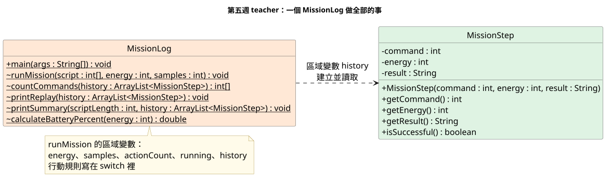
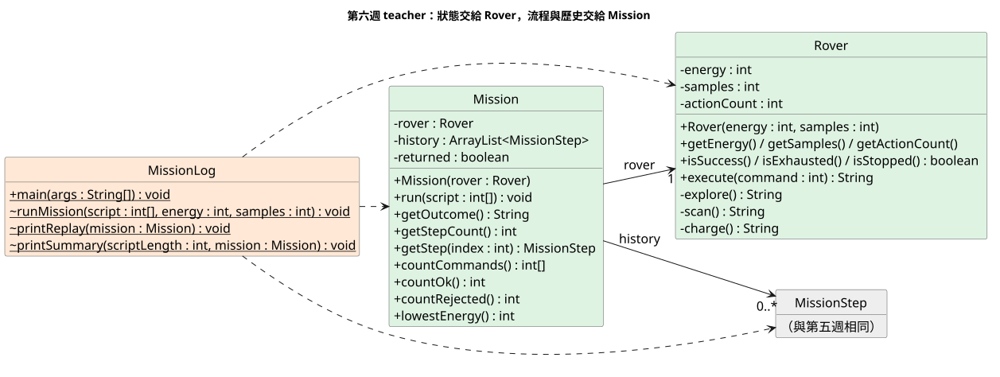
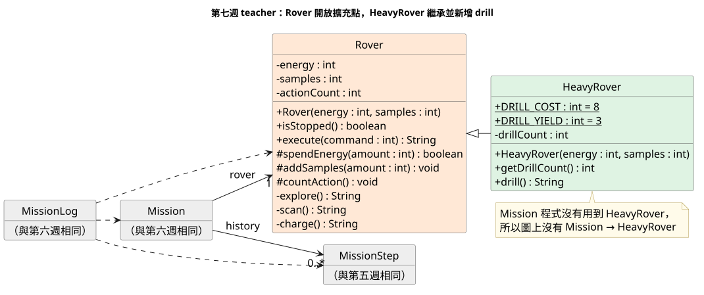

<!-- _class: lead by-claude -->

# 同一個任務，三種寫法

## 第五 → 六 → 七週 teacher 類別的演進

**行為一字不改**，責任一步一步搬家

物件導向程式設計（與 AI 協作）｜115 學年度第 1 學期
資訊管理學系 二年級｜授課教師：胡碩誠

<!--
講者備註：本份投影片由 Claude 依 week05、week06、week07 的 codex版本 teacher/ 程式整理，不新增學生作業。內容都是教師完整答案，建議在學生完成當週作業後使用。
-->

---

<!-- _class: by-claude small -->

## 這份投影片怎麼用

- 每頁右上角 <span class="tag" style="background:#c96442;color:#fff;border:none">claude</span>：由 Anthropic Claude（Claude Code）依 codex版本第 5–7 週 `teacher/` 程式整理，教師審閱後使用。
- 內容是**教師完整答案**的對照，請在學生**交完當週作業後**才投影。
- 左上角灰色標籤是對應的 teacher 檔案，路徑以 `week0N/codex版本/` 為起點。

| 建議時機 | 用哪幾頁 | 約幾分鐘 |
|---|---|---|
| 第七週 A 段診斷（複習第五、六週） | 第 3–9 頁 | 10 |
| 第七週 F 段或課後回顧 | 第 10–13 頁 | 5–10 |
| 第八週開場：從三週演進引出覆寫 | 全部，重點第 14–18 頁 | 15 |

**圖例**：類別圖中 <span class="tag new">綠色</span> 本週新增、<span class="tag chg">橘色</span> 本週修改、<span class="tag same">灰色</span> 與前一週相同。

<!--
講者備註：類別圖為本份新繪（diagrams/evolution_w05_claude、w06、w07），只列演進相關成員；與各週教材的參考圖可並用。
-->

---

<!-- _class: by-claude -->

## 一張表看三週：哪些檔案出現、哪些沒動

| teacher 類別 | 第五週 | 第六週 | 第七週 |
|---|---|---|---|
| `MissionStep` | <span class="tag new">新增</span> | <span class="tag same">相同</span> | <span class="tag same">相同</span> |
| `MissionLog` | <span class="tag chg">做全部的事</span> | <span class="tag chg">只剩入口與輸出</span> | <span class="tag same">相同</span> |
| `Mission` | — | <span class="tag new">新增</span> | <span class="tag same">相同</span> |
| `Rover` | — | <span class="tag new">新增</span> | <span class="tag chg">加 protected 擴充點</span> |
| `HeavyRover` | — | — | <span class="tag new">新增（extends Rover）</span> |

**三週都沒改的**：`MissionStep`、`MissionLogCheck`、`FixedScriptMission`——檔案逐位元組相同。

> 每週只改一件事，用**同一份完整輸出檢查**證明行為沒變。

<!--
講者備註：「相同」以檔案雜湊比對確認。第六、七週的 Mission 與 MissionLog 也逐位元組相同。
-->

---

<!-- _class: by-claude small -->

<div class="ex"><span>week05/codex版本/teacher/MissionLog.java</span><span>week05/codex版本/teacher/MissionStep.java</span></div>

## 第五週：一個 MissionLog 做全部的事

<div class="center">



</div>

- **新增** MissionStep：把同一步的指令、行動後能源、結果放在**一個物件**（取代第四週三條平行清單）。
- MissionLog 全是 static 方法；**目前狀態**是 `runMission` 的區域變數，**行動規則**寫在 switch 裡。

<!--
講者備註：第五週的主題是類別、建構子、封裝；只把「歷史」建模成物件，刻意不同時搬動目前狀態。
-->

---

<!-- _class: by-claude small -->

<div class="ex"><span>week05/codex版本/teacher/MissionLog.java</span></div>

## 第五週的 runMission：狀態、規則、流程、歷史全擠在一起

<style scoped>pre { font-size: 17px; line-height: 1.28; }</style>

```java
static void runMission(int[] script, int energy, int samples) {
    int actionCount = 0;                                   // 目前狀態（區域變數）
    boolean running = true;
    ArrayList<MissionStep> history = new ArrayList<>();    // 歷史
    for (int i = 0; i < script.length && running && energy > 0 && samples < 5; i++) {  // 停止條件
        int command = script[i];
        String result;
        switch (command) {
            case 1:                                        // 行動規則
                if (energy >= 6) { energy -= 6; samples += 2; actionCount++; result = "OK"; }
                else { result = "NOT_ENOUGH_ENERGY"; }
                break;
            ...                                            // 掃描、充電、返回、無效
        }
        history.add(new MissionStep(command, energy, result));
    }
    ...                                                    // 判斷結果、印報表
}
```

**問題**：要改「探索耗 6 得 2」、要改停止條件、要改報表格式——都得改**同一個方法**。

<!--
講者備註：程式為節錄（138 行的檔案），case 1 原本分行寫，這裡壓成一行方便看。
-->

---

<!-- _class: by-claude small -->

<div class="ex"><span>week06/codex版本/teacher/Mission.java</span><span>week06/codex版本/teacher/Rover.java</span><span>week06/codex版本/teacher/MissionLog.java</span></div>

## 第六週：狀態交給 Rover，流程與歷史交給 Mission

<div class="center">



</div>

Mission **有一台** Rover、**有多筆** MissionStep（實線、關聯）；MissionLog 只在 `runMission` 裡建立、使用三者（虛線、相依）。

<!--
講者備註：第六週的主題是 UML 類別圖與責任分配。Rover 是本週提供的銜接類別；學生寫 Mission 的 run、countOk、lowestEnergy。
-->

---

<!-- _class: by-claude small -->

## 第五 → 六週：每一項責任搬到哪裡

| 責任 | 第五週的位置 | 第六週的位置 |
|---|---|---|
| 目前能源／樣本／行動數 | `runMission` 的區域變數 | **Rover** 的 private 欄位 |
| 探索／掃描／充電規則 | `runMission` 的 switch | **Rover** 的 private 方法，經 `execute` 進入 |
| 成功或耗盡就停 | for 條件 `energy > 0 && samples < 5` | **Rover** `isStopped()`；**Mission** 每輪先檢查 |
| 指令 0 返回 | `running = false` | **Mission** `returned = true` 並 break |
| 歷史紀錄 | 區域變數 `history` | **Mission** 的欄位 `history` |
| 計數、最低能源 | MissionLog 的 static 方法 | **Mission** 的實例方法 |
| 結果 SUCCESS／EXHAUSTED／… | `runMission` 的 if-else | **Mission** `getOutcome()` |
| 報表格式 | MissionLog | MissionLog（**不變**） |

MissionLog 從 138 行縮成 42 行；新增 Mission 74 行、Rover 57 行。程式總量沒有變少，但**每段規則有了固定的家**。

<!--
講者備註：「資料在誰身上，規則就放誰身上」是起點；跨物件的流程（何時停止讀腳本）由看得到腳本的 Mission 協調。
-->

---

<!-- _class: by-claude small -->

<div class="ex"><span>week06/codex版本/teacher/MissionLog.java</span><span>week06/codex版本/teacher/Mission.java</span></div>

## 第六週：同一個迴圈，現在讀起來像句子

<div class="cols">
<div>

**MissionLog.runMission**（入口）

```java
Rover rover = new Rover(energy, samples);
Mission mission = new Mission(rover);
mission.run(script);
printReplay(mission);
...   // 其餘輸出
```

</div>
<div>

**Mission.run**（流程）

```java
for (int i = 0; i < script.length; i++) {
    if (rover.isStopped()) { break; }
    int command = script[i];
    String result = rover.execute(command);
    history.add(new MissionStep(
        command, rover.getEnergy(), result));
    if (command == 0) {
        returned = true;
        break;
    }
}
```

</div>
</div>

- 扣電、加樣本的細節不見了，只剩 `rover.execute(command)`——**怎麼做**藏在 Rover 裡。
- 建快照的時機沒變：**行動之後**才 `new MissionStep`（第五週 TODO 4 學過）。

<!--
講者備註：runMission 的簽名與第五週相同，所以 FixedScriptMission 與 MissionLogCheck 不用改。
-->

---

<!-- _class: by-claude small -->

<div class="ex"><span>week06/codex版本/teacher/Rover.java</span><span>week06/codex版本/teacher/Mission.java</span></div>

## 第六週：停止檢查為什麼有兩個？

<div class="cols">
<div class="box">

**Rover 守住「狀態」**

```java
public String execute(int command) {
    if (isStopped()) { return "STOPPED"; }
    ...
}
```

成功或耗盡後，誰來呼叫都**不再改變**能源與樣本。

</div>
<div class="box">

**Mission 守住「流程」**

```java
if (rover.isStopped()) { break; }
```

停止後**不再讀腳本、不再記錄**。

</div>
</div>

**反例**（第六週 D3）：拿掉 Mission 的檢查，跑 `{1,1,1,1}`——最終仍是 SUCCESS，但日誌**多出一筆 STOPPED**，ignored 從 1 變 0。

> 兩個檢查看起來重複，其實各守不同的規則。

<!--
講者備註：錯誤副本輸出：step 4: command=1, result=STOPPED, energy=2；steps=4, ok=3, rejected=1, ignored=0。本次在暫存副本實測過。
-->

---

<!-- _class: by-claude small -->

<div class="ex"><span>week07/codex版本/teacher/Rover.java</span><span>week07/codex版本/teacher/HeavyRover.java</span></div>

## 第七週：Rover 開放擴充點，HeavyRover 繼承

<div class="center">



</div>

**Rover**（修改）：新增三個 `#` protected 方法（圖上省略 getter 與 isSuccess、isExhausted）。**HeavyRover**（新增）：`extends Rover`，只加 `drillCount` 與 `drill()`。Mission、MissionLog、MissionStep **完全沒改**。

<!--
講者備註：第七週主題是繼承基礎。學生寫 Rover 的 spendEnergy 與 explore／scan 重構、HeavyRover 的 drillCount 與 drill。
-->

---

<!-- _class: by-claude small -->

<div class="ex"><span>week06/codex版本/teacher/Rover.java</span><span>week07/codex版本/teacher/Rover.java</span></div>

## 第六 → 七週：Rover 的 explore 怎麼變

<div class="cols">
<div>

**第六週**：直接改 private 欄位

```java
private String explore() {
    if (energy < 6) {
        return "NOT_ENOUGH_ENERGY";
    }
    energy -= 6;
    samples += 2;
    actionCount++;
    return "OK";
}
```

</div>
<div>

**第七週**：透過三個 protected 方法

```java
private String explore() {
    if (!spendEnergy(6)) {
        return "NOT_ENOUGH_ENERGY";
    }
    addSamples(2);
    countAction();
    return "OK";
}
```

</div>
</div>

- **行為完全相同**（輸出不變），改的是**結構**：扣能源規則現在只寫在 `spendEnergy` 一個地方。
- 子類別碰不到 private 的 energy，但能呼叫 protected 的 `spendEnergy`——**這就是給 HeavyRover 用的入口**。
- scan 同樣改寫；charge 不是扣能源，維持原樣。

<!--
講者備註：這是「重構」：不改外部行為，只改內部結構。輸出相同無法證明有重構，批改需讀程式。
-->

---

<!-- _class: by-claude small -->

<div class="ex"><span>week07/codex版本/teacher/HeavyRover.java</span></div>

## 第七週：HeavyRover 只寫自己多出來的部分

<style scoped>pre { font-size: 17px; line-height: 1.28; }</style>

<div class="cols" style="grid-template-columns: 520px 1fr;">
<div>

```java
public class HeavyRover extends Rover {
    public static final int DRILL_COST = 8;
    public static final int DRILL_YIELD = 3;
    private int drillCount;

    public HeavyRover(int energy, int samples) {
        super(energy, samples);
        drillCount = 0;
    }
    public int getDrillCount() { return drillCount; }

    public String drill() {
        if (isStopped()) { return "STOPPED"; }
        if (!spendEnergy(DRILL_COST)) {
            return "NOT_ENOUGH_ENERGY";
        }
        addSamples(DRILL_YIELD);
        countAction();
        drillCount++;
        return "OK";
    }
}
```

</div>
<div>

**從 Rover 沿用**
- energy、samples、actionCount 那份狀態（物件裡有；private 不被繼承）
- `execute`、`isStopped`、getter
- 探索耗 6 **得 2**

**HeavyRover 新增**
- `drillCount`
- `drill()`：鑽探耗 8 得 3

整個檔案 26 行。如果第六週直接**複製整個 Rover** 改名，扣能源、停止、計次的規則就會有**兩份**，改一份漏一份。

</div>
</div>

<!--
講者備註：第七週 E 段模擬 AI 重新宣告 energy、samples，正是把「一份狀態」變成「兩份」的反例。
-->

---

<!-- _class: by-claude small -->

## 三週的 teacher 工具：怎麼證明「行為沒變」

| 工具 | 第五週 | 第六週 | 第七週 | 驗證什麼 |
|---|---|---|---|---|
| `MissionLogCheck` | 15/15 | **同一個檔案** 15/15 | **同一個檔案** 15/15 | 15 組完整輸出（沿用第四週期望） |
| `FixedScriptMission` | ✓ | 同一個檔案 | 同一個檔案 | 指定初始能源與樣本，看終態 |
| `MissionStepCheck` | 8 項 | — | — | MissionStep 欄位、獨立、內容比較 |
| `MissionStateCheck` | — | 16 項 | 同一個檔案 | Rover 停止、Mission 流程與快照 |
| `RoverDemo` | — | ✓ | — | Rover 銜接示範 |
| `HeavyRoverTry`／`InheritanceCheck` | — | — | 15 行／45 項 | drill、一份狀態、protected |

**關鍵**：MissionLogCheck 從第五週到第七週**一個字都沒改**，卻在三種不同的類別設計下都通過。
→ 它只看 `MissionLog.runMission` 的**完整輸出**，不管內部怎麼分工——這就是**回歸檢查**。

<!--
講者備註：SampleCase：第五週在 teacher 當 F1 參考答案，第六週移到 examples 當 AI 設計活動的範例（檔案相同）。第七週另有 transfer/CargoRover 作獨立遷移參考。
本次以第五、六、七週各自的 teacher 目錄重新編譯並執行，MissionLogCheck 皆 15/15、MissionStepCheck 8/8、MissionStateCheck 16/16、InheritanceCheck 45 項通過。
-->

---

<!-- _class: by-claude small -->

## 一條規則的旅程：「探索耗 6 格、得 2 份」

| 週次 | 這條規則寫在哪 | 想改成「得 3 份」要動哪裡 |
|---|---|---|
| 第五週 | `MissionLog.runMission` 的 switch `case 1` | 改 runMission——和流程、報表擠在同一個方法 |
| 第六週 | `Rover` 的 private `explore()` | 只改 Rover；但**所有探測車都變 3 份** |
| 第七週 | `Rover.explore()` 透過 `spendEnergy(6)`、`addSamples(2)` | HeavyRover 繼承的 explore 仍是 2 份；**新增 drill 不能改變 explore** |
| 第八週（預告） | Rover 留一個可覆寫的方法 | HeavyRover **覆寫**它回 3，其他車仍是 2 |

> 每一週都讓「要改的地方」更集中；第八週才能做到「**只改一種車**」。

<!--
講者備註：第八週方案依第七週 handoff 建議：在 Rover 設 protected int exploreYield() 回 2，HeavyRover 以 @Override 回 3；本週程式沒有這個 API。
-->

---

<!-- _class: by-claude -->

<div class="ex"><span>week07/codex版本/teacher/Mission.java</span><span>week07/codex版本/teacher/HeavyRover.java</span></div>

## 想一想：把 HeavyRover 交給 Mission 會怎樣？

```java
HeavyRover h = new HeavyRover(20, 0);
Mission m = new Mission(h);          // Mission 的建構子收 Rover
m.run(new int[] {1, 1, 2});
```

1. 這行 `new Mission(h)` 能編譯嗎？為什麼？
2. 跑完 `{1,1,2}`，energy、samples、drillCount 各是多少？
3. 腳本能不能讓它鑽探？

<!--
講者備註：本次實測：能編譯（HeavyRover is-a Rover）；結果 SUCCESS、energy=6、samples=5、drillCount=0，和一般 Rover 完全相同。Mission 只呼叫 execute，腳本沒有鑽探指令；探索仍得 2 份。這正是第八週要解決的問題：Mission 不改，但讓不同的車有不同的探索行為（覆寫與多型）。答案在下一頁。
-->

---

<!-- _class: by-claude -->

## 答案：能放進去，但行為和一般 Rover 一樣

```text
SUCCESS energy=6 samples=5 drillCount=0
```

- **能編譯**：HeavyRover **是一種** Rover，可以放在要 Rover 的地方。
- 結果和一般 Rover **完全相同**：Mission 只會呼叫 `execute`，腳本沒有鑽探指令，探索仍得 2 份。
- 第七週的 drill 是**新增**的能力，Mission 不知道它存在。

**第八週的問題**：Mission **一行都不改**，能不能讓 HeavyRover 的探索自動變成 3 份？
→ 覆寫（override）與多型。

<!--
講者備註：不急著覆寫 execute 加指令 4，以免指令計數、輸入與報表契約同時變動（依第七週 handoff）。
-->

---

<!-- _class: by-claude small -->

## 課堂討論題

1. 第五週的 `runMission` 有 138 行。第六週把它拆開後，**總行數反而變多**，為什麼仍然比較好？
2. MissionLogCheck 三週都沒改。如果第六週的 run 不小心把**行動前**的能源存進 MissionStep，它會抓到嗎？會在哪一組案例失敗？
3. 第六週 Rover 與 Mission 都檢查停止。只留 Rover 的檢查，會發生什麼事？
4. 第七週為什麼不直接把 Rover 的 `energy` 改成 protected，讓 HeavyRover 自己扣？
5. 第七週 Mission、MissionLog、MissionStep 都沒改。這說明第六週的責任分配做對了什麼？

<!--
講者備註：參考答案：
1. 規則有固定位置，改一項只需動一個類別；每個類別小、可單獨測試（MissionStateCheck）。
2. 會：本次在暫存副本實測，15 組中 8 組失敗、7 組通過；通過的都是能源沒變或沒有紀錄的案例（如 {0}、{3,9,0}、空腳本）。例如 {1,1,2} 回放第一步印 energy=20 而非 14，mixed success 失敗。也說明只測 {3,9,0} 抓不到這個錯。
3. 日誌會多出 STOPPED（第六週 D3 反例）；狀態不變但流程規則被破壞。
4. protected 欄位讓子類別能繞過規則直接改值（例如扣成負數）；保留 private、只開放守規則的方法，規則仍只有一份。
5. Mission 只依賴 Rover 的公開入口（execute、isStopped、getter），不依賴 Rover 內部怎麼實作，所以 Rover 內部重構與新增子類別都不影響它。
-->

---

<!-- _class: by-claude small -->

## 小結：三週的設計原則

| 週次 | 新學的工具 | 解決的問題 | 留給下一週的問題 |
|---|---|---|---|
| 第五週 | 類別、建構子、private、物件清單 | 三條清單靠索引對齊，容易錯配 | 狀態、規則、流程還擠在一個方法 |
| 第六週 | UML、關聯／相依、責任分配 | 每段規則有固定的家 | 重型探測車要複製整個 Rover？ |
| 第七週 | extends、super、protected | 沿用 Rover，只寫多出來的 drill | 探索要得 3 份，新增方法做不到 |
| 第八週 | 覆寫、多型（預告） | 只改一種車的探索行為 | — |

**貫穿三週的做法**
- 每週只改一件事，**對外輸出不變**。
- 用同一份完整輸出檢查（MissionLogCheck）證明沒改壞。
- 新增功能前，先問「這條規則**屬於誰**」。

<span class="note">本頁「第八週」欄是依第七週 handoff 的建議，實際內容由第八週教材決定。</span>

<!--
講者備註：程式依據：week05、week06、week07 codex版本 teacher/。類別圖為本份新繪，原始碼在 week07/codex版本/diagrams/evolution_w0N_claude.puml。
-->
