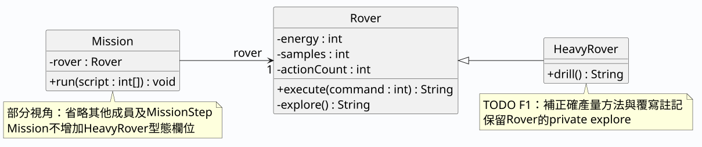

# 第八週設計紀錄（學生範本）

姓名／學號：待填。初稿由Codex生成的空白範本；以下由學生填本人結果。

## 1. 覆寫位置與責任

- private explore保留哪些步驟：待填。
- exploreYield只負責什麼：待填。
- Mission為何仍只需要Rover型態：待填。
- 用一句話區分參考型態與實際物件類別：待填。

## 2. 本人類別圖

原稿：diagrams/dispatch_practice.puml。產圖方式／操作者：待填。
本人開圖後看見的修改、是否重疊、如何修正：待填。
部分視角只列指定成員；不必抄完整API。

## 3. 獨立遷移

選SurveyRover或自訂類別：待填。
一句情境及固定探索產量（1..4）：待填。
建構子、覆寫方法與main入口：待填。
使用Rover型態參考的程式位置：待填。

| 案例／初始狀態與操作 | 預期回傳／三狀態／outcome | 本人實際 | 能抓到何種錯誤 |
|---|---|---|---|
| 正常與一般車比較 | 待填 | 待填 | 待填 |
| 能源邊界 | 待填 | 待填 | 待填 |
| 拒絕 | 待填 | 待填 | 待填 |
| 已停止 | 待填 | 待填 | 待填 |
| 本人反例 | 待填 | 待填 | 待填 |

直接execute沒有Mission outcome時標不適用；若使用Mission則需記錄outcome及已讀步數。實際輸出可引用LAB_REPORT或本檔折疊區塊，不重複抄寫。
