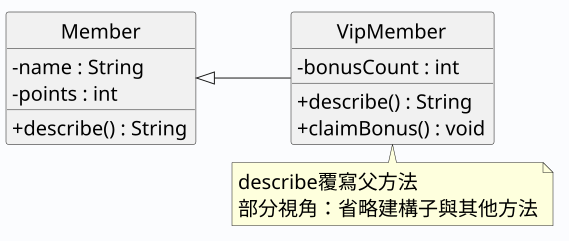
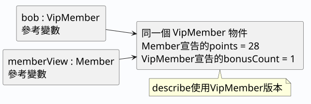
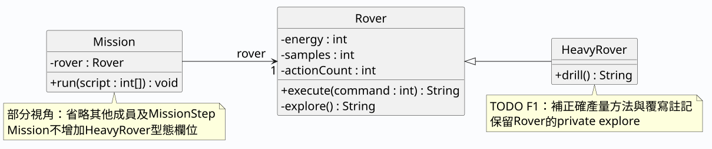

<!-- _class: lead -->
# 第八週｜覆寫與多型基礎

繼承 II：覆寫、多型基礎與設計實務

Code Review：審查 AI 生成的繼承程式碼

資訊管理學系二年級　胡碩誠

<!-- 教師提示：承接第七週Codex；先做A診斷，不先跑會員範例。 -->

---
## 重型探測車的探索產量

第七週新增了鑽探，但探索仍得到 2 份樣本。

本週需求：一般車探索得 2 份，重型車得 3 份。

- 探索成本同為 6 格
- 停止、拒絕與行動計次沿用原規則
- 同一份 Mission 程式接受不同車種

<!-- 教師提示：動機來自第七週handoff。不要把增加drill與覆寫既有探索行為混為一談。 -->

---
## 本週學習成果

- 以相同簽名覆寫實例方法，使用 @Override
- 分開判斷能否編譯與執行哪個方法
- 用 Rover 型態參考操作不同車種
- 用 super 呼叫沿用父類別，只在子類別加入新指令
- 完成四組 TODO、AI 反例與一個課後遷移

第九週學抽象類別與介面，第十週深入過載與多型。

<!-- 教師提示：不教轉型、instanceof、JUnit或泛型設計。super方法呼叫在B3體驗，D6的execute覆寫再用一次。 -->

---
## 課堂配置

| 第1節50分 | 第2節50分 | 第3節50分 |
|---|---|---|
| A 診斷10 | D1 規格8 | E AI審查25 |
| B 會員20 | D2–D4 實作24 | F 圖與檢核10 |
| C 參考與實驗20 | D5 比較10、D6 鑽探8 | G 保存15 |

課後延續成果，獨立完成一種小型探測車。

<!-- 教師提示：備課估計未試教。落後先減文字整理，不刪修正重測與保存時間。 -->

---
## 學生檔案與入口

| 活動 | 開啟位置 | main入口 |
|---|---|---|
| B、C | src 的會員三檔 | MemberDemo |
| D 一般車 | src | MissionLog |
| D 狀態檢查 | src | HeavyRoverTry |
| D 兩車任務 | src | CompareMissions |
| D6 指令4 | src | DrillMissionTry |
| E 模擬AI | ai-check 三檔 | HeavyRoverTry |

src 先放 examples 三檔與 starter 八檔，共十一檔。

<!-- 教師提示：A。日期目錄見README；VS Code確認位置後，IDEA開同一java-08、src來源根、已裝SDK。teacher與ai不混進src。 -->

---
## A｜前週診斷

1. 第七週 HeavyRover.execute(1) 得幾份？
2. drill 為何沒有改變探索行為？
3. Rover、Mission、MissionStep 各負責什麼？
4. 子類別如何使用父類別的 private 狀態？

記錄本人 java／javac 版本與操作目錄。

<!-- 教師提示：A答案見teacher_notes。探索2份；drill是另一個入口。不得直接操作private狀態，使用既有方法；protected也允許同套件存取。 -->

---
## B｜會員覆寫的程式位置



父、子類別都有 describe()，參數與回傳型態相同。

<!-- 教師提示：B1先讀src/Member、VipMember、MemberDemo再預測。圖是部分視角，省略建構子及其他方法。 -->

---
## describe 的父、子版本

```java
// Member
public String describe() {
    return "會員 " + name + " / 點數=" + points;
}
// VipMember
@Override
public String describe() {
    return "VIP 會員 " + getName() + " / 點數=" + getPoints()
            + " / 獎勵次數=" + bonusCount;
}
```

子類別透過 getter 讀父類別狀態。

<!-- 教師提示：只觀察會員的完整範例；重型車覆寫要留給學生獨立實作。語意來源JLS 8.4.8.1，連結見teacher_notes。 -->

---
## B1｜先預測三次說明

```java
Member memberView = bob;
System.out.println(amy.describe());
System.out.println(bob.describe());
System.out.println(memberView.describe());
```

Amy 購買 120，Bob 購買 80，再領取一次 20 點加贈。

先填 LAB_REPORT 的 B1，再執行 MemberDemo。

<!-- 教師提示：預期Amy12、Bob28；後兩行都VIP 會員 Bob / 點數=28 / 獎勵次數=1。建構訊息三行也要預測。不要先執行或展開examples答案。 -->

---
## @Override 的檢查

```java
@Override
public String describeVIP() { ... }
```

在副本把子方法名稱改成 describeVIP，保留註記。

- 先預測能否編譯，再驗證與還原
- 記一段有意義的診斷
- 比較方法名稱、參數與父類別宣告

<!-- 教師提示：B2。這是刻意錯誤片段，不直接貼正式src。Override API與JLS來源見teacher_notes。註記檢查覆寫，並不製造動態選擇。 -->

---
## B3｜沿用父類別的說明

小修改需求：VIP 的說明沿用父方法，再加上「 / VIP」。

```java
super.describe()
```

在 experiments 副本完成回傳運算式，父方法保持原樣。

先寫三行預期，再編譯、執行與解釋結果。

<!-- 教師提示：super指定呼叫父方法，仍是同一個物件。完整return不立即顯示。參考輸出最後兩行會員 Bob / 點數=28 / VIP；原src維持原範例。 -->

---
## C｜參考型態與實際物件



memberView = bob 新增一個參考，不另建立會員物件。

<!-- 教師提示：C1、C3。請學生指出兩個變數宣告型態、物件實際類別與同一份points。JLS 15.12.4.4來源見teacher_notes。 -->

---
## C2｜編譯判斷

```java
Member memberView = bob;
memberView.describe();
memberView.claimBonus();
```

每次只測一行，先填能否編譯及理由。

再把 VIP 方法改為 describe(int amount)，保留 @Override。

<!-- 教師提示：describe能編譯，實際執行VIP；claimBonus不能，Member沒有宣告。參數錯誤不能覆寫無參數方法，保留註記會報錯；完整過載留第十週。 -->

---
## 編譯與執行的判斷

| 階段 | 本週的問題 | 本例依據 |
|---|---|---|
| 編譯時 | 這個型態有此方法嗎？ | 參考的宣告型態與方法宣告 |
| 執行時 | 可覆寫實例方法用哪個版本？ | 實際物件類別 |

父類別參考指向子類別物件，仍然保留子類別行為。

<!-- 教師提示：只針對本週可覆寫實例方法，避免把private、static、欄位一律套此表。學生先用會員例解釋再回探測車。 -->

---
## D1｜探索流程的責任

| 位置 | 責任 |
|---|---|
| execute | 檢查停止、分派指令 |
| private explore | 判斷能源、扣除、加樣本與計次 |
| protected exploreYield | 回傳探索產量 |
| Mission | 決定何時讀下一筆、保存日誌 |

D2–D4 先在產量位置加入可覆寫方法，D6 再覆寫指令入口。

<!-- 教師提示：D1畫呼叫追蹤。父方法private不是覆寫入口，透過新的protected產量方法引入。只回傳正固定小整數，任意惡意覆寫不在契約內。 -->

---
## 探索的呼叫追蹤

```text
Mission.run
  Rover.execute(1)
    Rover.private explore()
      spendEnergy(6)
      exploreYield()   ← 本週觀察這個呼叫
      addSamples(...)
      countAction()
```

能源不足時先回傳，不呼叫產量方法。

<!-- 教師提示：這是教學追蹤示意，不是可編譯Java。HeavyRover物件的exploreYield選子版本，即使呼叫位置在父類別private explore內。 -->

---
## D2｜TODO 1：產量來源

開 src/Rover.java，找到 private explore。

已提供 exploreYield()，一般車回傳 2。

- 自行讓增加樣本的步驟使用產量方法
- 保留拒絕、扣能源、行動計次及回傳值
- 重編譯後，先執行 MissionLog

一般車預設仍應為 6 格、5 份、3 次行動。

<!-- 教師提示：檢查點1。不要直接貼完整explore答案。此時HeavyRoverTry仍有兩行不符，下一步完成子覆寫。一般車舊完整輸出回歸。 -->

---
## D3｜TODO 2：重型車覆寫

開 src/HeavyRover.java，自行寫出產量方法。

| 項目 | 規格 |
|---|---|
| 名稱／參數／回傳型態 | 與父類別相同 |
| 可見性 | protected |
| 註記 | @Override |
| 行為 | 只回傳 3 |

完成後 HeavyRoverTry 十五行應全 成功。

<!-- 教師提示：檢查點2。父類別三狀態private，學生不重複宣告；不在產量方法扣能源或加行動。不立即展示完整方法答案。 -->

---
## 鑽探後再探索的狀態

全新 HeavyRover(20,0)，先預測再執行。

| 操作 | 回傳 | energy | samples | actions | drills |
|---|---|---|---|---|---|
| drill() | 待預測 |  |  |  |  |
| execute(1) | 待預測 |  |  |  |  |
| drill() | 待預測 |  |  |  |  |

用本週新規格核對，保留第七週原教材。

<!-- 教師提示：D3答案依序成功 12/3/1/1，成功 6/6/2/1，任務已停止 6/6/2/1。第七週兩處6/5要改成本週6/6，不能為印成功任意改expect。 -->

---
## D4｜TODO 3：兩組任務

開 src/CompareMissions.java，完成 main。

1. 用 Rover 型態參考分別接一般車與重型車
2. 每台車各交給新的 Mission
3. 分別 run 同一份固定 script 一次
4. 呼叫已提供的 show 顯示兩段報表

show 只印報表，建立任務由你完成。

<!-- 教師提示：TODO3核心是學生自己new車、new Mission、run。不要用老師helper代做。固定script={1,1,2}，標籤「一般探測車」「重型探測車」；同一腳本唯讀，共享腳本不共享車。 -->

---
## D5｜兩車任務的結果

初始 20 格、0 份，腳本 {1,1,2}。

| 項目 | 一般車 | 重型車 |
|---|---|---|
| energy / samples / actions | 6 / 5 / 3 | 8 / 6 / 2 |
| outcome | 任務成功 | 任務成功 |
| 已讀／忽略指令 | 3 / 0 | 2 / 1 |
| battery | 30.0 | 40.0 |

重型車為何沒有掃描日誌？

<!-- 教師提示：先完成D4預測才顯示本頁。重型車兩次探索已達標，下輪先查停止，不讀掃描。講義貼兩段完整報表，完整答案見teacher_notes D5。 -->

---
## 能源邊界與成功優先

先預測，再用本人測試入口驗證。

| 初始／腳本 | 一般車 | 重型車 |
|---|---|---|
| 6格2份，{1,3} | 待預測 | 待預測 |
| 5格0份，{1} | 待預測 | 待預測 |

每次新車、新任務，記回傳、三個狀態與 outcome。

再設計一個本人反例，說明能抓到何種錯誤。

<!-- 教師提示：D5依序0/4/1 能源耗盡、0/5/1 任務成功，各1步。第二列皆拒絕且5/0/0 任務未完成；拒絕是行動回傳，任務未完成是任務結果。 -->

---
## D6｜TODO 4：任務也能鑽探

腳本寫 4 時，兩種車目前都回「無效指令」。

不改 Mission 與 Rover，只在 src/HeavyRover.java 覆寫 execute：

| 指令 | 交給誰 |
|---|---|
| 4 | 已提供的 drill() |
| 其他 | 父類別原本的 execute（super 呼叫） |

宣告與父類別相同、保留 public、加 @Override；不重抄 switch。

<!-- 教師提示：TODO4。先讓學生寫，再顯示答案：if (command == 4) { return drill(); } return super.execute(command);。改protected會得到weaker access。drill自行檢查停止。countCommands仍只統計0..3，不另加格子。 -->

---
## D6｜同一份 Mission，兩種結果

兩台新車各跑腳本 {4,1}，先預測再執行 DrillMissionTry。

| 項目 | 一般車 20/0 | 重型車 20/0 |
|---|---|---|
| 第 1 步結果 | 待預測 | 待預測 |
| energy / samples / actions | 待預測 | 待預測 |
| outcome、已讀步數 | 待預測 | 待預測 |

若改在 Mission 判斷「是不是重型車」，再加一種車要改哪裡？

<!-- 教師提示：答案一般車無效指令、14/2/1、任務未完成2步；重型車成功、6/6/2（鑽探1次）、任務成功2步。DrillMissionTry十四行全相符，未完成時四行不符。Mission只認得Rover，執行時選到HeavyRover.execute。在Mission判斷車種要改Mission且需轉型，留第十週閱讀。 -->

---
## E｜AI 審查的需求與來源

教師設計的模擬回覆，非真實 AI 對話。

需求：重型車探索得 3 份，成本、停止與計次不變。

模擬 AI 聲稱：
> 在子類別加入同名 private explore，execute 就會自動用它。

先預測能否編譯，再看 ai/HeavyRover.java。

<!-- 教師提示：E1先commit本人D成果與預測。不能因AI說可用就跳過編譯。先讀完整模擬原文，下一頁只聚焦錯誤片段。 -->

---
## 模擬 AI 的探索方法

```java
// HeavyRover 中刻意有錯的設計
private String explore() {
    if (!spendEnergy(6)) { return "能源不足"; }
    addSamples(3);
    countAction();
    return "成功";
}
```

父類別 execute 呼叫的 private explore 在哪裡？

<!-- 教師提示：E1–E2。這段本身能編譯，但不是父private方法的覆寫；父流程仍呼叫繼承的產量2。ai-check用本人完成Rover、Try與AI Heavy三檔，不混src。 -->

---
## E2｜反例與精確狀態

在 ai-check 獨立編譯，執行 HeavyRoverTry。

- 保留 after explore、done unchanged 的 不符
- 比較樣本數，說明實際呼叫路徑
- 思考只看 任務成功 是否能抓到錯誤

先記預期與實際，再解釋原因。

<!-- 教師提示：錯誤6/5/2/1，預期6/6/2/1；兩處不符。5和6都達標，最後drill仍任務已停止，所以只看成功不夠。teacher_notes有完整對照。 -->

---
## E3｜@Override 編譯診斷

在副本的 private explore 前加 @Override。

```java
@Override
private String explore() { ... }
```

只編譯，記錄診斷後還原。

本週需要可覆寫的實例方法，產量方法維持非 static。

<!-- 教師提示：預定錯誤實驗；private父方法不被覆寫，加註記編譯失敗。static只文字判讀，不擴張完整隱藏規則。官方JLS 8.4.8與Override API見teacher_notes。 -->

---
## E4｜最小修正與重測

- 移除無效的子類別 private explore
- 在正確的產量方法完成覆寫
- 保留父類別流程與既有 drill
- 用相同 HeavyRoverTry 重測十五行

以 [AI] 與 [fix] 保存原文及修正，填 AI_USAGE。

<!-- 教師提示：先讓學生修正再顯示teacher答案，不能整份覆蓋。E5補Prompt要求精確方法宣告、禁止改狀態與兩個案例；來源明寫教師模擬。 -->

---
## F1｜類別圖補寫



補兩個產量方法、重型車的 execute 與覆寫註記，再產本人 SVG。

<!-- 教師提示：原稿dispatch_practice.puml，保留private explore與Mission的Rover欄位。只補指定成員，不抄完整圖；立即預覽，DESIGN嵌入本人SVG。 -->

---
## F2｜課末檢核

1. 父類別參考會改變物件的實際類別嗎？
2. private explore 保留，為何產量仍可改變？
3. 產量方法為何不再增加行動次數？
4. 覆寫 execute 卻不用 super、整份抄 switch，會有什麼問題？

用今天的實際結果支持解釋。

<!-- 教師提示：F2第2個同物件問題可口頭追問；完整五題見講義。不要把跑過工具當成已理解；至少點一位學生追蹤呼叫位置。 -->

---
## 課後一個小型遷移

SurveyRover：精細採樣，每次探索只取 1 份，成本仍 6。

也可自訂車種，固定探索產量 1..4。

- 親自寫建構子、覆寫與測試入口
- 以 Rover 參考交入新建立的 Mission
- 正常、邊界、拒絕、停止與本人反例
- 與一般車比較，說明結果符合哪條規格

<!-- 教師提示：assignment二選一。預估45–60分鐘另加未完成項目，非試教工時。不能只換名稱數字無驗證，不加第二套大型系統。 -->

---
## G｜保存與重新取回

- 編譯並執行五個主入口，缺項標待補
- puml 與 SVG 同步，README 記入口與 JDK
- GitHub Desktop 檢查差異、commit、push
- 在 GitHub 核對，再於新位置 clone
- 重新編譯 CompareMissions，ai-check 分開驗證

排除 out、class、IDE 暫存與憑證。

<!-- 教師提示：保留15分鐘。網路失敗先備份並記原因，不能把備份寫成push成功；保留原repo，不在日期資料夾再建repo。GUI與真實遠端由學生本人做。 -->

---
## 第九週的問題

本週共同的 Rover 仍可直接建立物件。

如果共同類別不適合直接建立，該如何表達？

如果不同家族要遵守共同操作規格，該如何設計？

下週：抽象類別與介面。

<!-- 教師提示：handoff入口。先診斷本週覆寫與參考型態，不假設課後遷移已完成。教科書對照9.4、10.2–10.3與部分10.6，實際目錄核對見teacher_notes。 -->
