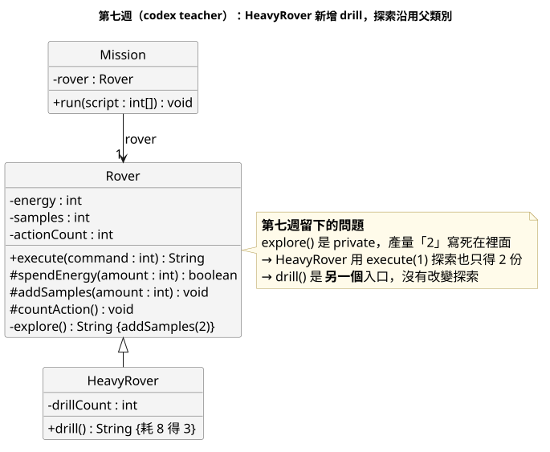
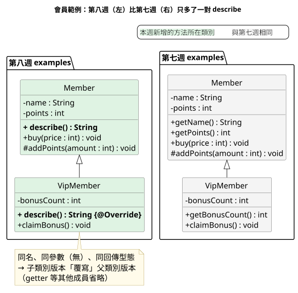
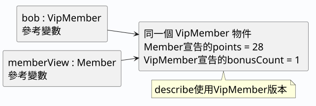
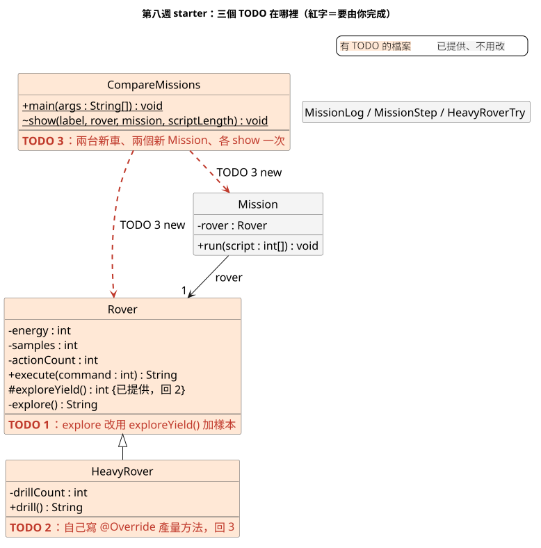
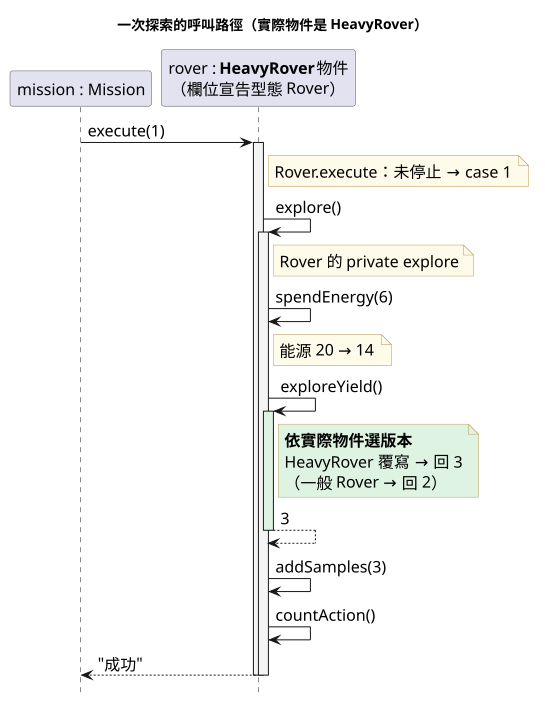
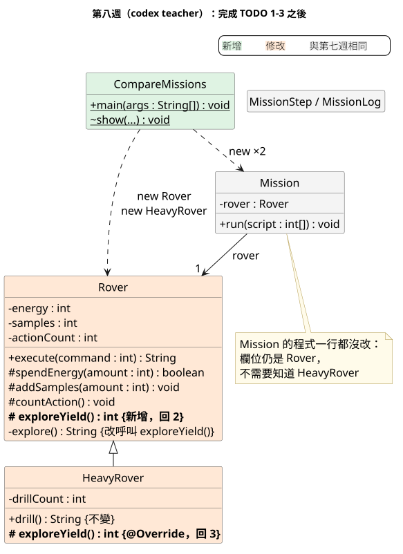
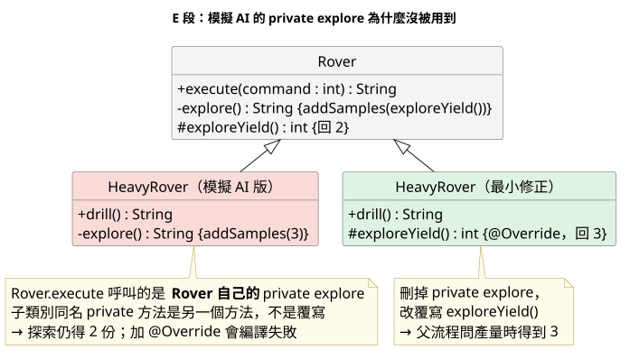
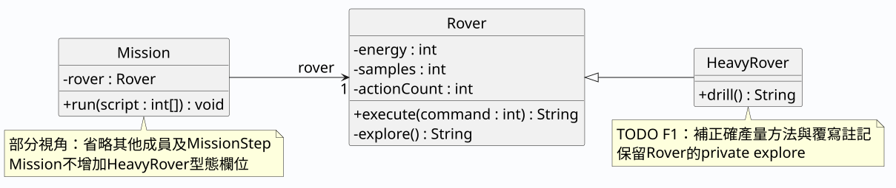
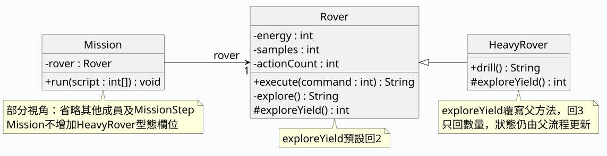

<!-- _class: lead by-claude -->

# 第八週｜覆寫與多型基礎

## 繼承（II）：覆寫、多型基礎與設計實務

Code Review：**審查 AI 生成的繼承程式碼**

物件導向程式設計（與 AI 協作）｜115 學年度第 1 學期
資訊管理學系 二年級｜授課教師：胡碩誠

<!--
講者備註：本份投影片依 week08/codex版本 的 README、student_lab、assignment、examples、starter、ai、teacher、teacher_notes、handoff 製作，由 Claude 撰寫；codex 原投影片 week08_slides_codex.md 保留不動，可擇一使用。
本份分兩部分：先只用 examples/ 的會員三檔教「覆寫、@Override、父類別參考」，再用 starter/ 說明探測車主線 TODO 1–3、AI 審查與作業；teacher/ 的答案只出現在附錄。
-->

---

<!-- _class: by-claude small -->

## 關於這份投影片

- 每頁右上角 <span class="tag">claude</span>：本投影片由 Anthropic Claude（Claude Code）依 **codex版本教材** 製作，教師審閱後使用。
- 程式、講義題號（A–G）、TODO、預期輸出全部沿用 `week08/codex版本/`；投影片**不新增**學生作業。
- 左上角標籤是該頁對應的檔案（路徑以 `week08/codex版本/` 為起點）：

| 標籤 | 資料夾 | 在本投影片的角色 |
|---|---|---|
| <span class="tag blue">examples/…</span> | `examples/` | **第一部分：範例教學**——會員覆寫、@Override、父類別參考（講義 B、C） |
| <span class="tag green">starter/…</span> | `starter/` | **第二部分：作業說明**——探測車產量覆寫、TODO 1–3（講義 A、D–G） |
| <span class="tag purple">ai/…</span> | `ai/` | E 段：教師撰寫的**模擬 AI 回覆**（子類別 private explore） |
| <span class="tag brown">diagrams/…</span> | `diagrams/` | 類別圖；`*_claude` 為本份新繪，用來說明**與第七週的演進** |
| <span class="tag gray">teacher/…</span> | `teacher/` | **附錄：教師用**——完整答案、檢查工具、遷移參考 |

<!--
講者備註：講義的活動順序是 A→B→C→D→E→F→G。本份依教師要求先把 examples（講義 B、C）完整講完，再進 starter；A 段診斷放在第二部分開頭。帶課以講義題號為準。
-->

---

<!-- _class: by-claude small -->

<div class="ex"><span class="dg">diagrams/evolution_w07_claude.svg</span><span>../../week07/codex版本/teacher/</span></div>

## 上週留下的問題：重型車探索只得 2 份

<div class="cols" style="grid-template-columns: 640px 1fr; gap: 22px;">
<div>



</div>
<div>

第七週：`HeavyRover extends Rover`，**新增** `drill()`（耗 8 得 3）。

但用同一套指令探索時：

```java
HeavyRover h = new HeavyRover(20, 0);
h.execute(1);   // 只得 2 份
```

- `explore()` 是 `Rover` 的 **private** 方法，產量 2 **寫死**在裡面。
- `drill()` 是**另一個入口**，沒有改變探索。

**本週需求**：一般車探索得 **2** 份、重型車得 **3** 份；成本都是 6，**同一份 `Mission`** 不改。

</div>
</div>

<!--
講者備註：動機來自第七週 handoff。不要把「增加 drill」和「改變既有探索行為」混為一談：新增方法 ≠ 改變父類別流程。本週答案：讓子類別「覆寫」一個父流程會呼叫的方法。
-->

---

<!-- _class: by-claude small -->

## 本週流程：先用範例學覆寫，再用到探測車作業

| 部分 | 內容 | 講義 | 時間（備課估計） |
|---|---|---|---|
| **第一部分** <span class="tag blue">examples/</span> | 會員 `describe()` 覆寫、`@Override`、`super.describe()` | B | 第 1 節 20 分 |
| | 父類別參考 vs 實際物件、編譯判斷 vs 執行選擇 | C | 第 1 節 20 分 |
| **第二部分** <span class="tag green">starter/</span> | A 前週診斷（放在第 1 節開頭 10 分） | A | 第 1 節 |
| | D 探測車產量覆寫：TODO 1–3、兩車比較 | D | 第 2 節 |
| | E 模擬 AI 審查 → F 補 UML → G 保存 | E、F、G | 第 3 節 |
| 課後 | 自己寫一種探測車（`SurveyRover` 或自訂） | 作業 | 45–60 分（暫估） |

**每段都先寫預測，再編譯、執行、比對。** 編譯失敗時，先讀第一個與自己改動有關的錯誤。

<!--
講者備註：150 分鐘為未試教的備課估計。落後時先把 B3 文字整理、C3 圖美化、E5 文字延到課後；保留本人反例實測、E4 修正重測與最後 15 分鐘保存（codex 教師筆記）。
-->

---

<!-- _class: by-claude small -->

## 本週學習目標與範圍

<div class="cols">
<div class="box green">

**本週要會**

1. 用**相同簽名**覆寫實例方法，加 `@Override`
2. 分開判斷「**能不能編譯**」與「**執行哪個版本**」
3. 用 `Rover` 型態參考操作不同車種，`Mission` 不必知道車種
4. 讀模擬 AI 程式：找出「能編譯但不對」的反例，最小修正後重測

</div>
<div class="box">

**本週不做**（之後的週次）

- 抽象類別、介面 → **第九週**
- 方法過載（overloading）完整規則 → **第十週**
- 向下轉型、`instanceof`、泛型、JUnit → 不列本週必做
- `super.describe()` 只做**短體驗**，不要求熟練設計

</div>
</div>

<!--
講者備註：C2 會出現一次 describe(int) 的參數錯誤，只用來辨識「這不是覆寫」，過載完整規則留第十週。
-->

---

<!-- _class: by-claude small -->

## 從 C# 對照：Java 不用寫 `virtual`

| 概念 | C#（一年級學過） | Java（本週） |
|---|---|---|
| 父類別方法允許被覆寫 | 要寫 `public virtual string Describe()` | **預設就可以**：`public String describe()` |
| 子類別覆寫 | `public override string Describe()` | `@Override public String describe()` |
| `override` 是… | **關鍵字**，必寫 | `@Override` 是**註記**，建議必寫，讓編譯器檢查 |
| 呼叫父類別版本 | `base.Describe()` | `super.describe()` |
| 父類別參考指向子類別物件 | `Member m = bob;` | `Member m = bob;`（相同） |

- Java 的非 `private`、非 `static`、非 `final` 實例方法，**都可以被覆寫**。
- 少寫 `@Override` 仍能編譯，但**打錯名字時不會有人提醒你**——本週會實際看到。

<!--
講者備註：codex 教師筆記提醒：只點出 Java 本例沒有 virtual 關鍵字，不要暗示 C# WinForms 經驗已包含完整 virtual／override 知識。WinForms 中常見的 protected override void OnPaint 可以當作「看過」的例子。
-->

---

<!-- _class: lead by-claude -->
<!-- footer: '物件導向程式設計｜Week 08｜第一部分 範例教學（examples/）' -->

# 第一部分｜範例教學

## 用 `examples/` 的會員三檔學會覆寫

`Member.java`、`VipMember.java`、`MemberDemo.java`｜講義 B、C

<!--
講者備註：會員範例與探測車完全獨立（沒有程式相依），先在小範例看清楚規則，再回到探測車。這三檔與第七週同名，本週多了一對 describe()。
-->

---

<!-- _class: by-claude small -->

<div class="ex"><span>examples/Member.java</span><span>examples/VipMember.java</span><span>examples/MemberDemo.java</span></div>

## 範例檔案與執行入口

| 檔案 | 有 main？ | 角色 | 和第七週比 |
|---|---|---|---|
| `Member.java` | — | 一般會員：名字、點數、購物得點 | **新增** `describe()` |
| `VipMember.java` | — | `extends Member`，多了領獎勵點數 | **新增** `@Override describe()` |
| `MemberDemo.java` | ✓ | 建立 Amy、Bob，印三次說明 | 改成呼叫 `describe()`，多了 `memberView` |

複製三檔到 `java-08/src/`，在 `java-08` 執行：

```powershell
javac -encoding UTF-8 -d out src/*.java
java -cp out MemberDemo
```

<span class="note">**先填講義 B1 預測，才執行。** 三檔已構成多檔合作：先用 VS Code 確認檔案位置，再示範 IntelliJ IDEA 開同一個 java-08（已安裝 JDK、src 為來源根、MemberDemo 入口）；不建 Maven／Gradle。</span>

<!--
講者備註：JDK 不限定版本，學生用 java -version、javac -version 記錄自己的版本。examples 三檔與 starter 七檔可以放同一個 src 一起編譯（沒有同名類別），共十檔。
-->

---

<!-- _class: by-claude small -->

<div class="ex"><span class="dg">diagrams/member_evolution_claude.svg</span></div>

## UML 演進：會員範例只多了一對 `describe()`

<div class="cols" style="grid-template-columns: 560px 1fr; gap: 22px;">
<div>



</div>
<div>

**讀圖**

- 右邊是第七週：VIP 只**新增**能力（`claimBonus`）。
- 左邊是第八週：父、子類別**都有** `describe()`，名稱、參數、回傳型態**完全相同**。
- 子類別的同名方法「蓋過」父類別版本 → **覆寫（override）**。

**和第七週的差別**

| 第七週 | 第八週 |
|---|---|
| 子類別**加**新方法 | 子類別**換掉**父類別某個方法的做法 |

</div>
</div>

<!--
講者備註：本圖為 Claude 依 week07 與 week08 codex examples 的 diff 新繪（diagrams/member_evolution_claude.puml）。getter 等成員在第八週那一側省略以免太擠。codex 原圖 member_reference.svg 也可使用。
-->

---

<!-- _class: by-claude small -->

<div class="ex"><span>examples/Member.java</span><span>examples/VipMember.java</span></div>

## `describe()` 的父、子兩個版本

<div class="cols">
<div>

```java
// Member.java
public String describe() {
    return "會員 " + name + " / 點數=" + points;
}
```

```java
// VipMember.java
@Override
public String describe() {
    return "VIP 會員 " + getName()
            + " / 點數=" + getPoints()
            + " / 獎勵次數=" + bonusCount;
}
```

</div>
<div>

**覆寫的條件**（本週範圍）

| 要一致／要注意 | 本例 |
|---|---|
| 方法名稱相同 | `describe` |
| 參數列相同 | 都沒有參數 |
| 回傳型態相同 | `String` |
| 存取權**不能更嚴** | 都是 `public` |
| 是**實例方法**，不是 `private`／`static` | ✓ |

**注意**：子類別讀不到父類別的 `private name`、`points`，所以用 `getName()`、`getPoints()`。

</div>
</div>

<!--
講者備註：「存取權不能更嚴」在 starter 會再遇到：父類別是 protected，子類別可以 protected 或 public，不能 private。本機 JDK 22 實測診斷：attempting to assign weaker access privileges; was protected。
-->

---

<!-- _class: by-claude -->

<div class="ex"><span>examples/MemberDemo.java</span></div>

## B1｜先預測：印出哪六行？

<div class="cols">
<div>

```java
Member amy = new Member("Amy");
VipMember bob = new VipMember("Bob");
amy.buy(120);
bob.buy(80);
bob.claimBonus();

Member memberView = bob;
System.out.println(amy.describe());
System.out.println(bob.describe());
System.out.println(memberView.describe());
```

</div>
<div>

**請寫在講義 B1：**

1. 建立兩個物件時，印出哪**三行**建構訊息？順序？
2. `amy`、`bob` 各有幾點？（購物每 10 元 1 點，領獎勵 +20）
3. 三次 `describe()` 各印什麼？
4. `memberView.describe()` 會用**哪個類別**的版本？

</div>
</div>

<!--
講者備註：給學生 2–3 分鐘。第 1 題是第七週建構順序的複習（super 先執行）。答案在下一頁。
-->

---

<!-- _class: by-claude small -->

<div class="ex"><span>examples/MemberDemo.java</span></div>

## B1｜答案：父類別參考，仍執行 VIP 版本

<div class="cols">
<div>

```text
Member 建構子: Amy
Member 建構子: Bob
VipMember 建構子: Bob
會員 Amy / 點數=12
VIP 會員 Bob / 點數=28 / 獎勵次數=1
VIP 會員 Bob / 點數=28 / 獎勵次數=1
```

點數計算：
- Amy：120 ÷ 10 ＝ **12**
- Bob：80 ÷ 10 ＝ 8，領獎勵 ＋20 ＝ **28**

</div>
<div class="box blue">

**最後兩行一模一樣**

`memberView = bob` 只是**多了一個參考**，指向**同一個** `VipMember` 物件：

- 不會再跑一次建構子（只有三行建構訊息）
- 不會複製另一份點數

`memberView` 的型態寫 `Member`，但物件**本身仍是 VIP**，所以執行 VIP 的 `describe()`。

</div>
</div>

<!--
講者備註：本機 JDK 22 實測輸出與 teacher_notes B1 相同。下一頁的 C1 會用表格把「宣告型態」與「實際物件」分開。
-->

---

<!-- _class: by-claude small -->

<div class="ex"><span>examples/VipMember.java</span><span>→ java-08/experiments/</span></div>

## B2｜`@Override` 在檢查什麼？

在 `experiments` 副本把 VIP 的方法名改成 `describeVIP`，**保留** `@Override`：

```text
VipMember.java:12: error: method does not override or implement a method from a supertype
    @Override
    ^
```

<div class="cols">
<div class="box green">

**有 `@Override`**：編譯器檢查「父類別真的有這個方法嗎？」→ 名字打錯**立刻報錯**。

</div>
<div class="box red">

**拿掉 `@Override`**：能編譯，但 `describeVIP` 只是**新方法**；三次 `describe()` 都變成父類別版本：

```text
會員 Bob / 點數=28
```

</div>
</div>

**結論**：`@Override` 本身**不製造**多型；它讓「打錯簽名」從執行時的怪結果，變成編譯時的錯誤。驗證後**還原**。

<!--
講者備註：兩種情況都在 JDK 22 暫存副本實測。請學生保留註記修正宣告，不要直接刪註記消除錯誤。診斷字句依 JDK 可能略有不同。
-->

---

<!-- _class: by-claude small -->

<div class="ex"><span>examples/VipMember.java</span><span>→ java-08/experiments/</span></div>

## B3｜沿用父類別說明：`super.describe()`

需求：VIP 的說明改成「**沿用父類別 describe，再加上 ` / VIP`**」。父方法、購買、領點都不改。

<div class="cols">
<div>

語法提示（完整寫法自己完成）：

```java
@Override
public String describe() {
    return super.describe() + ...;
}
```

- `super.describe()`：在子類別裡**指定呼叫父類別版本**
- 先寫三行預期，再修改、編譯、執行

</div>
<div class="box blue">

**想一想**：`super.describe()` 有沒有**建立另一個 `Member` 物件**？

提示：父類別版本讀的 `name`、`points` 存在哪裡？

<span class="note">在 experiments 副本做，不改正式 src：</span>

```powershell
javac -encoding UTF-8 -d out *.java
java -cp out MemberDemo
```

</div>
</div>

<!--
講者備註：教師先介紹 super.describe() 語法，先不展示完整 return。預期最後三行：會員 Amy / 點數=12、會員 Bob / 點數=28 / VIP（兩次）；建構訊息三行不變。super 呼叫不建立新物件，讀的是同一個物件裡 Member 宣告的狀態。已在 JDK 22 實測。
-->

---

<!-- _class: by-claude small -->

<div class="ex"><span>examples/MemberDemo.java</span><span class="dg">diagrams/member_views.svg</span></div>

## C1｜宣告型態 vs 實際物件

<div class="cols" style="grid-template-columns: 1fr 520px; gap: 22px;">
<div>

| 變數 | 宣告型態 | 實際物件 | 能呼叫 `describe`？ | 執行哪個 |
|---|---|---|---|---|
| `bob` | `VipMember` | `VipMember` | 能 | VIP 版 |
| `memberView` | `Member` | `VipMember` | 能 | **VIP 版** |

- **宣告型態**：變數宣告時寫的型態（`Member memberView`）
- **實際物件**：`new` 出來的類別（`new VipMember(...)`）
- 一個子類別物件可以放進父類別型態的變數：**VIP 是一種會員**。

</div>
<div>



<span class="note">兩條參考線，一個物件、一份點數。（codex 原圖）</span>

</div>
</div>

<!--
講者備註：C1 最後一題：memberView = bob 不會複製另一份點數。C3 要學生自己畫這張圖並口頭解釋。
-->

---

<!-- _class: by-claude small -->

<div class="ex"><span>examples/</span><span>→ java-08/experiments/</span></div>

## C2｜三個單獨實驗：能編譯嗎？（JDK 22 實測）

每次只改一處，先判斷再編譯，記錄後**還原**：

| 單獨實驗 | 結果 | 原因 |
|---|---|---|
| `memberView.claimBonus();` | **編譯錯誤** `cannot find symbol`<br>`location: variable memberView of type Member` | `Member` 沒有宣告 `claimBonus` |
| `memberView.describe();` | 能編譯，執行 **VIP 版** | `Member` 有宣告 `describe` |
| VIP 改成 `describe(int amount)`，保留 `@Override` | **編譯錯誤** `method does not override or implement a method from a supertype` | 參數不同 → 不是覆寫 |

<span class="note">第三個實驗只用來辨認「這不是題目要的覆寫」；同名不同參數（過載）的完整規則留第十週。</span>

<!--
講者備註：第一個錯誤的關鍵詞是「of type Member」——編譯器只看宣告型態。不要用轉型替這個活動解套（不列本週）。
-->

---

<!-- _class: by-claude small -->

## C3｜兩個時間點，兩個問題

<div class="cols">
<div class="box">

**① 編譯時：能不能呼叫？**

看**宣告型態**有沒有宣告這個方法。

- `memberView` 是 `Member` → 只能叫 `Member` 有的方法
- `claimBonus()` → 編譯錯誤

</div>
<div class="box green">

**② 執行時：執行哪個版本？**

看**實際物件**的類別（可覆寫的實例方法）。

- `memberView` 實際是 `VipMember`
- `describe()` → VIP 覆寫的版本

</div>
</div>

> 口訣：**編譯看宣告型態，執行看實際物件**

**限制**：這條規則只適用**可覆寫的實例方法**。欄位、`static` 方法、`private` 方法**不會**依實際物件選版本——不要把所有成員都概括成同一規則。

<!--
講者備註：這就是「多型」：同一行 memberView.describe()，接到不同實際物件，執行不同版本。第二部分的 Mission 正是用 Rover 型態的欄位，接到 HeavyRover 物件。
-->

---

<!-- _class: by-claude small -->

## 第一部分小結：範例學到的，作業要用在哪裡

| examples 學到的 | starter 作業中的位置 |
|---|---|
| 子類別寫**相同簽名**的方法 → 覆寫 | **TODO 2**：`HeavyRover` 覆寫 `exploreYield()`，回 3 |
| `@Override` 讓編譯器檢查簽名 | **TODO 2** 必加；**E3** 用它揭穿 AI 的 private 方法 |
| 父類別參考仍執行子類別版本 | **TODO 3**：`Rover heavy = new HeavyRover(20, 0)` |
| 編譯看宣告型態 | **D1／F2**：`Rover` 參考不能呼叫 `drill()` |
| 父類別程式**呼叫**可覆寫方法 | **TODO 1**：`Rover.explore()` 改呼叫 `exploreYield()` |

範例裡是 `main` 直接呼叫 `describe()`；作業多一層——**父類別自己的流程**去呼叫被覆寫的方法。

<!--
講者備註：TODO 1 是本週最關鍵、也最容易被忽略的一步：只有父流程真的「問」產量方法，子類別的覆寫才會被用到。
-->

---

<!-- _class: lead part2 by-claude -->
<!-- footer: '物件導向程式設計｜Week 08｜第二部分 作業說明（starter/）' -->

# 第二部分｜作業說明

## 探測車：讓重型車探索得 3 份

講義 A、D–G＋課後作業｜`starter/` 7 個 Java 檔

<!--
講者備註：從這裡開始看 starter；teacher 的完整答案不投影。
-->

---

<!-- _class: by-claude small -->

<div class="ex"><span class="st">starter/</span></div>

## 作業檔案與起始狀態

<div class="cols">
<div>

| starter 檔案 | 狀態 |
|---|---|
| `Rover.java` | **TODO 1**；新增 `exploreYield()` 已提供 |
| `HeavyRover.java` | **TODO 2** |
| `CompareMissions.java` | **新**；**TODO 3** |
| `HeavyRoverTry.java` | 已提供；兩個期望值更新為 `6/6/2/1` |
| `Mission`、`MissionStep`、`MissionLog` | 已提供，與第七週**逐位元組相同** |

`src` = examples 三檔＋starter 七檔，共**十檔**。

</div>
<div>

```powershell
javac -encoding UTF-8 -d out src/*.java
java -cp out MissionLog
java -cp out HeavyRoverTry
java -cp out CompareMissions
```

起始時（JDK 22 實測）：

- `MissionLog`：一般車 **6/5/3 任務成功**（正確）
- `HeavyRoverTry`：15 行中 **2 行 不符**
- `CompareMissions`：

```text
尚未完成：請建立兩個獨立任務
```

**能編譯 ≠ 已完成**。

</div>
</div>

<!--
講者備註：不複製 teacher 和 ai 到 src。十個檔案、四個 main，可示範 IntelliJ IDEA：開 java-08、設 SDK、src 標為 Sources Root、從各 main 旁的執行鈕跑。
-->

---

<!-- _class: by-claude small -->

<div class="ex"><span class="dg">diagrams/starter_todo_claude.svg</span></div>

## 起點地圖：三個 TODO 在類別圖的哪裡

<div class="cols" style="grid-template-columns: 560px 1fr; gap: 22px;">
<div>



</div>
<div>

- **橘色**：有 TODO 的檔案；**灰色**：已提供、不用改。
- **紅字**：要由你完成的部分。
- **紅色虛線**：TODO 3 要由你建立的物件。

**建議順序**：1 → 2 → 3，每做完一個就重新編譯、跑對應入口。

| TODO | 跑哪個入口檢查 |
|---|---|
| 1 | `MissionLog`（一般車不變） |
| 2 | `HeavyRoverTry`（15 行相符） |
| 3 | `CompareMissions`（兩段報表） |

</div>
</div>

<!--
講者備註：本圖為 Claude 依 starter 原始碼新繪（diagrams/starter_todo_claude.puml）。
-->

---

<!-- _class: by-claude small -->

<div class="ex"><span class="st">starter/Rover.java</span><span class="st">starter/HeavyRover.java</span><span class="st">starter/Mission.java</span></div>

## A｜前週診斷（10 分鐘，不跑程式先回答）

1. 第七週 `HeavyRover` 呼叫 `execute(1)` 得幾份樣本？新增的 `drill()` 為什麼**沒有**改變它？
2. `Rover`、`Mission`、`MissionStep` 各負責什麼？「目前狀態」和「歷史快照」差在哪？
3. 子類別能直接讀寫 `Rover` 的 `private samples` 嗎？`protected` 是「**只有**子類別能用」嗎？
4. 記下自己的 `java -version`、`javac -version`，以及本週四個 main 入口。

<span class="note">規則提醒：探索耗 6 得 2（本週重型車得 3）；掃描耗 2 得 1；充電 +5 上限 20；樣本 ≥ 5 成功、能源 0 耗盡；成功與耗盡同時成立時以**成功**為準。</span>

<!--
講者備註（答案）：1. 2 份；drill 是新增入口，execute 走的仍是 Rover 的 private explore。2. Rover 保存目前狀態與行動；Mission 讀腳本、停止與歷史；MissionStep 是行動後的快照，之後充電不會改舊快照。3. 不能，要用既有方法；protected 也允許同套件存取，本課程約定只由行動實作使用。4. MemberDemo、MissionLog、HeavyRoverTry、CompareMissions。
-->

---

<!-- _class: by-claude small -->

<div class="ex"><span class="st">starter/Rover.java</span></div>

## D1｜規格：流程在父類別，產量交給子類別

<div class="cols">
<div>

```java
// starter/Rover.java（起始狀態）
// 本週新增的可覆寫實例方法。
// 只回產量，不扣能源、不加樣本、不計次。
protected int exploreYield() {
    return 2;
}

private String explore() {
    if (!spendEnergy(6)) { return "能源不足"; }
    // TODO 1：改用 exploreYield() 取得產量
    addSamples(2);
    countAction();
    return "成功";
}
```

</div>
<div>

| 誰負責 | 做什麼 |
|---|---|
| `execute` | 停止檢查、指令分派 |
| `private explore` | 扣 6 格、加樣本、計次一次 |
| **`exploreYield()`** | **只回答「這台車一次得幾份」** |

**為什麼另外開一個小方法？**

- 產量是**唯一**不同的地方 → 只讓子類別換這一小塊
- 扣能源、停止、計次留在父類別 → 不會被每種車重抄、抄錯

</div>
</div>

<!--
講者備註：codex 教師筆記：不要為教覆寫把 private explore 整段改 protected 再讓子類別複製狀態更新，會同時增加錯誤負擔。用短產量方法集中本週新增觀念。
-->

---

<!-- _class: by-claude small -->

<div class="ex"><span class="dg">diagrams/dispatch_sequence_claude.svg</span><span class="st">starter/Rover.java</span></div>

## D1｜追蹤一次探索：哪一步依實際物件選版本？

<div class="cols" style="grid-template-columns: 430px 1fr; gap: 22px;">
<div>



</div>
<div>

`Mission` 的欄位型態是 `Rover`，實際放進去的是 `HeavyRover` 物件：

| 步驟 | 執行的程式 | 在哪個類別 |
|---|---|---|
| 1 | `execute(1)`：未停止 → `case 1` | `Rover` |
| 2 | `explore()`：扣 6 格 | `Rover`（**private**） |
| 3 | `exploreYield()` | **依實際物件**：`HeavyRover` 回 3 |
| 4 | `addSamples(3)`、`countAction()` | `Rover` |

只有第 3 步會因車種不同而不同。

**D1-1**：如果只在 `HeavyRover` 加一個同名 `private explore()`，第 2 步會走到它嗎？**先記想法，E 段驗證。**

</div>
</div>

<!--
講者備註：本循序圖為 Claude 新繪（diagrams/dispatch_sequence_claude.puml）。D1-1 答案：不會。父類別 private 方法不被繼承也不能覆寫，子類別的同名 private 方法是另一個方法；E 段用模擬 AI 程式實測。
-->

---

<!-- _class: by-claude small -->

<div class="ex"><span class="st">starter/Rover.java</span></div>

## D2｜TODO 1：讓流程「問」產量方法（8 分鐘）

<div class="cols">
<div>

**只改一行**：`private explore()` 裡加樣本的**來源**。

- 寫死的 `2` → 改成**呼叫產量方法**取得
- 扣能源、拒絕、`countAction()`、回傳值**保留**
- 不可改成從 `main` 直接加樣本

**檢查點**：

```powershell
javac -encoding UTF-8 -d out src/*.java
java -cp out MissionLog
```

預設 `{1, 1, 2}` 仍是：

```text
最終能源=6, 樣本數=5, 行動次數=3 -> 任務成功
```

</div>
<div class="box red">

**此時 `HeavyRoverTry` 仍有兩行不符，是正常的：**

```text
探索後: 6/5/2/1 （預期 6/6/2/1） 不符
完成後狀態維持: 6/5/2/1 （預期 6/6/2/1） 不符
```

`HeavyRover` 還沒覆寫產量方法，所以繼承 `Rover` 的版本 → 仍回 2。

**陷阱**：如果**只做 TODO 2、不做 TODO 1**，結果也一樣不符——父流程根本沒問產量方法，子類別覆寫了也沒人呼叫。

</div>
</div>

<!--
講者備註：起始狀態兩行不符已在 JDK 22 實測。四個數字是 energy/samples/actionCount/drillCount。答案見附錄。
-->

---

<!-- _class: by-claude small -->

<div class="ex"><span class="st">starter/HeavyRover.java</span></div>

## D3｜TODO 2：自己寫出覆寫方法（9 分鐘）

<div class="cols">
<div>

```java
public class HeavyRover extends Rover {
    public static final int DRILL_COST = 8;
    public static final int DRILL_YIELD = 3;
    private int drillCount;

    public HeavyRover(int energy, int samples) {
        super(energy, samples);
        drillCount = 0;
    }

    // TODO 2：自行寫出覆寫方法，使用 @Override，
    // 探索產量固定回傳3。只回傳產量，
    // 不額外扣能源、增加樣本或計次。

    public String drill() { ... }   // 沿用前週
}
```

</div>
<div>

**對照父類別簽名自己寫**：

| 項目 | 要和父類別一致 |
|---|---|
| 存取權 | `protected`（不可更嚴） |
| 回傳型態 | `int` |
| 名稱、參數 | `exploreYield`、**無參數** |
| 註記 | `@Override` |

**不可以**：加欄位、扣能源、`countAction()`、改 `private explore`／`execute`／`drill`。

完成後跑 `HeavyRoverTry` → **15 行全部「相符」**。失敗時先找哪個狀態數字不同。

</div>
</div>

<!--
講者備註：不要立即顯示完整方法（codex 教師筆記）。巡視重點：@Override、protected、不改狀態。若學生在產量方法裡也 countAction，成功探索會計兩次，行動次數多 1。
-->

---

<!-- _class: by-claude -->

<div class="ex"><span class="st">starter/HeavyRoverTry.java</span></div>

## D3｜先預測：連續三個呼叫的狀態

`HeavyRover h = new HeavyRover(20, 0);`

| 呼叫 | 回傳 | energy | samples | actionCount | drillCount |
|---|---|---:|---:|---:|---:|
| `h.drill()` | ? | ? | ? | ? | ? |
| `h.execute(1)` | ? | ? | ? | ? | ? |
| `h.drill()` | ? | ? | ? | ? | ? |

規則：鑽探耗 8 得 3；探索耗 6，重型車得 3；樣本 ≥ 5 即成功停止。

<!--
講者備註：讓學生填表 2 分鐘，答案在下一頁。
-->

---

<!-- _class: by-claude small -->

<div class="ex"><span class="st">starter/HeavyRoverTry.java</span></div>

## D3｜答案：第三次呼叫被「停止」擋下

| 呼叫 | 回傳 | energy | samples | actionCount | drillCount |
|---|---|---:|---:|---:|---:|
| `h.drill()` | 成功 | 12 | 3 | 1 | 1 |
| `h.execute(1)` | 成功 | 6 | **6** | 2 | 1 |
| `h.drill()` | **任務已停止** | 6 | 6 | 2 | 1 |

- 探索：12 − 6 ＝ 6 格；3 ＋ **3** ＝ 6 份（第七週是 3 ＋ 2 ＝ 5）。
- 6 ≥ 5 → 成功停止 → 第二次 `drill()` 不改任何狀態。
- `actionCount` 只 +1：計次仍由父類別 `explore()` 做一次。

`HeavyRoverTry` 對應的兩行：

```text
探索後: 6/6/2/1 （預期 6/6/2/1） 相符
完成後狀態維持: 6/6/2/1 （預期 6/6/2/1） 相符
```

<!--
講者備註：第七週的期望 6/5/2/1 不再適用本週；HeavyRoverTry 已更新兩個期望字串，前週原檔保留。不要讓學生改 Try 的期望值來消除不符。
-->

---

<!-- _class: by-claude small -->

<div class="ex"><span class="st">starter/CompareMissions.java</span></div>

## D4｜TODO 3：同一份腳本，兩組獨立任務（8 分鐘）

<div class="cols">
<div>

```java
int[] script = {1, 1, 2};
// TODO 3：兩次分別建立 Rover 型態參考、
// 新車與新 Mission。一般車與重型車各 run
// 同一份 script 一次，再呼叫已提供的 show，
// 標籤分別用"一般探測車"與"重型探測車"。
System.out.println("尚未完成：請建立兩個獨立任務");
```

`show(label, rover, mission, scriptLength)` 已提供：**只印報表**，不建立任務、不執行行動、不判斷車種。

</div>
<div>

**自己完成 main**：

1. 兩個參考**都宣告為 `Rover`**：一個指向 `new Rover(20, 0)`，一個指向 `new HeavyRover(20, 0)`
2. 每台車交給**自己的** `new Mission(...)`，各 `run(script)` 一次
3. 各呼叫 `show` 一次：標籤用 `"一般探測車"`／`"重型探測車"`，再傳入對應的車、任務、`script.length`
4. 刪除「尚未完成」那一行

**不可以**：`if` 判斷車種、改 `Mission`、把同一台車交給兩個任務。

</div>
</div>

<!--
講者備註：標籤文字統一為「一般探測車」「重型探測車」（student_lab D4、starter 註解、teacher/CompareMissions.java 與 tools/verify.py 一致）。下一頁的預期輸出可直接逐字比對。
-->

---

<!-- _class: by-claude small -->

<div class="ex"><span class="st">starter/CompareMissions.java</span></div>

## D5｜兩車結果：重型車少讀一筆

<div class="cols">
<div>

```text
=== 一般探測車 ===
=== 任務回放 ===
步驟 1: 指令=1, 結果=成功, 能源=14
步驟 2: 指令=1, 結果=成功, 能源=8
步驟 3: 指令=2, 結果=成功, 能源=6
指令次數[0..3]=[0, 2, 1, 0]
步數=3, 成功=3, 拒絕=0, 略過=0
最低能源=6
最終能源=6, 樣本數=5, 行動次數=3
  -> 任務成功
電量百分比=30.0
```

</div>
<div>

```text
=== 重型探測車 ===
=== 任務回放 ===
步驟 1: 指令=1, 結果=成功, 能源=14
步驟 2: 指令=1, 結果=成功, 能源=8
指令次數[0..3]=[0, 2, 0, 0]
步數=2, 成功=2, 拒絕=0, 略過=1
最低能源=8
最終能源=8, 樣本數=6, 行動次數=2
  -> 任務成功
電量百分比=40.0
```

**為什麼？** 重型車第二次探索後已 6 份 → `Mission` 下一輪先查停止 → **不讀掃描**。所以指令次數、最低能源、電量都不同。

</div>
</div>

<!--
講者備註：為了版面，final 那行在投影片上斷成兩行；實際是一行。完整輸出已用 teacher 版在 JDK 22 實測，與 teacher_notes D5 相同。比較的是各自一次完整任務，不應為了「同樣讀三筆」而取消停止規則。
-->

---

<!-- _class: by-claude small -->

<div class="ex"><span class="st">starter/ → java-08/experiments/</span></div>

## D5｜邊界案例與自己的反例

在 `experiments` 建立自己的測試入口（沿用完成的四個類別；每次新車、新任務）：

| 案例 | 一般車 | 重型車 |
|---|---|---|
| 6 格、2 份，腳本 `{1, 3}` | ? | ? |
| 5 格、0 份，腳本 `{1}` | ? | ? |
| **自己設計一個能抓錯的案例** | ? | ? |

<div class="cols">
<div>

**自己的案例要說明「能抓到什麼錯」**，例如：
- 覆寫方法裡多計了一次行動
- 停止後仍讀下一個指令
- 產量方法從未被呼叫（TODO 1 漏做）

</div>
<div class="box">

**不能只是換數字、貼「成功」。**

記錄每次的回傳或 outcome，以及 energy／samples／actionCount 三個狀態。

</div>
</div>

<!--
講者備註（答案，JDK 22 實測）：6/2 跑 {1,3}：一般車 0/4/1 能源耗盡；重型車 0/5/1 任務成功（成功優先），都只讀 1 步。5/0 跑 {1}：兩車都 能源不足、5/0/0、任務未完成、拒絕 1。本人反例參考：HeavyRover(6,1) 探索 → 0/4/1 能源耗盡，可驗證只計一次；HeavyRover(20,5) 腳本 {1} → 不讀不記、狀態不變。
-->

---

<!-- _class: by-claude small -->

<div class="ex"><span class="dg">diagrams/evolution_w08_claude.svg</span><span class="tc">teacher/</span></div>

## 類別圖演進：完成 TODO 1–3 之後（第八週）

<div class="cols" style="grid-template-columns: 420px 1fr; gap: 26px;">
<div>



</div>
<div>

<span class="tag green">新增</span> `CompareMissions`（兩車比較入口）

<span class="tag">修改</span> `Rover`：新增 `# exploreYield()`，`explore()` 改呼叫它；`HeavyRover`：覆寫 `exploreYield()`

<span class="tag gray">相同</span> `Mission`、`MissionStep`、`MissionLog`

**讀圖重點**

- 子類別與父類別出現**同一個方法簽名** → 覆寫。
- `Mission → Rover` 沒變：任務只認 `Rover`，卻能跑重型車。
- `private explore()` 仍是 `-`：覆寫的是 `#` 的小方法。

<span class="note">對照第 3 頁的第七週圖。</span>

</div>
</div>

<!--
講者備註：本圖為 Claude 依 week08 codex teacher 原始碼新繪（diagrams/evolution_w08_claude.puml），顏色表示相對第七週 codex teacher 的變化。
-->

---

<!-- _class: by-claude small -->

## 第七週 → 第八週：每個類別改了什麼、為什麼

<style scoped>table { font-size: 18px; } section { font-size: 21px; }</style>

| 類別 | 第七週 | 第八週 | 為什麼 |
|---|---|---|---|
| `Rover` | `explore()` 寫死 `addSamples(2)` | **新增** `protected int exploreYield()` 回 2；`explore()` 改呼叫它 | 把「會因車種不同」的一小塊開放給子類別 |
| `HeavyRover` | 新增 `drill()`；探索沿用父類別 | **覆寫** `exploreYield()` 回 3；`drill()` 不變 | 重型車只改產量，流程與規則沿用 |
| `HeavyRoverTry` | 探索後期望 `6/5/2/1` | 期望 `6/6/2/1` | 規格改了，期望值跟著規格改 |
| `CompareMissions` | 無 | **新增** | 用同一份 `Mission` 比較兩車 |
| `Mission`／`MissionStep`／`MissionLog` | — | **不變**（逐位元組相同） | 父類別參考就能接收子類別物件 |
| 會員 `examples` | 只有繼承與新增方法 | **新增** `describe()` 與覆寫 | 先在小範例看覆寫 |

**演進原則**：找出「唯一會不同的那一小塊」開成可覆寫方法，其餘流程留在父類別；用第七週一般車輸出做**回歸檢查**。

<!--
講者備註：依 week07 與 week08 codex teacher、examples 原始碼的 diff 整理。
-->

---

<!-- _class: by-claude small -->

<div class="ex"><span class="ai">ai/HeavyRover.java</span></div>

## E｜AI Code Review：需求與模擬回覆

**需求**：「保留 Rover 的探索流程，讓 HeavyRover 每次探索得 3 份，成本與停止規則不變。」

**模擬 AI 宣稱**：「在子類別加**同名 private explore**，execute 就會自動使用它。」

<div class="cols">
<div>

```java
// 教師設計的模擬AI回覆，刻意有錯
public class HeavyRover extends Rover {
    ...
    // 模擬AI提出的探索方法
    private String explore() {
        if (!spendEnergy(6)) { return "能源不足"; }
        addSamples(3);
        countAction();
        return "成功";
    }
    public String drill() { ... }   // 正確
}
```

</div>
<div>

**E1 先預測**（不跑程式）：

1. 能不能編譯？
2. 鑽探後再 `execute(1)`，samples 是幾？
3. `execute` 會走**哪一個** `explore`？

先用 commit 保存自己 D 段的完成碼與預測。

<span class="note">來源：教師設計的模擬回覆，**不是真實 AI 對話**；AI_USAGE 要照實標示。</span>

</div>
</div>

<!--
講者備註：這是本週的核心反例：「能編譯」不等於「滿足需求」。
-->

---

<!-- _class: by-claude small -->

<div class="ex"><span class="ai">ai/HeavyRover.java</span><span class="st">→ java-08/ai-check/</span></div>

## E2｜在 ai-check 重現：能編譯，但有兩行不符

建立 `java-08/ai-check/`，只放三檔：**自己完成的** `Rover.java`、`HeavyRoverTry.java`、模擬 AI 的 `HeavyRover.java`。

```powershell
cd ai-check
javac -encoding UTF-8 -d out *.java
java -cp out HeavyRoverTry
```

```text
探索後: 6/5/2/1 （預期 6/6/2/1） 不符
完成後狀態維持: 6/5/2/1 （預期 6/6/2/1） 不符
```

其他 13 行都是「相符」。

- 編譯成功，`drill()` 也正確 → 只看「有沒有成功」**抓不到**錯。
- 5 份和 6 份**都達標**，所以要看**精確的 samples**。

<!--
講者備註：JDK 22 實測：用 teacher 完成版 Rover 搭配 ai/HeavyRover，兩行不符與 teacher_notes E2 相同。ai-check 與正式 src 分開編譯（兩份 HeavyRover 同名）。
-->

---

<!-- _class: by-claude small -->

<div class="ex"><span class="dg">diagrams/ai_private_claude.svg</span><span class="ai">ai/HeavyRover.java</span></div>

## E3｜為什麼 AI 的 private explore 沒被用到？

<div class="cols" style="grid-template-columns: 620px 1fr; gap: 22px;">
<div>



</div>
<div>

在 ai-check **副本**的 AI `explore()` 前加 `@Override`，只編譯：

```text
HeavyRover.java:17: error: method does
not override or implement a method from
a supertype
```

→ 證明它**不是覆寫**。記錄後還原。

**文字判讀**：把父類別產量方法改成 `static` 行不行？

<span class="note">不行：static 方法不能被實例方法覆寫（JDK 22：overridden method is static），也不依實際物件選版本。</span>

</div>
</div>

<!--
講者備註：本圖為 Claude 新繪（diagrams/ai_private_claude.puml）。父類別 private 方法不被繼承、不能覆寫；Rover.execute 只認得 Rover 自己的 explore。static 改法本週只做文字判讀，不延伸隱藏規則。兩個診斷都在 JDK 22 暫存副本實測。
-->

---

<!-- _class: by-claude small -->

<div class="ex"><span class="ai">ai/HeavyRover.java</span><span class="st">AI_USAGE_template.md</span></div>

## E4–E5｜最小修正、同入口重測、補強 Prompt

<div class="cols">
<div>

**E4 最小修正**

1. **刪除**子類別的 `private explore()`
2. **改成**覆寫正確的產量方法（同 TODO 2）
3. 不重寫 `execute`、不改 `drill`、不改父類別
4. 重新編譯，跑**同一個** `HeavyRoverTry` → 15 行全「相符」
5. 以 `[fix]` commit 保存

<span class="note">保存順序：`[AI]` 原文 → 本人預測與反例 → `[fix]` 修正；不要用 teacher 整份答案蓋過去冒充最小修正。</span>

</div>
<div>

**E5 補強 Prompt**（3–5 句）要包含：

- 可覆寫方法的**精確宣告**（名稱、參數、回傳型態、`@Override`）
- **禁止**改狀態：不扣能源、不加樣本、不計次
- **預期案例**：例如 20/0 跑 `{1,1,2}` 與 6/2 跑 `{1,3}` 的最終狀態與已讀步數

AI_USAGE 記錄：來源（教師模擬）、預測、實際兩行不符、診斷、改了哪裡、重測結果、採納／拒絕理由。

</div>
</div>

<!--
講者備註：進度落後可課後補 E5 文字，保留 E4 重測時間。若另用真實 AI，要分開揭露工具與對話摘要。示範 Prompt 見 teacher_notes E5。
-->

---

<!-- _class: by-claude small -->

<div class="ex"><span class="dg">diagrams/dispatch_practice.svg</span></div>

## F1｜補 UML：在圖上標出覆寫

<style scoped>pre { font-size: 15px; }</style>



<div class="cols">
<div>

- `Rover` 補 `# exploreYield() : int`，**保留** `- explore() : String`
- `HeavyRover` 補同一個方法，旁邊用註記標示**覆寫**

</div>
<div>

- 繼承箭頭仍指 `Rover`；`Mission` 欄位仍是 `Rover`
- **不要**新增 `Mission → HeavyRover`（Mission 程式沒有用到它）

</div>
</div>

```powershell
cmd /c "java -jar C:\ClassTools\plantuml.jar -charset UTF-8 -tsvg -pipe < diagrams\dispatch_practice.puml > diagrams\dispatch_practice.svg"
```

重新產圖 → **立即開 SVG 核對** → `DESIGN.md` 引用自己的 SVG。

<!--
講者備註：jar 路徑換實際位置。UML 符號：+ public、- private、# protected。教師參考圖 dispatch_reference.svg 見附錄，不直接發作答案。
-->

---

<!-- _class: by-claude small -->

## F2｜課末檢核：各用一句話回答

1. 用 `Rover` 型態參考指向 `HeavyRover`，會把重型車「變成」一般車嗎？
2. 兩個參考的宣告型態不同，能指向**同一個**物件嗎？舉本週例子。
3. 為什麼 `private explore()` 可以保留，重型車仍能改變產量？
4. 產量覆寫方法裡為什麼**不該**再 `countAction()`？
5. 如果每種新車都被迫重寫整個 `execute`，會有什麼維護成本？

**F3**：決定課後遷移要做哪一種車、探索產量多少，記在 `DESIGN.md`。

<!--
講者備註（答案）：1 不會，物件仍是 HeavyRover。2 可以，bob 與 memberView。3 父流程呼叫可覆寫的產量方法。4 父流程已計次，子方法再計會重複。5 停止、扣能源、計次與指令分派會到處重複且不同步。
-->

---

<!-- _class: by-claude small -->

## G｜保存及取回（最後 15 分鐘）

- ☐ 正式 `src` 重新編譯；`MemberDemo`、`MissionLog`、`HeavyRoverTry`、`CompareMissions` 符合規格。
- ☐ `README.md` 寫 main 入口、JDK、完成度；puml 與 SVG 同步；缺項據實標示。
- ☐ GitHub Desktop 檢查差異 → commit → push；到 GitHub 核對程式、AI 修正與 SVG。
- ☐ 在原 repo **以外**的新位置 clone，編譯 `java-08/src`，執行 `CompareMissions`。
- ☐ `ai-check` 單獨編譯與重測；排除 `out/`、`.class`、IDE 暫存與憑證。

```text
115_1_Java/YYYY_MM_DD/
  LAB_REPORT.md   AI_USAGE.md
  java-08/
    README.md  DESIGN.md
    src/          # examples 三檔＋starter 七檔
    diagrams/     # dispatch_practice.puml 與 .svg
    ai-check/     # E 活動三檔，分開編譯
```

<!--
講者備註：日期換成實際上課日，沿用同一學期 repo，不在日期資料夾內再建巢狀 repo。無法 push 時先另存完整備份並確認能開啟，記錄失敗原因；備份不能寫成遠端成功。
-->

---

<!-- _class: by-claude small -->

<div class="ex"><span class="st">assignment.md</span></div>

## 課後作業：自己寫一種探測車（二選一）

<div class="cols">
<div>

**路線 A：`SurveyRover` 精細採樣車**

探索耗 6、**只得 1 份**；其他規則沿用。

- `extends Rover`，建構子自己寫 `super(...)`
- **只覆寫** `exploreYield()` 回 1，加 `@Override`
- 測試入口用 `Rover` 參考接收，交給 `Mission`；不用 `if` 判斷車種

| 案例 | 期望 |
|---|---|
| 20/0，`{1,1,2}` | 6/3/3 任務未完成，3 步 |
| 6/4，`{1,3}` | 0/5/1 任務成功，1 步 |
| 5/0，`execute(1)` | 能源不足，5/0/0 |
| 20/5，`execute(1)` | 任務已停止，20/5/0 |

</div>
<div>

**路線 B：自訂同等規模的探測車**

- 一句話說明需求；產量為固定 **1..4**，成本 6 不變
- 有 `super` 建構子、正確 `@Override`、自己命名的 main
- 寫清產量與情境的關係；正常、能源邊界、拒絕、已停止案例＋**一個反例**
- 與一般車比較至少一次

**兩條路線都要**：先預測再實測、**一個自己的反例**並說明能抓到什麼錯。

<span class="note">產量較少不代表比較差：精細採樣三步內無法完成，是規格效果。</span>

</div>
</div>

<!--
講者備註：路線 A 四個案例已用 teacher/transfer 參考解在 JDK 22 實測。控制在一個子類別及一個入口，更多功能列選做。
-->

---

<!-- _class: by-claude small -->

## 主線必做、繳交與評量

**主線必做**：TODO 1–3；`HeavyRoverTry` 15 行全「相符」；`CompareMissions` 兩段完整報表；D5 兩個邊界＋一個本人反例；E 模擬 AI 審查；F 指定 UML。

| 項目 | 建議配分 | 驗收重點 |
|---|---:|---|
| 主線與狀態驗證 | 35 | 三組 TODO、兩車完整報表、邊界及本人反例 |
| 獨立遷移 | 25 | 自行建構／覆寫／入口，規格及比較有證據 |
| AI 審查與修正 | 20 | 先預測、解釋 private 誤用、最小修正與同案例重測 |
| UML、解釋與可重現 | 20 | 本人圖、呼叫判讀、README 及重新取回結果 |

**選做**：用 `super.describe()` 討論沿用與重寫的取捨；閱讀 `Object.toString()` 覆寫；自訂三檔短情境（如通知與緊急通知）。

<span class="note">當週內配分，不更動課綱總評。多寫功能或長報告不直接加分。截止與繳交平台由教師公告。</span>

<!--
講者備註：繳交目錄另含 experiments/（D5 本人測試入口）；B、C 的編譯錯誤只留診斷於 LAB_REPORT，不繳錯誤副本。
-->

---

<!-- _class: lead part3 by-claude -->
<!-- footer: '物件導向程式設計｜Week 08｜附錄 教師用（teacher/）' -->

# 附錄｜教師用

## `teacher/`：答案、檢查工具、遷移參考

課堂不投影，交件後或檢討時使用

<!--
講者備註：teacher 與 starter、ai 有同名類別，分開編譯、分開輸出目錄。
-->

---

<!-- _class: by-claude small -->

<div class="ex"><span class="tc">teacher/Rover.java</span><span class="tc">teacher/HeavyRover.java</span><span class="tc">teacher/CompareMissions.java</span></div>

## 參考答案：TODO 1–3、B3

<div class="cols">
<div>

```java
// TODO 1｜Rover.java
private String explore() {
    if (!spendEnergy(6)) { return "能源不足"; }
    addSamples(exploreYield());
    countAction();
    return "成功";
}

// TODO 2｜HeavyRover.java
@Override
protected int exploreYield() {
    return 3;
}

// B3｜experiments/VipMember.java
@Override
public String describe() {
    return super.describe() + " / VIP";
}
```

</div>
<div>

```java
// TODO 3｜CompareMissions.java
Rover normal = new Rover(20, 0);
Mission normalMission = new Mission(normal);
normalMission.run(script);
show("一般探測車", normal, normalMission,
     script.length);

Rover heavy = new HeavyRover(20, 0);
Mission heavyMission = new Mission(heavy);
heavyMission.run(script);
show("重型探測車", heavy, heavyMission,
     script.length);
```

E4 修正後的 AI 版 = 刪掉 `private explore()`，加上 TODO 2 的方法。

</div>
</div>

<!--
講者備註：以上全部在 JDK 22 暫存目錄實測。
-->

---

<!-- _class: by-claude small -->

<div class="ex"><span class="tc">tools/verify.py</span><span class="tc">teacher/PolymorphismCheck.java</span><span class="dg">diagrams/dispatch_reference.svg</span></div>

## 教師檢查工具與 F1 參考圖



<span class="note">↑ codex 教師參考圖（F1 答案），不直接發給學生。</span>

<div class="cols">
<div>

```powershell
# 在 week08/codex版本
python -X utf8 tools/verify.py

javac -encoding UTF-8 -d out-teacher teacher/*.java
java -cp out-teacher PolymorphismCheck
java -cp out-teacher MissionStateCheck
```

</div>
<div>

- `PolymorphismCheck`：51 項覆寫／結構檢查（本機實測通過）
- 批改學生主線：只編譯學生 src＋需要的 Check，**不加入**教師同名答案
- 檢查器不驗收自訂遷移、圖的可讀性與學生解釋

</div>
</div>

<!--
講者備註：MissionLogCheck 需與 FixedScriptMission 一起編譯；詳見 tools/README.md。
-->

---

<!-- _class: by-claude small -->

<div class="ex"><span class="tc">teacher/transfer/SurveyRover.java</span><span class="tc">teacher/transfer/SurveyRoverTry.java</span></div>

## 參考：課後遷移 SurveyRover

<style scoped>pre { font-size: 15px; }</style>

<div class="cols">
<div>

```java
public class SurveyRover extends Rover {
    public SurveyRover(int energy, int samples) {
        super(energy, samples);
    }

    @Override
    protected int exploreYield() {
        return 1;
    }
}
```

</div>
<div>

```text
6/3/3/任務未完成
0/5/1/任務成功
能源不足/5/0/0
任務已停止/20/5/0
```

**批改重點**

- 只覆寫產量方法，沒有重複父類別狀態、沒有重寫 `execute`
- 用 `Rover` 參考交給 `Mission`
- 有**本人反例**與說明，不只抄這四行
- 路線 B：產量 1..4、成本 6、同一 `Mission` 契約

</div>
</div>

```powershell
javac -encoding UTF-8 -d out-transfer teacher/Rover.java teacher/Mission.java teacher/MissionStep.java teacher/transfer/*.java
java -cp out-transfer SurveyRoverTry
```

<!--
講者備註：本機 JDK 22 實測四行與 teacher_notes 相同。參考答案不能代替學生自由題驗收。
-->

---

<!-- _class: by-claude small -->

## 常見錯誤與診斷

| 現象 | 原因與處理 |
|---|---|
| 重型車仍得 2 份 | 父 `explore` 仍寫死 2（TODO 1 漏做），或子方法未真正覆寫；逐步追蹤呼叫 |
| `@Override` 報錯 | 比對名稱、參數、存取權、父方法是否 `private`；**不要直接刪註記** |
| 行動次數多 1 | 產量方法額外改了狀態；只保留回傳值 |
| `Rover` 參考不能 `drill()` | `Rover` 沒宣告 `drill`；本週用共同操作，不要求轉型 |
| 重型車仍讀最後的掃描 | 改了 `Mission` 停止檢查、共用任務或輸出硬寫；恢復原契約 |
| 只看「任務成功」就判 AI 通過 | 5 和 6 都達標，要看**精確 samples** |
| 改 Try 的期望值消除不符 | 驗收規格被改；恢復期望，修正實作 |
| `duplicate class` | starter／teacher／ai 同名類別混在一起編譯；分開來源與 out |

<!--
講者備註：整理自 codex teacher_notes「常見錯誤與診斷」。
-->

---

<!-- _class: by-claude small -->

## 交給第九週與來源

**第九週入口**（codex handoff）：先診斷 `Rover r = new HeavyRover(...)` 的參考型態、實際物件與呼叫路徑，再問——如果**共同類別本身不適合直接建立物件**，或**不同家族都要遵守共同操作規格**，該如何表示？由此引入 `abstract` 與 `interface`。

本週的 `Rover` 仍是可建立的普通類別，`exploreYield()` 有預設 2——**新車種忘了覆寫也會默默得到 2 份**，這正是第九週要解決的問題。

**來源**
- Deitel, *Java How to Program, Early Objects* 11e（本專案 EPUB）：§9.4、§10.2、§10.3、§10.6（父類別參考指向子類別物件）。
- [JLS §8.4.8.1 Overriding](https://docs.oracle.com/javase/specs/jls/se25/html/jls-8.html#jls-8.4.8.1)；[JLS §8.4.8.3](https://docs.oracle.com/javase/specs/jls/se25/html/jls-8.html#jls-8.4.8.3)；[JLS §15.12.4.4](https://docs.oracle.com/javase/specs/jls/se25/html/jls-15.html#jls-15.12.4.4)；[Override API](https://docs.oracle.com/en/java/javase/25/docs/api/java.base/java/lang/Override.html)。
- 本週 README、student_lab、assignment、teacher_notes、handoff。

<span class="note">情境、程式與 member_views／dispatch_practice／dispatch_reference 圖為 codex 教材；本投影片與 `*_claude` 圖由 Claude 依該教材編排與繪製。程式輸出與編譯診斷以 OpenJDK 22 在暫存副本實測，其他 JDK 字句可能略有不同。</span>

<!--
講者備註：Claude 新繪圖原始碼：diagrams/evolution_w07_claude.puml、member_evolution_claude.puml、starter_todo_claude.puml、dispatch_sequence_claude.puml、evolution_w08_claude.puml、ai_private_claude.puml。第九週 codex_claude 投影片第 3 頁使用的 week09/codex版本/diagrams/evolution_w08_claude.svg 與本份同名圖用途不同（該圖強調第八週留下的問題），兩者不互相覆蓋。
-->
