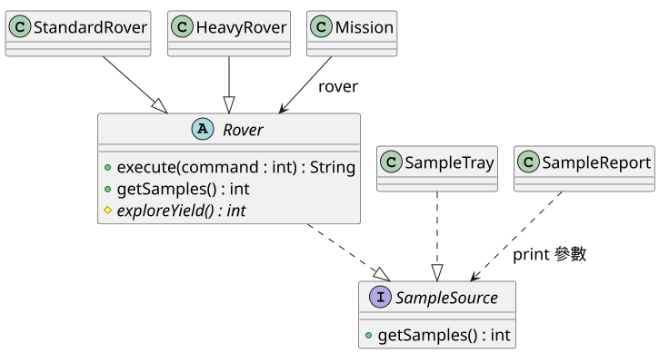

<!-- _class: lead -->
# 第 9 週｜抽象類別與介面

每台探測車如何交代探索產量？

同一份報表如何讀取不同來源的樣本數？

資訊管理學系二年級　胡碩誠

<!-- 承接第 8 週 Codex。先複製 README 指定的起始碼。 -->

---
## 今天要留下的三份證據

| 節次 | 主要活動 | 檢查點 |
|---|---|---|
| 第 1 節 | A 跑基準，B 改抽象類別 | 報表相同，編譯器會擋下少寫產量的車種 |
| 第 2 節 | C 寫共用報表，D 看兩種測試來源 | 同一方法讀到 6、4、0 |
| 第 3 節 | E 審查 Prompt，F 看圖，G 保存 | 錯誤能重現，修正能重測 |

<!-- 三節各 50 分鐘。最後 15 分鐘留給保存、遠端核對和取回。 -->

---
## A｜先預測兩台車

```java
Rover rover = new HeavyRover(20, 0);
rover.execute(1);
```

- 參考的宣告型態與實際物件各是什麼？
- 第一次探索會取得幾份？
- 一般車和重型車跑 `{1, 1, 2}`，哪台會讀到掃描？

開 `CompareMissions.java`。先寫預測，再跑基準。

<!-- 一般車第三步才達標。重型車第二步達標。請學生指出執行流程及決定產量的位置。 -->

---
## B｜把預設產量交還給車種

新車種沿用父類別的預設值時，即使忘了寫產量，也能執行。

| 放在哪裡 | 負責什麼 |
|---|---|
| `Rover` | 能源、停止、扣電、加樣本、計次 |
| `StandardRover` | 探索取得 2 份 |
| `HeavyRover` | 探索取得 3 份 |

讓編譯器檢查每種具體車是否交代產量。

先看範例一 `examples/ParcelDemo.java`：運費流程寫在抽象的 `Parcel`，費率由子類別提供。

<!-- 開 Rover.java。指出 private explore 保留了整段行動規則。 -->

---
## 抽象方法留簽名

```java
protected abstract int exploreYield();
```

`Rover` 成為抽象類別，仍保有欄位、建構子與共用方法。

建立 `StandardRover` 時，子類別用 `super` 讓父類別初始化能源和樣本。

<!-- 具體子類別必須實作抽象方法。用一句話問學生，Rover 變數可以指向誰。 -->

---
## B｜照順序修改並重跑

1. TODO 1 在 `StandardRover.java` 先寫產量覆寫。
2. TODO 2 在 `Rover.java` 將類別與產量方法改為抽象。
3. 編譯，跑 `CompareMissions` 和 `HeavyRoverTry`。

一般車 `6/5/3`，重型車 `8/6/2`。  
依序核對能源、樣本、成功行動數，再看讀了幾步。

<!-- HeavyRoverTry 共 15 行都應 成功。第一步先完成覆寫，能把編譯問題限制在當次變動。 -->

---
## B｜編譯器能抓到什麼？

擇一在 `experiments/` 副本試驗。

| 改一處 | 問題 |
|---|---|
| 把一般車的建立式改成 `new Rover(...)` | 抽象類別能直接建立嗎？ |
| 刪除一般車的產量覆寫 | 具體類別還少什麼？ |

寫下第一個相關診斷。正式 `src` 保持可編譯。

<!-- 問為什麼 Mission 的欄位型態仍能用 Rover。輸出相同只能證明行為，編譯實驗才能觀察限制。 -->

---
## C｜按下「顯示數量」

地面站畫面要顯示一台車和兩個樣本盒的樣本數。

車的數量由探索或掃描累積，樣本盒由建構時填入。

**報表需要向這些物件問哪一件事？**

先看範例二 `examples/ScaleDemo.java`：行李箱和貓沒有共同父類別，都能放上同一個秤。

先寫自己的方法草案，再看下一頁。

<!-- 連結 WinForms 的按鈕處理方法。讓學生獨立寫出簽章，留給 E 段使用。 -->

---
## 共同介面定義可以問什麼

```java
public interface SampleSource {
    int getSamples();
}
```

回傳目前的非負樣本數。呼叫前後，來源狀態相同。

類別用 `implements` 承諾提供這個操作。實作的 `getSamples()` 必須是 `public`。

<!-- 這裡只介紹普通抽象介面方法。可提醒 public 不能因介面宣告省略就跟著省略。 -->

---
## 報表透過參數使用介面

| 誰 | 責任 |
|---|---|
| `Rover` | 用既有的公開方法讀取車上的樣本 |
| `SampleTray` | 從自己保存的欄位讀取樣本 |
| `SampleReport` | 透過 `SampleSource` 取得數量，再印標籤 |

同一個方法呼叫，數量取自收到的物件。

<!-- 對照 Mission 需要整套 Rover 行為，報表只需要讀取一個值。 -->

---
## C｜TODO 3 接上兩種來源

1. 在 `SampleSource.java` 宣告方法。
2. 在 `Rover.java` 宣告實作介面，核對既有方法。
3. 在 `SampleTray.java` 寫出讀取欄位的方法。

重新編譯。這時 `SampleReportDemo` 仍印 `尚未完成`。

<!-- 巡視時檢查 SampleTray 的方法可見性與資料來源。報表邏輯留給學生。 -->

---
## C｜TODO 4 共用同一個報表

```java
public static void print(String label, SampleSource source)
```

在 `SampleReport.java` 寫方法，在 `SampleReportDemo.java` 依序接上重型車、4 份盒與空盒。

| 標籤 | 預期輸出 |
|---|---|
| heavy | `重型探測車 樣本數=6` |
| tray | `樣本盒 樣本數=4` |
| empty | `空盒 樣本數=0` |

<!-- 先讓學生推算重型車和空盒。完成後請提出能抓出寫死數字的額外案例。 -->

---
## D｜同一份資料，兩種物件寫法

開 `examples/FixtureDemo.java`（範例三）。兩個物件都用範例二的 `Weighable` 參考。

| 寫法 | 觀察位置 |
|---|---|
| 具名靜態巢狀類別 | `FixedWeight` 宣告在示範類別裡 |
| 匿名類別 | 在 `new Weighable() { ... }` 當場寫實作 |

先預測兩次 `show` 的輸出，再看執行。

<!-- 兩行 測試資料重量=2。靜態巢狀類別建立時無須外層物件。進度許可可示範 StepListenerDemo 回放，見教師筆記。 -->

---
## E｜先改寫需求，再看回覆

> 幫我寫地面站樣本報表。

沿用 C 的人工草案，補齊四欄。

| 欄位 | 要說清楚的內容 |
|---|---|
| 呼叫者 | 哪個方法會接哪些來源？ |
| 必要操作 | 回傳值和方法簽章為何？ |
| 限制 | 誰保存資料？讀取會改狀態嗎？ |
| 驗收案例 | 一種車和一種樣本盒各應印什麼？ |

<!-- 學生先寫 3 至 5 句。模擬回覆由教師提供，真實 AI 為選用。 -->

---
## E｜先預測，再編譯副本

開 `ai/SampleReport.java`。模擬回覆改用這個簽名。

```java
public static void print(String label, Rover source)
```

三個原本的呼叫中，哪些能通過型別檢查？

用 `ai-check/` 副本編譯。留下第一個相關診斷。

<!-- 去掉兩個盒子呼叫後重編譯，重型車仍印 重型探測車 樣本數=6。恢復盒子呼叫再進入下一步。 -->

---
## E｜修正後用原案例重測

1. 保留原本的三個呼叫。
2. 只改共用方法的參數型態。
3. 重編譯並跑同一個 `SampleReportDemo`。
4. 記下診斷、採納或拒絕理由，以及三行結果。

使用 `AI_USAGE.md`，分開記模擬回覆和真實 AI。

<!-- 三行回到 6、4、0。使用相同入口才看得出參數改動解決了什麼。 -->

---
## F｜兩個使用者各需要什麼？



<!-- 找 Mission 的 Rover 欄位、SampleReport 的 SampleSource 參數。實線空心是繼承，虛線空心是實作。 -->

---
## G｜保存前自己重跑

- 正式 `src` 編譯後跑兩車比較與樣本報表。
- GitHub Desktop 檢查差異、commit、push。
- 在 GitHub 核對原始碼與實測紀錄。
- 在新位置 clone，重編譯並重跑報表。

保留實際輸出。排除編譯結果、實驗副本與憑證。

<!-- 保存 15 分鐘。如果遠端失敗，先確認本機 commit 有完整成果，紀錄原因。 -->

---
## 課後｜讓兩批樣本接上同一報表

新增 `SampleBatch` 與 `SampleBatchDemo`。

- 建構子接兩個 0 至 100 的整數。
- 透過同一介面提供合計。
- 自己設計能抓出漏算任一批的案例，再測零或重讀。

下週用同一台車的兩種參考型態，比較多載和覆寫。

<!-- 作業以一個新來源為限。詳細繳交條件見 assignment.md。 -->
