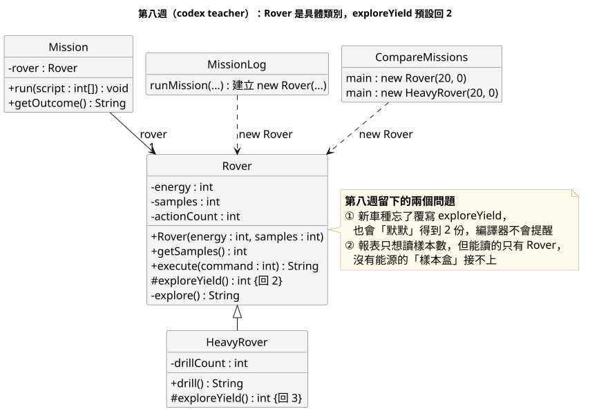
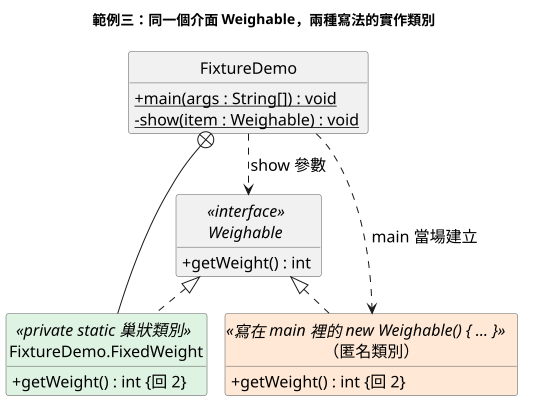
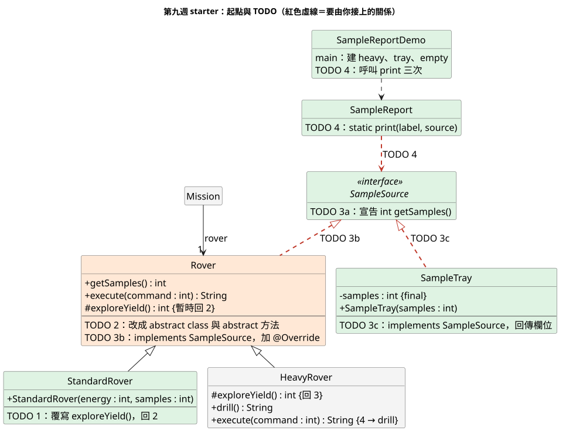
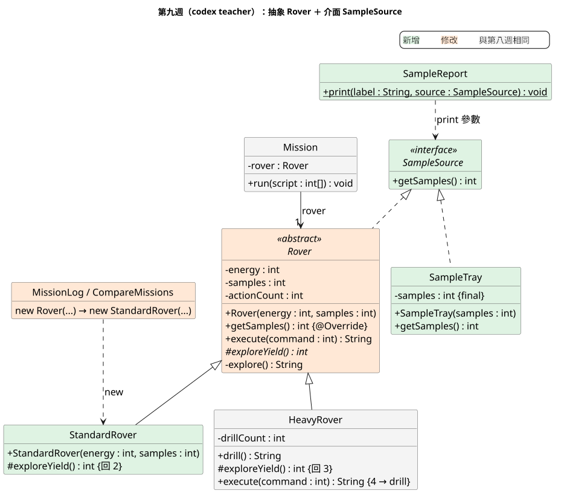
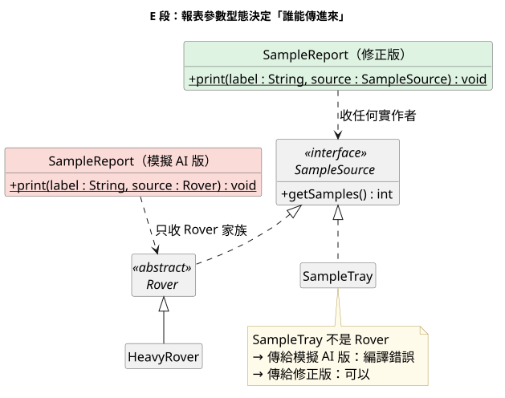
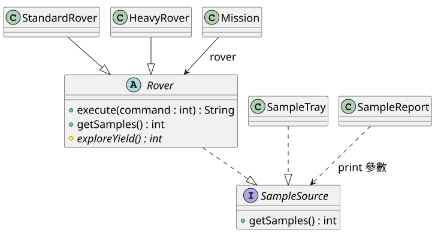

<!-- _class: lead by-claude -->

# 第九週｜抽象類別與介面

## 含巢狀類別、匿名類別概念

AI 協作：**先寫介面草案與可驗收的 Prompt**，再審查 AI 回覆

物件導向程式設計（與 AI 協作）｜115 學年度第 1 學期
資訊管理學系 二年級｜授課教師：胡碩誠

<!--
講者備註：本份投影片依 week09/codex版本 的 README、student_lab、assignment、examples、starter、teacher、teacher_notes、handoff 製作，由 Claude 撰寫；codex 原投影片 week09_slides_codex.md 保留不動，可擇一使用。
本份分兩部分：先只用 examples/ 的兩個檔案教「介面、巢狀類別、匿名類別」，再用 starter/ 說明抽象類別與作業；teacher/ 的答案只出現在附錄。
-->

---

<!-- _class: by-claude small -->

## 關於這份投影片

- 每頁右上角 <span class="tag">claude</span>：本投影片由 Anthropic Claude（Claude Code）依 **codex版本教材** 製作，教師審閱後使用。
- 程式、講義題號（A–G）、TODO、預期輸出全部沿用 `week09/codex版本/`；投影片**不新增**學生作業。
- 左上角標籤是該頁對應的檔案（路徑以 `week09/codex版本/` 為起點）：

| 標籤 | 資料夾 | 在本投影片的角色 |
|---|---|---|
| <span class="tag blue">examples/…</span> | `examples/` | **第一部分：範例教學**——介面、具名巢狀類別、匿名類別 |
| <span class="tag green">starter/…</span> | `starter/` | **第二部分：作業說明**——抽象 Rover、SampleSource 報表、TODO 1–4 |
| <span class="tag purple">ai/…</span> | `ai/` | E 段：教師撰寫的**模擬 AI 回覆**（參數型態錯誤） |
| <span class="tag brown">diagrams/…</span> | `diagrams/` | 類別圖；`*_claude` 為本份新繪，用來說明**與第八週的演進** |
| <span class="tag gray">teacher/…</span> | `teacher/` | **附錄：教師用**——完整答案、通知示範、作業參考 |

<!--
講者備註：講義的活動順序是 A→B→C→D→E→F→G；本份依教師要求先把 examples（講義 D 的 FixtureDemo）完整講完，再進 starter。D 段在第二部分只做一頁回顧。帶課以講義題號為準。
-->

---

<!-- _class: by-claude small -->

<div class="ex"><span class="dg">diagrams/evolution_w08_claude.svg</span><span>../../week08/codex版本/teacher/</span></div>

## 上週留下的兩個問題

<div class="cols" style="grid-template-columns: 700px 1fr; gap: 22px;">
<div>



</div>
<div>

第八週：`Rover` 是**普通類別**，`exploreYield()` 預設回 2；`HeavyRover` 覆寫回 3。

**問題 ①**：明天加第三種車，若忘了寫 `exploreYield()`，程式照樣編譯、照樣得 2 份——**錯誤要靠測試才找得到**。

**問題 ②**：地面站報表只想「讀樣本數」。實驗室的**樣本盒**沒有能源、不會探索，不能硬說它「是一種 Rover」，報表卻只收 `Rover`。

<span class="note">本週答案：① 抽象類別（abstract class）② 介面（interface）</span>

</div>
</div>

<!--
講者備註：第八週 handoff 的入口：「如果共同類別本身不適合直接建立物件，或不同家族都要遵守共同操作規格，該如何表示？」先讓學生口頭回答，不急著給關鍵字。
-->

---

<!-- _class: by-claude small -->

## 本週流程：先用範例學介面，再用到探測車作業

| 部分 | 內容 | 講義 | 時間（備課估計） |
|---|---|---|---|
| **第一部分** <span class="tag blue">examples/</span> | 介面是什麼、介面當參數型態、具名巢狀類別、匿名類別 | D（提前） | 約 20 分 |
| **第二部分** <span class="tag green">starter/</span> | A 跑第八週基準 → B 抽象類別（TODO 1–2） | A、B | 第 1 節 |
| | C 共用報表（TODO 3–4）、類別圖演進 | C | 第 2 節 |
| | E Prompt 與模擬 AI 審查、F 看圖、G 保存 | E、F、G | 第 3 節 |
| 課後 | 新增 `SampleBatch`，接上同一份報表 | 作業 | 20–30 分 |

**每段都先寫預測，再編譯、執行、比對。** 編譯失敗時，先讀第一個與自己改動有關的錯誤。

<!--
講者備註：三節各 50 分鐘、休息另計，是備課估計。第一部分若在第 1 節開頭講，B 段可壓縮到 30 分鐘；時間不夠時編譯實驗只選一個（codex 教師筆記）。最後 15 分鐘一定留給 G 保存。
-->

---

<!-- _class: by-claude small -->

## 從 C# 對照：關鍵字幾乎一樣，寫法稍有不同

| 概念 | C#（一年級學過） | Java（本週） |
|---|---|---|
| 抽象類別 | `abstract class Rover` | `abstract class Rover` |
| 抽象方法 | `protected abstract int ExploreYield();` | `protected abstract int exploreYield();` |
| 覆寫抽象方法 | `protected override int ExploreYield()` | `@Override protected int exploreYield()` |
| 介面 | `interface ISampleSource { int GetSamples(); }` | `interface SampleSource { int getSamples(); }` |
| 繼承＋實作 | `class Rover : Base, ISampleSource` | `class Rover extends Base implements SampleSource` |
| 匿名實作介面 | 沒有（改用 lambda／委派） | `new SampleSource() { ... }` |

- Java 用兩個不同關鍵字：**`extends` 接類別**、**`implements` 接介面**；C# 都用冒號。
- Java 介面名稱**不加 `I` 前綴**；C# 習慣 `ISampleSource`。
- Java 的 `@Override` 是**註記**，寫錯方法名稱時會讓編譯器報錯；C# 的 `override` 是關鍵字。

<!--
講者備註：學生一年級在 WinForms 常看到 IDisposable 之類的 I 前綴介面，但多半沒有自己設計過。強調「Java 匿名類別」是 C# 沒有的語法，本週只要求讀懂。
-->

---

<!-- _class: lead by-claude -->
<!-- footer: '物件導向程式設計｜Week 09｜第一部分 範例教學（examples/）' -->

# 第一部分｜範例教學

## 用 `examples/` 的兩個檔案學會介面

`SampleSource.java`、`FixtureDemo.java`｜講義 D

<!--
講者備註：examples 與主任務沒有程式相依（它自帶一份同名 SampleSource），先在小範例看清楚規則，再回到探測車。
-->

---

<!-- _class: by-claude small -->

<div class="ex"><span>examples/SampleSource.java</span><span>examples/FixtureDemo.java</span></div>

## 範例檔案與執行入口

| 檔案 | 有 main？ | 角色 |
|---|---|---|
| `examples/SampleSource.java` | — | 介面：只宣告 `int getSamples();` |
| `examples/FixtureDemo.java` | ✓ | 用**兩種寫法**做出「固定回傳 2 份」的測試來源，交給同一個 `show` 方法 |

examples 要**另外放一個資料夾、另外編譯**（它和 starter 都有 `SampleSource`，不能放進同一個 `src`）：

```powershell
# 在 java-09 資料夾
javac -encoding UTF-8 -d out-examples examples/*.java
java -cp out-examples FixtureDemo
```

<span class="note">JDK 不限定版本；先用 java -version、javac -version 記下自己的版本。只有兩個檔案，用 VS Code 即可。</span>

<!--
講者備註：README 的目錄配置：java-09/examples/ 只在需要本機跑示範時才複製。教師也可以直接投影執行結果。
-->

---

<!-- _class: by-claude small -->

<div class="ex"><span>examples/SampleSource.java</span></div>

## 介面（interface）：一份「能做什麼」的承諾

<div class="cols">
<div>

```java
// 獨立示範使用的介面，與課堂主線分開編譯。
public interface SampleSource {
    int getSamples();
}
```

| 看到的寫法 | 意思 |
|---|---|
| `interface` | 不是類別，是**操作規格** |
| `int getSamples();` | 只有簽名、**沒有方法本體**，以分號結束 |
| 沒寫 `public` | 介面方法**自動是 public、abstract** |

</div>
<div class="box blue">

**概念**：介面只說「實作我的類別，一定有 `int getSamples()` 可以呼叫」，不管資料怎麼存、數字怎麼算。

**為何需要**：使用者（例如報表）只關心「拿得到數量」，不想知道對方是探測車還是樣本盒。

**限制**：介面不能 `new`；本週的介面**沒有欄位、沒有建構子**。

</div>
</div>

<!--
講者備註：本週只教普通的抽象介面方法；Java 8 以後介面可有 default／static 方法，本週不展開，被問到再說「之後的課才用」。
-->

---

<!-- _class: by-claude small -->

<div class="ex"><span>examples/FixtureDemo.java</span></div>

## 介面當作「參數型態」：show 只要求一件事

```java
private static void show(SampleSource source) {
    System.out.println("測試資料樣本數=" + source.getSamples());
}
```

<div class="cols">
<div>

- 參數型態寫 `SampleSource`：**任何實作了 SampleSource 的物件**都能傳進來。
- `show` 裡只能呼叫 `SampleSource` 有宣告的方法——也就是只有 `getSamples()`。
- 真正執行哪一份 `getSamples()`，由**傳進來的實際物件**決定（第八週的動態派送）。

</div>
<div class="box">

**WinForms 對照**

想像表單上一個「顯示數量」按鈕。按鈕的處理程式只需要問一句：「**你現在有幾份樣本？**」

它不需要知道對方有沒有能源、會不會探索。這「一句話」就是介面。

</div>
</div>

<!--
講者備註：連回第八週的追蹤方式：「先看宣告型態能叫什麼，再看實際物件執行什麼」。宣告型態是 SampleSource → 只能叫 getSamples；實際物件決定哪一份 getSamples 被執行。
-->

---

<!-- _class: by-claude small -->

<div class="ex"><span>examples/FixtureDemo.java</span></div>

## 寫法一：具名的 `static` 巢狀類別

<div class="cols">
<div>

```java
public class FixtureDemo {
    // 只有本示範用得到，放在示範類別內。
    private static class FixedSampleSource
            implements SampleSource {
        @Override
        public int getSamples() {
            return 2;
        }
    }

    public static void main(String[] args) {
        SampleSource named = new FixedSampleSource();
        ...
    }
}
```

</div>
<div>

| 位置 | 說明 |
|---|---|
| `class` 寫在 `FixtureDemo` **裡面** | 巢狀類別（nested class） |
| `private` | 只有 `FixtureDemo` 自己用得到 |
| `static` | 建立時**不需要**先有 `FixtureDemo` 物件 |
| `implements SampleSource` | 承諾提供 `getSamples()` |
| `@Override public` | 讓編譯器檢查簽名；**一定要 public** |

**何時用**：這個類別只為某個類別服務、別處用不到，就收進去，不另開檔案。

</div>
</div>

<!--
講者備註：類別名稱 FixedSampleSource 只在 FixtureDemo 裡可見。編譯後會產生 FixtureDemo$FixedSampleSource.class，可讓學生看 out-examples 資料夾。
-->

---

<!-- _class: by-claude small -->

<div class="ex"><span>examples/FixtureDemo.java</span></div>

## 寫法二：匿名類別（anonymous class）

<div class="cols">
<div>

```java
SampleSource anonymous = new SampleSource() {
    @Override
    public int getSamples() {
        return 2;
    }
};   // ← 這是一個陳述式，分號不能少
```

拆開讀：

1. `new SampleSource()`：要建立「某個實作 SampleSource 的物件」
2. `{ ... }`：**當場寫出**這個類別的內容
3. 這個類別**沒有名字**，宣告與建立同時完成

</div>
<div class="box blue">

**它不是 `new` 了介面**

介面不能直接建立物件。`new SampleSource() { ... }` 建立的是「一個沒名字、實作了 SampleSource 的類別」的物件。

**何時用**：只用一次、內容很短的實作，例如測試資料、事件處理。

**限制**：沒有名字，就不能在別處再 `new` 一次；內容一長就難讀，改用具名類別。

</div>
</div>

<!--
講者備註：編譯後會看到 FixtureDemo$1.class，那個 $1 就是編譯器替匿名類別取的編號名。C# 沒有這個語法；WinForms 的事件處理是委派＋方法，概念上類似「把一段要被呼叫的程式交出去」。
-->

---

<!-- _class: by-claude -->

<div class="ex"><span>examples/FixtureDemo.java</span></div>

## D｜先預測：兩次 `show` 各印什麼？

<div class="cols">
<div>

```java
public static void main(String[] args) {
    SampleSource named = new FixedSampleSource();
    SampleSource anonymous = new SampleSource() {
        @Override
        public int getSamples() { return 2; }
    };
    show(named);
    show(anonymous);
}
```

</div>
<div>

**請寫下：**

1. 兩行輸出各是什麼？
2. 圈出兩個 `getSamples()` 的位置。
3. 兩個物件的**宣告型態**是什麼？**實際類別**各是什麼？
4. 一句話：兩個不同類別的物件，為什麼能交給**同一個** `show`？

</div>
</div>

<!--
講者備註：讓學生先寫 1 分鐘再執行。答案在下一頁。
-->

---

<!-- _class: by-claude small -->

<div class="ex"><span>examples/FixtureDemo.java</span></div>

## D｜答案：同一個 show、同一種結果，兩個不同類別

```text
測試資料樣本數=2
測試資料樣本數=2
```

| 變數 | 宣告型態 | 實際類別 | 執行的 getSamples |
|---|---|---|---|
| `named` | `SampleSource` | `FixtureDemo.FixedSampleSource` | 巢狀類別裡的那一份 |
| `anonymous` | `SampleSource` | 匿名類別（編譯後叫 `FixtureDemo$1`） | `new SampleSource() { ... }` 裡的那一份 |

**為什麼能交給同一個 show？** 兩個類別都 `implements SampleSource`，而 `show` 的參數型態就是 `SampleSource`——它只要求「有 `getSamples()`」。

<span class="note">兩個實作都回傳 2，所以輸出相同；如果把匿名類別改成回傳 5，第二行就會變成 5——輸出由實際物件決定。</span>

<!--
講者備註：可以現場改成 return 5 示範，強調「同一個呼叫，不同物件，不同結果」，這就是下一部分報表要用的能力。
-->

---

<!-- _class: by-claude small -->

<div class="ex"><span class="dg">diagrams/fixture_claude.svg</span></div>

## UML：怎麼畫巢狀類別與「實作介面」

<style scoped>table { font-size: 18px; }</style>

<div class="cols" style="grid-template-columns: 560px 1fr; gap: 20px;">
<div>



</div>
<div>

| 圖示 | 意思 |
|---|---|
| `«interface»` 斜體名稱 | 介面 |
| **虛線＋空心三角** ⇢▷ | 實作（`implements`），三角形指向介面 |
| 實線＋空心三角 →▷ | 繼承（`extends`），上週學過 |
| 圓圈加號 ⊕ | 巢狀類別，⊕ 在外層類別那一端 |
| 虛線箭頭 ⇢ | 使用（參數、區域變數、建立） |

**比較**：繼承是實線、實作是虛線，三角形都**指向「被遵守的那一方」**。

</div>
</div>

<!--
講者備註：本圖為 Claude 新繪（diagrams/fixture_claude.puml）。匿名類別在 UML 沒有正式名稱，這裡用「（匿名類別）」標示，只為了讓學生看到它也實作 SampleSource。
-->

---

<!-- _class: by-claude small -->

<div class="ex"><span>examples/FixtureDemo.java</span><span>examples/SampleSource.java</span></div>

## 編譯器會幫你擋什麼？（在副本試，教師示範即可）

| 在副本改一處 | 第一個相關診斷（JDK 22 實測） | 學到什麼 |
|---|---|---|
| `new SampleSource();` | `SampleSource is abstract; cannot be instantiated` | 介面不能直接建立物件 |
| 巢狀類別方法名打成 `getSample()` | `FixedSampleSource is not abstract and does not override abstract method getSamples() in SampleSource`<br>`method does not override or implement a method from a supertype` | 承諾沒做到；`@Override` 也抓到名字寫錯 |
| 拿掉實作方法的 `public` | `attempting to assign weaker access privileges; was public` | 介面方法是 public，實作**不能更嚴** |

**讀錯誤訊息的順序**：先看檔名與行號 → 再看「哪個類別」「少了哪個方法」→ 回到自己改的那一行。

<span class="note">這三個診斷在第二部分會原樣再出現（Rover、StandardRover、SampleTray），先在小範例看過，作業時就認得。</span>

<!--
講者備註：三個錯誤都在暫存副本實測過（OpenJDK 22，javac -encoding UTF-8）。不同 JDK 版本的訊息字句可能略有差異，重點詞一樣。
-->

---

<!-- _class: by-claude small -->

## 三種實作方式比較

| | 一般頂層類別 | 具名 `static` 巢狀類別 | 匿名類別 |
|---|---|---|---|
| 放在哪 | 自己一個 `.java` 檔 | 另一個類別**裡面** | 寫在一個**運算式**裡 |
| 有名字？ | 有 | 有（`外層.內層`） | 沒有 |
| 可在別處重複 `new`？ | 可以 | 在外層類別內可以 | 不行（只在那一處） |
| 適合 | 多處會用、內容較多 | 只為某個類別服務 | 只用一次、內容很短 |
| 本週例子 | `SampleTray`（第二部分） | `FixedSampleSource` | `new SampleSource() { ... }` |

<span class="note">補充：巢狀類別不加 static 時叫「內部類別」（inner class），建立它需要先有外層物件；本週不要求寫，看懂差別即可。</span>

<!--
講者備註：codex 教師筆記：課堂先看這一對（具名 static 巢狀 vs 匿名），非靜態內部類別只補充它需要外層物件。
-->

---

<!-- _class: by-claude small -->

## 第一部分小結：範例學到的，作業要用在哪裡

| examples 學到的 | starter 作業中的位置 |
|---|---|
| 介面只宣告 `int getSamples();` | **TODO 3a**：在 `starter/SampleSource.java` 寫同一行 |
| `implements` ＋ `@Override public` | **TODO 3b、3c**：`Rover`、`SampleTray` 實作介面 |
| 參數型態用介面，什麼實作都能傳 | **TODO 4**：`SampleReport.print(String, SampleSource)` |
| 介面不能 `new`，`@Override` 抓錯 | **B 段編譯實驗**：抽象類別同樣不能 `new` |
| 匿名類別 | **課後選做**：用匿名物件提供另一組固定樣本數 |

範例只有「介面」；作業還多了一個新概念——**抽象類別**，下一部分從探測車的問題開始講。

<!--
講者備註：提醒學生 examples 的 SampleSource 與 starter 的 SampleSource 同名，所以要分開編譯；作業中的那一份要自己寫（TODO 3a）。
-->

---

<!-- _class: lead part2 by-claude -->
<!-- footer: '物件導向程式設計｜Week 09｜第二部分 作業說明（starter/）' -->

# 第二部分｜作業說明

## 抽象 Rover 與共用樣本報表

講義 A–C、E–G＋課後作業｜`starter/` 12 個 Java 檔

<!--
講者備註：從這裡開始看 starter；teacher 的完整答案不投影。
-->

---

<!-- _class: by-claude small -->

<div class="ex"><span class="st">starter/</span></div>

## 作業檔案與起始狀態

<div class="cols">
<div>

| starter 檔案 | 狀態 |
|---|---|
| `StandardRover.java` | **新**；**TODO 1** |
| `Rover.java` | **TODO 2、TODO 3b** |
| `SampleSource.java` | **新**；**TODO 3a**（空介面） |
| `SampleTray.java` | **新**；**TODO 3c** |
| `SampleReport.java` | **新**；**TODO 4**（空類別） |
| `SampleReportDemo.java` | **新**；**TODO 4** 接三個呼叫 |
| `HeavyRover`、`HeavyRoverTry` | 已提供（同第八週） |
| `Mission`、`MissionStep` | 已提供（同第八週） |
| `MissionLog`、`CompareMissions` | 已提供；一般車改 `new StandardRover` |

</div>
<div>

複製 12 檔到 `115_1_Java/YYYY_MM_DD/java-09/src/`，在 `java-09` 執行：

```powershell
javac -encoding UTF-8 -d out src/*.java
java -cp out MissionLog
java -cp out CompareMissions
java -cp out HeavyRoverTry
java -cp out SampleReportDemo
```

起始時：三個探測車入口跑出**第八週基準**；`SampleReportDemo` 只印：

```text
尚未完成
```

**能編譯 ≠ 已完成**：完成 TODO 1–4 後才會印出三行報表。

</div>
</div>

<!--
講者備註：12 個檔案、多個 main，可示範 IntelliJ IDEA：開 java-09 資料夾，用已安裝的 JDK 設 SDK，把 src 標為 Sources Root，從各 main 旁的執行鈕跑。學生用一套 IDE 完成即可。
-->

---

<!-- _class: by-claude small -->

<div class="ex"><span class="dg">diagrams/starter_todo_claude.svg</span></div>

## 起點地圖：TODO 在類別圖的哪裡

<div class="cols" style="grid-template-columns: 690px 1fr; gap: 22px;">
<div>



</div>
<div>

- **綠色**：本週新增的檔案；**橘色**：要改的 `Rover`；**灰色**：沿用第八週。
- **紅色虛線**：現在還不存在、要由你接上的關係。
- 第一節只動左下（TODO 1–2）；第二節才動右邊（TODO 3–4）。

**建議順序**：1 → 2 → 3a → 3b → 3c → 4，每做完一個就重新編譯。

<span class="note">順序錯了會怎樣？後面兩頁會用實際錯誤訊息說明。</span>

</div>
</div>

<!--
講者備註：本圖為 Claude 依 starter 原始碼新繪（diagrams/starter_todo_claude.puml）。
-->

---

<!-- _class: by-claude small -->

<div class="ex"><span class="st">starter/CompareMissions.java</span><span class="st">starter/Rover.java</span><span class="st">starter/HeavyRover.java</span></div>

## A｜先跑第八週基準，再預測

```java
Rover rover = new HeavyRover(20, 0);
rover.execute(1);
```

1. 變數的**宣告型態**是什麼？**實際物件**是什麼類別？呼叫 `execute(1)` 時，哪個類別決定探索產量？
2. 一般車、重型車各跑 `{1, 1, 2}`（探索、探索、掃描），**哪台會讀到第 3 個指令**？為什麼？
3. 記下 JDK 版本，編譯起始碼，執行 `CompareMissions`，留下兩段 `最終能源=...` 與 `步數=...`。

<span class="note">規則提醒：探索耗 6 格；一般車得 2 份、重型車得 3 份；掃描耗 2 得 1；樣本 ≥ 5 為成功、能源 0 為耗盡；成功與耗盡同時成立時以成功為準。</span>

<!--
講者備註：A1 宣告型態 Rover、實際物件 HeavyRover。execute 在 Rover，進入 Rover 私有的 explore()，取產量時呼叫 exploreYield()，依實際物件執行 HeavyRover 的版本，得 3 份。
A2 一般車讀到第 3 步（兩次探索只有 4 份）；重型車第二次探索後已有 6 份，成功停止，掃描沒被讀取。
-->

---

<!-- _class: by-claude small -->

<div class="ex"><span class="st">starter/CompareMissions.java</span></div>

## A｜基準結果：記住這兩行，B 段改完要一模一樣

<div class="cols">
<div>

```text
=== 一般探測車 ===
...
步驟 3: 指令=2, 結果=成功, 能源=6
步數=3, 成功=3, 拒絕=0, 略過=0
最終能源=6, 樣本數=5, 行動次數=3
  -> 任務成功
```

一般車 **6/5/3**，讀 3 步

</div>
<div>

```text
=== 重型探測車 ===
...
步驟 2: 指令=1, 結果=成功, 能源=8
步數=2, 成功=2, 拒絕=0, 略過=1
最終能源=8, 樣本數=6, 行動次數=2
  -> 任務成功
```

重型車 **8/6/2**，讀 2 步、忽略 1 步

</div>
</div>

三個數依序是：**能源／樣本／成功行動數**。

B 段會改 `Rover` 的宣告，**行為不應改變**——這叫回歸檢查（regression check）。

<!--
講者備註：為了版面，final 那行在投影片上斷成兩行；實際輸出是一行「最終能源=6, 樣本數=5, 行動次數=3 -> 任務成功」。完整輸出見 teacher_notes.md。
-->

---

<!-- _class: by-claude small -->

<div class="ex"><span class="st">starter/Rover.java</span></div>

## B｜問題：「預設產量」會讓忘記的車種默默通過

<div class="cols">
<div>

```java
// starter/Rover.java（起始狀態）
public class Rover {
    ...
    // TODO 2：把暫用的預設產量換成抽象方法宣告。
    protected int exploreYield() {
        return 2;
    }

    private String explore() {
        if (!spendEnergy(6)) { return "能源不足"; }
        addSamples(exploreYield());
        countAction();
        return "成功";
    }
}
```

</div>
<div>

- 探索的**流程**（扣 6 格 → 加樣本 → 計次）大家都一樣，放在 `Rover`。
- 探索的**產量**每種車不同，應由**每種車自己交代**。
- 現在 `Rover` 有「預設 2」：新車種忘了覆寫，照樣能編譯、能跑。

> 能不能讓**編譯器**在「有車種沒交代產量」時就報錯？

</div>
</div>

<!--
講者備註：codex 規劃的對照：沿用具體 Rover 與預設產量，改動最少，但錯誤要靠測試；改為抽象，編譯器就能提前檢查。
-->

---

<!-- _class: by-claude small -->

## B｜抽象類別（abstract class）

<div class="cols">
<div>

```java
public abstract class Rover {
    private int energy;          // 仍有欄位
    ...
    public Rover(int energy, int samples) { ... }  // 仍有建構子
    public String execute(int command) { ... }      // 仍有一般方法

    // 抽象方法：只有簽名，以分號結束
    protected abstract int exploreYield();
}
```

| 規則 | 結果 |
|---|---|
| `new Rover(...)` | **編譯錯誤**：抽象類別不能建立物件 |
| `Rover r = new StandardRover(...)` | 可以：宣告型態可以是抽象類別 |
| 具體子類別沒覆寫抽象方法 | **編譯錯誤** |

</div>
<div class="box green">

**概念**：抽象類別是「**不完整的類別**」——有共同的狀態與流程，但留一個（或多個）空格給子類別填。

**為何需要**：讓共同流程只寫一次，同時**強迫**每個具體子類別補上不同的部分。

**常見誤解**：抽象類別 ≠ 介面。抽象類別**可以有欄位、建構子、已寫好的方法**；建立 `StandardRover` 時，`super(energy, samples)` 仍會執行 `Rover` 的建構子。

</div>
</div>

<!--
講者備註：抽象類別的建構子不能被 new 直接呼叫，但子類別建構時會透過 super 呼叫它，讓私有狀態得到初值。
-->

---

<!-- _class: by-claude small -->

<div class="ex"><span class="st">starter/StandardRover.java</span><span class="st">starter/HeavyRover.java</span></div>

## B｜TODO 1：先讓一般車自己交代產量

<div class="cols">
<div>

```java
// starter/StandardRover.java
public class StandardRover extends Rover {
    public StandardRover(int energy, int samples) {
        super(energy, samples);
    }

    // TODO 1：自行覆寫探索產量方法。
    // 一般車每次探索取得 2 份。
}
```

參考已完成的 `HeavyRover`：

```java
@Override
protected int exploreYield() {
    return 3;
}
```

</div>
<div>

**自己寫**：照 `HeavyRover` 的方法簽名，固定回傳 2。

- 簽名要一致：`protected`、`int`、方法名、**沒有參數**。
- 加 `@Override`，讓編譯器檢查有沒有寫錯名字。
- 建構子已經交給 `super`，不要再宣告 `energy`、`samples`。

寫完**立刻重新編譯**，跑一次 `CompareMissions`：結果和 A 段一樣。

<span class="note">此時 Rover 仍有預設 2，所以「結果一樣」還不能證明你的覆寫有被用到——下一步才讓編譯器檢查。</span>

</div>
</div>

<!--
講者備註：答案見附錄。不要直接投影答案；巡視時看可見性（protected 或更寬）與 @Override。
-->

---

<!-- _class: by-claude small -->

<div class="ex"><span class="st">starter/Rover.java</span></div>

## B｜TODO 2：把 Rover 與產量方法改成抽象

改兩處宣告，其他（欄位、建構子、`execute`、`explore`）**全部保留**：

<div class="cols">
<div>

```java
public class Rover {
    ...
    protected int exploreYield() {
        return 2;
    }
```

</div>
<div>

```java
public abstract class Rover {
    ...
    protected abstract int exploreYield();
```

</div>
</div>

**為什麼要先做 TODO 1、再做 TODO 2？** 若先做 TODO 2，`StandardRover` 還沒有覆寫，馬上出現：

```text
StandardRover.java:2: error: StandardRover is not abstract and does not override
abstract method exploreYield() in Rover
```

先完成覆寫，可以把編譯問題限制在「這一次的改動」。

<!--
講者備註：這個錯誤訊息正是抽象類別的價值：編譯器替我們抓出「沒交代產量的車種」。錯誤訊息已用 JDK 22 在副本實測，實際為一行，投影片斷成兩行。
-->

---

<!-- _class: by-claude small -->

<div class="ex"><span class="st">starter/Rover.java</span><span class="st">starter/StandardRover.java</span></div>

## B｜追蹤一次探索：流程在父類別，產量在子類別

```java
Rover rover = new StandardRover(20, 0);
rover.execute(1);
```

| 步驟 | 執行的程式 | 在哪個類別 |
|---|---|---|
| 1 | `execute(1)`：檢查停止 → `case 1` | `Rover` |
| 2 | `explore()`：`spendEnergy(6)` 成功，能源 20 → 14 | `Rover`（private） |
| 3 | `addSamples(exploreYield())`：**問實際物件要產量** | 呼叫者在 `Rover` |
| 4 | `exploreYield()` 回 2 | **`StandardRover`**（實際物件） |
| 5 | `countAction()`，回 `"成功"` | `Rover` |

換成 `new HeavyRover(20, 0)`，只有第 4 步改由 `HeavyRover` 回 3，其餘完全相同。

<!--
講者備註：重點句：抽象方法讓 Rover 可以「呼叫一個自己沒寫內容的方法」，因為 Java 保證每個能被建立的物件都一定有實作。
-->

---

<!-- _class: by-claude small -->

<div class="ex"><span class="st">starter/CompareMissions.java</span><span class="st">starter/HeavyRoverTry.java</span></div>

## B｜重跑：行為必須和第八週完全相同

```powershell
javac -encoding UTF-8 -d out src/*.java
java -cp out CompareMissions
java -cp out HeavyRoverTry
```

| 檢查 | 預期 |
|---|---|
| `CompareMissions` 一般車 | `最終能源=6, 樣本數=5, 行動次數=3 -> 任務成功`，讀 3 步 |
| `CompareMissions` 重型車 | `最終能源=8, 樣本數=6, 行動次數=2 -> 任務成功`，讀 2 步、`略過=1` |
| `HeavyRoverTry` | **15 行全部 顯示「相符」**（鑽探、低能源、剛好 8 格、初始停止） |

有 `不符` 時：找**第一個不同的欄位**（能源？樣本？次數？），再回頭看你改的那一行。

<!--
講者備註：改成抽象類別只改「誰能被建立、誰必須提供什麼」，不改行為，所以輸出應逐字相同。MissionLog 也會印一般車同樣的九行。
-->

---

<!-- _class: by-claude small -->

<div class="ex"><span class="st">starter/ → java-09/experiments/</span></div>

## B4｜編譯實驗：擇一，在 `experiments/` 副本做

```powershell
# 把 src 的全部 Java 檔複製到 java-09/experiments/，進入該資料夾
javac -encoding UTF-8 -d out *.java
```

| 實驗 | 改一處 | 先預測 | JDK 22 實測的第一個相關診斷 |
|---|---|---|---|
| 一 | `CompareMissions` 中 `new StandardRover(20, 0)` → `new Rover(20, 0)` | ？ | `Rover is abstract; cannot be instantiated` |
| 二 | 刪除 `StandardRover` 的產量覆寫 | ？ | `StandardRover is not abstract and does not override abstract method exploreYield() in Rover` |

**記錄到 LAB_REPORT**：選了哪個實驗、預測、實際診斷、原因；再回答「`Mission` 為何仍可把欄位宣告為 `Rover`？」

<span class="note">正式 src 保持可編譯。輸出相同只能證明行為沒變；編譯實驗才能看到「限制」真的存在。</span>

<!--
講者備註：Mission 的欄位宣告為 Rover：抽象類別可以當宣告型態，實際放進去的一定是具體子類別的物件（StandardRover 或 HeavyRover）。
-->

---

<!-- _class: by-claude small -->

<div class="ex"><span class="st">starter/SampleReportDemo.java</span><span class="st">starter/SampleTray.java</span></div>

## C｜新需求：按下「顯示數量」

地面站要在同一份報表顯示「`標籤 樣本數=數量`」：

| 來源 | 數量從哪來 | 有能源、會探索嗎？ |
|---|---|---|
| 重型車（跑完 `{1, 1, 2}`） | 行動累積 | 有 |
| 樣本盒（建構時放 4 份） | 建構時給定 | **沒有** |
| 空樣本盒（放 0 份） | 建構時給定 | **沒有** |

**先寫自己的介面草案**（保留給 E 段使用）：

| 草案問題 | 你的判斷 |
|---|---|
| 報表應從來源讀到什麼？方法需要參數嗎？ | 待填 |
| 方法的回傳型態與簽名是什麼？ | 待填 |
| 哪兩種類別應提供此方法？讀取會改變什麼狀態？ | 待填 |

<!--
講者備註：先收一分鐘人工草案再顯示統一契約。合理答案：無參數、回傳 int、讀取不改狀態。
-->

---

<!-- _class: by-claude small -->

## C｜為什麼不讓 SampleTray `extends Rover`？

<div class="cols">
<div>

**繼承（is-a）**：「樣本盒**是一種**探測車」？

- 樣本盒沒有能源、不會探索、不會停止。
- 若硬繼承，它會帶著 `execute`、`spendEnergy`……全都沒有意義。
- `Mission` 甚至能拿它跑任務——**錯得離譜但能編譯**。

</div>
<div>

**介面（can-do）**：「樣本盒**能提供**樣本數」？

- 成立！探測車也能提供樣本數。
- 兩者沒有共同祖先也沒關係。
- 報表只依賴這**一個能力**。

</div>
</div>

| | 抽象類別 `Rover` | 介面 `SampleSource` |
|---|---|---|
| 回答的問題 | 「是什麼？」共同狀態＋共同流程 | 「能做什麼？」共同操作 |
| 誰使用 | `Mission`（需要整套探測車行為） | `SampleReport`（只需要讀一個數） |
| 一個類別可以 | 只 `extends` **一個** | `implements` **多個** |

<!--
講者備註：codex 教師筆記：若學生把樣本盒設成 extends Rover，問它是否真的有能源、移動與停止規則。報表接的是「會提供樣本數」的能力，任務接的是整套探測車行為。
-->

---

<!-- _class: by-claude small -->

<div class="ex"><span class="st">starter/SampleSource.java</span><span class="st">starter/Rover.java</span><span class="st">starter/SampleTray.java</span></div>

## C｜TODO 3：定義介面，接上兩種來源

| TODO | 檔案 | 要做的事 |
|---|---|---|
| **3a** | `SampleSource.java` | 宣告 `int getSamples();`（和 examples 同一行）；契約：回傳非負數、讀取不改狀態 |
| **3b** | `Rover.java` | 類別宣告加上 `implements SampleSource`；在**既有的** `public int getSamples()` 上加 `@Override` |
| **3c** | `SampleTray.java` | 實作同一介面；`@Override public int getSamples()` 回傳**自己的欄位** |

<div class="cols">
<div>

**3b 寫成這樣**（抽象＋實作同時存在）：

```java
public abstract class Rover implements SampleSource {
```

`extends` 寫在 `implements` 前面；`Rover` 沒有寫 `extends`，就直接接 `implements`。

</div>
<div class="box red">

**順序錯了？** 先做 3b、介面還是空的：

```text
Rover.java:（行號）: error: method does not override
or implement a method from a supertype
```

→ 先完成 3a，再加 `@Override`。

</div>
</div>

重新編譯。這時 `SampleReportDemo` **仍印 `尚未完成`**，正常。

<!--
講者備註：3b 不需要寫新的方法，Rover 早就有 public getSamples()；加 implements 只是讓編譯器確認它符合介面。3c 巡視重點：public 與資料來源（回欄位，不要回常數）。錯誤訊息為 JDK 22 在副本實測。
-->

---

<!-- _class: by-claude small -->

<div class="ex"><span class="st">starter/SampleReport.java</span><span class="st">starter/SampleReportDemo.java</span></div>

## C｜TODO 4：一個報表方法，三個來源

<div class="cols">
<div>

在 `SampleReport.java` **自己實作**：

```java
public static void print(String label, SampleSource source)
```

- 每呼叫一次印**一行**：`<label> 樣本數=<數量>`
- 透過 `source` 讀**一次**樣本數

在 `SampleReportDemo.java` 依序呼叫三次，**移除** `尚未完成`：

| 標籤 | 來源變數 |
|---|---|
| `heavy` | `heavy`（`Rover` 型態） |
| `tray` | `tray`（`SampleTray` 型態） |
| `empty` | `empty`（`SampleTray` 型態） |

</div>
<div>

**先預測，再執行**：

```text
重型探測車 樣本數=?
樣本盒 樣本數=?
空盒 樣本數=?
```

**診斷提示**

- 兩個盒子都印 4 → 方法沒有從**各自的物件**取值？
- 盒子傳不進去 → 查 `implements` 和**參數型態**
- 再自己提出一個能抓出「寫死數字」的輸入（例如放 9 份的盒子），在 `experiments` 副本實測

</div>
</div>

<!--
講者備註：預期輸出：重型探測車 樣本數=6、樣本盒 樣本數=4、空盒 樣本數=0。重型車：20 格探索兩次得 6 份、能源 8，掃描沒被讀。答案程式見附錄。
-->

---

<!-- _class: by-claude small -->

<div class="ex"><span class="st">starter/SampleReportDemo.java</span></div>

## C｜追蹤：同一行程式，三個不同的 getSamples

```text
重型探測車 樣本數=6
樣本盒 樣本數=4
空盒 樣本數=0
```

| 呼叫 | `source` 宣告型態 | 實際物件 | 執行的 `getSamples()` | 數量來源 |
|---|---|---|---|---|
| `print("heavy", heavy)` | `SampleSource` | `HeavyRover` | `Rover` 的版本（繼承） | 探索兩次累積 3＋3 |
| `print("tray", tray)` | `SampleSource` | `SampleTray` | `SampleTray` 的版本 | 建構時 4 |
| `print("empty", empty)` | `SampleSource` | `SampleTray` | `SampleTray` 的版本 | 建構時 0 |

- `HeavyRover` 沒寫 `getSamples()`，但它繼承了 `Rover` 的；`Rover` 實作了介面，所以 **`HeavyRover` 也算是 `SampleSource`**。
- 讀兩次結果相同，車的狀態仍是 **8/6/2**——讀取**沒有副作用**。

<!--
講者備註：這一頁把第八週的「宣告型態 vs 實際物件」用到介面上。對照第一部分 FixtureDemo：同一個 show、不同物件。
-->

---

<!-- _class: by-claude small -->

<div class="ex"><span>examples/FixtureDemo.java</span></div>

## D｜回顧：第一部分的 FixtureDemo 在講義的位置

講義 D（5 分鐘）就是第一部分看過的 `FixtureDemo`：

| 講義 D 要寫的 | 第一部分的答案 |
|---|---|
| 具名巢狀類別、匿名類別各印什麼？ | 兩行都是 `測試資料樣本數=2` |
| 圈出兩個 `getSamples()` 的位置 | `FixedSampleSource` 裡、`new SampleSource() { ... }` 裡 |
| 兩個物件如何交給同一個 `show`？ | 都實作 `SampleSource`，`show` 的參數型態就是它 |

**和 C 段的關係**：`show(SampleSource)` 與 `SampleReport.print(String, SampleSource)` 是**同一個設計**——用介面當參數，讓不同類別共用同一段程式。

<!--
講者備註：教師可在這裡（或 F 前）用 2–3 分鐘示範 teacher/StepListenerDemo.java（見附錄），對照「報表主動問」與「回放程式逐步通知」。
-->

---

<!-- _class: by-claude small -->

<div class="ex"><span class="dg">diagrams/evolution_w09_claude.svg</span><span class="tc">teacher/</span></div>

## 類別圖演進：完成 TODO 1–4 之後（第九週）

<div class="cols" style="grid-template-columns: 600px 1fr; gap: 22px;">
<div>



</div>
<div>

<span class="tag green">新增</span> `SampleSource`、`StandardRover`、`SampleTray`、`SampleReport`

<span class="tag">修改</span> `Rover` 變成 `«abstract»`，並實作 `SampleSource`；`MissionLog`／`CompareMissions` 改建 `StandardRover`

<span class="tag gray">相同</span> `Mission`、`HeavyRover`（及 `MissionStep`）

**讀圖重點**

- `Mission → Rover` 沒變：任務需要整套探測車行為。
- `SampleReport ⇢ SampleSource`：報表只依賴一個能力。
- 斜體 `exploreYield()`＝抽象方法。

<span class="note">對照第 3 頁的第八週圖。</span>

</div>
</div>

<!--
講者備註：本圖為 Claude 依 week09 codex teacher 原始碼新繪（diagrams/evolution_w09_claude.puml），顏色表示相對第八週 codex teacher 的變化。與第 3 頁的第八週圖對照。
-->

---

<!-- _class: by-claude small -->

## 第八週 → 第九週：每個類別改了什麼、為什麼

| 類別 | 第八週 | 第九週 | 為什麼 |
|---|---|---|---|
| `Rover` | 普通類別；`exploreYield()` 回 2 | **`abstract`**；`exploreYield()` 抽象；`implements SampleSource` | 強迫每種車交代產量；讓報表能讀車 |
| 一般車 | 直接 `new Rover(...)` | **新類別 `StandardRover`**，覆寫回 2 | 抽象類別不能 `new`，一般車需要自己的具體類別 |
| `HeavyRover` | 覆寫回 3、`drill()` | **不變** | 它本來就有交代產量 |
| `Mission`／`MissionStep` | 欄位型態 `Rover` | **不變**（逐位元組相同） | 抽象類別仍可當宣告型態 |
| `MissionLog`／`CompareMissions` | `new Rover(...)` | `new StandardRover(...)` | 唯一被抽象化影響的建立點 |
| `SampleSource`、`SampleTray`、`SampleReport` | 無 | **新增** | 讓非探測車也能接上同一份報表 |

**演進原則**：先找出「哪裡要被強迫」（抽象方法）和「誰只需要一個能力」（介面），其餘程式不動，並用第八週輸出做回歸檢查。

<!--
講者備註：依 week08 與 week09 codex teacher 原始碼的 diff 整理：Mission、MissionStep、HeavyRover（除註解）、HeavyRoverTry 與第八週相同。
-->

---

<!-- _class: by-claude small -->

## 小結：抽象類別 vs 介面

| | 抽象類別 | 介面 |
|---|---|---|
| 宣告 | `abstract class Rover` | `interface SampleSource` |
| 子類別關鍵字 | `extends`（只能一個） | `implements`（可以多個） |
| 欄位、建構子 | **可以有** | 本週的介面沒有 |
| 已寫好的方法 | 可以有（`execute`、`explore`） | 本週只有抽象方法 |
| 方法存取 | 抽象方法可 `protected` | 方法自動 `public` |
| 能 `new` 嗎？ | 不行 | 不行 |
| 當宣告型態？ | 可以：`Rover r = ...` | 可以：`SampleSource s = ...` |
| 本週用途 | 共用狀態＋流程，留產量給子類別 | 讓報表讀取任何來源 |

**一個類別可以同時用兩者**：`public abstract class Rover implements SampleSource`

<!--
講者備註：常見考題：「什麼時候用抽象類別、什麼時候用介面？」本週的回答：有共同狀態與流程、是同一家族 → 抽象類別；不同家族只需要共同操作 → 介面。
-->

---

<!-- _class: by-claude small -->

<div class="ex"><span class="st">AI_USAGE_template.md</span></div>

## E｜把「可以共用」寫成可驗收的 Prompt

> 幫我寫地面站樣本報表。

這句話太模糊：AI 不知道誰要用、要接哪些來源、怎樣算正確。沿用 C 段的人工草案，補齊四欄（3–5 句，寫入 `AI_USAGE.md`）：

| 欄位 | 要說清楚的內容 |
|---|---|
| **呼叫者** | 哪個報表方法要同時處理哪些來源？ |
| **必要操作** | 共用方法的簽名？回傳值代表什麼？ |
| **限制** | 誰持有資料？讀取是否改狀態？報表要保留哪個參數型態？ |
| **驗收案例** | 至少一種車與一種樣本盒，以及各自的預期輸出 |

<span class="note">先保留自己的完成碼與草案，再看 AI 回覆；真實 AI 為選用，使用時另外記錄來源與人工驗證。</span>

<!--
講者備註：學生交人工草案後，可投影 teacher_notes 的四欄示例：「地面站的 SampleReport.print 要同時讀取探測車與樣本盒。共同操作為 int getSamples()……完成任務的重型車印 重型探測車 樣本數=6，有 4 份的盒子印 樣本盒 樣本數=4。」
-->

---

<!-- _class: by-claude small -->

<div class="ex"><span class="ai">ai/SampleReport.java</span><span class="dg">diagrams/ai_param_claude.svg</span></div>

## E｜模擬 AI 回覆：「探測車已有 getSamples()，報表可以共用」

<div class="cols" style="grid-template-columns: 1fr 590px; gap: 22px;">
<div>

```java
// 教師撰寫的模擬 AI 回覆。
public class SampleReport {
    public static void print(String label,
                             Rover source) {
        System.out.println(label + " 樣本數="
                + source.getSamples());
    }
}
```

**先預測**：`SampleReportDemo` 的三個呼叫中，哪些能通過型別檢查？

- 輸出格式、讀取寫法：可以用
- 參數型態：？

</div>
<div>



</div>
</div>

<!--
講者備註：答案：heavy 可以（HeavyRover 是 Rover），tray、empty 不行（SampleTray 不是 Rover）。這份固定回覆用於審查，讓全班重現同一個問題。右圖為 Claude 新繪。
-->

---

<!-- _class: by-claude small -->

<div class="ex"><span class="ai">ai/SampleReport.java</span><span class="st">→ java-09/ai-check/</span></div>

## E｜在 ai-check 副本重現、修正、重測

1. 把已完成的 `src` 全部複製到 `java-09/ai-check/`，把其中的 `SampleReport.java` **換成模擬版本**。正式 `src` 不動。
2. 在 `ai-check` 編譯 `javac -encoding UTF-8 -d out *.java`，記錄第一個診斷：

```text
SampleReportDemo.java:12: error: incompatible types: SampleTray cannot be converted to Rover
        SampleReport.print("樣本盒", tray);
```

3. 暫時註解兩個樣本盒呼叫 → 重編譯執行：只印 `重型探測車 樣本數=6`（只有車的案例通過）。恢復兩個呼叫。
4. **最小修正**：只把參數型態 `Rover` 改成 `SampleSource` → 重編譯、執行**同一個** `SampleReportDemo` → 三行回到 6、4、0。

**AI_USAGE.md 要有**：Prompt 摘要、預測、實際診斷、改了哪裡、重測結果、採納或拒絕的理由。

<!--
講者備註：JDK 22 實測：兩個錯誤（第 12、13 行）。重點：AI 宣稱「可以共用」不能代替編譯；用同一入口重測才看得出參數改動解決了什麼。模擬回覆是教師撰寫，紀錄時要標明來源。
-->

---

<!-- _class: by-claude small -->

<div class="ex"><span class="dg">diagrams/responsibilities.svg</span></div>

## F｜看圖核對責任（兩人交換答案）

<div class="cols" style="grid-template-columns: 640px 1fr; gap: 22px;">
<div>



</div>
<div>

各指出一處**對應程式**：

1. `Mission` 的欄位需要什麼型態？`SampleReport.print` 的參數需要什麼型態？
2. 為什麼 `SampleTray` 的箭頭接到 `SampleSource`，而不是 `Rover`？
3. 介面方法在實作類別中**漏寫 `public`**，編譯器會接受嗎？（第一部分看過的診斷）

<span class="note">此圖為 codex 教材原圖（課堂責任視角，省略無關成員）。</span>

</div>
</div>

<!--
講者備註：答案：Mission 欄位是 Rover，print 參數是 SampleSource。SampleTray 只實作介面，不是探測車。漏寫 public：attempting to assign weaker access privileges; was public。實線空心三角是繼承，虛線空心三角是實作。
-->

---

<!-- _class: by-claude small -->

## G｜保存及取回（最後 15 分鐘）

- ☐ 正式 `src` 重新編譯，執行 `CompareMissions` 與 `SampleReportDemo`。
- ☐ GitHub Desktop 檢查差異 → commit → push；到 GitHub 網頁核對原始碼、`LAB_REPORT.md`、`AI_USAGE.md`。
- ☐ 在原 repo **以外**的新位置 clone，重新編譯、執行 `SampleReportDemo`，記下實際三行與 commit。
- ☐ 排除 `out/`、`.class`、`experiments/`、`ai-check/` 與任何憑證。

```text
115_1_Java/YYYY_MM_DD/
  LAB_REPORT.md        # 從 student_lab.md 複製
  AI_USAGE.md          # 從 AI_USAGE_template.md 複製
  java-09/
    src/               # starter 12 檔（作業再新增兩檔）
```

<span class="note">遠端有問題時，先確認本機 commit 有完整成果，據實記錄原因。</span>

<!--
講者備註：日期換成實際上課日，沿用同一學期 repo，不在日期資料夾內再建巢狀 repo。模擬 AI 的證據放在報告即可，不必提交 ai-check。
-->

---

<!-- _class: by-claude small -->

<div class="ex"><span class="st">assignment.md</span></div>

## 課後作業：讓兩批樣本接上同一份報表

地面站收到兩批樣本。新增 `SampleBatch.java` 與 `SampleBatchDemo.java`：

- 建構子接收**兩批**數量，每批是 0 至 100 的整數
- 報表讀到的是**兩批合計**；每次讀取都得到同一個數字
- 用**既有的** `SampleReport.print` 顯示——不新增、不修改報表方法

| 驗收 | 證據 |
|---|---|
| 仍用同一個報表入口 | `SampleBatch` 實作既有介面；原本的車與樣本盒結果不變 |
| 能抓出漏算其中一批 | 自選兩個不同的正整數：兩批數量、預期總數、實際一行；說明漏算第一批或第二批會印什麼 |
| 一個額外案例 | 兩批皆 0（邊界），**或**同一物件讀兩次（一致性） |
| 說得出責任差別 | `LAB_REPORT.md` 2–3 句：`Rover` 為何用抽象類別、`SampleBatch` 為何能以介面接入 |

<span class="note">例：兩批 2、5 份，標籤「混合樣本」→ `混合樣本 樣本數=7`。繳交案例請自選，不要照抄此例。</span>

<!--
講者備註：為什麼兩個數要「不同的正整數」？若兩批相同（例如 3、3），漏算任一批都印 3，分不出是哪一批漏了；若有一批是 0，漏算那批也看不出來。
-->

---

<!-- _class: by-claude small -->

## 選做、繳交與評量

**選做**：用**匿名物件**提供另一組固定樣本數（第一部分的寫法二），先預測結果，再與具名的固定來源比較；程式與結果附在報告。

**繳交**：`java-09/src/`、`LAB_REPORT.md`、`AI_USAGE.md`

| 評量重點 | 看什麼 |
|---|---|
| 抽象類別責任 | `Rover` 抽象化後行為不變；能說明為何一般車需要 `StandardRover` |
| 介面能否支援新來源 | `SampleBatch` 不改報表就能接上 |
| 案例設計 | 能分辨正確值與漏算任一批；有零樣本或重讀 |
| 預測與實測 | 差異有說明，不是只貼輸出 |
| AI 修正 | 有實際診斷、最小修正與**同案例重測** |

<!--
講者備註：截止與繳交平台由教師公告。報告寫實際看到的差異與處理結果。
-->

---

<!-- _class: lead part3 by-claude -->
<!-- footer: '物件導向程式設計｜Week 09｜附錄 教師用（teacher/）' -->

# 附錄｜教師用

## `teacher/`：答案、通知示範、作業參考

課堂不投影，交件後或檢討時使用

<!--
講者備註：teacher 與 starter 有同名類別，分開編譯、分開輸出目錄。
-->

---

<!-- _class: by-claude small -->

<div class="ex"><span class="tc">teacher/StandardRover.java</span><span class="tc">teacher/Rover.java</span><span class="tc">teacher/SampleSource.java</span><span class="tc">teacher/SampleTray.java</span><span class="tc">teacher/SampleReport.java</span></div>

## 參考答案：TODO 1–4

<div class="cols">
<div>

```java
// TODO 1｜StandardRover.java
@Override
protected int exploreYield() {
    return 2;
}

// TODO 2、3b｜Rover.java（只列改動）
public abstract class Rover implements SampleSource {
    @Override
    public int getSamples() { return samples; }
    protected abstract int exploreYield();
}

// TODO 3a｜SampleSource.java
public interface SampleSource {
    int getSamples();
}
```

</div>
<div>

```java
// TODO 3c｜SampleTray.java
public class SampleTray implements SampleSource {
    private final int samples;
    public SampleTray(int samples) { this.samples = samples; }
    @Override
    public int getSamples() { return samples; }
}

// TODO 4｜SampleReport.java
public static void print(String label, SampleSource source) {
    System.out.println(label + " 樣本數=" + source.getSamples());
}

// TODO 4｜SampleReportDemo.java
SampleReport.print("重型探測車", heavy);
SampleReport.print("樣本盒", tray);
SampleReport.print("空盒", empty);
```

</div>
</div>

<!--
講者備註：教師工具：在 week09/codex版本 執行 python -X utf8 tools/verify.py，會分開編譯 starter、teacher、examples 並跑回歸、樣本來源、遷移與編譯反例。
-->

---

<!-- _class: by-claude small -->

<div class="ex"><span class="tc">teacher/StepListenerDemo.java</span></div>

## 教師短示範（選用）：匿名類別當「通知接收者」

<div class="cols">
<div>

```java
private interface StepListener {
    void onStep(int stepNumber, MissionStep step);
}
...
Mission mission = new Mission(new HeavyRover(14, 0));
mission.run(new int[] {1, 1, 2});

StepListener alarm = new StepListener() {
    @Override
    public void onStep(int stepNumber, MissionStep step) {
        if (step.getEnergy() <= 6) {
            System.out.println("能源偏低，步驟=" + stepNumber
                    + " 能源=" + step.getEnergy());
        }
    }
};
for (int i = 0; i < mission.getStepCount(); i++) {
    alarm.onStep(i + 1, mission.getStep(i));
}
```

</div>
<div>

輸出：

```text
能源偏低，步驟=2 能源=2
```

14 格探索兩次 → 依序剩 8、2 格；門檻 6 只觸發第 2 步。

| | 報表 | 通知 |
|---|---|---|
| 呼叫方向 | 報表**主動問**來源 | 回放程式**逐步通知**接收者 |
| 介面 | `SampleSource` | `StepListener` |

<span class="note">類似 WinForms 事件處理的呼叫方向，但這裡是任務完成後回放日誌；`Mission.run` 裡**沒有**註冊或發送通知。</span>

</div>
</div>

<!--
講者備註：2–3 分鐘，視進度替換部分 F 討論。不要說成 Java 事件機制。
-->

---

<!-- _class: by-claude small -->

<div class="ex"><span class="tc">teacher/transfer/SampleBatch.java</span><span class="tc">teacher/transfer/SampleBatchDemo.java</span></div>

## 參考：課後作業 SampleBatch

<div class="cols">
<div>

```java
public class SampleBatch implements SampleSource {
    private final int firstCount;
    private final int secondCount;

    public SampleBatch(int firstCount, int secondCount) {
        this.firstCount = firstCount;
        this.secondCount = secondCount;
    }

    @Override
    public int getSamples() {
        return firstCount + secondCount;
    }
}
```

```powershell
javac -encoding UTF-8 -d out-teacher teacher/*.java
javac -encoding UTF-8 -cp out-teacher -d out-transfer teacher/transfer/*.java
java -cp 'out-teacher;out-transfer' SampleBatchDemo
```

</div>
<div>

```text
混合樣本 樣本數=7
空盒 樣本數=0
再次讀取 樣本數=7
```

**批改重點**

- 案例能分辨正確值與任一批漏算（2＋5＝7；漏算印 5 或 2）
- 有零樣本或重讀
- 真的呼叫同一個 `SampleReport.print`
- 若寫死 7：換一組數字就會露出來

</div>
</div>

<!--
講者備註：用已取回的提交跑主線，再跑學生的 SampleBatchDemo。學生可選不同資料。
-->

---

<!-- _class: by-claude small -->

## 交給第十週與來源

**第十週入口**（codex handoff）：讓同一台 `HeavyRover` 分別由 `Rover` 和 `SampleSource` 參考，加入兩個同名、參數型態不同的報表方法；學生先依**宣告型態**預測選到哪個多載簽名，再用 `exploreYield()` 回顧覆寫如何依**實際物件**執行。本週只驗收單一報表簽名。

**來源**
- Deitel, *Java How to Program, Early Objects* 11e（本專案 EPUB）：§10.4 Abstract Classes and Methods、§10.9 Creating and Using Interfaces。
- [JLS §8.1.1.1 abstract Classes](https://docs.oracle.com/javase/specs/jls/se25/html/jls-8.html#jls-8.1.1.1)；[JLS §9 Interfaces](https://docs.oracle.com/javase/specs/jls/se25/html/jls-9.html)；[JLS §15.9.5 Anonymous Class Declarations](https://docs.oracle.com/javase/specs/jls/se25/html/jls-15.html#jls-15.9.5)。
- 本週 README、student_lab、assignment、AI_USAGE_template、teacher_notes、handoff、verification。

<span class="note">情境、程式與 responsibilities 圖為 codex 教材；本投影片與 `*_claude` 類別圖由 Claude 依該教材編排與繪製。編譯診斷以 OpenJDK 22 在暫存副本實測，其他 JDK 字句可能略有不同。</span>

<!--
講者備註：類別圖原始碼：diagrams/evolution_w08_claude.puml、evolution_w09_claude.puml、starter_todo_claude.puml、fixture_claude.puml、ai_param_claude.puml。
-->
