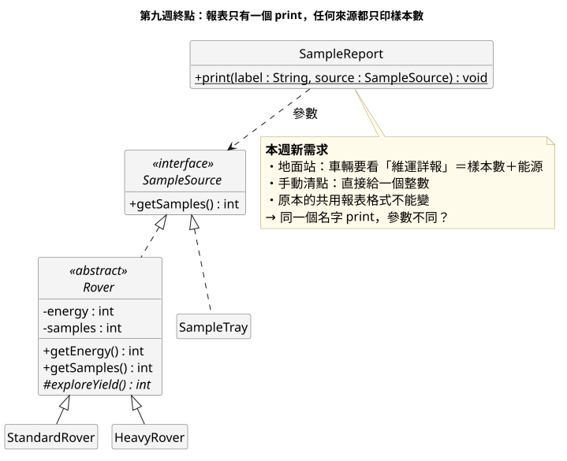
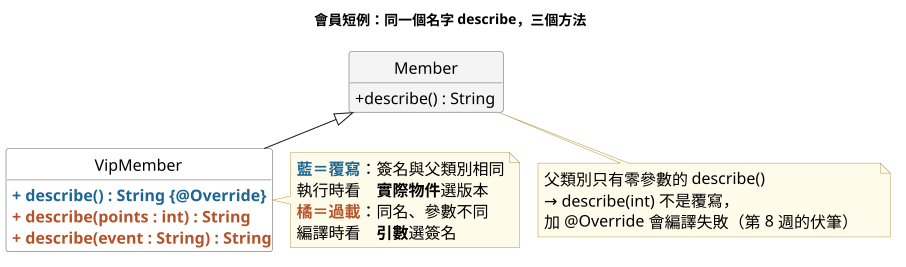
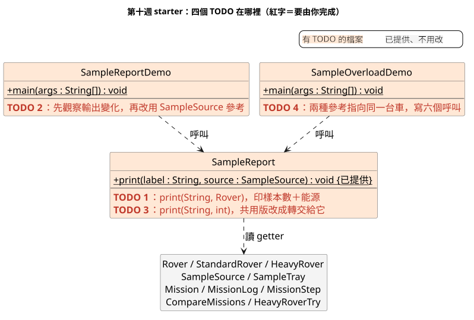
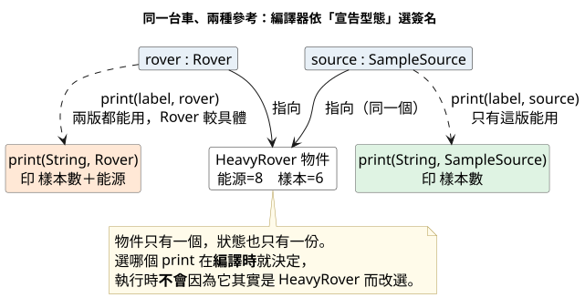
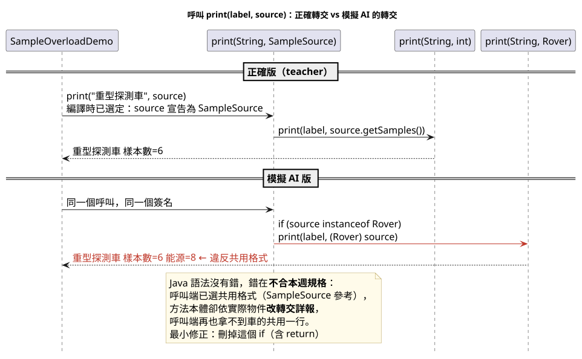
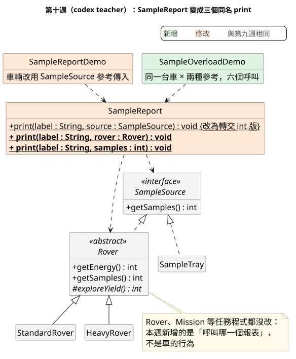

<!-- _class: lead by-claude -->

# 第十週｜過載與多型

## 同一台重型車，為什麼會印出兩種報表？

AI 生成多型程式碼：**比較與除錯**

物件導向程式設計（與 AI 協作）｜115 學年度第 1 學期
資訊管理學系 二年級｜授課教師：胡碩誠

<!--
講者備註：本份投影片依 week10/codex版本 的 README、student_lab、assignment、examples、starter、ai、teacher、teacher_notes、handoff 製作，由 Claude 撰寫；codex 原投影片 week10_slides_codex.md 保留不動，可擇一使用。
本份分兩部分：先用 examples/ 的會員短例教「過載是什麼、編譯器怎麼選簽名、和覆寫差在哪」，再用 starter/ 說明報表過載 TODO 1–4、AI 除錯與作業；teacher/ 的答案只出現在附錄。
-->

---

<!-- _class: by-claude small -->

## 關於這份投影片

- 每頁右上角 <span class="tag">claude</span>：本投影片由 Anthropic Claude（Claude Code）依 **codex版本教材** 製作，教師審閱後使用。
- 程式、講義題號（A–E）、TODO、預期輸出全部沿用 `week10/codex版本/`；投影片**不新增**學生作業。
- 左上角標籤是該頁對應的檔案（路徑以 `week10/codex版本/` 為起點）：

| 標籤 | 資料夾 | 在本投影片的角色 |
|---|---|---|
| <span class="tag blue">examples/…</span> | `examples/` | **第一部分：範例教學**——會員短例的覆寫與過載（講義 A2、A3） |
| <span class="tag green">starter/…</span> | `starter/` | **第二部分：作業說明**——報表過載 TODO 1–4（講義 A1、A4、B–E） |
| <span class="tag purple">ai/…</span> | `ai/` | D 段：教師撰寫的**模擬 AI 回覆**（共用報表多轉交一次） |
| <span class="tag brown">diagrams/…</span> | `diagrams/` | 本份新繪的 `*_claude` 圖，用來說明**與第九週的演進** |
| <span class="tag gray">teacher/…</span> | `teacher/` | **附錄：教師用**——完整答案、檢查工具、作業參考 |

<!--
講者備註：講義的活動順序是 A1→A2→A3→A4→B→C→D→E。本份依教師要求先把 examples（A2、A3）完整講完，再進 starter；A1 診斷與 A4 教師示範放在第二部分開頭。帶課以講義題號為準。
-->

---

<!-- _class: by-claude small -->

<div class="ex"><span class="dg">diagrams/start_w09_claude.svg</span><span>../../week09/codex版本/teacher/</span></div>

## 上週留下的問題：一個 `print` 不夠用

<div class="cols" style="grid-template-columns: 600px 1fr; gap: 22px;">
<div>



</div>
<div>

第九週：`SampleReport.print(String, SampleSource)`
車、樣本盒**都能傳入**，但只印樣本數。

地面站這週多了兩種需求：

- **車輛維運詳報**：樣本數＋**能源**
- **手動清點**：直接給一個**整數**

而且原本的共用報表格式**不能變**。

**本週問題**：可以讓三種報表都叫 `print` 嗎？編譯器怎麼知道要用哪一個？

</div>
</div>

<!--
講者備註：動機來自第九週 handoff 的「第 10 週入口」：同一台重型車同時由 Rover 和 SampleSource 參考，新增兩個同名報表簽名比較。第九週只驗收單一報表簽名。
-->

---

<!-- _class: by-claude small -->

## 本週流程：先用範例學過載，再用到報表作業

| 部分 | 內容 | 講義 | 時間（備課估計） |
|---|---|---|---|
| **第一部分** <span class="tag blue">examples/</span> | 會員短例：`describe()` 覆寫 vs `describe(int)`、`describe(String)` 過載 | A2 | 第 1 節 15 分 |
| | 兩個編譯預測：誤加 `@Override`、只改回傳型態 | A3 | （含在上面） |
| | 覆寫與過載對照：回收第 8 週的伏筆 | A3 | 第 1 節 10 分 |
| **第二部分** <span class="tag green">starter/</span> | A1 兩車診斷（放在第 1 節開頭 10 分） | A1 | 第 1 節 |
| | A4 同一台車、兩種參考：教師示範 | A4 | 第 1 節 15 分 |
| | B 新增簽名並檢查舊入口（TODO 1–3） | B | 第 2 節 35 分 |
| | C 並排六行（TODO 4） | C | 第 2 節 15 分 |
| | D 模擬 AI 除錯 → E 同儕與保存 | D、E | 第 3 節 |
| 課後 | 單參數快速查詢 `print(SampleSource)` | 作業 | 25–35 分（暫估） |

**每段都先寫預測，再編譯、執行、比對。**

<!--
講者備註：150 分鐘為未試教的備課估計（codex 教師筆記）。時間不足時，D 段保留同入口重測及保存成果。
-->

---

<!-- _class: by-claude small -->

## 本週學習目標與範圍

<div class="cols">
<div class="box green">

**本週要會**

1. 說出**簽名**＝方法名稱＋參數型態列表
2. 依「名稱 → 引數個數 → 引數**宣告型態**」預測編譯器選哪個過載
3. 兩個版本都能用時，選**較具體**的那個（`Rover` 比 `SampleSource` 具體）
4. 分開說明：**過載在編譯時選**、**覆寫在執行時選**
5. 觀察「新增一個簽名，會改變舊呼叫的選擇」
6. 重現並最小修正一段**能編譯**的模擬 AI 程式

</div>
<div class="box">

**本週不做**

- 自動裝箱、可變參數 `int...`、`null` 引數的歧義
- 基本型態的放寬轉換（`int` → `double`）只在補充提到
- 泛型方法過載 → **第十一週**起
- `instanceof`、轉型：只在 D 段**讀懂**教師片段，不要求會寫

</div>
</div>

<!--
講者備註：範圍依 codex 教材生成規劃：固定參數個數、完全相符的基本型態，以及既有的類別／介面型態。短例限定固定個數與完全相符的基本型態（codex 教師筆記末段）。
-->

---

<!-- _class: by-claude small -->

## 從 C# 對照：過載規則幾乎一樣

| 概念 | C#（一年級學過） | Java（本週） |
|---|---|---|
| 同名、參數不同 | `Console.WriteLine(int)`、`WriteLine(string)` | `print(String, Rover)`、`print(String, int)` |
| 選哪一個 | **編譯時**依引數的**宣告型態** | **編譯時**依引數的**宣告型態**（相同） |
| 只差回傳型態 | 不行 | 不行（相同） |
| 覆寫 | `virtual` ＋ `override` 關鍵字 | 預設可覆寫，`@Override` 註記檢查 |
| 執行時看實際物件 | 只有覆寫（`virtual`）會 | 只有覆寫的實例方法會（相同） |

- 你在 WinForms 早就用過過載：`MessageBox.Show(text)` 和 `MessageBox.Show(text, caption)`。
- **兩邊都一樣**：過載不會因為物件「其實是」哪個子類別，在執行時重新挑選。

<!--
講者備註：不展開 C# 的 dynamic。只強調 Java 與 C# 在「過載依宣告型態、編譯時決定」這點相同，學生的 C# 經驗可以直接遷移。
-->

---

<!-- _class: lead by-claude -->
<!-- footer: '物件導向程式設計｜Week 10｜第一部分 範例教學（examples/）' -->

# 第一部分｜範例教學

## 用 `examples/MemberOverloadDemo.java` 看懂過載

會員短例｜講義 A2、A3

<!--
講者備註：會員短例與探測車完全獨立，一個檔案就能跑。先在小範例看清楚規則，再回到報表。
-->

---

<!-- _class: by-claude small -->

<div class="ex"><span>examples/MemberOverloadDemo.java</span></div>

## 範例檔案與執行入口

一個檔案放**三個類別**：

| 類別 | 修飾 | 內容 |
|---|---|---|
| `Member` | （無 `public`） | `describe()` 回「一般會員」 |
| `VipMember` | （無 `public`） | 覆寫 `describe()`，另有 `describe(int)`、`describe(String)` |
| `MemberOverloadDemo` | `public` | `main`：印三行 |

- Java 規則：**只有 `public` 類別必須和檔名相同**；短例為了方便放在一起，主線仍維持一檔一類別。
- 與 starter **分開編譯**（輸出到不同資料夾）。在 `java-10` 執行：

```powershell
javac -encoding UTF-8 -d out-examples examples/*.java
java -cp out-examples MemberOverloadDemo
```

<!--
講者備註：短例用 VS Code 即可。這裡的 Member、VipMember 與第七、八週 examples 同名但不同內容，不要放進同一個輸出目錄。
-->

---

<!-- _class: by-claude small -->

<div class="ex"><span class="dg">diagrams/member_overload_claude.svg</span><span>examples/MemberOverloadDemo.java</span></div>

## 同一個名字 `describe`，三個方法



- **簽名（signature）**＝方法名稱＋**參數型態的順序列表**。`describe()`、`describe(int)`、`describe(String)` 是**三個不同的簽名**。
- 參數名稱（`points`、`event`）和回傳型態**都不算**在簽名裡。

<!--
講者備註：語言規則依據 JLS 8.4.2（方法簽名）、8.4.9（過載）。藍色那個和父類別同簽名，是覆寫；橘色兩個是 VipMember 自己的過載。
-->

---

<!-- _class: by-claude -->

<div class="ex"><span>examples/MemberOverloadDemo.java</span></div>

## A2｜先預測三行輸出

```java
VipMember vip = new VipMember();
// 指向同一個物件。編譯時由 Member 找簽名，執行時由 VIP 提供覆寫。
Member member = vip;
System.out.println(member.describe());
System.out.println(vip.describe(30));
System.out.println(vip.describe("迎新"));
```

在講義 A 的表格寫下：**引數有幾個、什麼型態** → 對到哪一個 `describe` → 印出什麼。

<!--
講者備註：先投影呼叫處。不要先執行。提醒學生 member 的宣告型態是 Member。
-->

---

<!-- _class: by-claude small -->

<div class="ex"><span>examples/MemberOverloadDemo.java</span></div>

## A2｜答案：先選簽名，再決定執行哪個版本

```text
VIP 會員
VIP 會員 點數=30
VIP 會員 活動=迎新
```

| 呼叫 | 編譯時（看宣告型態、引數） | 執行時（看實際物件） |
|---|---|---|
| `member.describe()` | `member` 宣告為 `Member` → 在 `Member` 找到零參數 `describe()` | 物件是 VIP → 執行 VIP 的**覆寫** |
| `vip.describe(30)` | 一個 `int` 引數 → 選 `describe(int)` | 只有一個版本 |
| `vip.describe("迎新")` | 一個 `String` 引數 → 選 `describe(String)` | 只有一個版本 |

**口訣（延續第 8 週）**：編譯看宣告型態**選簽名**，執行看實際物件**選覆寫版本**。

<!--
講者備註：codex 教師筆記：member.describe() 編譯時依 Member 找到零參數簽名，執行時執行 VIP 的覆寫。若學生問 member.describe(30)：Member 沒有這個簽名，編譯失敗（與第 8 週 memberView.claimBonus() 同理）。
-->

---

<!-- _class: by-claude small -->

## 編譯器怎麼挑過載：本週只用這四步

<div class="cols" style="grid-template-columns: 1.1fr 1fr;">
<div>

1. **名稱**：在引數的宣告型態（或類別）裡找同名方法
2. **個數**：留下參數個數相同的
3. **型態**：留下每個引數都「放得進去」的
   - 子類別物件可以放進父類別／介面參數
4. **最具體**：還剩好幾個時，選參數型態**最具體**的

找不到 → 編譯錯誤；選好之後，執行時**不再改選**。

</div>
<div class="box blue">

**例：第 4 步**

```java
static void f(SampleSource s) {…}
static void f(Rover r) {…}

Rover rover = new HeavyRover(20, 0);
f(rover);
```

兩個都放得進去（`Rover` 實作 `SampleSource`）。
`Rover` 比 `SampleSource` **具體** → 選 `f(Rover)`。

</div>
</div>

<!--
講者備註：完整規則見 JLS 15.12.2（三階段、裝箱、可變參數），本週只用固定個數與完全相符型態。不要現在講裝箱與 null 歧義。這四步就是第二部分 A4、B 段要用的工具。
-->

---

<!-- _class: by-claude -->

<div class="ex"><span>examples/MemberOverloadDemo.java</span></div>

## A3｜兩個編譯預測（先寫理由）

**1.** 在 `VipMember.describe(int points)` 上面加 `@Override`，可以編譯嗎？

```java
@Override
public String describe(int points) { … }
```

**2.** 同一個類別已有 `String describe(int points)`，再宣告這個，可以編譯嗎？

```java
public int describe(int points) { return points; }
```

先在講義寫「可以／不行＋理由」，再看教師在**獨立副本**編譯。

<!--
講者備註：第 1 題回收第 8 週 C2 的伏筆（describe(int) 加 @Override 不能編譯，當時只說「這不是覆寫」，完整過載留到本週）。教師在副本示範，不改正式 examples。
-->

---

<!-- _class: by-claude small -->

<div class="ex"><span>examples/MemberOverloadDemo.java（教師副本）</span></div>

## A3｜答案與實際診斷（JDK 22）

<div class="cols">
<div>

**1. 誤加 `@Override`** → 不能編譯

```text
error: method does not override or
implement a method from a supertype
    @Override
    ^
```

父類別 `Member` 只有 `describe()`，**沒有** `describe(int)`。
`describe(int)` 是**過載**，不是覆寫；拿掉 `@Override` 就能編譯。

</div>
<div>

**2. 只差回傳型態** → 不能編譯

```text
error: method describe(int) is already
defined in class VipMember
```

回傳型態**不是**簽名的一部分：兩個都是 `describe(int)`。
呼叫 `vip.describe(30)` 時編譯器也無從分辨。

</div>
</div>

<span class="note">診斷字句為 OpenJDK 22 英文訊息；其他版本或語系可能略有不同，看「第一個與自己改動有關的錯誤」即可。</span>

<!--
講者備註：codex 教師筆記：學生先答，再看隔離編譯的第一個相關錯誤。
-->

---

<!-- _class: by-claude small -->

## 覆寫 vs 過載：這週要能分清楚

| | **覆寫**（override，第 8 週） | **過載**（overload，本週） |
|---|---|---|
| 簽名 | 與父類別**相同** | **同名、參數不同** |
| 出現在哪 | 子類別改寫父類別的方法 | 同一類別（或繼承來的）多個同名方法 |
| **何時決定** | **執行時**，看**實際物件** | **編譯時**，看引數的**宣告型態** |
| `@Override` | 建議加，讓編譯器檢查 | **不能**加（會編譯錯誤） |
| 本課例子 | `exploreYield()`、`describe()` | `describe(int)`、`SampleReport.print(...)` |

**一句話**：過載是「**名字一樣，給編譯器挑**」；覆寫是「**簽名一樣，給物件決定**」。

<!--
講者備註：codex 教師筆記第 1 節最後 10 分鐘「回收第 8 週的 @Override 及覆寫」。可以請學生舉手判斷：describe() 是哪一種？describe("迎新") 是哪一種？
-->

---

<!-- _class: by-claude small -->

## 第一部分小結 → 帶到報表作業

| 從會員短例學到 | 在 starter 報表會用在 |
|---|---|
| 簽名＝名稱＋參數型態 | **TODO 1、3**：新增 `print(String, Rover)`、`print(String, int)` |
| 依引數**宣告型態**選簽名 | **A4、TODO 2**：同一台車用 `Rover` 或 `SampleSource` 參考傳入 |
| 兩個都能用 → 選**最具體** | **TODO 2**：加了 `Rover` 版後，舊呼叫改選它 |
| 過載編譯時選、覆寫執行時選 | **D 段**：AI 在方法裡依實際物件改轉交，蓋掉呼叫端選的共用格式 |
| 只差回傳型態不能過載 | 設計報表時，用**參數**區分，不用回傳值 |

<!--
講者備註：接下來進入 starter。提醒學生 examples 與 starter 分開編譯。
-->

---

<!-- _class: lead part2 by-claude -->
<!-- footer: '物件導向程式設計｜Week 10｜第二部分 作業說明（starter/）' -->

# 第二部分｜作業說明

## 用 `starter/` 為報表加上過載

TODO 1–4｜講義 A1、A4、B、C、D、E

<!--
講者備註：starter 是第九週 Codex 教師版的完成狀態，加上本週的 SampleOverloadDemo 與 TODO。
-->

---

<!-- _class: by-claude small -->

<div class="ex"><span class="st">starter/（13 個 .java）</span></div>

## starter 的檔案與起始狀態

<div class="cols" style="grid-template-columns: 1.15fr 1fr;">
<div>

| 檔案 | 狀態 |
|---|---|
| `SampleReport.java` | **TODO 1、3** |
| `SampleReportDemo.java` | **TODO 2**（舊入口） |
| `SampleOverloadDemo.java` | **TODO 4**（新入口） |
| `Rover`、`StandardRover`、`HeavyRover` | 已提供（第九週完成版） |
| `SampleSource`、`SampleTray` | 已提供 |
| `Mission`、`MissionLog`、`MissionStep` | 已提供 |
| `CompareMissions`、`HeavyRoverTry` | 已提供（回歸用） |

</div>
<div>

複製到 `java-10/src/`，在 `java-10`：

```powershell
javac -encoding UTF-8 -d out src/*.java
java -cp out CompareMissions
java -cp out SampleReportDemo
java -cp out SampleOverloadDemo
```

起始輸出：

```text
重型探測車 樣本數=6
樣本盒 樣本數=4
空盒 樣本數=0
```

`SampleOverloadDemo` 印「尚未完成」。

</div>
</div>

<!--
講者備註：13 個檔超過兩個，示範一次 IntelliJ IDEA：開 java-10、選已安裝的 JDK、src 標為來源根、從 main 啟動。一套 IDE 即可完成。examples/、teacher/、ai-check/ 各自有輸出目錄。
-->

---

<!-- _class: by-claude -->

<div class="ex"><span class="st">starter/CompareMissions.java</span></div>

## A1｜診斷：哪台車會讀到第 3 步？

```java
int[] script = {1, 1, 2};   // 探索、探索、掃描
Rover normal = new StandardRover(20, 0);
Rover heavy  = new HeavyRover(20, 0);
```

- 兩個變數的**宣告型態**都是 `Rover`；**實際物件**各是哪一種？
- 探索耗 6 格：一般車得 2 份、重型車得 3 份。樣本數 ≥ 5 就達標停止。
- 預測：哪台會讀到第 3 筆（掃描）？最後能源／樣本／成功行動數各是多少？

先填講義 A1，再執行 `CompareMissions`。

<!--
講者備註：10 分鐘。這是第九週的覆寫複習：探索流程相同，實際車種決定產量。
-->

---

<!-- _class: by-claude small -->

<div class="ex"><span class="st">starter/CompareMissions.java</span></div>

## A1｜答案：同一流程，產量由實際車種決定

<div class="cols">
<div>

| | 一般車 | 重型車 |
|---|---|---|
| 第 1 次探索 | 14 格／2 份 | 14 格／3 份 |
| 第 2 次探索 | 8 格／4 份 | 8 格／**6 份 → 達標** |
| 第 3 筆掃描 | 6 格／**5 份 → 達標** | **沒讀到**（略過=1） |
| 能源/樣本/行動 | **6/5/3** | **8/6/2** |
| 步數 | 3 | 2 |

</div>
<div>

```text
=== 重型探測車 ===
...
步數=2, 成功=2, 拒絕=0, 略過=1
最低能源=8
最終能源=8, 樣本數=6, 行動次數=2
 -> 任務成功
```

`exploreYield()` 是**覆寫**：`Rover` 的探索流程呼叫它時，**執行時**看實際物件回 2 或 3。

</div>
</div>

<!--
講者備註：codex 教師筆記：共同探索流程成功扣 6 格後才呼叫 exploreYield()，由實際車種決定回 2 或 3。這是「執行時選」的例子；接下來的報表是「編譯時選」的例子。
-->

---

<!-- _class: by-claude small -->

<div class="ex"><span class="dg">diagrams/starter_todo_claude.svg</span><span class="st">starter/SampleReport.java</span><span class="st">starter/SampleReportDemo.java</span><span class="st">starter/SampleOverloadDemo.java</span></div>

## starter：四個 TODO 在哪裡



<!--
講者備註：TODO 1、3 在 SampleReport（新增兩個過載），TODO 2 在舊入口 SampleReportDemo，TODO 4 在新入口 SampleOverloadDemo。車輛、任務等任務程式全部已提供、不用改。
-->

---

<!-- _class: by-claude small -->

<div class="ex"><span class="dg">diagrams/overload_select_claude.svg</span><span class="tc">teacher/SampleOverloadDemo.java（教師示範）</span></div>

## A4｜同一台車、兩種參考：各選哪個 `print`？

<div class="cols" style="grid-template-columns: 440px 1fr; gap: 18px;">
<div>

假設報表**已經有**兩個簽名：

```java
print(String label, Rover rover)
print(String label, SampleSource source)
```

```java
Rover rover = new HeavyRover(20, 0);
// …任務跑完…
SampleSource source = rover;
SampleReport.print("重型探測車", rover);
SampleReport.print("重型探測車", source);
```

**先預測**：兩行各選哪個簽名？哪行有能源？

</div>
<div>



</div>
</div>

<!--
講者備註：15 分鐘。教師跑完成版 SampleOverloadDemo，只投影呼叫處與前兩行輸出，完成版方法本體留在教師材料（codex 教師筆記）。圖中已標出選擇結果，可先遮住右半邊讓學生預測。
-->

---

<!-- _class: by-claude small -->

<div class="ex"><span class="tc">teacher/SampleOverloadDemo.java（前兩行）</span></div>

## A4｜答案：把「編譯時」和「執行時」分開追蹤

```text
重型探測車 樣本數=6 能源=8
重型探測車 樣本數=6
```

| 呼叫 | 編譯時找什麼 | 執行時看到什麼 |
|---|---|---|
| `print(label, rover)` | 兩版都能用，`Rover` **較具體** → 詳報 | 印樣本數**及能源** |
| `print(label, source)` | `SampleSource` 放不進 `Rover` 參數 → **只有共用版** | 印樣本數 |
| 車內呼叫 `exploreYield()` | 已確定零參數簽名 | **實際車種**決定回 2 或 3 |

- 兩個變數指向**同一個物件**（能源 8、樣本 6 只有一份）。
- `static print` 的選擇**不會**在執行時因為物件「其實是 HeavyRover」而改變。

<!--
講者備註：codex 教師筆記：同一重型車用 Rover 引數時，兩個參考型態版本適用，選較具體的 Rover。用 SampleSource 引數時，只適用共用版本。車種不會在執行期重新替 static print 選簽名。
-->

---

<!-- _class: by-claude -->

<div class="ex"><span class="st">starter/SampleReport.java</span><span class="st">starter/SampleReportDemo.java</span></div>

## B｜先跑舊報表，留下基準

```java
public class SampleReport {
    public static void print(String label, SampleSource source) {
        // 共用報表只讀取樣本數，適用於車輛及樣本盒。
        System.out.println(label + " 樣本數=" + source.getSamples());
    }
    // TODO 1：新增 Rover 版的詳報，讀取樣本數與能源。
    // TODO 3：新增 int 版，並由共用報表轉交相同的輸出格式。
}
```

`SampleReportDemo` 裡：`Rover heavy = new HeavyRover(20, 0);` → `print("重型探測車", heavy)`

先執行一次，把三行（6、4、0）寫進講義 B 表格「新增簽名前」。

<!--
講者備註：第 2 節前 10 分鐘讀規格。此時 heavy 宣告為 Rover，但報表只有 SampleSource 版本，所以選到共用版。
-->

---

<!-- _class: by-claude -->

<div class="ex"><span class="st">starter/SampleReport.java</span></div>

## B｜TODO 1：新增車輛詳報

規格：

```java
public static void print(String label, Rover rover)
```

- 用公開 getter 讀：`rover.getSamples()`、`rover.getEnergy()`
- 印**一行**：`<標籤> 樣本數=<數量> 能源=<能源>`
- 只讀，不改車輛狀態或任務日誌

> 共用報表 `print(String, SampleSource)` 的規格**不變**：一行 `<標籤> 樣本數=<數量>`。

<!--
講者備註：不要在這頁給方法本體。完成 TODO 1 後先不要改 SampleReportDemo，下一頁先預測。
-->

---

<!-- _class: by-claude -->

<div class="ex"><span class="st">starter/SampleReportDemo.java</span></div>

## B｜TODO 2（預測）：舊程式一個字都沒改……

完成 TODO 1 後，**先不要動** `SampleReportDemo`：

```java
Rover heavy = new HeavyRover(20, 0);
…
SampleReport.print("重型探測車", heavy);
SampleReport.print("樣本盒", tray);
SampleReport.print("空盒", empty);
```

- 重新編譯執行，三行會**有變化嗎**？哪一行？為什麼？
- 用第一部分的「四步」解釋：`heavy` 的**宣告型態**是什麼？現在有幾個 `print` 放得進去？

<!--
講者備註：不要在學生預測前顯示結果。這是本週最重要的觀察：新增一個簽名，可能改變既有呼叫的選擇。
-->

---

<!-- _class: by-claude small -->

<div class="ex"><span class="st">starter/SampleReportDemo.java</span></div>

## B｜TODO 2（答案）：新簽名「搶走」了舊呼叫

```text
重型探測車 樣本數=6 能源=8     ← 變了！
樣本盒 樣本數=4
空盒 樣本數=0
```

- `heavy` 宣告為 `Rover` → 現在 `print(String, Rover)` 也放得進去，而且**較具體** → 編譯器改選它。
- 盒子是 `SampleTray`，放不進 `Rover` → 仍選共用版，兩行不變。

**修正（依舊入口規格：要共用格式）**：用同一台車建立介面參考再傳入

```java
SampleSource source = heavy;
SampleReport.print("重型探測車", source);   // 第一行恢復：樣本數=6
```

> **教訓**：新增過載不只「多一個選擇」，也可能**改變已經存在的呼叫**。AI 順手「加一個更方便的版本」時特別要重跑舊入口。

<!--
講者備註：codex 教師筆記 TODO 1／TODO 2。若學生想移除詳報版本，引導回需求：同一台車要能從共用報表與維運詳報兩個入口呈現。若重跑仍是舊輸出，先確認這次編譯成功、執行的是當前 out。
-->

---

<!-- _class: by-claude small -->

<div class="ex"><span class="st">starter/SampleReport.java</span></div>

## B｜TODO 3：手動清點，並讓共用版轉交

<div class="cols" style="grid-template-columns: 1fr 1fr;">
<div>

1. 新增

```java
public static void print(String label, int samples)
```

印共用格式：`<標籤> 樣本數=<數量>`

2. 把 `SampleSource` 版改成：**先讀數量**，再交給 `int` 版印出（格式只寫一次）
3. 重跑舊入口，三行都維持共用格式

</div>
<div class="box red">

**常見陷阱：轉交到自己**

如果在 `Rover` 版裡寫

```java
print(label, rover);
```

`rover` 的宣告型態是 `Rover` → 選到的**還是這個方法** → 一直呼叫自己 → `StackOverflowError`。

轉交方向要往「更簡單的參數」：`SampleSource` → `int`。

</div>
</div>

<!--
講者備註：codex 教師筆記 TODO 3：若在 Rover 版寫 print(label, rover)，呼叫會再次選到同一個 Rover 簽名，最後出現 StackOverflowError。先請學生指出重複呼叫的位置。詳報仍須包含能源。實測 JDK 22 確實拋出 StackOverflowError。
-->

---

<!-- _class: by-claude small -->

<div class="ex"><span class="st">starter/SampleReportDemo.java</span></div>

## B｜講義表格：舊入口的三個階段（答案）

| `SampleReportDemo` 階段 | 三行實際輸出 | 重型車呼叫選到的簽名及理由 |
|---|---|---|
| 新增簽名前 | `樣本數=6`／`4`／`0` | `print(String, SampleSource)`：唯一放得進去的版本 |
| 新增後、改呼叫前 | `樣本數=6 能源=8`／`4`／`0` | `print(String, Rover)`：`heavy` 宣告為 `Rover`，較具體 |
| 改呼叫並完成 TODO 3 後 | `樣本數=6`／`4`／`0` | `print(String, SampleSource)`：引數宣告為 `SampleSource`；本體再轉交 `int` 版 |

**盒子兩行全程不變**：`SampleTray` 從來放不進 `Rover` 參數。

<!--
講者備註：codex 驗證紀錄「舊呼叫的三個階段」與本表一致（本份另於 JDK 22 實測只加入 TODO 1 的中間狀態）。
-->

---

<!-- _class: by-claude small -->

<div class="ex"><span class="st">starter/SampleOverloadDemo.java</span></div>

## C｜TODO 4：並排六個呼叫

```java
Rover rover = new HeavyRover(20, 0);
Mission mission = new Mission(rover);
mission.run(new int[] {1, 1, 2});
// TODO 4：建立同一台車的介面參考，依講義 C 的順序寫六個呼叫。
```

移除「尚未完成」，依序印出：

```text
重型探測車 樣本數=6 能源=8      ← rover
重型探測車 樣本數=6             ← 同一台車的 SampleSource 參考
樣本盒 樣本數=4
空盒 樣本數=0                   ← 樣本盒 0 份
手動清點 樣本數=7               ← 整數 7
手動清點 樣本數=0               ← 整數 0
```

<!--
講者備註：15 分鐘。兩個 0 走不同簽名：空盒經介面版（再轉交 int 版），手動清點直接進 int 版。每次修改 src 後重編譯。
-->

---

<!-- _class: by-claude -->

<div class="ex"><span class="st">starter/SampleOverloadDemo.java</span></div>

## C｜再設計一個「抓錯」案例

六行都對，**不代表**程式讀的是真的資料。

- 例：把樣本盒從 `new SampleTray(4)` 改成 `new SampleTray(9)`，報表應該跟著變成 9。
- 如果還是印 4 → 報表可能把數字**寫死**了。

在講義記下：**想抓的錯誤、預期、實際、判斷**。
**提交前恢復六行基準。**

<!--
講者備註：codex 教師筆記 TODO 4：再以非 4 的樣本盒數量抓寫死資料。
-->

---

<!-- _class: by-claude small -->

<div class="ex"><span class="ai">ai/SampleReport.java</span></div>

## D｜模擬 AI 回覆：這段程式**可以編譯**

先在 `AI_USAGE.md` 用 3–5 句寫下規格，並**預測**同一台車經兩種參考的兩行。

教師模擬 AI 在共用報表裡加了：

```java
public static void print(String label, SampleSource source) {
    if (source instanceof Rover) {
        print(label, (Rover) source);
        return;
    }
    print(label, source.getSamples());
}
```

- `source instanceof Rover`：「這個來源**實際上**是一台 `Rover` 嗎？」
- `(Rover) source`：讓後面的呼叫以 `Rover` 型態傳入。

**只要讀懂這兩行，不需會寫。** 這段違反了哪一條規格？

<!--
講者備註：前 5 分鐘先寫需求與預測。instanceof 與轉型前兩週都明訂不教；本活動只讀教師片段（codex 講義 D2）。
-->

---

<!-- _class: by-claude small -->

<div class="ex"><span class="ai">ai/SampleReport.java</span><span class="st">ai-check/（本人副本）</span></div>

## D｜重現：在獨立副本跑同一個入口

1. 保存人工完成版。把完成的 `src` Java 檔**複製**到 `java-10/ai-check/`。
2. 用 `ai/SampleReport.java` 覆蓋**副本**中的同名檔。
3. 在 `ai-check`：

```powershell
javac -encoding UTF-8 -d out *.java
java -cp out SampleOverloadDemo
```

4. 圈出違反規格的欄位。寫下：呼叫端先選到**哪個簽名**？方法本體又轉交給**哪個簽名**？

<!--
講者備註：20 分鐘含重現與重測。只改副本，正式 src 不動。
-->

---

<!-- _class: by-claude -->

<div class="ex"><span class="ai">ai/SampleReport.java</span><span class="st">ai-check/（本人副本）</span></div>

## D｜結果：第二行多了能源

```text
重型探測車 樣本數=6 能源=8
重型探測車 樣本數=6 能源=8     ✗ 應為「重型探測車 樣本數=6」
樣本盒 樣本數=4
空盒 樣本數=0
手動清點 樣本數=7
手動清點 樣本數=0
```

- 只有第二行錯；**盒子與手動四行都正確**——只測它們會**漏抓**。
- 先回答講義 D3：呼叫端選到哪個簽名？方法本體又轉交給哪個？（下一頁對答案）

<!--
講者備註：codex 教師筆記第 3 節：模擬程式第二行錯誤地成為「重型探測車 樣本數=6 能源=8」，第一行及後四行仍正確。
-->

---

<!-- _class: by-claude small -->

<div class="ex"><span class="dg">diagrams/ai_forward_claude.svg</span><span class="ai">ai/SampleReport.java</span></div>

## D｜為什麼：方法本體「多轉交了一次」



<!--
講者備註：codex 教師筆記第 3 節：呼叫端先以 SampleSource 選定共用簽名，該方法的分支再以 (Rover) source 傳入另一個簽名。instanceof 加轉型在 Java 裡完全合法，問題是它和本週規格衝突：規格讓呼叫端依參考型態選格式，AI 版卻讓實際物件決定，呼叫端就算刻意傳 SampleSource 參考也拿不到共用一行。下一頁的討論再談「需求改了會怎樣」。
-->

---

<!-- _class: by-claude small -->

<div class="ex"><span class="ai">ai-check/SampleReport.java</span></div>

## D｜最小修正與重測

**只改造成違規的轉交**：刪掉整個 `if`（含 `return`），保留用數量轉交那一行。

```java
public static void print(String label, SampleSource source) {
    print(label, source.getSamples());
}
```

- 從**同一入口** `SampleOverloadDemo` 重跑，六行回到講義 C。
- 也可以再跑一次舊入口 `SampleReportDemo`：錯誤版的第一行**也會**多出能源，修正後恢復。
- 在 `AI_USAGE.md` 記：錯誤前後的輸出、採納或拒絕的理由。

> 不是「把 AI 的程式整份換成老師的」，而是**找出那一處、只改那一處、用同一案例證明**。

<!--
講者備註：舊入口那一點是 Claude 實測補充（AI 版本的 SampleReportDemo 第一行也是「樣本數=6 能源=8」），codex 講義只要求比對 SampleOverloadDemo；可作為「回歸測試抓到同一個錯」的例子口頭提出。
-->

---

<!-- _class: by-claude small -->

<div class="ex"><span class="ai">ai/SampleReport.java</span><span class="st">student_lab.md D5</span></div>

## D｜討論：AI 的寫法「錯」在哪裡？

<div class="cols">
<div class="box green">

**Java 語法沒有錯**

- `instanceof`＋轉型能編譯、能執行
- 「依實際物件決定行為」本身是合理的設計
- 所以不能只說「過載在編譯時選，AI 卻在執行時再選」就判它錯

</div>
<div class="box red">

**錯在不合本週規格**

- 規格：**呼叫端**選格式——`Rover` 參考印詳報，`SampleSource` 參考印共用一行
- AI 版：傳 `SampleSource` 也印能源，呼叫端**拿不到**車的共用一行
- 舊入口 `SampleReportDemo` 第一行、作業的快速查詢也都會跟著多出能源

</div>
</div>

**如果需求改成「只要是車，就一律印能源」**：AI 的輸出就對了。但較好的寫法是讓物件自己提供報表內容，由 `Rover` 覆寫（就像 `HeavyRover` 覆寫 `exploreYield()`）；共用報表不必認得 `Rover`，也不用轉型。

<!--
講者備註：對應講義 D5 討論題（可課後補）。判斷對錯要回到需求：本週需求是同一台車可經兩個入口呈現兩種格式，所以拒絕 AI 的轉交。若需求改為依實際物件決定，instanceof 也能做到，但每加一種有詳報的來源都要回頭改 SampleReport；用覆寫則只改新類別。這是延伸討論，本週不要求實作。
-->

---

<!-- _class: by-claude small -->

## E｜同儕檢查與保存（第 3 節後 25 分）

<div class="cols">
<div>

**同儕 10 分鐘**：互相解釋並**指出程式行**

1. 同一台車為什麼有**兩種報表**？
   → 呼叫處的引數宣告型態（編譯時）
2. 相同探索流程為什麼有**兩種產量**？
   → `exploreYield()` 覆寫（執行時）

</div>
<div>

**保存 15 分鐘**

- 在正式 `src` 重跑舊入口、新入口、`CompareMissions`
- GitHub Desktop：看差異 → commit → push → 遠端核對
- 在原 repo 外取回並重編譯，記錄輸出
- **不提交**：`out`、`.class`、`ai-check`、實驗副本、憑證
- 遠端有問題：先保存本機提交，**據實記錄**

</div>
</div>

<!--
講者備註：無法推送時保留本機提交並據實記錄，不能把備份寫成 push 成功。
-->

---

<!-- _class: by-claude small -->

<div class="ex"><span class="dg">diagrams/evolution_w10_claude.svg</span><span class="tc">teacher/</span></div>

## 第九週 → 第十週：改了什麼？

<div class="cols" style="grid-template-columns: 560px 1fr; gap: 22px;">
<div>



</div>
<div>

- **修改** `SampleReport`：一個 `print` 變**三個同名 `print`**
- **修改** `SampleReportDemo`：車輛改用 `SampleSource` 參考，維持舊格式
- **新增** `SampleOverloadDemo`：六個呼叫並排比較
- **不變**：`Rover`、`HeavyRover`、`StandardRover`、`SampleSource`、`SampleTray`、`Mission`……

本週新增的是「**呼叫哪一個報表**」，不是車的行為。

</div>
</div>

<!--
講者備註：Rover、HeavyRover、CompareMissions 本週只更新註解（行為與第九週相同，codex 驗證以第九週教師版比對完整輸出）。第九週教師的 StepListenerDemo 示範沒有帶到本週。
-->

---

<!-- _class: by-claude small -->

## 三週演進一覽：同一個 `Rover`，越來越會「被替換」

| 週 | 關鍵程式 | 誰決定用哪個方法 | 何時決定 |
|---|---|---|---|
| 第 8 週 | `HeavyRover` 覆寫 `exploreYield()` | 實際物件 | **執行時** |
| 第 9 週 | `Rover` 變抽象、實作 `SampleSource`；報表收介面 | 實際物件（介面方法也是覆寫） | **執行時** |
| 第 10 週 | `SampleReport.print` 三個過載 | 引數的**宣告型態** | **編譯時** |
| 第 11 週（預告） | `ArrayList<MissionStep>`：取出時編譯器知道什麼？ | 型態參數 | **編譯時** |

<!--
講者備註：codex handoff 第 11 週入口：先問 ArrayList<MissionStep> 取出元素時編譯器知道什麼，放錯型態時在哪裡被發現；再問相同存取流程要處理另一種資料時，如何保留各自的型態。
-->

---

<!-- _class: by-claude small -->

## 課後作業：樣本快速查詢（25–35 分，暫估）

在課堂完成版的 `SampleReport` 新增**單參數**版本：

```java
public static void print(SampleSource source)
```

自訂固定、易懂的繁體中文標籤，**轉交既有共用報表**，每次印一行樣本數。

**必做**

1. 寫一個簡短入口：用**宣告為 `Rover`** 的車輛、和樣本盒各呼叫一次；至少一個來源是**零樣本**（例：重型車 20/0 跑 `{1,1,2}`、空樣本盒）
2. `LAB_REPORT.md`：每次呼叫的引數個數、預期、實際；說明「**以 `Rover` 參考呼叫單參數版本時，為何只顯示樣本數？**」
3. 重跑 `SampleReportDemo`（3 行）、`SampleOverloadDemo`（6 行）、`CompareMissions`（`6/5/3`、`8/6/2`）
4. 繳交 `src/`、`LAB_REPORT.md`、`AI_USAGE.md`

<!--
講者備註：提示方向不給答案：單參數呼叫時，只有一個引數的 print 只有一個；方法本體裡的 source 宣告為 SampleSource，再用兩個引數轉交時會選哪一個？
-->

---

<!-- _class: by-claude small -->

## 作業驗收與選做

| 驗收重點 | 怎麼看 |
|---|---|
| 新增簽名及轉交正確 | 單參數版只做一件事：補上標籤，交給共用報表 |
| 兩筆快速查詢正確 | 格式與數量對；零樣本那筆印 0 |
| 原入口回歸 | 3 行、6 行、兩車狀態都和課堂一致 |
| 理由與 AI 證據完整 | 能指出呼叫行與方法本體各一處；AI 修正有同案例重測 |

**選做**：各寫一行「過載呼叫」與「用不同方法名稱的呼叫」（例如 `printVehicle(...)`），說明哪個在呼叫處較容易看出是車輛詳報。

<!--
講者備註：codex 教師筆記：自行選的有效標籤也可通過驗收。教師判讀時要求學生指到呼叫行和方法本體各一處，並說明修正後用哪一個案例重跑。
-->

---

<!-- _class: lead part3 by-claude -->
<!-- footer: '物件導向程式設計｜Week 10｜附錄 教師用（teacher/）' -->

# 附錄｜教師用

## `teacher/` 完整答案、檢查工具、作業參考

學生實作前不投影

<!--
講者備註：以下頁面含完整解答，課堂講評或備課時使用。
-->

---

<!-- _class: by-claude small -->

<div class="ex"><span class="tc">teacher/SampleReport.java</span></div>

## TODO 1、3 參考答案

```java
public class SampleReport {
    public static void print(String label, SampleSource source) {
        // 介面只提供樣本數。交給 int 版本共用輸出格式。
        print(label, source.getSamples());
    }

    public static void print(String label, Rover rover) {
        // Rover 額外提供能源。兩個 getter 都只讀狀態。
        System.out.println(label + " 樣本數=" + rover.getSamples() + " 能源=" + rover.getEnergy());
    }

    public static void print(String label, int samples) {
        System.out.println(label + " 樣本數=" + samples);
    }
}
```

<!--
講者備註：檢查重點：Rover 版沒有呼叫 print(label, rover)；SampleSource 版轉交 int 版；格式字串只在兩處（詳報、共用）。
-->

---

<!-- _class: by-claude small -->

<div class="ex"><span class="tc">teacher/SampleReportDemo.java</span><span class="tc">teacher/SampleOverloadDemo.java</span></div>

## TODO 2、4 參考答案

<div class="cols">
<div>

**TODO 2**（`SampleReportDemo`）

```java
// 舊入口需要共用報表。
// 以介面參考傳入同一台重型車。
SampleSource source = heavy;
SampleReport.print("重型探測車", source);
SampleReport.print("樣本盒", tray);
SampleReport.print("空盒", empty);
```

</div>
<div>

**TODO 4**（`SampleOverloadDemo`）

```java
SampleSource source = rover;
SampleReport.print("重型探測車", rover);
SampleReport.print("重型探測車", source);
SampleReport.print("樣本盒", new SampleTray(4));
SampleReport.print("空盒", new SampleTray(0));
SampleReport.print("手動清點", 7);
SampleReport.print("手動清點", 0);
```

</div>
</div>

<!--
講者備註：兩個入口各自建立新車（codex handoff）。
-->

---

<!-- _class: by-claude small -->

## 常見錯誤與診斷

| 現象 | 原因 | 引導 |
|---|---|---|
| 舊入口第一行多了能源 | 完成 TODO 1 後 `heavy`（`Rover`）改選詳報 | 這是 TODO 2 要觀察的；改用 `SampleSource` 參考 |
| `StackOverflowError` | `Rover` 版內寫 `print(label, rover)`，選回自己 | 指出重複呼叫的那一行；轉交往 `int` 版 |
| 想刪掉詳報版本讓舊入口恢復 | 誤把「恢復輸出」當成目標 | 回到需求：同一台車要有兩個入口 |
| 重跑還是舊輸出 | 編譯失敗卻執行舊 `out`、或執行錯資料夾 | 先看 `javac` 有無錯誤、`-cp` 指向哪裡 |
| `describe(int)` 加 `@Override` 編譯失敗 | 過載不是覆寫 | 拿掉註記；對照覆寫 vs 過載表 |
| 以為執行時會依實際車種選 `print` | 混淆過載與覆寫 | A4 追蹤表：編譯時欄 vs 執行時欄 |
| AI 修正整份覆蓋 | 沒有最小修正 | 只刪 `if`；同入口重跑六行 |

<!--
講者備註：來源為 codex 教師筆記第 2 節與第 3 節；StackOverflowError 與中間狀態輸出已由 Claude 於 JDK 22 實測。
-->

---

<!-- _class: by-claude small -->

<div class="ex"><span class="tc">teacher/homework/SampleReport.java</span><span class="tc">teacher/homework/QuickSampleDemo.java</span></div>

## 作業參考解（與主線分開編譯）

<div class="cols" style="grid-template-columns: 1.2fr 1fr;">
<div>

```java
public static void print(SampleSource source) {
    // 使用固定標籤。以介面型態轉交後
    // 仍會印共用格式。
    print("快速查詢", source);
}
```

```java
Rover rover = new HeavyRover(20, 0);
Mission mission = new Mission(rover);
mission.run(new int[] {1, 1, 2});
SampleReport.print(rover);
SampleReport.print(new SampleTray(0));
```

</div>
<div>

```text
快速查詢 樣本數=6
快速查詢 樣本數=0
```

- `print(rover)` 只有一個引數 → 只有單參數版能用。
- 本體裡 `source` 宣告為 `SampleSource` → 兩個引數轉交時選**共用版**，不會印能源。

</div>
</div>

<!--
講者備註：homework/ 的 SampleReport 含四個 print，與 teacher/ 主線分開編譯（同名類別）。
-->

---

<!-- _class: by-claude small -->

## 教師工具、交接與來源

<div class="cols">
<div>

**重跑驗證**（在 `week10/codex版本`）

```powershell
python -X utf8 tools/verify.py
```

分開編譯短例、starter、teacher、隔離實驗、作業參考；比對第九週教師版的任務輸出（15/16/51 項）。

**本份投影片另行實測（JDK 22）**：短例三行、starter 起始、只完成 TODO 1 的中間狀態、teacher 六行、模擬 AI 六行與舊入口、遞迴錯誤、兩個編譯診斷。

</div>
<div>

**交接第十一週**（codex handoff）

- 先問：`ArrayList<MissionStep>` 取出元素時，編譯器知道什麼？放錯型態在哪裡被發現？
- 再問：同樣的存入／取出流程要處理另一種資料，怎麼保留各自的型態？→ 型態參數

**語言規則來源**（JLS SE 25）

- [8.4.9 過載](https://docs.oracle.com/javase/specs/jls/se25/html/jls-8.html#jls-8.4.9)
- [15.12.2 編譯期選擇簽名](https://docs.oracle.com/javase/specs/jls/se25/html/jls-15.html#jls-15.12.2)
- [15.12.4.4 執行期方法查找](https://docs.oracle.com/javase/specs/jls/se25/html/jls-15.html#jls-15.12.4.4)

</div>
</div>

<!--
講者備註：雙 IDE GUI、教室投影、學生試教、真實 AI 對話及 GitHub 推送與取回待課堂驗證（codex 驗證紀錄）。
-->
