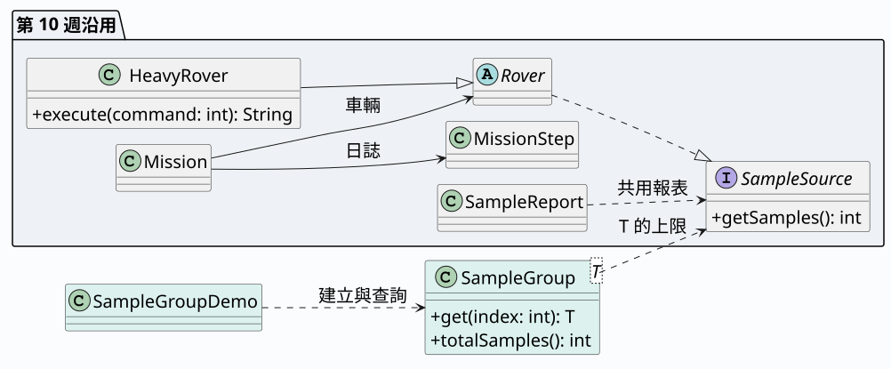
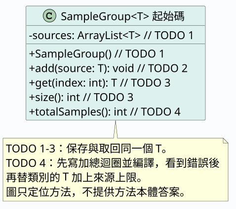
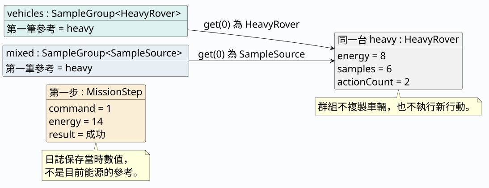

<!-- _class: lead -->
# 第 11 週｜泛型與型別安全

同一套存入與取回流程，可以保留不同資料的型態嗎？

資訊管理學系二年級　胡碩誠

<!-- 先發學生講義。承接現行第 10 週，保留第 8 週起的 execute 指令 4 覆寫。 -->

---
## 三節課的活動與證據

| 節次 | 活動 | 最低成果 |
|---|---|---|
| 1 | 獨立盒子範例、型態上限 | 型態替換表、編譯預測 |
| 2 | 四組 TODO、群組查詢 | 九行展示、自選案例 |
| 3 | AI 反例、修正、保存 | 非法拒絕、合法重測、取回 |

<!-- 三節各 50 分鐘，休息另計，未經試教。最後 15 分鐘保存，不挪用。 -->

---
## A1｜已經使用過的泛型

```java
ArrayList<MissionStep> history = new ArrayList<>();
history.add(new MissionStep(1, 14, "成功"));
MissionStep first = history.get(0);
```

- 編譯器知道 first 可以呼叫哪些方法？
- 放進 String 時，會等執行才發現嗎？
- 同一台車用 Rover 與 SampleSource 傳給報表，選哪個簽名？

<!-- A1 共 10 分鐘。取出為 MissionStep，錯誤元素於編譯拒絕。Rover 選詳報，SampleSource 選共用格式。不要因用過集合就省略新觀念。 -->

---
<!-- _class: lead -->
# 第一部分｜獨立範例

`examples/ObjectBox.java`、`Box.java`、`TypedBoxDemo.java`

先看型態如何重用，再回到樣本來源群組

<!-- 兩個小程式用 VS Code 即可：ObjectBox 自帶 main；Box 配 TypedBoxDemo。不要先開完整教師 SampleGroup 方法本體。ObjectBox 為 Claude 依教師指示補充的對照例。 -->

---
## A2｜兩種盒子的重複流程

```java
class StringBox {
    private String value;
    StringBox(String value) { this.value = value; }
    String get() { return value; }
}
class IntegerBox {
    private Integer value;
    IntegerBox(Integer value) { this.value = value; }
    Integer get() { return value; }
}
```

哪些地方只因為資料型態不同而重寫？

<!-- A2 共 18 分鐘，含 Object 盒對照與後續盒子預測。片段只比較，不要求另建兩個舊類別。回扣第 7 週複製 VIP 的維護成本；泛型不是把兩個盒子硬接成繼承關係。 -->

---
## A2｜第一種只寫一次：Object 盒

```java
ObjectBox message = new ObjectBox("採樣完成");   // 欄位型態是 Object
String text = (String) message.get();             // 取出要自己轉型
// Integer wrongCount = (Integer) message.get(); // 副本取消註解：能編譯嗎？
```

- 什麼都放得進去，一個類別就夠。
- 取出時編譯器只知道是 **Object**，轉型由呼叫者負責。
- 轉錯型態時編譯器不阻止，**執行**到那行才失敗。

<!-- 約 3 分鐘，對應 examples/ObjectBox.java（自帶 main）。輸出「Object 盒 訊息=採樣完成」「Object 盒 數量=7」；取消 wrongCount 那行仍可編譯，執行時先印兩行，再 ClassCastException。只辨識失敗時機，不教 catch。這一頁是 D2 模擬 AI 用 (T) 轉型的伏筆。 -->

---
## A2｜型態也留一個可指定的位置

```java
public class Box<T> {
    private T value;
    public Box(T value) { this.value = value; }
    public T get() { return value; }
}
```

- **T 是型態參數**，這份程式先不固定資料型態。
- 欄位、建構參數、回傳值使用同一個 T。
- 建構時保存，get 時交回，流程只寫一次。

<!-- 對應 examples/Box.java，簡化排版但語意一致。此例無型態上限，不能假定每個 T 有樣本方法。 -->

---
## A2｜先預測取回的型態

```java
Box<String> message = new Box<>("採樣完成");
Box<Integer> number = new Box<>(7);
String text = message.get();
int count = number.get();
```

| 位置 | 代表什麼？ |
|---|---|
| `Box<T>` 的 T | 待填 |
| `Box<String>` 的 String | 待填 |
| `"採樣完成"` | 待填 |

<!-- 型態參數、型態引數、資料值。不要用 T 是萬用變數一語帶過。 -->

---
## A2｜執行與編譯實驗

```powershell
javac -encoding UTF-8 -d out-examples examples/*.java
java -cp out-examples ObjectBox
java -cp out-examples TypedBoxDemo
```

| 把字串當成 Integer | 能否編譯 | 何時發現 |
|---|---|---|
| ObjectBox：`(Integer) message.get()` | 可以 | 執行時 |
| Box：`Integer wrong = message.get()` | 不行 | 編譯時 |

副本另試 `Box<int>`：型態引數要用 Integer。

<!-- TypedBoxDemo 印「訊息=採樣完成」「數量=7」。Java 型態引數用參考型態，使用 Integer。7 自動裝箱，指定給 int 時拆箱。負向實驗在獨立副本，不混入正式 examples。泛型把同類錯誤從執行期提前到編譯期。官方依據 https://docs.oracle.com/javase/tutorial/java/generics/restrictions.html -->

---
## A3｜介面清單與保留具體型態

```java
ArrayList<SampleSource> sources = new ArrayList<>();
sources.add(new SampleTray(4));
sources.add(new HeavyRover(20, 0));
```

- 只要混放與讀樣本數，這個做法已經足夠。
- 取出只保證 SampleSource，不能直接查車輛能源。
- 若每種群組還想保留自己的取回型態，就用 T。

<!-- A3 共 15 分鐘，含上限說明。回扣第 9 週 Weighable 參考不能 meow 的例子。不要宣稱自訂泛型類別永遠比普通介面清單好。 -->

---
## A3｜型態上限提供可用的操作

```java
class WeightBox<T extends Weighable> {
    int read(T item) { return item.getWeight(); }
}
```

T 保證符合 Weighable，方法才知道能呼叫 getWeight。

上限即使是介面，也使用 **extends**。
泛型類別本身不會因此變成一種 Weighable。

<!-- 語法片段回扣第 9 週介面，只供說明，不要求建立額外專案。無上限時 getWeight 無法通過編譯。本週主線稍後由學生為 T 補 SampleSource 上限。依據 https://docs.oracle.com/javase/tutorial/java/generics/bounded.html -->

---
## A4｜方法自己的型態參數

教師示範 `teacher/GenericMethodDemo.java`

```java
public static <T extends SampleSource>
        T moreSamples(T left, T right)
```

- `<T ...>` 位於回傳 T 之前，這是方法自己宣告的 T。
- 兩個樣本盒比較後，結果可直接交給 SampleTray。
- 泛型類別的 `T get(int)` 則沿用類別宣告的 T。

<!-- 3 分鐘閱讀，只示範兩個 SampleTray。輸出較多樣本 9、平手回左側 true。方法本體與答案在 teacher，不列 TODO。依據 https://docs.oracle.com/javase/tutorial/java/generics/methods.html -->

---
## 範例概念與主線工作

| 已觀察的概念 | 稍後的工作 |
|---|---|
| 同一個 T 貫穿存入與取回 | TODO 1～3：ArrayList<T>、add、get |
| 需要某個共同操作時設定上限 | TODO 4：可呼叫 getSamples |
| 型態引數讓每個群組各有約定 | C：同型與混合來源、編譯反例 |
| 取出仍保留編譯期型態 | C：同一台車的兩種報表 |

<!-- 第一部分到此結束，才開 starter。A5 4 分鐘看圖、位置與規格。 -->

---
<!-- _class: lead -->
# 第二部分｜樣本來源群組

`starter/`：同一份類別，管理不同來源

學生實作集中於 `SampleGroup.java` 四組 TODO

<!-- 多檔主線示範 IDEA 的 src 來源根與 SampleGroupDemo main，學生用一套 IDE 即可。 -->

---
## A5｜第 10 週基準與本週新增



本圖省略部分成員。T 的上限用依賴線標示，群組不繼承來源。

<!-- 淺灰沿用，綠色新增。HeavyRover 保留 execute 覆寫，Mission 不改。圖是部分 API 視角，型態上限不是群組繼承來源。 -->

---
## B｜檔案位置與起始結果

把 starter 頂層 **15 個 Java 檔**放進 `java-11/src/`。

```powershell
javac -encoding UTF-8 -d out src/*.java
java -cp out SampleGroupDemo
```

```text
尚未完成：TODO 1～3（保存與取回）還沒通過，請依講義 B 檢查。
```

TODO 1～3 正確後改印「TODO 4 總樣本數還沒通過」。
舊報表與任務已完成。examples、teacher、ai-check 各自編譯。

<!-- 開場 B 的 10 分鐘。預設可編譯且安全返回，不把 null/0 佔位當答案。展示入口分兩段檢查：第一段筆數與第 0 筆原物件，第二段三個固定總量。不要改展示檢查數字消除提示。 -->

---
## B｜資料約定與新增責任

- 來源非 null、索引合法、非負小整數，總和不溢位。
- 清單保持加入順序，相同來源加入兩次就是兩筆。
- 空群組筆數與總和為 0，不讀第 0 筆。
- 群組保存原參考，查詢讀目前數量，不執行車輛行動。
- Mission 的腳本、停止、日誌仍由原本程式處理。

<!-- 泛型只幫特定型態檢查，不自動保證這些值與生命週期。每次任務新車且只 run 一次。指令 4 僅重型車，countCommands 仍四格。 -->

---
## B｜四組 TODO 的位置



<!-- 圖只定位，不展示方法本體。欄位與建構學生自己完成；型態上限留 TODO 4。 -->

---
## B｜TODO 1～3：保存與取回 T

| TODO | 自己完成 | 檢查點 |
|---|---|---|
| 1 | private ArrayList<T>、建構初始化 | 每個群組有自己的清單 |
| 2 | add(T source) 儲存參考 | 不複製、不操作來源 |
| 3 | T get(int)、int size() | 取回原參考，不轉型 |

此時保留無上限 T。完成後展示改印第二段提示：TODO 4 總樣本數還沒通過。

<!-- TODO 1～4 共 25 分鐘。若要先觀察儲存，experiments 自建小入口，size 確認足夠後才 get。不要教師代寫核心迴圈。 -->

---
## B｜TODO 4：統計需要來源能力

先預測：無上限 T 能否直接呼叫 `getSamples()`？

1. 保持 `SampleGroup<T>`，在 totalSamples 寫迴圈呼叫 getSamples，編譯、記診斷。
2. 替 T 補上 SampleSource 上限，重新編譯。

total 由 0 開始，每次讀目前數量；空群組回 0。
**不要**用 `(SampleSource)` 轉型代替上限，也不要在 add 時先存總和。

<!-- 兩步都在學生自己的檔案，不另建副本。診斷 cannot find symbol；上限用 extends，不用 implements。轉型代替上限與快取總和兩種寫法的九行都正確，分別由 C2 第 2 題與 C1 LiveTotalTry 抓出。不寫死 10。完整本體留附錄。 -->

---
## C1｜三個群組的約定

```java
SampleGroup<SampleTray> trays = new SampleGroup<>();
SampleGroup<HeavyRover> vehicles = new SampleGroup<>();
SampleGroup<SampleSource> mixed = new SampleGroup<>();
```

| 群組 | 資料 | get 的編譯期型態 |
|---|---|---|
| trays | 4 份、0 份樣本盒 | SampleTray |
| vehicles | 已完成任務的重型車 | HeavyRover |
| mixed | 同一車、4 份盒、空盒 | SampleSource |

<!-- C1 共 10 分鐘，含展示、自選案例與參考圖。不把三個群組誤看為三份 SampleGroup 程式碼。 -->

---
## C1｜完成後的九行展示

```text
樣本盒群組 筆數=2 總樣本數=4
車輛群組 筆數=1 總樣本數=6
混合群組 筆數=3 總樣本數=10
重型探測車 樣本數=6 能源=8
重型探測車 樣本數=6
取回重型車 能源=8 鑽探次數=0
同一台車=true
空群組 筆數=0 總樣本數=0
任務狀態=8/6/2 日誌筆數=2
```

<!-- 此為固定入口的驗收輸出。另在副本以 11、2 或重複同一盒抓寫死結果，不修改正式入口檢查。 -->

---
## C1｜固定自測：探索後總和

```java
HeavyRover fresh = new HeavyRover(20, 0);   // 新車，沒有交給 Mission
SampleGroup<HeavyRover> live = new SampleGroup<>();
live.add(fresh);
System.out.println("加入後 總樣本數=" + live.totalSamples());
fresh.execute(1);                            // 探索一次
System.out.println("探索後 總樣本數=" + live.totalSamples()
        + " 車上樣本數=" + fresh.getSamples());
```

先預測兩行。九行展示裡的車不再變動，看不出總和是不是「目前值」。

<!-- 完整檔案 LiveTotalTry 在講義 C1，放 experiments，用 javac -cp out -d out-exp 編譯、java -cp "out;out-exp" 執行。正確為 0 與 3/3；若在 add 時先存總和，九行全對但探索後仍印 0。新車不交給 Mission，不違反任務期間不外部操作同一車的約定。 -->

---
## C1｜取回型態與報表過載

```java
SampleReport.print("重型探測車", vehicles.get(0));
SampleReport.print("重型探測車", mixed.get(0));
```

| 運算式型態 | 編譯器選到 | 是否有能源 |
|---|---|---|
| HeavyRover | print(String, Rover) | 有 |
| SampleSource | print(String, SampleSource) | 沒有 |

泛型保留型態資訊，過載仍遵守第 10 週的規則。

<!-- 兩個運算式指向同一車。維持呼叫端選格式的規格，沒有實作第 10 週延伸討論的另一種報表設計。 -->

---
## C1｜兩個群組仍指向同一台車



<!-- 群組保存物件參考，MissionStep 保存當時數值。以箭頭標註與一句解釋即可，不另加完整 UML 作業。 -->

---
## C2｜每段單獨判斷能否編譯

```java
// 第 1 題
SampleGroup<HeavyRover> cars = new SampleGroup<>();
cars.add(new SampleTray(4));
// 第 2 題（獨立副本）
SampleGroup<String> words = new SampleGroup<>();
// 第 3 題（獨立副本）
SampleGroup<HeavyRover> cars = new SampleGroup<>();
SampleGroup<SampleSource> sources = cars;
```

先說理由，再看第一個相關診斷。正式 src 保持可編譯。
第 2 題用**自己的** SampleGroup 編譯；若竟然通過，回 TODO 4。

<!-- C2 5 分鐘，至少本人實測第 1、2 題，第 3 題教師帶看。三題都拒絕，分別是錯誤元素、違反上限、群組型態不相容。第 2 題能通過代表學生用轉型代替了上限。 -->

---
## C2｜元素繼承與群組型態

HeavyRover 是一種 SampleSource。

但重型車群組不能直接交給來源群組變數。
假設允許，經來源群組放入一個樣本盒後，
原本的重型車群組還能保證取出是 HeavyRover 嗎？

需要混放時，建立 `SampleGroup<SampleSource>`。

<!-- 這是泛型不變性的直覺，無需推導完整萬用字元規則。依據 https://docs.oracle.com/javase/tutorial/java/generics/inheritance.html -->

---
<!-- _class: lead -->
# 第三部分｜AI 判讀與驗證

編譯有警告時，合法案例全過就足夠嗎？

教師模擬回覆，不是真實 AI 對話

<!-- D1 5 分鐘保存人工完成版、寫 3～5 句需求與預測，才換副本。 -->

---
## D2｜模擬建議與群組約定

```java
public void add(SampleSource source) {
    sources.add((T) source);
}
```

模擬建議：「都實作同一介面，轉成 T 就能放入。」

原需求是重型車群組只接受重型車。
這個 add 參數還有保留原本限制嗎？

<!-- D2 8 分鐘。來源 ai/SampleGroup.java，只有 add 的兩個位置錯誤。不要宣稱所有轉型都不合法；本例是未檢查轉型繞過約定。 -->

---
## D2｜合法輸出與非法來源

在獨立 ai-check，先換模擬群組並加入 UnsafeGroupTry：

```powershell
javac -encoding UTF-8 -Xlint:unchecked -d out-bad *.java
java -cp out-bad SampleGroupDemo
java -cp out-bad UnsafeGroupTry
```

合法入口仍印九行。非法入口卻在取回指派時失敗。

記錄 unchecked 警告與 ClassCastException 的出錯行。

<!-- 編譯雖有警告仍成功。樣本盒沒有變成重型車。此處只辨識失敗種類與時機，不教例外處理。 -->

---
## D3｜最小修改與兩種重測

把 add 的參數恢復 T，移除 `(T)`，直接保存來源。

| 重測 | 預期證據 |
|---|---|
| 原本非法 add 保留，編到新目錄 | 在 add 呼叫處編譯拒絕 |
| 移開 UnsafeGroupTry，再編合法入口 | 沒有警告，九行一致 |

編譯失敗後不執行舊的 out-bad。

<!-- D3 7 分鐘。負向編譯失敗正是修正成功的證據。只改兩處，不拿 teacher 整份覆蓋。完整操作見講義 D3。 -->

---
## D4｜型態檢查與其他契約

- 需求真要混放，就使用 SampleSource 型態引數。
- 泛型不自動保證非 null、索引合法或數值合理。
- 保存原參考不代表來源不可變。
- 有警告、可編譯、符合需求，必須分別判斷。

<!-- D4 5 分鐘。延續第 10 週 D5：合法語法也要對照需求。不要用 SuppressWarnings 隱藏證據。 -->

---
## E｜同儕檢核與保存

10 分鐘：互指 T、add/get、兩種 print 與同物件參考。

最後 15 分鐘：

1. 正式 src 重跑主線與舊任務。
2. GitHub Desktop 查看差異、commit、push，遠端核對。
3. repo 外取回後重編譯，記本人結果。

排除 out、class、錯誤副本及憑證。未完成據實標待補。

<!-- 備份或本機提交不能寫成遠端推送成功。沒有真實 AI，仍記教師模擬與人工驗證。 -->

---
## 課後｜取回樣本最多的原來源

新增 `public T findMostSamples()`，回傳原物件。

| 必要案例 | 能抓的問題 |
|---|---|
| 樣本盒 4、9、9 | 只回第一筆、平手回最後筆 |
| 至少兩台重型車 | 取回具體型態與狀態不變 |
| 單筆零樣本、空群組先判斷 | 有 0 份與沒資料的差別 |
| 混合群組結果指派給 SampleTray 的編譯反例 | 回傳型態跟著 T |

<!-- 約 25～35 分鐘。非空才呼叫，平手保留最先加入，T 回傳不轉型。資料與標籤自訂。 -->

---
## 繳交與評量

`src/`、`LAB_REPORT.md`、`AI_USAGE.md`

| 面向 | 比例 |
|---|---|
| 泛型宣告與型態安全 | 30% |
| 功能與資料規則 | 30% |
| 驗證與修正 | 25% |
| 解釋與保存 | 15% |

<!-- 最低驗收固定，資料與展示開放。選做泛型方法或萬用字元擇一，不列共同先備，不要求第二套系統。 -->

---
<!-- _class: lead -->
# 教師附錄

完整答案、作業參考與驗證工具

學生實作前不展示完整方法本體

<!-- 下面的頁面是教師材料，不作為學生 TODO 的前置答案。 -->

---
## 教師答案｜四組 TODO

```java
// 類別宣告：SampleGroup<T extends SampleSource>
private ArrayList<T> sources;
public SampleGroup() { sources = new ArrayList<>(); }
public void add(T source) { sources.add(source); }
public T get(int index) { return sources.get(index); }
public int size() { return sources.size(); }
public int totalSamples() {
    int total = 0;
    for (T source : sources) { total += source.getSamples(); }
    return total;
}
```

<!-- 來源 teacher/SampleGroup.java。學生只有一個 TODO 檔，其他基準不變。 -->

---
## 教師答案｜最大值與平手

```java
public T findMostSamples() {
    T best = sources.get(0);
    for (T source : sources) {
        if (source.getSamples() > best.getSamples()) {
            best = source;
        }
    }
    return best;
}
```

呼叫前確定非空。嚴格大於才替換，保留最早的平手來源。

<!-- 來源 teacher/homework/SampleGroup.java，與主線同名類別分開編譯。用 == 驗證原物件，零樣本案例別誤當無資料。 -->

---
## 教師驗證與第 12 週入口

```powershell
python -X utf8 tools/verify.py
```

驗證學生完成路徑、AI 反例、群組、作業與前週指令 4。

下週先問：型態正確後，null、非法索引、空資料怎麼辦？
本週仍是單執行緒，泛型不保證並行安全。

<!-- 讀 handoff 與 verification 的實際證據。教科書實際 EPUB 目錄 §20.6 為主線，§20.2～20.4 閱讀，§16.3～16.4 裝拆箱補充。來源 JLS https://docs.oracle.com/javase/specs/jls/se25/html/jls-4.html#jls-4.4 與教師筆記。不把 JLS 版本當課堂 JDK 要求。 -->
