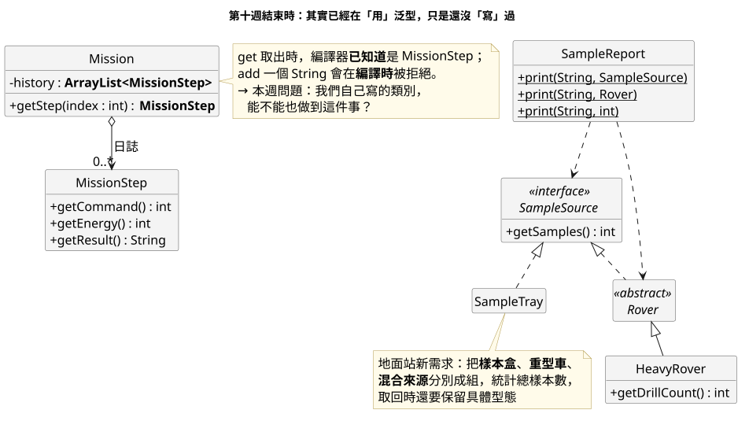
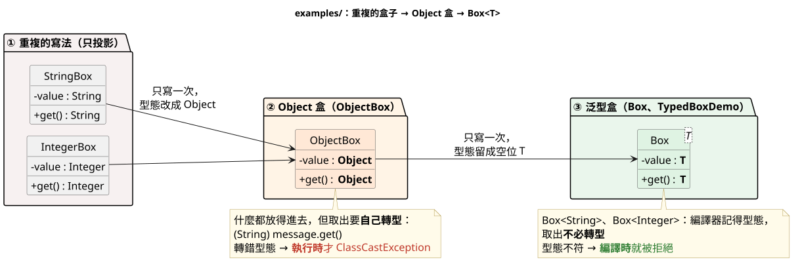
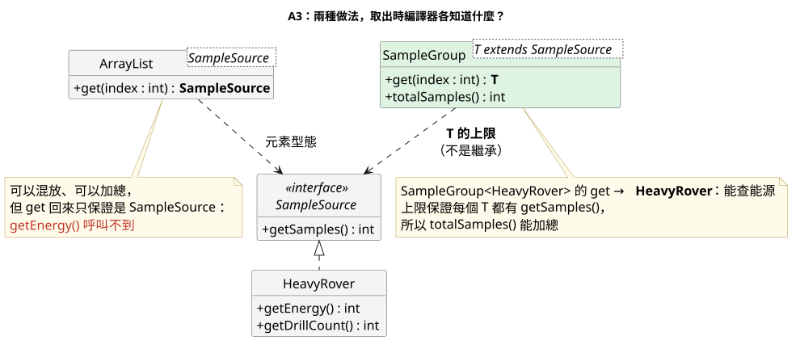
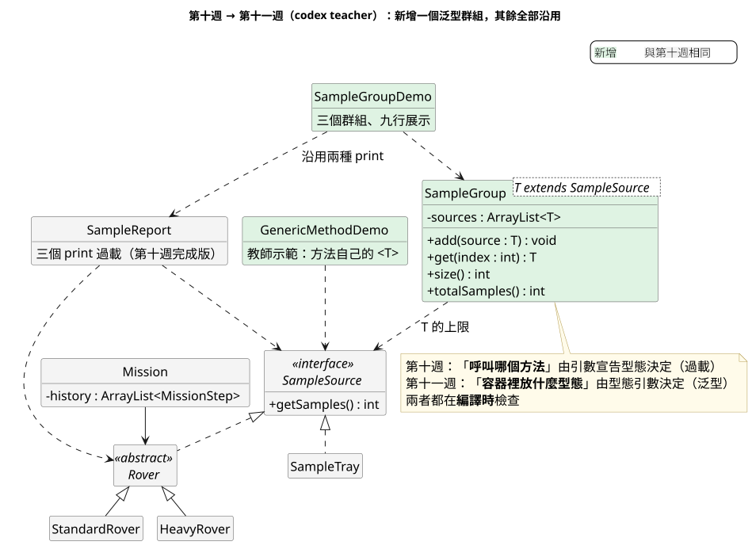
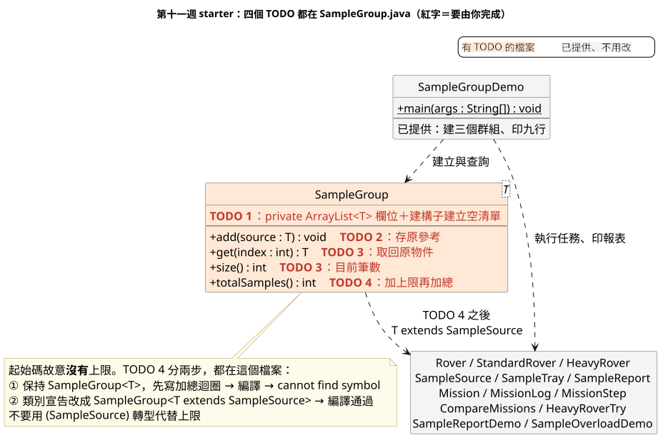
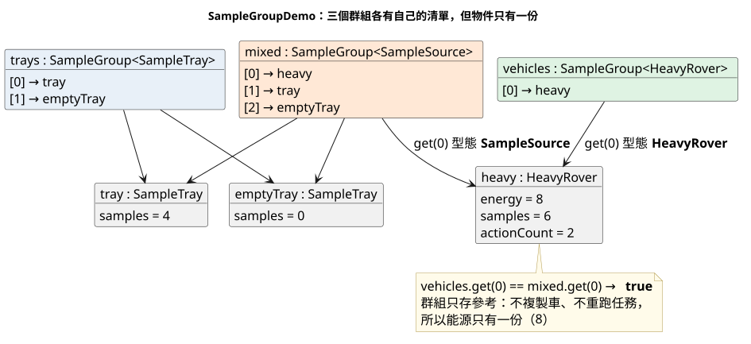
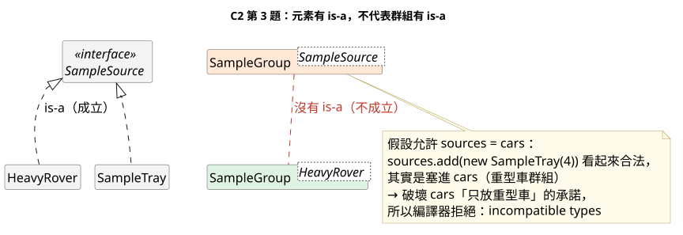
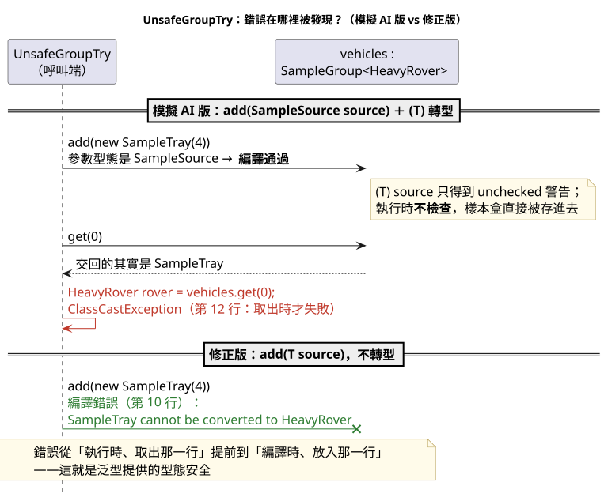

<!-- _class: lead by-claude -->

# 第十一週｜泛型與型別安全

## 一個群組類別，怎麼同時管樣本盒、重型車與混合來源？

AI 生成泛型程式碼：**型態檢查與最小修正**

物件導向程式設計（與 AI 協作）｜115 學年度第 1 學期
資訊管理學系 二年級｜授課教師：胡碩誠

<!--
講者備註：本份投影片依 week11/codex版本 的 README、student_lab、assignment、examples、starter、ai、teacher、teacher_notes、handoff、verification（含 2026-11-19 補充修訂）製作，由 Claude 撰寫；codex 原投影片 week11_slides_codex.md 保留不動，可擇一使用。
本份分兩部分：先用 examples/ 的三種盒子（重複盒子 → Object 盒 → Box<T>）把「型態參數」與「錯誤何時被發現」講清楚，再用 starter/ 說明 SampleGroup 的 TODO 1–4、自測、編譯反例、AI 除錯與作業；teacher/ 的答案只出現在附錄。
-->

---

<!-- _class: by-claude small -->

## 關於這份投影片

- 每頁右上角 <span class="tag">claude</span>：本投影片由 Anthropic Claude（Claude Code）依 **codex版本教材** 製作，教師審閱後使用。
- 程式、講義題號（A–E）、TODO、預期輸出全部沿用 `week11/codex版本/`；投影片**不新增**學生作業。
- 左上角標籤是該頁對應的檔案（路徑以 `week11/codex版本/` 為起點）：

| 標籤 | 資料夾 | 在本投影片的角色 |
|---|---|---|
| <span class="tag blue">examples/…</span> | `examples/` | **第一部分：範例教學**——三種盒子（講義 A2），再延伸到上限與泛型方法（A3、A4） |
| <span class="tag green">starter/…</span> | `starter/` | **第二部分：作業說明**——`SampleGroup` 的 TODO 1–4（講義 A5、B–E） |
| <span class="tag purple">ai/…</span> | `ai/` | D 段：教師撰寫的**模擬 AI 回覆**（`add` 參數放寬＋`(T)` 轉型） |
| <span class="tag brown">diagrams/…</span> | `diagrams/` | 本份新繪的 `*_claude` 圖，說明**與第十週的演進** |
| <span class="tag gray">teacher/…</span> | `teacher/` | **附錄：教師用**——完整答案、九行抓不到的寫法、作業參考 |

<!--
講者備註：講義的活動順序是 A1→A2→A3→A4→A5→B→C→D→E。本份依教師要求先把 examples（A2）完整講完，再進 starter。A1 診斷放在最前面當暖身；A3、A4 是從盒子走到群組的橋樑，放在第一部分末尾；A5 的演進圖放在第二部分開頭。帶課以講義題號為準。
-->

---

<!-- _class: by-claude small -->

<div class="ex"><span class="dg">diagrams/start_w10_claude.svg</span><span>../../week10/codex版本/teacher/</span></div>

## 上週留下的問題：我們一直在「用」泛型

<div class="cols" style="grid-template-columns: 800px 1fr; gap: 18px;">
<div>



</div>
<div>

`Mission` 從第六週起就用
`ArrayList<MissionStep>`：
取出不用轉型，放錯在**編譯時**被擋。

**新需求**：樣本盒、重型車、混合來源各成一組，統計總樣本數；重型車組取回後能直接查**能源**。

**本週問題**：自己寫的類別，能不能也帶 `<…>`？

</div>
</div>

<!--
講者備註：動機來自第十週 handoff 的「第 11 週入口」：先問 ArrayList<MissionStep> 取出元素時編譯器知道什麼、放錯型態時在哪裡被發現；再問相同存取流程要處理另一種資料時，如何保留各自的型態。左圖灰色全部是第十週已完成的程式。
-->

---

<!-- _class: by-claude small -->

## 本週流程：先用盒子學泛型，再寫樣本群組

| 部分 | 內容 | 講義 | 時間（備課估計） |
|---|---|---|---|
| 暖身 | `ArrayList<MissionStep>`：取出時編譯器知道什麼？ | A1 | 第 1 節 10 分 |
| **第一部分** <span class="tag blue">examples/</span> | 重複的盒子 → `ObjectBox` → `Box<T>`，比較錯誤何時被發現 | A2 | 第 1 節 18 分 |
| | 介面清單 vs 型態上限 `T extends SampleSource` | A3 | 第 1 節 15 分 |
| | 教師示範：方法自己的 `<T>` | A4 | 第 1 節 3 分 |
| **第二部分** <span class="tag green">starter/</span> | 第十週 → 第十一週演進圖、找入口 | A5 | 第 1 節 4 分 |
| | `SampleGroup` 的 TODO 1–4 | B | 第 2 節 35 分 |
| | 九行結果、探索後總和自測、三個編譯反例 | C | 第 2 節 15 分 |
| | 模擬 AI 的 `(T)` 轉型 → 最小修正 → 同儕與保存 | D、E | 第 3 節 |
| 課後 | `findMostSamples()`：取回樣本最多的**原物件** | 作業 | 25–35 分（暫估） |

**每段都先寫預測，再編譯、執行、比對。**

<!--
講者備註：150 分鐘為未試教的備課估計（codex 教師筆記）。時間不足時，D 段保留「負向編譯＋合法入口重測」，文字整理可課後補，不犧牲最後 15 分鐘保存。
-->

---

<!-- _class: by-claude small -->

## 本週學習目標與範圍

<div class="cols">
<div class="box green">

**本週要會**

1. 分清楚**型態參數**（`T`）、**型態引數**（`String`）和**資料**（`"採樣完成"`）
2. 說出 `Object` 欄位與 `T` 欄位的差別：錯誤在**執行時**還是**編譯時**被發現
3. 宣告泛型類別 `SampleGroup<T>`，讓 `add` 收 `T`、`get` 回 `T`
4. 用**上限** `T extends SampleSource` 讓統計可以呼叫 `getSamples()`
5. 判讀三種編譯錯誤：放錯元素、違反上限、群組互相指派
6. 重現並最小修正一段**能編譯但不安全**的模擬 AI 程式

</div>
<div class="box">

**本週不做**

- 萬用字元 `? extends`、型態擦除：只在教師備查／選做
- 泛型方法：只**讀**教師示範，不要求寫
- `try/catch`：看到 `ClassCastException` 只辨識「何時失敗」
- 自動裝箱：只讀懂 `Integer` ↔ `int` 這一組
- 例外處理、執行緒 → 第十二週起

</div>
</div>

<!--
講者備註：範圍依 codex 教材生成規劃與教師筆記：§20.6 Generic Classes 為主線，§20.2–20.4 泛型方法為閱讀，§16.3–16.4 包裝／裝拆箱僅補充（Deitel 11e EPUB 實際目錄）。
-->

---

<!-- _class: by-claude small -->

## 從 C# 對照：你在 WinForms 已經用過泛型

| 概念 | C#（一年級學過） | Java（本週） |
|---|---|---|
| 用泛型集合 | `List<string> names = new List<string>();` | `ArrayList<String> names = new ArrayList<>();` |
| 宣告泛型類別 | `class Box<T> { … }` | `class Box<T> { … }`（相同） |
| 型態上限 | `class Group<T> where T : ISampleSource` | `class Group<T extends SampleSource>` |
| 基本型態當引數 | `List<int>` **可以** | `Box<int>` **不行**，要寫 `Box<Integer>` |
| `List<子>` 指派給 `List<父>` | 不行 | 不行（相同） |

- 寫法幾乎一樣，最大差別是 **Java 的型態引數只能是參考型態**（類別、介面），所以要用 `Integer`、不能用 `int`。
- `<>`（菱形）讓編譯器從左邊推斷：`new ArrayList<>()` 等於 `new ArrayList<String>()`。

<!--
講者備註：C# 的泛型在執行時保留型態資訊，所以允許 List<int>；Java 不行，這是本週 Box<int> 編譯實驗的背景。型態擦除的細節不展開（教師備查）。C# 介面與類別本來就都不允許 List<Derived> 指派給 List<Base>，學生的直覺可以直接遷移到 C2 第 3 題。
-->

---

<!-- _class: by-claude -->

<div class="ex"><span class="st">starter/Mission.java</span></div>

## A1｜暖身：`ArrayList<MissionStep>` 告訴編譯器什麼？

```java
private ArrayList<MissionStep> history;
...
public MissionStep getStep(int index) { return history.get(index); }
```

1. `history.get(index)` 取出時，編譯器知道它是**什麼型態**？可以直接呼叫 `getEnergy()` 嗎？
2. 如果寫 `history.add("探索")`（放一個 String），**何時**會發現錯誤？
3. 回顧第十週：同一台 `HeavyRover`，用 `Rover` 參考和 `SampleSource` 參考呼叫 `SampleReport.print`，為什麼會選到不同的方法？

先在講義 A1 寫答案與理由。

<!--
講者備註：10 分鐘。這題同時診斷兩件事：學生是否知道 <MissionStep> 的作用，以及第十週「宣告型態決定可用成員與過載選擇」是否還記得。使用過泛型集合不代表會宣告泛型類別（codex 教師筆記）。
-->

---

<!-- _class: by-claude small -->

<div class="ex"><span class="st">starter/Mission.java</span></div>

## A1｜答案：宣告型態決定「編譯器知道什麼」

| 問題 | 答案 |
|---|---|
| `history.get(i)` 的型態 | **`MissionStep`**，可以直接呼叫 `getEnergy()`、`getResult()`，不用轉型 |
| `history.add("探索")` | **編譯時**就被拒絕：String 不能轉成 MissionStep |
| 同車兩種報表 | `Rover` 參考 → 選 `print(String, Rover)` 詳報；`SampleSource` 參考 → 選共用版。物件仍是**同一台車** |

> **共同點**：編譯器只看「宣告了什麼型態」。
> `<MissionStep>` 是寫給編譯器的**承諾**：這個清單只放日誌。
> 本週要學的，就是**自己寫**這種承諾。

<!--
講者備註：codex 教師筆記 A1：型態資訊影響可呼叫成員與過載選擇，物件仍是同一台車。這裡先不講上限，留到 A3。
-->

---

<!-- _class: lead by-claude -->
<!-- footer: '物件導向程式設計｜Week 11｜第一部分 範例教學（examples/）' -->

# 第一部分｜範例教學

## 三種盒子：重複的盒子 → `ObjectBox` → `Box<T>`

講義 A2（含 A3、A4 的延伸）

<!--
講者備註：examples 與探測車完全獨立，不需要任何主線檔案就能編譯執行。先在小盒子看清楚「型態參數」和「錯誤何時被發現」，再回到樣本群組。
-->

---

<!-- _class: by-claude small -->

<div class="ex"><span>examples/ObjectBox.java</span><span>examples/Box.java</span><span>examples/TypedBoxDemo.java</span></div>

## 範例檔案與執行入口

| 檔案 | 角色 | 有 `main`？ |
|---|---|---|
| `ObjectBox.java` | 對照例：欄位用 `Object`，什麼都能放，取出要自己轉型 | 有（自帶） |
| `Box.java` | 泛型盒子：欄位用 `T`，取出不必轉型 | 沒有 |
| `TypedBoxDemo.java` | 用 `Box<String>`、`Box<Integer>` 各存一個值再取回 | 有 |

在自己的 `java-11` 執行（編譯成功才執行下一行）：

```powershell
javac -encoding UTF-8 -d out-examples examples/*.java
java -cp out-examples ObjectBox
java -cp out-examples TypedBoxDemo
```

- 只有 3 個小檔，用 **VS Code** 即可。
- 與 starter **分開編譯**（輸出到 `out-examples`，不要和 `out` 混在一起）。

<!--
講者備註：ObjectBox 是 2026-11-19 依教師指示補充的對照例（codex 範例說明已註明）。主線超過兩個檔，到第二部分再用 IntelliJ IDEA。
-->

---

<!-- _class: by-claude -->

<div class="ex"><span>examples/README.md（第 1 節）</span></div>

## A2 ①｜兩個盒子，哪裡不一樣？

```java
class StringBox {
    private String value;
    StringBox(String value) { this.value = value; }
    String get() { return value; }
}
class IntegerBox {
    private Integer value;
    IntegerBox(Integer value) { this.value = value; }
    Integer get() { return value; }
}
```

- 圈出兩份程式**不同**的地方：只有類別名稱和 **`String` / `Integer`**。
- 欄位、建構子存值、`get` 回傳——**流程完全一樣**。
- 再多一種資料（例如 `SampleTray`）就要再抄一份？

<!--
講者備註：這段只投影、不要求學生另寫兩個類別（codex 範例說明）。問學生：如果要「只寫一次」，你會怎麼改？通常會有人說「把型態改成 Object」——正好接下一頁。
-->

---

<!-- _class: by-claude small -->

<div class="ex"><span>examples/ObjectBox.java</span></div>

## A2 ②｜第一種「只寫一次」：`Object` 盒子

<div class="cols" style="grid-template-columns: 1.25fr 1fr;">
<div>

```java
public class ObjectBox {
    private Object value;

    public ObjectBox(Object value) {
        this.value = value;
    }
    public Object get() {
        return value;
    }

    public static void main(String[] args) {
        ObjectBox message = new ObjectBox("採樣完成");
        ObjectBox number = new ObjectBox(7);
        String text = (String) message.get();
        Integer count = (Integer) number.get();
        System.out.println("Object 盒 訊息=" + text);
        System.out.println("Object 盒 數量=" + count);
    }
}
```

</div>
<div>

- 所有類別都繼承 `Object`，所以字串、整數**都放得進去**。
- 但 `get()` 宣告回傳 `Object`：編譯器只知道「這是一個 Object」。
- 想當字串用，呼叫者要**自己寫** `(String)` 轉型。

**先預測**：

1. 兩行輸出是什麼？
2. `message.get()` 的**編譯期型態**是什麼？

</div>
</div>

<!--
講者備註：程式碼省略了檔案中的註解。7 傳進 Object 參數時會自動包成 Integer 物件（裝箱），本週只要讀懂。(String) 這種寫法是「呼叫者向編譯器保證盒中是字串」。
-->

---

<!-- _class: by-claude -->

<div class="ex"><span>examples/ObjectBox.java</span></div>

## A2 ②｜Object 盒：能跑，但「轉錯」編譯器不會擋

```text
Object 盒 訊息=採樣完成
Object 盒 數量=7
```

`message.get()` 的編譯期型態是 **`Object`**——不轉型就不能指派給 `String`。

**執行期實驗**（在副本取消這一行註解）：

```java
Integer wrongCount = (Integer) message.get();   // 盒裡其實是字串
```

1. 這一行**能不能編譯**？
2. 如果能，執行時會怎樣？前兩行還會印出來嗎？

<!--
講者備註：先讓學生預測。實驗在 experiments 或教師副本做，正式 examples 保持可編譯（codex 範例說明）。
-->

---

<!-- _class: by-claude small -->

<div class="ex"><span>examples/ObjectBox.java（副本：取消 wrongCount 註解）</span></div>

## A2 ②｜答案：編譯通過，**執行到那一行才失敗**

```text
Object 盒 訊息=採樣完成
Object 盒 數量=7
Exception in thread "main" java.lang.ClassCastException: class java.lang.String
  cannot be cast to class java.lang.Integer ...
	at ObjectBox.main(ObjectBox.java:35)
```

- **能編譯**：編譯器只知道 `get()` 是 `Object`，它**相信**你寫的 `(Integer)`。
- **執行時**：前兩行照常印出，跑到第 35 行才發現盒裡是字串 → `ClassCastException`。
- 錯誤離「放錯東西」的地方很遠——在大程式裡很難追。

> 本週只要辨識「**這是執行時才發現的錯**」，不教 `try/catch`。

<!--
講者備註：JDK 22 實測，第 35 行就是取消註解的那一行。訊息的括號說明（module java.base…）已省略。重點是失敗的「時機」：編譯過了，執行才爆。
-->

---

<!-- _class: by-claude small -->

<div class="ex"><span>examples/Box.java</span><span>examples/TypedBoxDemo.java</span></div>

## A2 ③｜第二種「只寫一次」：泛型盒子 `Box<T>`

<div class="cols" style="grid-template-columns: 1fr 1.15fr;">
<div>

```java
public class Box<T> {
    private T value;

    public Box(T value) {
        this.value = value;
    }

    public T get() {
        return value;
    }
}
```

- 類別名稱後的 **`<T>`**：宣告一個「先不決定的型態」。
- 欄位、參數、回傳都寫 **`T`**。

</div>
<div>

```java
Box<String> message = new Box<>("採樣完成");
Box<Integer> number = new Box<>(7);

String text = message.get();
int count = number.get();
System.out.println("訊息=" + text);
System.out.println("數量=" + count);
```

**先預測**：

1. `message.get()`、`number.get()` 的編譯期型態？
2. 兩行輸出？
3. 為什麼這裡**不用**寫 `(String)`？

</div>
</div>

<!--
講者備註：TypedBoxDemo 的程式碼省略了註解與兩行編譯實驗（下一頁之後再講）。Box 沒有 main，入口是 TypedBoxDemo。
-->

---

<!-- _class: by-claude small -->

<div class="ex"><span class="dg">diagrams/box_generic_claude.svg</span><span>examples/</span></div>

## A2 ③｜答案與三個名詞

```text
訊息=採樣完成
數量=7
```

| 寫在程式裡 | 叫什麼 | 意思 |
|---|---|---|
| `class Box<T>` 的 **`T`** | **型態參數** | 宣告類別時留的「型態空位」 |
| `Box<String>` 的 **`String`** | **型態引數** | 使用時填進空位的型態 |
| `new Box<>("採樣完成")` 的 **`"採樣完成"`** | **資料（值）** | 真正存進盒子的東西 |

- `message.get()` 是 **`String`**、`number.get()` 是 **`Integer`**：編譯器記得每個盒子的 `T`，所以**不用轉型**。
- `int count = number.get();`：`Integer` 自動**拆箱**成 `int`（放入 7 時自動**裝箱**）。

<span class="note">類比：方法的「參數 / 引數 / 值」，現在換成「型態」也有參數和引數。</span>

<!--
講者備註：codex 教師筆記 A2：Box 的 T 是型態參數，Box<String> 的 String 是型態引數，"採樣完成" 是值。T 不代表某個固定數字，也不代表只能放探測車。
-->

---

<!-- _class: by-claude small -->

<div class="ex"><span>examples/TypedBoxDemo.java（副本：一次取消一行）</span></div>

## A2 ③｜兩個編譯實驗（JDK 22 實際診斷）

<div class="cols">
<div>

**1.** `Box<int> wrong = new Box<>(7);`

```text
error: unexpected type
        Box<int> wrong = new Box<>(7);
            ^
  required: reference
  found:    int
```

型態引數必須是**參考型態**：改寫 `Box<Integer>`。

</div>
<div>

**2.** `Integer wrong = message.get();`

```text
error: incompatible types: String
  cannot be converted to Integer
        Integer wrong = message.get();
                                   ^
```

`message` 是 `Box<String>`，`get()` 回 **String**，編譯器直接擋下。

</div>
</div>

<span class="note">兩行變數都叫 wrong，所以一定要**一次只取消一行**。診斷字句為 OpenJDK 22 英文訊息，其他版本可能略有不同，記「第一個與自己改動有關的錯誤」即可。</span>

<!--
講者備註：教師在隔離副本示範，或學生自己複製 examples 到 experiments 實驗；正式 examples 維持可編譯（codex 講義 A2）。
-->

---

<!-- _class: by-claude small -->

<div class="ex"><span class="dg">diagrams/box_generic_claude.svg</span></div>

## A2｜比較：同樣「把字串當整數」，何時被發現？



| 寫法 | 能否編譯 | 何時發現錯誤 |
|---|---|---|
| ObjectBox：`(Integer) message.get()` | **可以** | **執行**到那一行才 `ClassCastException` |
| Box：`Integer wrong = message.get();` | **不行** | **編譯**時就被拒絕 |

<!--
講者備註：這張圖是本週的核心訊息：泛型把同類錯誤從「執行期、取出那一行」提前到「編譯期」。第三節模擬 AI 用 (T) 轉型，就是把這個好處又丟掉了——先在這裡埋伏筆（codex 範例說明末段）。
-->

---

<!-- _class: by-claude small -->

<div class="ex"><span class="dg">diagrams/bound_claude.svg</span></div>

## A3｜從盒子到群組：只用介面清單夠不夠？

<div class="cols" style="grid-template-columns: 1fr 1fr;">
<div>

地面站要：樣本盒一組、重型車一組，都要算總樣本數。

```java
ArrayList<SampleSource> list = new ArrayList<>();
list.add(heavy);
list.add(tray);
int total = 0;
for (SampleSource s : list) {
    total += s.getSamples();
}
```

**先回答**：

1. 能混放、能加總嗎？
2. `list.get(0)` 取出後，能直接 `getEnergy()` 嗎？

</div>
<div>

**想要的是**：

- 樣本盒群組取出就是 `SampleTray`
- 重型車群組取出就是 `HeavyRover`
- 兩種群組**共用同一份**加總程式

→ 群組本身要有型態參數 `T`

→ 但加總要呼叫 `getSamples()`，編譯器怎麼知道 `T` 有這個方法？

</div>
</div>

<!--
講者備註：15 分鐘。先讓學生回答，教師再介紹上限。codex 教師筆記：單純混放及計總量，用 ArrayList<SampleSource> 已足夠；需要共用群組領域操作、取回時又保留各群組型態，才採 SampleGroup<T extends SampleSource>。
-->

---

<!-- _class: by-claude small -->

<div class="ex"><span class="dg">diagrams/bound_claude.svg</span></div>

## A3｜答案：型態上限 `T extends SampleSource`



- 介面清單**能混放、能加總**；但取出只保證 `SampleSource` → `getEnergy()` 呼叫不到。
- `<T extends SampleSource>`：**T 只能是實作 SampleSource 的型態** → 每個 T 都保證有 `getSamples()`。
- 上限是介面也寫 **`extends`**（泛型裡不寫 `implements`）。**不代表** `SampleGroup` 是一種 `SampleSource`。

<!--
講者備註：codex 教師筆記 A3：extends 在型態參數中同時用於類別與介面上限。回扣第 9 週秤重：Weighable 參考不能直接 meow，並不是貓消失了。
-->

---

<!-- _class: by-claude small -->

<div class="ex"><span class="tc">teacher/GenericMethodDemo.java（教師示範）</span></div>

## A4｜閱讀：方法也可以有自己的 `<T>`

```java
public class GenericMethodDemo {          // ← 類別本身沒有 <T>
    public static <T extends SampleSource> T moreSamples(T left, T right) {
        if (left.getSamples() >= right.getSamples()) {
            return left;
        }
        return right;
    }
    ...
    SampleTray selected = moreSamples(new SampleTray(4), new SampleTray(9));
```

```text
較多樣本=9
平手回左側=true
```

- `<T extends SampleSource>` 寫在 **`static` 後、回傳型態前**：這是**方法自己**宣告的 T。
- 對照 `SampleGroup<T>` 的 `T get(int)`：沿用**類別的** T，沒有重新宣告。
- 兩個 9 份平手：`>=` 讓**左側**（先傳入的）勝出。

<!--
講者備註：3 分鐘，只讀不寫。不要教成「泛型方法的兩個引數必須是完全相同的具體類別」，混合引數的推斷本週不展開（codex 教師筆記 A4）。實際程式 main 用變數 left/right，這裡為了版面合併寫法。
-->

---

<!-- _class: by-claude small -->

## 第一部分小結 → 帶到樣本群組

| 從盒子學到 | 在 starter 的 `SampleGroup` 會用在 |
|---|---|
| `class Box<T>`：類別名稱後宣告型態參數 | **TODO 1**：`class SampleGroup<T>`、欄位 `ArrayList<T>` |
| 參數、回傳都寫 `T`，取出不用轉型 | **TODO 2、3**：`add(T source)`、`T get(int index)` |
| `Object` + 轉型：錯誤拖到**執行時** | **D 段**：模擬 AI 用 `(T)` 轉型，又把錯誤拖回執行時 |
| `Box<int>` 不行，型態引數要參考型態 | 群組的 T 都是類別或介面：`SampleTray`、`HeavyRover`、`SampleSource` |
| 上限 `T extends SampleSource` | **TODO 4**：加總時才能呼叫 `getSamples()` |

<!--
講者備註：接下來進入 starter。提醒學生 examples 與 starter 分開編譯、分開輸出資料夾。
-->

---

<!-- _class: lead part2 by-claude -->
<!-- footer: '物件導向程式設計｜Week 11｜第二部分 作業說明（starter/）' -->

# 第二部分｜作業說明

## 用 `starter/` 完成可保留型態的 `SampleGroup<T>`

TODO 1–4｜講義 A5、B、C、D、E

<!--
講者備註：starter 是第十週 Codex 教師版的完成狀態（含 HeavyRover.execute 指令 4 覆寫），加上本週的 SampleGroup 起始碼與 SampleGroupDemo。
-->

---

<!-- _class: by-claude small -->

<div class="ex"><span class="dg">diagrams/evolution_w11_claude.svg</span><span class="tc">teacher/</span></div>

## A5｜第十週 → 第十一週：改了什麼？

<div class="cols" style="grid-template-columns: 730px 1fr; gap: 18px;">
<div>



</div>
<div>

- **新增** `SampleGroup`：本週唯一要寫的類別
- **新增** `SampleGroupDemo`：九行展示（已提供）
- **新增**（教師）`GenericMethodDemo`
- **不變**：車、樣本盒、`Mission`、`SampleReport`（三個 `print`）

上週決定「**呼叫哪個方法**」；
這週決定「**容器裡放什麼型態**」。

</div>
</div>

<!--
講者備註：4 分鐘。codex 教師筆記 A5：SampleGroup 與 SampleGroupDemo 為新增；既有 Rover、HeavyRover、SampleSource、Mission、MissionStep、SampleReport 沿用（驗證紀錄：指定共用原始檔與第十週逐位元組相同）。請學生記下自己的 java／javac 版本，不照抄作者的 22。
-->

---

<!-- _class: by-claude small -->

<div class="ex"><span class="st">starter/（15 個 .java）</span></div>

## starter 的檔案與起始狀態

<div class="cols" style="grid-template-columns: 1fr 1fr;">
<div>

| 檔案 | 狀態 |
|---|---|
| `SampleGroup.java` | **TODO 1–4（唯一要改）** |
| `SampleGroupDemo.java` | 已提供：本週入口 |
| 三種車、`SampleSource`、`SampleTray`、`SampleReport` | 已提供（第十週完成版） |
| `Mission`、`MissionLog`、`MissionStep` | 已提供 |
| 四個舊入口（`CompareMissions` 等） | 已提供（回歸用） |

</div>
<div>

複製到 `java-11/src/`，在 `java-11`：

```powershell
javac -encoding UTF-8 -d out src/*.java
java -cp out SampleGroupDemo
java -cp out CompareMissions
```

起始輸出：

```text
尚未完成：TODO 1～3（保存與取回）
還沒通過，請依講義 B 檢查。
```

這是**預期**的未完成提示。

</div>
</div>

<!--
講者備註：15 個檔超過兩個，示範一次 IntelliJ IDEA：開 java-11、選已安裝的 JDK、src 標為來源根、從 SampleGroupDemo.main 啟動。一套 IDE 完成即可，不建立 Maven／Gradle。examples、experiments、ai-check 各自有輸出目錄。實際輸出為一行，這裡為版面折行。
-->

---

<!-- _class: by-claude small -->

<div class="ex"><span class="dg">diagrams/starter_todo_w11_claude.svg</span><span class="st">starter/SampleGroup.java</span></div>

## starter：四個 TODO 都在 `SampleGroup.java`



<!--
講者備註：學生只改 SampleGroup.java。不要修改其他探測車檔案，也不要把教師版整份貼進來。起始碼故意沒有上限，TODO 4 才補。
-->

---

<!-- _class: by-claude small -->

<div class="ex"><span class="st">starter/SampleGroupDemo.java</span></div>

## B｜先讀入口：已提供的資料與三個群組

```java
HeavyRover heavy = new HeavyRover(20, 0);
Mission mission = new Mission(heavy);
mission.run(new int[] {1, 1, 2});        // 跑完：能源 8、樣本 6、行動 2
SampleTray tray = new SampleTray(4);
SampleTray emptyTray = new SampleTray(0);

SampleGroup<SampleTray> trays = new SampleGroup<>();     // 樣本盒群組
trays.add(tray);  trays.add(emptyTray);
SampleGroup<HeavyRover> vehicles = new SampleGroup<>();  // 重型車群組
vehicles.add(heavy);
SampleGroup<SampleSource> mixed = new SampleGroup<>();   // 混合群組
mixed.add(heavy);  mixed.add(tray);  mixed.add(emptyTray);
```

- 同一台 `heavy` **同時**放進 `vehicles` 和 `mixed`——放的是**參考**，不會多出一台車。
- 這段是教師提供的展示資料，**不是 TODO**。

<!--
講者備註：B 段前 10 分鐘看入口。為版面把兩個 add 寫在同一行；原檔每行一個呼叫。重型車 {1,1,2} 的結果沿用第十週：探索兩次就達標，掃描沒讀到，8/6/2、日誌 2 步。
-->

---

<!-- _class: by-claude small -->

<div class="ex"><span class="st">starter/SampleGroupDemo.java</span></div>

## B｜入口會分兩段提示你的進度

| 你完成到 | `SampleGroupDemo` 印出 |
|---|---|
| 還沒做（起始） | `尚未完成：TODO 1～3（保存與取回）還沒通過，請依講義 B 檢查。` |
| TODO 1–3 正確，TODO 4 還沒 | `尚未完成：TODO 1～3 已能保存與取回，TODO 4 總樣本數還沒通過。` |
| 四個都正確 | 九行結果（C1） |

**第一段**檢查：三個群組的筆數 2／1／3，且 `get(0)` 是**當初加入的同一個物件**（`==`）。
**第二段**檢查：總樣本數 4／6／10。

> 提示只用來看進度、避免未完成時出錯，**不是完整驗收**。
> **不要**修改入口裡的數字來消除提示。

<!--
講者備註：第一段用 || 短路：筆數不對就不會往右讀 get(0)，所以空清單不會出錯（codex 教師筆記）。2026-11-19 補充修訂改為兩段提示；Claude 於 JDK 22 實測：起始印第一段、只完成 TODO 1–3 印第二段。
-->

---

<!-- _class: by-claude small -->

<div class="ex"><span class="st">starter/SampleGroup.java</span></div>

## B｜資料約定：哪些情況不必處理

| 約定 | 意思 |
|---|---|
| 來源**不為 null** | 不用檢查 `add(null)` |
| `get` 的索引 `0 <= index < size()` | 由**呼叫端**先確認，群組不用防呆 |
| 樣本數與總和是不為負的小整數 | 不考慮溢位 |
| 空群組：筆數 0、總和 0 | 不讀第 0 筆 |
| 同一來源加入兩次 = **兩筆** | 總和也算兩次，不去重 |
| 群組保存**原參考** | 不複製來源；每次統計讀「**目前**」的值；查詢不讓車執行行動 |

<!--
講者備註：codex README「本週資料與行為約定」。本週沒教例外處理，所以用約定限定合法輸入；第十二週再從「型態正確就一定成功嗎？」引入例外。
-->

---

<!-- _class: by-claude -->

<div class="ex"><span class="st">starter/SampleGroup.java</span></div>

## B｜TODO 1：每個群組有自己的清單

```java
public class SampleGroup<T> {
    // TODO 1：宣告 private 的 ArrayList 欄位，元素型態用 T
    public SampleGroup() {
        // TODO 1：建立空清單並存進欄位
    }
```

- 欄位：`private`、元素型態寫 **`T`**（不是 `Object`、不是 `SampleSource`）
- 建構子：建立**空**清單
- **不能**用 `static`：每個群組要有**自己的一份**
- 類別宣告**暫時保持** `SampleGroup<T>`，上限留到 TODO 4

想一想：如果清單是 `static`，`trays` 和 `vehicles` 會發生什麼事？

<!--
講者備註：不要在這頁給答案。codex 教師筆記 TODO 1 常見失敗：若 static 共用，兩個新群組會互相影響；若沒初始化，第一次 add 會失敗，本週不要求 catch。
-->

---

<!-- _class: by-claude -->

<div class="ex"><span class="st">starter/SampleGroup.java</span></div>

## B｜TODO 2、3：存進去的，就是取出來的

```java
public void add(T source) {              // TODO 2
}
public T get(int index) {                // TODO 3
    return null; // 暫時的回傳值
}
public int size() {                      // TODO 3
    return 0;    // 暫時的回傳值
}
```

- **TODO 2** `add`：把 `source` 這個**參考**存進清單尾端。不建立新物件、不轉型、不呼叫車的行動方法。
- **TODO 3** `get`：回傳第 `index` 筆的**原物件**。回傳型態維持 **`T`**——不要改成 `Object`、不要加轉型。
- **TODO 3** `size`：回傳**筆數**（不是樣本數）。

完成後重編譯，入口應改印「TODO 1～3 已能保存與取回，TODO 4 總樣本數還沒通過」。

<!--
講者備註：codex 教師筆記 TODO 2、3：是否重新 new 了來源？是否執行行動？T 不改 Object；size 不是總樣本數。每次修改都重新編譯。
-->

---

<!-- _class: by-claude -->

<div class="ex"><span class="st">starter/SampleGroup.java</span></div>

## B｜TODO 4 第 1 步：先不加上限，寫寫看

**先預測**：沒有上限的 `T`，能不能呼叫 `getSamples()`？

類別宣告**保持** `SampleGroup<T>`，在 `totalSamples` 寫普通迴圈：

```java
public int totalSamples() {
    int total = 0;
    for (T source : sources) {        // sources 是你 TODO 1 的欄位名稱
        total += source.getSamples();
    }
    return total;
}
```

然後**編譯**，記下第一個相關的錯誤訊息。

<!--
講者備註：這段迴圈就是講義與起始碼註解描述的寫法（普通迴圈、從 0 開始累加），學生自己寫出來；投影時可以先只給「對每一筆來源呼叫 getSamples() 並累加」，讓學生寫完再對照。2026-11-19 修訂後不另建副本，直接在學生自己的檔案編譯看錯誤。
-->

---

<!-- _class: by-claude small -->

<div class="ex"><span class="st">starter/SampleGroup.java</span></div>

## B｜TODO 4 第 1 步答案 → 第 2 步：補上上限

<div class="cols" style="grid-template-columns: 1.1fr 1fr;">
<div>

**第 1 步的實際診斷**（JDK 22）

```text
SampleGroup.java:44: error: cannot find symbol
            total += source.getSamples();
                           ^
  symbol:   method getSamples()
  location: variable source of type T
  where T is a type-variable:
    T extends Object declared in class SampleGroup
```

沒寫上限時，`T` 只保證是 **`Object`**——Object 沒有 `getSamples()`。

</div>
<div>

**第 2 步**：只改類別宣告

```java
public class SampleGroup<T extends SampleSource>
```

重新編譯、執行 → 九行結果。

**不要**這樣繞過：

- `((SampleSource) source).getSamples()` 轉型代替上限
- 在 `add` 時先存一份總和

這兩種寫法**九行都會對**——C 段才抓得到。

</div>
</div>

<!--
講者備註：行號 44 是 Claude 在 starter 副本補完 TODO 1–3 與迴圈後的實測位置，學生的行號會依自己的寫法不同。codex 教師筆記：無上限 T 不保證 getSamples；警告不能用轉型壓掉；foreach 每次讀目前數量，不快取加入時的數字。
-->

---

<!-- _class: by-claude small -->

<div class="ex"><span class="st">student_lab.md B</span></div>

## B｜講義檢查點（實作 25 分鐘內填）

| 檢查點 | 要寫的內容 |
|---|---|
| 每個群組有自己的清單 | 欄位宣告在哪一行、為什麼不能 `static` |
| `add` 的參數與 `get` 的回傳都使用 `T` | 指出兩個 `T`，說明重型車群組為何只收重型車 |
| 沒有上限時呼叫 `getSamples` | 第 1 步的第一個診斷 |
| 上限加在哪裡、統計為何能呼叫 getter | 類別宣告那一行；上限保證每個 `T` 都有 `getSamples()` |

- 每次修改都**重新編譯**；全部完成後再做 C 段驗收。
- 想自己看存入／取出：在 `experiments` 自建入口，**只在 `size()` 足夠時**讀第 0 筆。

<!--
講者備註：25 分鐘實作。巡堂時先看 TODO 4 第 1 步有沒有真的編譯並記下診斷，再看第 2 步。
-->

---

<!-- _class: by-claude small -->

<div class="ex"><span class="st">starter/SampleGroupDemo.java</span></div>

## C1｜完成後的九行（先預測再對照）

<div class="cols" style="grid-template-columns: 1.15fr 1fr;">
<div>

```text
樣本盒群組 筆數=2 總樣本數=4
車輛群組 筆數=1 總樣本數=6
混合群組 筆數=3 總樣本數=10
重型探測車 樣本數=6 能源=8
重型探測車 樣本數=6
取回重型車 能源=8 鑽探次數=0
同一台車=true
空群組 筆數=0 總樣本數=0
任務狀態=8/6/2 日誌筆數=2
```

</div>
<div>

- 第 1–3 行：**4**＝4+0、**6**＝重型車、**10**＝6+4+0
- 第 6 行：`vehicles.get(0)` 直接當 `HeavyRover` 用，查**鑽探次數**不用轉型
- 第 7 行：兩個群組的第 0 筆是**同一個物件**
- 第 8 行：空群組的 0 來自累加的**初始值**，不讀 `get(0)`
- 第 9 行：查詢**沒有改動**車和日誌

</div>
</div>

<!--
講者備註：C1 共 10 分鐘。若第 9 行不是 8/6/2，表示群組的某個方法讓車執行了行動，回頭檢查。
-->

---

<!-- _class: by-claude small -->

<div class="ex"><span class="st">starter/SampleGroupDemo.java</span><span class="st">starter/SampleReport.java</span></div>

## C1｜第 4、5 行：同一台車，兩種報表

```java
SampleReport.print("重型探測車", vehicles.get(0));   // 重型探測車 樣本數=6 能源=8
SampleReport.print("重型探測車", mixed.get(0));      // 重型探測車 樣本數=6
```

| 呼叫 | `get(0)` 的編譯期型態 | 選到的 `print`（第十週） |
|---|---|---|
| `vehicles.get(0)` | `SampleGroup<HeavyRover>` 的 T → **`HeavyRover`** | `print(String, Rover)`：較具體 → **詳報** |
| `mixed.get(0)` | `SampleGroup<SampleSource>` 的 T → **`SampleSource`** | `print(String, SampleSource)` → **共用報表** |

- **型態引數**決定 `get` 的回傳型態 → 回傳型態決定**選哪個過載**。
- 第十週的過載規則**完全沒變**，只是型態現在來自泛型群組。

<!--
講者備註：codex 教師筆記 C：vehicles.get(0) 為 HeavyRover，選 print(String, Rover)；mixed.get(0) 為 SampleSource，選介面版。泛型不會重新執行探索，也不會把實際物件轉成另一種車。
-->

---

<!-- _class: by-claude small -->

<div class="ex"><span class="dg">diagrams/references_w11_claude.svg</span></div>

## C1｜三個群組各有清單，車只有一台



在講義上用箭頭標出 `vehicles`、`mixed` 的第 0 筆指向誰，並說明**為什麼沒有兩份能源**。

<!--
講者備註：對照 codex 的 diagrams/references.svg（含 MissionStep 快照對照）。MissionStep 的 energy 是建立時保存的 int 快照，不會隨之後行動改變；群組保存的則是參考。
-->

---

<!-- _class: by-claude small -->

<div class="ex"><span class="st">student_lab.md C1</span><span class="st">java-11/experiments/LiveTotalTry.java</span></div>

## C1｜固定自測：總和有沒有讀「目前」的數量？

九行裡的車加入後就不再動 → 看不出 `totalSamples` 是**每次重讀**還是**沿用加入時的數字**。

```java
public class LiveTotalTry {
    public static void main(String[] args) {
        HeavyRover fresh = new HeavyRover(20, 0);    // 新車，沒有交給 Mission
        SampleGroup<HeavyRover> live = new SampleGroup<>();
        live.add(fresh);
        System.out.println("加入後 總樣本數=" + live.totalSamples());
        fresh.execute(1);                             // 指令 1：探索一次
        System.out.println("探索後 總樣本數=" + live.totalSamples()
                + " 車上樣本數=" + fresh.getSamples());
    }
}
```

```powershell
javac -encoding UTF-8 -cp out -d out-exp experiments/LiveTotalTry.java
java -cp "out;out-exp" LiveTotalTry
```

**先預測兩行輸出。**

<!--
講者備註：程式整段由講義 C1 提供（檔頭一行註解省略）。-cp out 讓編譯器找到正式 src 編好的 SampleGroup、HeavyRover；Windows 類別路徑用分號分隔。用沒有交給 Mission 的新車，避免從外部操作任務中的車。
-->

---

<!-- _class: by-claude small -->

<div class="ex"><span class="st">java-11/experiments/</span></div>

## C1｜自測答案與自選案例

<div class="cols">
<div>

**正確寫法**（JDK 22 實測）

```text
加入後 總樣本數=0
探索後 總樣本數=3 車上樣本數=3
```

若「探索後」總和仍是 **0**：你在 `add` 時存了一份舊總和 → 回 TODO 4，改成每次呼叫都重新累加。

> 這種寫法的**九行全部正確**，只有這個自測抓得到。

</div>
<div>

**自選案例**（自己在 experiments 建）

| 資料 | 預期 | 想抓的錯 |
|---|---|---|
| 樣本盒 11、2 | 筆數 2／總量 13 | 寫死 10、誤回 `size` |
| 同一個 4 份盒加兩次 | 筆數 2／總量 8 | 偷偷去重 |

寫下：想抓的錯、預期、實際。
**不要改**正式 Demo 的固定檢查值。

</div>
</div>

<!--
講者備註：codex 教師筆記 C：自選數量 11、2 應為 2／13；同一個 4 份盒加入兩次應為 2／8。快取總和寫法的九行正確、探索後仍 0，教師工具已重現。
-->

---

<!-- _class: by-claude -->

<div class="ex"><span class="st">student_lab.md C2</span></div>

## C2｜三段程式，能不能編譯？（各自獨立副本）

```java
// 第 1 題
SampleGroup<HeavyRover> cars = new SampleGroup<>();
cars.add(new SampleTray(4));

// 第 2 題（另一個副本）——一定要用「自己完成的」SampleGroup 編譯
SampleGroup<String> words = new SampleGroup<>();

// 第 3 題（另一個副本）
SampleGroup<HeavyRover> cars = new SampleGroup<>();
SampleGroup<SampleSource> sources = cars;
```

先寫「可以／不行＋理由」。課堂至少實測第 1、2 題；第 3 題可由教師示範。
**正式 src 不放刻意錯誤碼。**

<!--
講者備註：5 分鐘。第 2 題要求搭配學生自己完成的 SampleGroup：若竟然能通過，代表 T 沒有真正的上限（2026-11-19 補充修訂）。
-->

---

<!-- _class: by-claude small -->

<div class="ex"><span class="st">student_lab.md C2</span></div>

## C2｜答案與實際診斷（JDK 22）

| 題目 | 能否編譯 | 第一個相關診斷 | 理由 |
|---|---|---|---|
| 1. 樣本盒放進重型車群組 | **不行** | `incompatible types: SampleTray cannot be converted to HeavyRover` | `add` 的參數是 `T`＝`HeavyRover` |
| 2. `SampleGroup<String>` | **不行** | `type argument String is not within bounds of type-variable T` | `String` 沒有實作 `SampleSource`，違反上限 |
| 3. 重型車群組指派給來源群組 | **不行** | `incompatible types: SampleGroup<HeavyRover> cannot be converted to SampleGroup<SampleSource>` | 見下一頁 |

<span class="note">第 2 題 JDK 22 還會接著報第二個錯（菱形 `<>` 無法推斷），記第一個即可。</span>

另可備查：`HeavyRover r = mixed.get(0);` 也**不能**編譯——混合群組取出只保證 `SampleSource`。

<!--
講者備註：codex 教師筆記 C2 表；四個診斷均由 Claude 於 JDK 22 獨立副本實測。需要混合資料時從一開始宣告 SampleGroup<SampleSource>，不靠轉型解套。
-->

---

<!-- _class: by-claude small -->

<div class="ex"><span class="dg">diagrams/no_subtype_claude.svg</span></div>

## C2 第 3 題：元素是 is-a，群組不是



- `HeavyRover` **是一種** `SampleSource`，但 `SampleGroup<HeavyRover>` **不是一種** `SampleGroup<SampleSource>`。
- 不能套用第七週「子類別可以當父類別用」的繼承理由：群組之間**沒有繼承關係**。

<!--
講者備註：codex 教師筆記：不同元素型態不構成群組之間的 is-a，不能套用第 7 週繼承理由。萬用字元 ? extends SampleSource 是處理這件事的工具，本週只在教師備查／作業選做。
-->

---

<!-- _class: by-claude small -->

<div class="ex"><span class="st">student_lab.md C2 第 2 題</span><span class="tc">teacher_notes.md B</span></div>

## C2 第 2 題為什麼要用「自己的」群組？

有一種寫法九行全對、`-Xlint:all` 也**沒有任何警告**：

```java
public class SampleGroup<T> {                       // 沒有上限
    ...
    total += ((SampleSource) source).getSamples();  // 用轉型代替上限
```

| 拿這種群組做 C2 第 2 題 | 結果 |
|---|---|
| `SampleGroup<String> words = new SampleGroup<>();` | **竟然能編譯**（沒有上限可以違反） |
| 再 `words.add("x"); words.totalSamples();` | **執行時** `ClassCastException`（在 `totalSamples` 那一行） |

> 如果你的第 2 題能編譯 → 回 TODO 4，把轉型拿掉，改成在類別宣告寫 `extends SampleSource`。

<!--
講者備註：codex 教師筆記 B 段表格第二列。從 T 轉成介面不屬於 unchecked 轉型，所以編譯器不提醒；這是學生或 AI 常給的「繞過上限」寫法。執行期失敗一列為 Claude 於 JDK 22 補測。
-->

---

<!-- _class: by-claude small -->

<div class="ex"><span class="ai">ai/SampleGroup.java</span></div>

## D1、D2｜模擬 AI 回覆：「轉成 T 就能放」

先保存人工完成版；在 `AI_USAGE.md` 用 3–5 句寫規格：**接受的型態、取回型態、統計與無副作用、空資料結果、驗收案例**。

教師模擬 AI 把 `add` 改成：

```java
public void add(SampleSource source) {     // 參數被放寬成 SampleSource
    sources.add((T) source);               // 再轉成 T 放入
}
```

模擬 AI 的說法：「都實作同一介面，轉成 T 就能放入。」

- 其他方法和正確版**一模一樣**。
- **先預測**：重型車群組還擋得住樣本盒嗎？合法的九行還會對嗎？

<!--
講者備註：D1 5 分鐘、D2 8 分鐘。這是教師設計的模擬 AI 回覆，不是真實服務對話。2026-11-19 修訂後此檔註解已標明是模擬 AI 版（不再出現 TODO 教師答案字樣）。
-->

---

<!-- _class: by-claude small -->

<div class="ex"><span class="ai">ai/SampleGroup.java</span><span class="ai">ai/UnsafeGroupTry.java</span><span class="st">ai-check/（本人副本）</span></div>

## D2｜重現：合法資料全對，非法資料執行才失敗

1. 把完成的 `src` Java 檔**複製**到 `java-11/ai-check/`；用 `ai/SampleGroup.java` 覆蓋副本的同名檔；另放 `ai/UnsafeGroupTry.java`。
2. 在 `ai-check`：

```powershell
javac -encoding UTF-8 -Xlint:unchecked -d out-bad *.java
java -cp out-bad SampleGroupDemo
java -cp out-bad UnsafeGroupTry
```

<div class="cols">
<div>

```text
SampleGroup.java:22: warning:
  [unchecked] unchecked cast
        sources.add((T) source);
```

`SampleGroupDemo`：**九行全部正確**

</div>
<div>

```text
Exception in thread "main"
java.lang.ClassCastException: class SampleTray
  cannot be cast to class HeavyRover ...
	at UnsafeGroupTry.main(UnsafeGroupTry.java:12)
```

</div>
</div>

<!--
講者備註：Claude 於 JDK 22 實測，行號為 2026-11-19 修訂後的檔案（ai/SampleGroup 第 22 行、UnsafeGroupTry 第 12 行）；學生記自己副本的行號。只測合法資料會漏抓這個錯。
-->

---

<!-- _class: by-claude small -->

<div class="ex"><span class="dg">diagrams/ai_cast_claude.svg</span><span class="ai">ai/UnsafeGroupTry.java</span></div>

## D2｜為什麼：`(T)` 不會把樣本盒變成重型車

<div class="cols" style="grid-template-columns: 700px 1fr; gap: 18px;">
<div>



</div>
<div>

- `(T)` 只是**對編譯器的保證**，執行時**不檢查**（所以只有 unchecked 警告）。
- 樣本盒被存進重型車群組，**直到取出**指派給 `HeavyRover` 才失敗。
- 就像第一部分的 **ObjectBox**：錯誤又被拖到執行時。

</div>
</div>

<!--
講者備註：codex 教師筆記 D2：模擬錯誤把 add 參數放寬成 SampleSource，再做未檢查的 (T)。合法 Demo 仍過，因此「只有合法例」不能排除漏洞。ClassCastException 只作閱讀診斷，不教 catch。
-->

---

<!-- _class: by-claude small -->

<div class="ex"><span class="ai">ai-check/SampleGroup.java</span></div>

## D3｜最小修正與兩種重測

**只改造成型態限制流失的地方**（兩處）：

```java
public void add(T source) {      // SampleSource → T
    sources.add(source);         // 移除 (T)
}
```

<div class="cols">
<div>

**① 負向編譯**（同一份反例，**先不執行**）

```powershell
javac -encoding UTF-8 -Xlint:unchecked -d out-negative *.java
```

```text
UnsafeGroupTry.java:10: error: incompatible types:
  SampleTray cannot be converted to HeavyRover
        vehicles.add(new SampleTray(4));
```

**編譯失敗是預期證據**。不要回頭執行舊的 `out-bad`。

</div>
<div>

**② 合法重測**

把 `UnsafeGroupTry.java` 移出 `ai-check`（片段留在報告），再：

```powershell
javac -encoding UTF-8 -Xlint:unchecked -d out-fixed *.java
java -cp out-fixed SampleGroupDemo
```

**無警告**、九行一致。

</div>
</div>

<!--
講者備註：D3 7 分鐘。codex 教師筆記 D3：不能拿整份教師解答覆蓋副本冒充最小修改。Claude 於 JDK 22 實測：修正後同一反例在第 10 行（add 那行）編譯失敗；移開後合法九行無警告。
-->

---

<!-- _class: by-claude small -->

<div class="ex"><span class="ai">ai/SampleGroup.java</span><span class="st">student_lab.md D4</span></div>

## D4｜討論：採納還是拒絕？

<div class="cols">
<div class="box red">

**拒絕 AI 的改法**

- 違反群組約定：「重型車群組**只放**重型車」
- 錯誤從**放入時編譯**拖到**取出時執行**
- 合法案例全對 → 只用合法資料測**抓不到**
- 用 `@SuppressWarnings` 把警告藏起來，問題還在

</div>
<div class="box green">

**如果需求真的是「混放」**

- 從一開始宣告 `SampleGroup<SampleSource>`
- 取出只保證 `SampleSource`，需要能源就用重型車群組
- **不要**硬轉成 `T`

**泛型擋不住的**：`null`、非法索引、負數樣本——仍靠本週的使用約定（第十二週例外處理）

</div>
</div>

<!--
講者備註：D4 5 分鐘。第 10 週已說過 instanceof 或轉型本身並非一律錯誤；本例違反的是「重型車群組保存重型車」的需求。進度落後時先確保 D3 的負向編譯與合法重測完成，D4 文字可課後補。
-->

---

<!-- _class: by-claude small -->

## E｜同儕檢查與保存（第 3 節後 25 分）

<div class="cols">
<div>

**同儕 10 分鐘**：互相指出程式行

1. `T` 宣告在哪裡？上限加在哪裡？
2. `add` 的參數、`get` 的回傳為什麼都是 `T`？
3. 第 4、5 行報表各選哪個 `print`？
4. 群組存的**參考**和 `MissionStep` 的**快照**差在哪？

各留一項回饋與修正。

</div>
<div>

**保存 15 分鐘**

- 正式 `src` 重編譯，跑 `SampleGroupDemo`、`CompareMissions`
- GitHub Desktop：看差異 → commit → push → 遠端核對
- 在原 repo 外取回，重編譯 `java-11/src` 並執行
- **不提交**：`out`、`.class`、`ai-check`、`experiments`、教師答案、憑證
- 遠端失敗：保留本機提交，**據實記錄**

</div>
</div>

<!--
講者備註：AI 的合法／非法證據要分清楚。無法推送時不能把本機提交寫成遠端成功。
-->

---

<!-- _class: by-claude small -->

## 四週演進一覽：同一批類別，越來越「型態安全」

| 週 | 關鍵程式 | 編譯器幫你檢查什麼 | 何時決定 |
|---|---|---|---|
| 第 8 週 | `HeavyRover` 覆寫 `exploreYield()` | 有沒有真的覆寫（`@Override`） | 執行時選版本 |
| 第 9 週 | `Rover` 抽象、實作 `SampleSource` | 介面方法有沒有實作 | 執行時選版本 |
| 第 10 週 | `SampleReport.print` 三個過載 | 依引數**宣告型態**選哪個 `print` | **編譯時** |
| **第 11 週** | `SampleGroup<T extends SampleSource>` | 容器裡**只放對的型態**、取出**不用轉型** | **編譯時** |
| 第 12 週（預告） | 型態都對，就一定成功嗎？ | `null`、非法索引、空群組查最大值…… | 例外處理 |

<!--
講者備註：codex handoff 第 12 週入口：先問「型態正確是否就一定能成功？」讓學生指出 null、非法索引、空群組查最大值及外部來源可能失敗等情況，再引入例外處理。本週只有單執行緒，泛型不是同步機制。
-->

---

<!-- _class: by-claude small -->

<div class="ex"><span class="st">assignment.md</span></div>

## 課後作業：取回樣本最多的**原來源**（25–35 分，暫估）

在自己的 `SampleGroup<T extends SampleSource>` 新增：

```java
public T findMostSamples()
```

- 回傳目前樣本數最大的**原物件**（不是複製品、不是數字）
- **平手保留最先加入者**
- 呼叫前由呼叫端確認 `size() > 0`（不要求空群組的例外處理）
- 查詢**不改**來源的能源、樣本、行動／鑽探次數

另寫 `MostSamplesDemo.java`（作業提供啟動框架，搜尋最大值的迴圈自己寫）。

想一想：回傳型態為什麼寫 `T` 而不是 `SampleSource`？

<!--
講者備註：提示方向不給答案：回傳 T，SampleGroup<HeavyRover> 的結果就能直接指派給 HeavyRover 查能源，不必轉型。框架要在方法完成後才放正式 src。
-->

---

<!-- _class: by-claude small -->

<div class="ex"><span class="st">assignment.md</span></div>

## 作業最低驗收與選做

| 案例 | 必須證明 |
|---|---|
| 三筆以上樣本盒，例如 4、9、9 | 最大值在**中間**；末筆平手仍回**第一個 9**——用 `==` 比物件，不只比數字 |
| 重型車群組，至少兩台不同狀態 | 結果直接指派給 `HeavyRover` 查能源，**不寫轉型**；查詢後狀態不變 |
| 單筆 0 份來源 | 回傳那個 0 份原物件，不誤判為無資料 |
| 空群組 | `size`、`totalSamples` 為 0，先判斷再**略過**最大值查詢 |
| 回傳型態的編譯反例 | `SampleGroup<SampleSource>` 的結果直接指派給 `SampleTray` 應被拒絕；保存診斷 |

**選做擇一**：實作教師示範的泛型方法，或研究 `? extends SampleSource` 當查詢參數的限制。
**評分**：泛型宣告與型態安全 30%｜功能與資料規則 30%｜驗證與修正 25%｜解釋與保存 15%

<!--
講者備註：車輛可直接用合法建構值，例如 new HeavyRover(18, 4)，不必再跑任務。完成後要重跑課堂九行。「寫出型態引數」指不要寫成沒有 <> 的 SampleGroup（codex 教師筆記）。
-->

---

<!-- _class: lead part3 by-claude -->
<!-- footer: '物件導向程式設計｜Week 11｜附錄 教師用（teacher/）' -->

# 附錄｜教師用

## `teacher/` 完整答案、九行抓不到的寫法、作業參考

學生實作前不投影

<!--
講者備註：以下頁面含完整解答，課堂講評或備課時使用。
-->

---

<!-- _class: by-claude small -->

<div class="ex"><span class="tc">teacher/SampleGroup.java</span></div>

## TODO 1–4 參考答案

```java
public class SampleGroup<T extends SampleSource> {      // TODO 4：上限
    private ArrayList<T> sources;                       // TODO 1
    public SampleGroup() { sources = new ArrayList<>(); }       // TODO 1
    public void add(T source) { sources.add(source); }          // TODO 2
    public T get(int index) { return sources.get(index); }      // TODO 3
    public int size() { return sources.size(); }                // TODO 3
    public int totalSamples() {                         // TODO 4：每次重讀目前值
        int total = 0;
        for (T source : sources) {
            total += source.getSamples();
        }
        return total;
    }
}
```

<!--
講者備註：原檔每個成員都有「類別／意義／作用」格式的註解，這裡省略。檢查重點：沒有 static、沒有轉型、沒有快取總和、get 回 T。
-->

---

<!-- _class: by-claude small -->

## 九行抓不到的寫法與常見錯誤

| 現象／寫法 | 九行結果 | 抓到的位置與引導 |
|---|---|---|
| `add` 時 `cached += ...`，`totalSamples` 回 cached | 全對 | C1 `LiveTotalTry`：探索後仍 0 → 改成每次重新累加 |
| 保留 `<T>`，迴圈寫 `((SampleSource) source)` | 全對、無警告 | C2 第 2 題竟能編譯 → 改成類別上限 |
| 清單宣告成 `static` | 筆數錯 | 兩個群組互相影響 → 每個群組自己的清單 |
| `get` 回傳改成 `Object` | 編譯失敗 | 入口報 `no suitable method found for print(String,Object)` → 回傳維持 `T` |
| 改 Demo 的檢查數字消除「尚未完成」 | 假完成 | 提示不是驗收；恢復數字、修群組 |
| 執行到舊 `out` | 結果不變 | 先看 `javac` 有無錯誤、`-cp` 指向哪裡 |
| AI 修正整份覆蓋成教師版 | 沒有最小修正 | 只改 `add` 兩處；同一反例負向編譯＋合法重測 |

<!--
講者備註：前兩列來源為 codex 教師筆記 B 段（教師工具已重現）。get 回傳 Object 一列由 Claude 於 JDK 22 實測：SampleGroupDemo 兩個 print 呼叫找不到 print(String, Object)，取回 HeavyRover 那行也報 Object cannot be converted to HeavyRover；這呼應第十週過載的「找不到 → 編譯錯誤」。
-->

---

<!-- _class: by-claude small -->

<div class="ex"><span class="tc">teacher/homework/SampleGroup.java</span><span class="tc">teacher/homework/MostSamplesDemo.java</span></div>

## 作業參考解（與主線分開編譯）

<div class="cols" style="grid-template-columns: 1.1fr 1fr;">
<div>

```java
// 呼叫前 size() > 0；平手不替換
public T findMostSamples() {
    T best = sources.get(0);
    for (T source : sources) {
        if (source.getSamples() > best.getSamples()) {
            best = source;
        }
    }
    return best;
}
```

- 用 **`>`**（嚴格大於）才替換 → 平手保留先加入的
- 回傳 `best` 原參考，不重建物件

</div>
<div>

```text
最大樣本數=9
平手先加入=true
最大來源能源=18
原車狀態=18/4/0
單筆零樣本=0
空群組：略過最大值查詢
```

回傳型態反例（JDK 22）：

```text
error: incompatible types:
  SampleSource cannot be converted
  to SampleTray
```

</div>
</div>

<!--
講者備註：homework/ 的 SampleGroup 與 teacher/ 主線同名，分開編譯。資料與標籤可不同；最大值不放第一筆、平手用兩個不同物件，才測得出「只回第一筆」「平手回最後筆」「回複製物件」的錯。
-->

---

<!-- _class: by-claude small -->

## 教師工具、交接與來源

<div class="cols">
<div>

**重跑驗證**（在 `week11/codex版本`）

```powershell
python -X utf8 tools/verify.py
```

分開編譯 examples、starter、teacher；25 項群組檢查、第十週 15/16/51 項回歸、六個編譯拒絕、AI 正反案例、作業。

**本份投影片另行實測（JDK 22）**：三個範例輸出與 ObjectBox 執行期失敗、兩段提示、TODO 4 第 1 步診斷、LiveTotalTry、C2 三題、轉型代替上限、AI 警告／失敗／修正行號、作業反例。

</div>
<div>

**交接第十二週**（codex handoff）

- 先問：型態正確，就一定能成功嗎？
- 指出 `null`、非法索引、空群組查最大值 → 引入例外處理

**語言規則來源**（JLS SE 25）

- [4.4 型態變數與上限](https://docs.oracle.com/javase/specs/jls/se25/html/jls-4.html#jls-4.4)
- [8.1.2 泛型類別](https://docs.oracle.com/javase/specs/jls/se25/html/jls-8.html#jls-8.1.2)
- [5.1.6.2 未檢查縮小轉換](https://docs.oracle.com/javase/specs/jls/se25/html/jls-5.html#jls-5.1.6.2)
- [Oracle 教學：泛型與繼承](https://docs.oracle.com/javase/tutorial/java/generics/inheritance.html)

</div>
</div>

<!--
講者備註：雙 IDE GUI、教室投影、學生試教、真實 AI 對話及 GitHub 推送與取回待課堂驗證（codex 驗證紀錄）。來源連結沿用 codex 教師筆記。
-->
