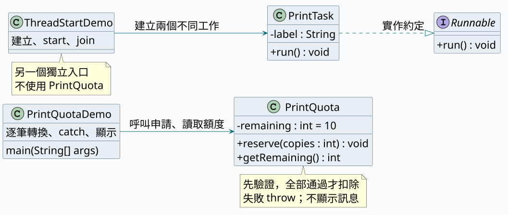
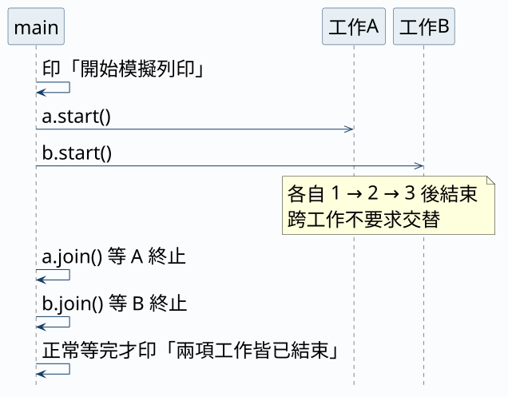

<!-- _class: lead -->
# 第 12 週｜例外處理與執行緒基礎

校園列印：拒絕申請之後，程式與額度會怎樣？

資訊管理學系二年級　胡碩誠

<!-- 本週獨立開始，不需要第11週泛型或探測車程式。發 student_lab.md 與兩組 starter。 -->

---
## 三節課的活動與成果

| 節次 | 活動 | 本人證據 |
|---|---|---|
| 1 | 文字轉數量、throw、額度規則 | 流程預測、A2 |
| 2 | 逐筆 try/catch、AI 狀態反例 | 七行結果、修正重測 |
| 3 | 兩個工作、start／join | 執行緒名稱、保存成果 |

開啟學生講義；最後 15 分鐘保存與取回。

<!-- 三節各50分鐘、休息另計。學生活動不是只看教師輸出。 -->

---
## A1｜文字方塊裡的 abc

在 C# WinForms 輸入 abc，不能直接拿來當頁數。

Java 的 main 也要決定：

- 哪裡將文字轉成整數？
- 轉換失敗時，是否仍顯示「受理成功」？
- 一筆出錯後，還要不要處理下一筆？

<!-- 10分鐘含診斷。這是熟悉情境，不假定學生已會C#例外處理。 -->

---
## A1｜先分清文字、數量與物件

```java
String raw = "3";
int copies = 3;
PrintQuota quota = new PrintQuota();
```

| 問題 | 先寫在講義 |
|---|---|
| 哪個可以直接用來扣額度？ | 待填 |
| 誰應該保管 private remaining？ | 待填 |
| 呼叫方法後，一定會正常返回嗎？ | 待填 |

<!-- 不從頭重教類別。診斷有缺口時用3分鐘補強方法與物件。 -->

---
## 文字轉整數的工具

```java
int copies = Integer.parseInt(raw.trim());
```

| 操作 | 作用 | 例子 |
|---|---|---|
| `raw.trim()` | 先去前後空白 | `" 2 "` → `"2"` |
| `Integer.parseInt(...)` | 再解析成 int | `"2"` → `2` |
| 無法解析 | 拋出 NumberFormatException | abc、空字串、2.5 |

超過 int 範圍也失敗；本週 raw 約定非 null。

<!-- API支援先說明，不能把用過String當成已會parseInt。來源：Integer API，規劃末節有連結。 -->

---
## A1｜try 與 catch 的位置

```java
try {
    int copies = Integer.parseInt(raw.trim());
    System.out.println("轉換成功 頁數=" + copies);
} catch (NumberFormatException e) {
    System.out.println("轉換失敗：請輸入整數");
}
System.out.println("轉換流程之後");
```

try 包住操作；相符例外發生時，catch 接手。

<!-- 對應examples/ParseDemo.java caught分支。raw=3時不進catch；raw=abc時跳過成功那行。 -->

---
## A1｜先預測，再跑短例

在自己的 java-12 編譯 examples，依序比較：

```powershell
java -cp out-examples ParseDemo caught 3
java -cp out-examples ParseDemo caught abc
java -cp out-examples ParseDemo uncaught abc
```

每次先寫：成功那行會印嗎？最後一行會印嗎？

編譯指令與模式說明在 `examples/README.md`。

<!-- 15分鐘短例含操作。uncaught預期是失敗實驗，錯誤堆疊不需背誦。 -->

---
## A1｜三條路徑

| 輸入／模式 | try 裡的成功訊息 | catch | 最後一行 |
|---|---|---|---|
| 3／caught | 執行 | 跳過 | 執行 |
| abc／caught | 被跳過 | 執行 | 執行 |
| abc／uncaught | 被跳過 | 沒有設置 | 不執行 |

例外不會帶你回到失敗那行重做。

錯誤堆疊先找：**例外類別、自己的檔名與行號**。

<!-- 填好預測才揭示。uncaught版仍有前面的「轉換前」，之後main終止。 -->

---
## 額度物件與呼叫端的責任



額度主線與工作實驗，是兩組獨立的兩檔程式。

<!-- 先看圖左半額度，右半留第三節。不要求複製第11週類別。PrintQuotaDemo處理文字與顯示，PrintQuota驗證與改狀態。 -->

---
## A2｜一次列印申請的規則

新物件有 10 頁；每次先檢查，全部通過才扣。

| 依序檢查 | 不通過時 | 額度 |
|---|---|---|
| 單筆在 1～5 頁嗎？ | 每筆限 1～5 頁 | 不變 |
| 剩餘額度足夠嗎？ | 剩餘額度不足 | 不變 |
| 全部通過 | 正常返回，呼叫端顯示受理 | 扣 copies |

剩 2 頁、申請 4 頁，拒絕後應剩多少？

<!-- 預期2，不是-2。使用IllegalArgumentException是本例簡化設計，不宣稱所有業務拒絕都應使用它。 -->

---
## throw：讓這次方法以例外離開

```java
if (count < 1) {
    throw new IllegalArgumentException("數量必須為正整數");
}
```

- new 建立例外物件，throw 將例外拋出。
- 呼叫端可以接住，再決定如何顯示與繼續。
- void 方法也可能無法正常返回。

<!-- 此片段只示範throw，不是A2完整答案。不要在reserve裡catch自己的規則錯誤。 -->

---
## A2｜現在完成額度方法

開啟 `src/PrintQuota.java` → **TODO A2**。

1. 寫單筆範圍驗證與指定例外訊息。
2. 再寫額度驗證。
3. 全部通過才扣除；方法不印結果。

編譯確認語法。入口仍印「尚未完成」，因為 A3 未接上。

<!-- 第一節最後10分鐘。建構子與getter已提供；學生自行寫條件與throw。巡視先扣再查的錯誤，不直接給完整答案。 -->

---
## A3｜兩個 catch 的順序

```text
IllegalArgumentException
  └─ NumberFormatException
```

格式錯誤是參數錯誤的一種。

先接住較具體的格式錯誤，再接較廣的規則錯誤。
本例分開顯示「請輸入整數」與 reserve 提供的原因。

<!-- 來源：NumberFormatException API。子類別catch必須先，否則不可到達。 -->

---
## A3｜交換順序，會在哪裡發現？

```java
try {
    Integer.parseInt("abc");
} catch (IllegalArgumentException e) {
    System.out.println("參數錯誤");
} catch (NumberFormatException e) {
    System.out.println("格式錯誤");
}
```

先預測，再看教師隔離編譯；正式 src 不放錯誤版。

<!-- 第二節前10分鐘含契約回顧。此片段刻意錯誤：NumberFormatException已被前一catch涵蓋，編譯拒絕。工具驗證同案例。 -->

---
## A3｜每筆資料都要有自己的處理範圍

```text
for 每一筆 raw
    try：轉換 → reserve → 印受理
    catch 格式錯誤：印拒絕與額度
    catch 規則錯誤：印原因與額度
全部讀完：印批次結束
```

若 try 包住整個 for，一筆失敗可能直接離開整個批次。

成功訊息放在 reserve **正常返回之後**。

<!-- 這是流程支架，不先給A3完整Java答案。catch執行後接下一圈，不會重跑本筆try。 -->

---
## A3｜接上批次入口

開 `src/PrintQuotaDemo.java` → **TODO A3**。

- 使用已提供的六筆資料與同一個額度物件。
- 取代未完成提示，自行寫迴圈、try 與兩個 catch。
- 每筆只印一次結果；額度變 0 也繼續處理。

```powershell
javac -encoding UTF-8 -d out-quota src/PrintQuota.java src/PrintQuotaDemo.java
java -cp out-quota PrintQuotaDemo
```

<!-- 第二節20分鐘含A4。編譯失敗先修正，不跑舊out。不要一筆new一個物件。 -->

---
## A3｜完整七行結果

```text
輸入=[3] 受理=3 頁 剩餘=7
輸入=[abc] 拒絕：請輸入整數 剩餘=7
輸入=[0] 拒絕：每筆限 1～5 頁 剩餘=7
輸入=[5] 受理=5 頁 剩餘=2
輸入=[4] 拒絕：剩餘額度不足 剩餘=2
輸入=[2] 受理=2 頁 剩餘=0
批次結束 剩餘=0
```

先找第一個差異；只看最後 0，無法證明每筆都正確。

<!-- 固定資料3、abc、0、5、4、2。中文格式與teacher一致，Java原生診斷保留原文。 -->

---
## A4｜發生位置與狀態要一起追蹤

| raw | 執行前額度 | 失敗位置／正常 | 執行後額度 |
|---|---|---|---|
| 3 | 10 | 待填 | 待填 |
| abc | 待填 | 待填 | 待填 |
| 0 | 待填 | 待填 | 待填 |
| 5 | 待填 | 待填 | 待填 |
| 4 | 待填 | 待填 | 待填 |
| 2 | 待填 | 待填 | 待填 |

將 catch 與下一筆是否處理，補在講義。

<!-- 教師答案10→7、7→7、7→7、7→2、2→2、2→0。失敗位置分parseInt與reserve。 -->

---
## AI｜先扣除，再檢查的建議

先保存人工版，寫需求並預測：剩 2、申請 4 會如何？

```java
// 教師設計的模擬 AI 錯誤；前方已檢查單筆範圍。
remaining -= copies;
if (remaining < 0) {
    throw new IllegalArgumentException("剩餘額度不足");
}
```

印出「拒絕」時，欄位已變成多少？

<!-- 第二節15分鐘。明標模擬，不冒稱真實AI回覆。預期-2；throw/catch沒有自動交易回復。 -->

---
## AI｜用同六筆資料比較修改前後

在 `ai-check/` 放模擬額度類別與自己的完成入口。

1. 預測並跑錯誤版：第五筆 -2，最後 -4。
2. 指出已改動欄位的位置。
3. 先驗證額度、需要時 throw，通過才扣除。
4. 重新編譯，同六筆回到七行正確結果。

記錄需求、問題證據、最小修正與採納理由。

<!-- 命令在講義，AI版另輸出out-ai。不用改初始額度或在catch猜測補回。再測5→5→1。 -->

---
## A4｜自選一組有辨識力的資料

| 資料 | 要檢查的能力 |
|---|---|
| `""`、`"   "` | 空文字與 trim 後的格式錯誤 |
| `" 2 "` | 正常去空白再轉換 |
| `"2147483648"` | 數字符號不代表一定放得進 int |
| 5 → 5 → 1 | 恰好用完後，拒絕仍不扣額度 |

拒絕後再接一筆成功，才能看出批次是否真的繼續。

<!-- 第二節最後5分鐘。自選測完還原固定六筆供AI及繳交重跑。raw不為null仍是約定。 -->

---
<!-- _class: lead -->
## B｜兩份講義，各自走三步

另一個獨立入口：不帶入額度物件。

工作只輸出有限步驟，不連真實印表機。

<!-- 第三節開始。兩個新工作，不延伸成共享額度或同步扣款。 -->

---
## Runnable 與 Thread

| 名稱 | 本例角色 |
|---|---|
| Runnable | 描述一份工作要做什麼，約定 run 方法 |
| PrintTask | 實作 Runnable，保存工作標籤 |
| Thread | 執行這份工作的一條執行緒 |
| main | 建立、啟動工作，再等待結束 |

```java
class PrintTask implements Runnable {
    public void run() { /* 工作內容 */ }
}
```

<!-- 第三節前10分鐘。具名類別，不用Lambda或匿名類別。final標籤與建構子為支援。 -->

---
## B1｜工作自己輸出三步

開 `threads/PrintTask.java` → **TODO B1**。

寫 1～3 的普通迴圈，每步一行：

```text
工作=講義A 執行緒=工作A 步驟=1
```

label 是工作標籤；實際執行緒名稱取：

```java
Thread.currentThread().getName()
```

<!-- 不把工作A寫死在輸出裡。列印語句可提供格式支援，但迴圈由學生完成。 -->

---
## B2｜建立與啟動工作

```java
Thread worker = new Thread(task, "執行緒名稱");
worker.start();
```

task 是要執行的 Runnable 工作物件。

本例要兩個不同的 PrintTask 與 Thread：

- 講義A → 工作A；講義B → 工作B。
- 先 start 兩者，才開始 join 等待。

<!-- 對應Thread API constructor及start。此片段示範單一形式，學生自行建立兩者。 -->

---
## B2｜誰在等待誰？



<!-- 各工作內有順序，跨工作沒有固定排列。若start A、join A、start B就延後了B啟動，不符合本次實驗流程。 -->

---
## B2｜等待支援段

```java
try {
    // 自行寫兩次 join：讓 main 等 a、b 終止。
} catch (InterruptedException e) {
    Thread.currentThread().interrupt();
    System.out.println("等待被中斷，本次不宣告兩項工作皆已結束");
    return;
}
System.out.println("兩項工作皆已結束");
```

catch 已提供；中斷等待不等於取消兩項工作。

<!-- 第三節15分鐘實作含B1。恢復等待者旗標、return，不讓中斷路徑印正常結束。不要求學生設計取消機制。 -->

---
## B｜執行並核對 8 行

```powershell
javac -encoding UTF-8 -d out-threads threads/PrintTask.java threads/ThreadStartDemo.java
java -cp out-threads ThreadStartDemo
```

開始 1 行 → 工作各 3 行 → 結束 1 行。

| 要看什麼 | 通過條件 |
|---|---|
| 名稱 | 工作與執行緒名稱對應 |
| 個別步驟 | 各自 1→2→3 |
| 最後一句 | 在六行工作之後 |

<!-- 不要求A先、交替或五次不同。工作都有界，正常不留下背景常駐程序。 -->

---
## 直接 run 與 start 的比較

把兩檔複製到 experiments/direct-run，另編譯。
只把兩個 start 改成 run，核對實際名稱。

| 操作 | 本例六行工作的實際執行緒 |
|---|---|
| `a.start(); b.start();` | 分別為工作A、工作B |
| `a.run(); b.run();` | 全部為 main |

即使 start 版這次 A 全在 B 前面，也可能是合法排程。

<!-- 第三節10分鐘觀察的一部分。直接run不建立新執行緒；比較currentThread，不以交錯外觀判斷。Thread API為規則來源。 -->

---
## throw、throws 與受檢例外

| 寫法 | 意義 |
|---|---|
| `throw new ...` | 現在拋出一個例外物件 |
| 方法簽名的 `throws ...` | 宣告例外可能往呼叫端傳出 |
| `catch (...)` | 接住相符例外並處理 |

join 宣告 InterruptedException，編譯器要求處理或宣告。
reserve 的 IllegalArgumentException 為非受檢例外。

<!-- 不以throws當成catch。教師可用工具產生的缺catch反例說明，學生不必改main加throws。來源JLS11.2與Thread API。 -->

---
## 結束的判定與限制

- join 等執行緒終止，不能保證一般業務工作成功。
- 工作 run 裡的例外，不會自動交給 main 的 catch。
- 本例不共用額度，沒有處理同步扣除。
- 多執行緒不保證加速，也不保證輪流輸出。

用講義比較表解釋「誰執行、誰等待、何時可印結束」。

<!-- 不另加競態實作或同步API。這些界線避免學生把可執行誤當並行安全。 -->

---
## 最後 15 分鐘｜保存與取回

1. 核對 src、threads、LAB_REPORT.md、AI_USAGE.md。
2. GitHub Desktop 檢查差異，排除 out、.class 與錯誤副本。
3. commit、push，再到遠端核對當日路徑。
4. 於原 repo 外取回，重新編譯兩個入口。

網路或登入未完成，紀錄待補，不把本機 commit 當已上傳。

<!-- 保留15分鐘，不建巢狀repo。取回兩個入口都要編譯，非只確認檔案存在。 -->

---
## 課後作業｜單筆結果形成批次摘要

抽出 `boolean processOne(PrintQuota quota, String raw)`。

- 方法內處理一筆並印結果：成功 true，拒絕 false。
- main 每筆呼叫一次，再累計受理／拒絕。
- 固定、自選、5→5→1、空陣列都要驗證。

```text
批次結束 受理=3 拒絕=3 剩餘=0
```

<!-- 25～35分鐘。不要重複reserve，不在finally計成功。詳細規格與評分在assignment.md，執行緒交課堂成果即可。 -->

---
<!-- _class: lead -->
## 教師附錄

以下含答案與選讀，不列入學生必做實作時間。

<!-- 正常授課到作業頁結束。按學生進度選擇揭示，不提前代做。 -->

---
## A2｜額度方法答案

```java
public void reserve(int copies) {
    if (copies < 1 || copies > 5) {
        throw new IllegalArgumentException("每筆限 1～5 頁");
    }
    if (copies > remaining) {
        throw new IllegalArgumentException("剩餘額度不足");
    }
    remaining -= copies;
}
```

<!-- 完整檔teacher/quota/PrintQuota.java，重點是全部通過才改欄位。 -->

---
## A3｜成功與拒絕的分支

```java
for (String raw : inputs) {
    try {
        int copies = Integer.parseInt(raw.trim());
        quota.reserve(copies);
        // 此處才印受理與剩餘額度。
    } catch (NumberFormatException e) {
        // 印「請輸入整數」與剩餘額度。
    } catch (IllegalArgumentException e) {
        // 印 e.getMessage() 與剩餘額度。
    }
}
```

<!-- 省略列印文字供投影；完整答案teacher/quota/PrintQuotaDemo.java。批次結束印在for之後。 -->

---
## A4｜固定資料追蹤答案

| raw | 前額度 | 流程 | 後額度 |
|---|---|---|---|
| 3 | 10 | 正常返回 | 7 |
| abc | 7 | parseInt → 格式 catch | 7 |
| 0 | 7 | reserve → 規則 catch | 7 |
| 5 | 7 | 正常返回 | 2 |
| 4 | 2 | reserve → 規則 catch | 2 |
| 2 | 2 | 正常返回 | 0 |

<!-- 完整答案另含下一筆欄位，見teacher_notes。例外不代表所有狀態自動安全。 -->

---
## B2｜啟動與等待答案

```java
Thread a = new Thread(new PrintTask("講義A"), "工作A");
Thread b = new Thread(new PrintTask("講義B"), "工作B");
System.out.println("開始模擬列印");
a.start();
b.start();
try {
    a.join();
    b.join();
} catch (InterruptedException e) {
    // 使用已提供的恢復旗標、提示與 return 支援段。
}
// 正常等完才印「兩項工作皆已結束」。
```

<!-- 投影節錄，catch不可真的留空。完整正確檔teacher/threads/ThreadStartDemo.java。B1每個工作1～3，輸出currentThread名稱。 -->

---
## 選讀｜finally 是收尾位置

```java
try {
    System.out.println(Integer.parseInt(raw));
} catch (NumberFormatException e) {
    System.out.println("轉換失敗");
} finally {
    System.out.println("本筆轉換流程收尾");
}
```

不要在 finally 扣額度、累計成功或用 return 蓋掉結果。

<!-- 對應examples/FinallyTrace.java，投影簡化成功輸出。一般正常／例外路徑都會經過finally，但不涵蓋JVM強制終止等情況。 -->

---
## 教師備查｜章節與規則

- Deitel 11e 第 11 章：例外流程、階層、傳遞與前後條件。
- 第 23 章 §23.1、§23.2：並行與生命週期概念。
- 本週採傳統 Thread 最小實驗；書中 §23.3 使用 Executor。
- 官方規則：JLS §11.2、§14.20，Integer、Thread API。

完整連結與本機實測範圍見教師筆記與 verification。

<!-- EPUB目錄已核對，不猜頁碼。https://docs.oracle.com/javase/specs/jls/se25/html/jls-11.html#jls-11.2 ; https://docs.oracle.com/javase/specs/jls/se25/html/jls-14.html#jls-14.20 ; https://docs.oracle.com/en/java/javase/25/docs/api/java.base/java/lang/Integer.html#parseInt(java.lang.String) ; https://docs.oracle.com/en/java/javase/25/docs/api/java.base/java/lang/Thread.html 。文件版本不是安裝版本要求。 -->
