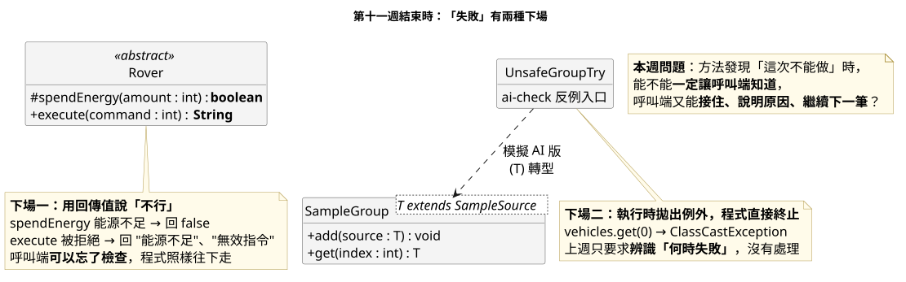
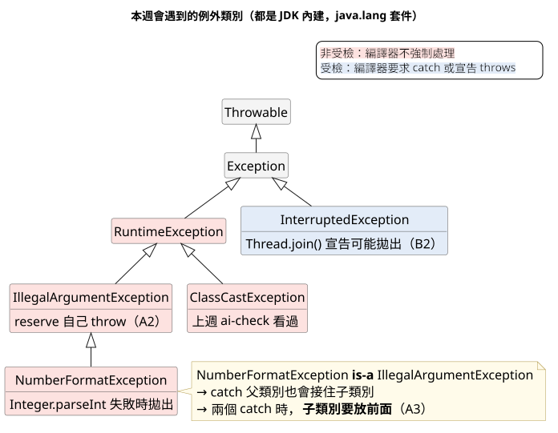
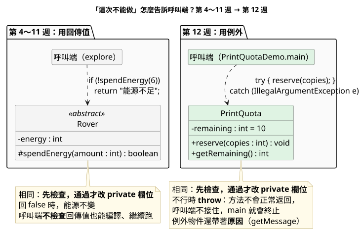
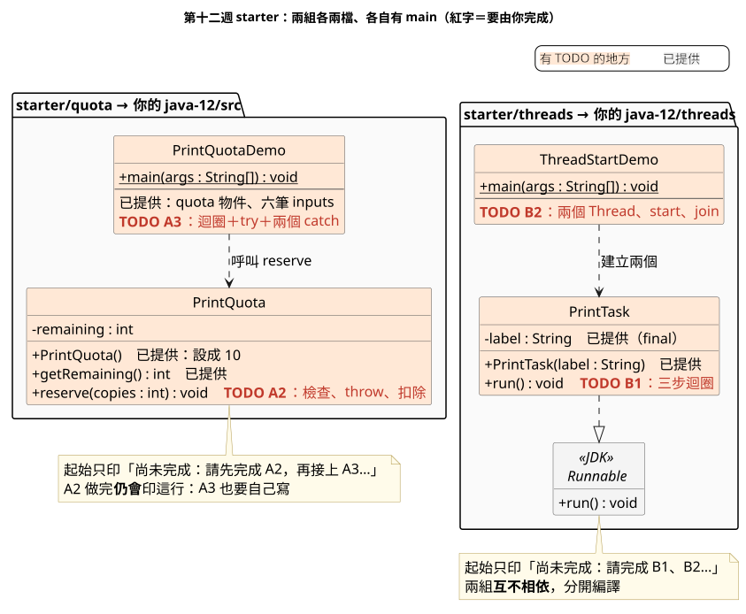
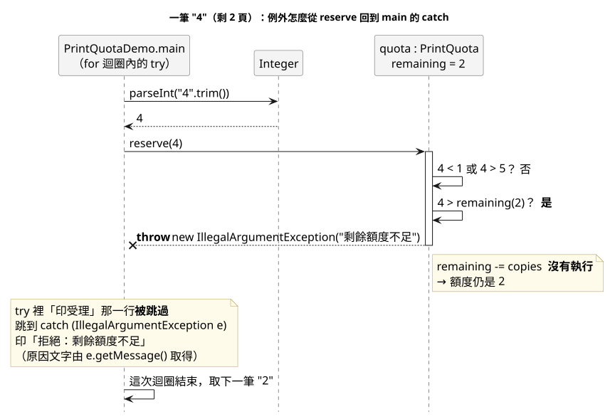
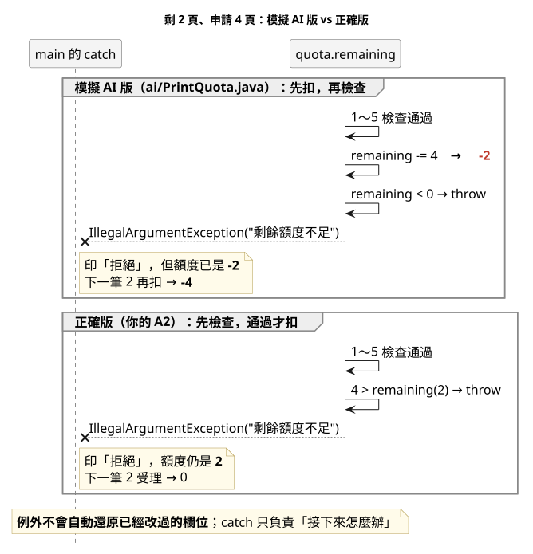
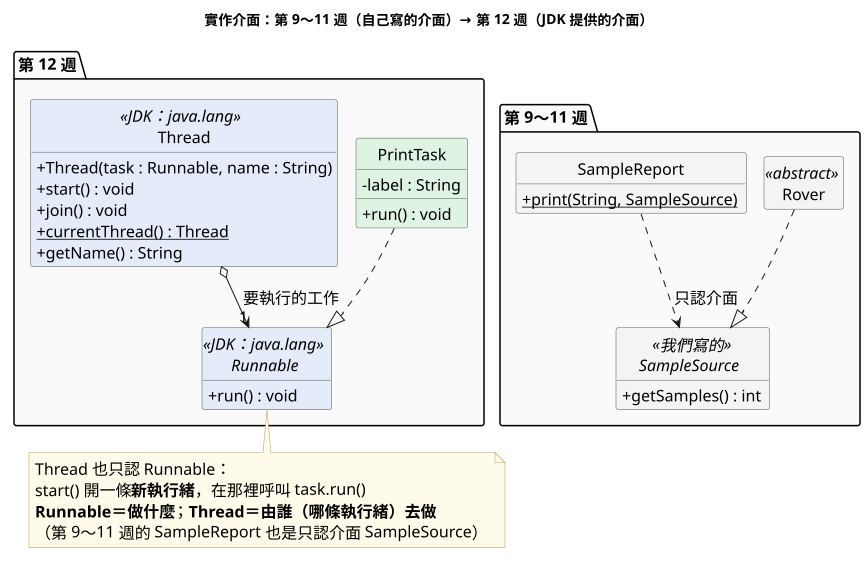
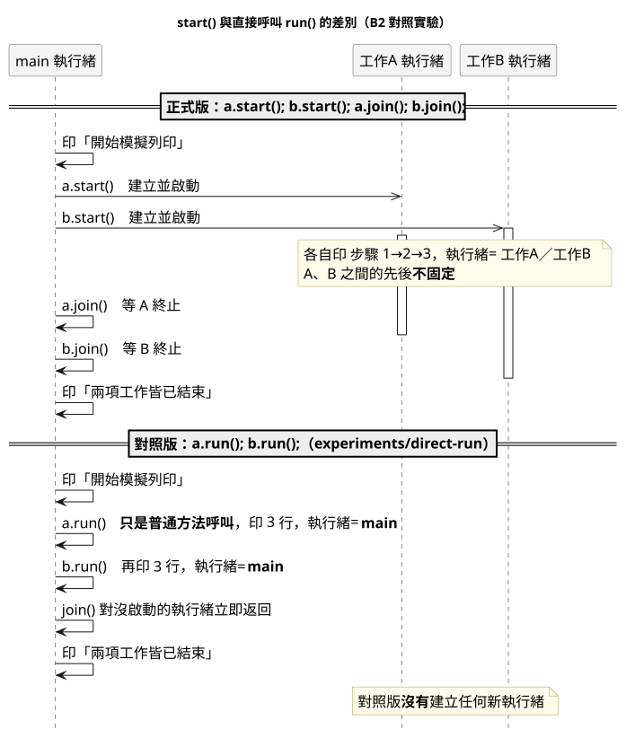
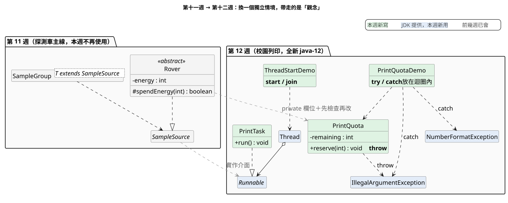

<!-- _class: lead by-claude -->

# 第十二週｜例外處理與執行緒基礎

## 申請失敗之後，程式去哪裡？兩個工作能不能同時進行？

AI 生成例外處理程式碼：**除錯練習**

物件導向程式設計（與 AI 協作）｜115 學年度第 1 學期
資訊管理學系 二年級｜授課教師：胡碩誠

<!--
講者備註：本份投影片依 week12/codex版本 的 README、student_lab、assignment、examples、starter、ai、teacher、teacher_notes、handoff、verification 製作，由 Claude 撰寫；codex 原投影片 week12_slides_codex.md 保留不動，可擇一使用。
本份分兩部分：先用 examples/ 的 ParseDemo（與選讀 FinallyTrace）把「例外發生後哪一行被跳過、誰接住、接住後去哪裡」講清楚，再用 starter/ 帶 A2、A3、A4、AI、B1、B2 與作業；teacher/ 的答案只出現在附錄。
-->

---

<!-- _class: by-claude small -->

## 關於這份投影片

- 每頁右上角 <span class="tag">claude</span>：本投影片由 Anthropic Claude（Claude Code）依 **codex版本教材** 製作，教師審閱後使用。
- 程式、講義題號（A1–A4、AI、B1–B2）、TODO、預期輸出全部沿用 `week12/codex版本/`；投影片**不新增**學生作業。
- 左上角標籤是該頁對應的檔案（路徑以 `week12/codex版本/` 為起點）：

| 標籤 | 資料夾 | 在本投影片的角色 |
|---|---|---|
| <span class="tag blue">examples/…</span> | `examples/` | **第一部分：範例教學**——`ParseDemo`（講義 A1）、`FinallyTrace`（選讀） |
| <span class="tag green">starter/…</span> | `starter/` | **第二部分：實作說明**——額度 TODO A2、A3（講義 A2–A4）與工作 TODO B1、B2 |
| <span class="tag purple">ai/…</span> | `ai/` | AI 段：教師撰寫的**模擬 AI 錯誤**（先扣額度、再檢查） |
| <span class="tag brown">diagrams/…</span> | `diagrams/` | 本份新繪的 `*_claude` 圖，說明**與前幾週的演進** |
| <span class="tag gray">teacher/…</span> | `teacher/` | **附錄：教師用**——完整答案、作業參考、常見錯誤 |

<!--
講者備註：講義的活動順序是 A1→A2→A3→A4→AI→B1→B2。本份依教師要求先把 examples（A1）完整講完，再進 starter。finally 在 codex 教材是選讀，放在第一部分末尾，時間不足可跳過。帶課以講義題號為準。
-->

---

<!-- _class: by-claude small -->

<div class="ex"><span class="dg">diagrams/start_w11_claude.svg</span><span>../../week11/codex版本/</span></div>

## 上週留下的問題：「失敗」只有兩種下場？



- **下場一**：用回傳值說「不行」（`spendEnergy` 回 `false`）——呼叫端忘了檢查，程式照樣往下跑。
- **下場二**：執行時拋出例外（上週的 `ClassCastException`）——沒有人處理，**程式直接終止**。

<!--
講者備註：第十一週 handoff 的第 12 週入口是「型態正確是否就一定能成功？」。本週不沿用探測車程式，但先用學生熟悉的兩個畫面引出問題：第 4–11 週用回傳值或結果字串表示拒絕；第十一週 ai-check 的 UnsafeGroupTry 在 get(0) 拋出 ClassCastException 後整個 main 結束。本週要學的是第三條路：方法 throw，呼叫端 catch，然後繼續。
-->

---

<!-- _class: by-claude small -->

## 本週是**獨立起點**：不需要第十一週的程式

<div class="cols">
<div>

**新情境：校園列印額度**

- 每個人有 **10 頁**列印額度
- 每次申請 **1～5 頁**
- 額度不夠就拒絕，**拒絕不扣額度**
- 一批六筆申請要**逐筆**處理完

**另一個小實驗：兩份講義同時列印**

- 兩個工作各印 3 步
- 看清楚「哪個執行緒在做」

</div>
<div class="box green">

**你不需要**

- 第十一週的 `SampleGroup`、泛型
- 探測車 `Rover`、`Mission`
- 上週作業是否完成

**你需要**（前幾週已會）

- `if`、`for` 迴圈、字串、陣列
- 方法、參數、回傳值
- 類別、`private` 欄位、建構子
- 讀得懂「類別實作介面」

</div>
</div>

<!--
講者備註：codex 教材生成規劃第一節：本週與第十一週的泛型主題、樣本群組及探測車實作脫鉤，從空白的 java-12 開始。不考前週名詞；介面只要求能讀。沒完成第十一週的同學也能完整參與。
-->

---

<!-- _class: by-claude small -->

## 本週流程：先用短例看流程，再寫額度與工作

| 部分 | 內容 | 講義 | 時間（備課估計） |
|---|---|---|---|
| 暖身 | 文字與數字、方法沒走完、誰能改額度 | A1 前段 | 第 1 節 10 分 |
| **第一部分** <span class="tag blue">examples/</span> | `ParseDemo`：捕捉 vs 未捕捉，哪一行被跳過？ | A1 | 第 1 節 15 分 |
| **第二部分** <span class="tag green">starter/</span> | 額度方法：先檢查、`throw`、通過才扣 | A2 | 第 1 節 25 分 |
| | 批次入口：迴圈內 `try` ＋ 兩個 `catch` | A3 | 第 2 節 30 分 |
| | 逐筆追蹤、自選邊界 | A4 | 第 2 節穿插 |
| | 模擬 AI「先扣再檢查」→ 最小修正 → 同案例重測 | AI | 第 2 節 15 分 |
| | `Runnable` 工作、兩個 `Thread`、`start`／`join` | B1、B2 | 第 3 節 35 分 |
| | 保存、push、取回重編譯 | — | 第 3 節最後 15 分 |
| 課後 | `processOne` 回傳成功／拒絕，加印摘要 | 作業 | 25–35 分 |

**每段都先寫預測，再編譯、執行、比對。**

<!--
講者備註：150 分鐘為未試教的備課估計（codex 教師筆記）。若第二節落後，縮短教師額外示例與選做討論（finally），保留逐筆處理、額度不變、AI 同案例重測；第三節保留執行緒基本體驗與最後保存時間。
-->

---

<!-- _class: by-claude small -->

## 本週學習目標與範圍

<div class="cols">
<div class="box green">

**本週要會**

1. 追蹤例外發生後：哪一行**被跳過**、哪個 `catch` **接住**、下一筆**如何繼續**
2. 在方法內用 `throw` 拒絕，在呼叫端用 `try/catch` 處理；**失敗時物件狀態不變**
3. 依繼承關係排 `catch` 順序：格式錯誤（子類別）在前
4. 用具名 `Runnable` 建立兩個有限工作，`start()` 兩者後再 `join()`
5. 用反例審查 AI 程式：重現 → 最小修正 → 同案例重測

</div>
<div class="box">

**本週不做**（延伸）

- 自訂例外類別、例外鏈
- 檔案 I/O、try-with-resources
- `finally`：只**選讀**收尾位置
- 執行緒同步、共用資料安全
- 執行緒池、`Future`、虛擬執行緒
- Lambda（第十三週）

</div>
</div>

<!--
講者備註：範圍依 codex 教材生成規劃第二節。Deitel 11e EPUB：第 11 章 §11.3–11.5、§11.7、§11.10 為主線；finally §11.6 選讀；並行參考第 23 章 §23.1、§23.2（§23.3 用 Executor，本週不採）。
-->

---

<!-- _class: by-claude small -->

## 從 C# 對照：你可能看過的錯誤畫面

<div class="cols">
<div>

**C#（WinForms）**

```csharp
// textBox1.Text 是 "abc"
int copies = int.Parse(textBox1.Text);
// → 拋出 FormatException
```

沒有處理時，程式跳出錯誤對話框；
若你用過 `int.TryParse`，那是**用回傳值**表示失敗。

</div>
<div>

**Java（本週）**

```java
String raw = "abc";
int copies = Integer.parseInt(raw.trim());
// → 拋出 NumberFormatException
```

沒有處理時，`main` 終止並印出錯誤訊息。
本週學 `try/catch` **接住它、說明原因、繼續下一筆**。

</div>
</div>

> 沒學過 C# 的例外也沒關係：本週從頭講。Java 多了一種 **「受檢例外」**——編譯器會**強迫**你處理（第三節的 `join()` 就是）。

<!--
講者備註：codex 規劃明示「這是情境對照，不假設學生已學過 C# 例外處理」。開場提問：在 C# 文字方塊輸入 abc，轉成數量會發生什麼？顯示錯誤之後，還能處理下一筆嗎？C# 沒有受檢例外，這是 Java 特有的編譯期規則，第三節再看實際診斷。
-->

---

<!-- _class: by-claude small -->

## 今天的資料夾（在既有 `115_1_Java` repo 裡）

```text
115_1_Java/YYYY_MM_DD/          ← 日期換成實際上課日
  LAB_REPORT.md                 從 student_lab.md 另存
  AI_USAGE.md                   從 AI_USAGE_template.md 另存
  java-12/
    examples/                   複製 examples/ 的 2 個 .java   ← 第一部分
    src/                        複製 starter/quota/ 的 2 個 .java   ← A2、A3
    threads/                    複製 starter/threads/ 的 2 個 .java ← B1、B2
    ai-check/                   AI 活動時才建立（錯誤副本）
    experiments/direct-run/     B2 對照實驗時才建立
```

- 每組都只有**兩個檔、各自有 `main`**，彼此**不相依** → 用 **VS Code** 即可，IntelliJ IDEA 選用。
- 每組**分開編譯**到不同 `out-…` 目錄；**不要**把 teacher、starter、ai 的同名類別放在同一個資料夾。
- 先記下自己的 `java -version`、`javac -version`。

<!--
講者備註：README「準備與檔案位置」。experiments/direct-run 在 README 的結構圖沒有列出，但學生講義 B2 有用到，這裡一併列出。四檔合計但兩組互不相依，依共用技能「多檔才加入 IDEA」的規則，本週不排雙 IDE 重做。
-->

---

<!-- _class: lead by-claude -->

<div class="ex"><span>examples/</span></div>

# 第一部分｜範例教學

## `ParseDemo`：同一個 abc，接住與沒接住差在哪？

<!--
講者備註：第一部分只用 examples/ 的兩個檔。目標是讓學生能指出：失敗那一行之後的哪些敘述被跳過、catch 執行後程式往哪裡走、沒有 catch 時 main 怎麼結束。
-->

---

<!-- _class: by-claude small -->

<div class="ex"><span>examples/ParseDemo.java</span><span>examples/FinallyTrace.java</span><span>examples/README.md</span></div>

## 範例檔案與執行入口

| 檔案 | 角色 | 本週用途 |
|---|---|---|
| `ParseDemo.java` | 文字轉整數；可切換「有接住」與「沒接住」 | **A1 必做** |
| `FinallyTrace.java` | 加上 `finally` 的收尾順序 | 選讀 |

在自己的 `java-12` 執行（編譯成功才執行下一行）：

```powershell
javac -encoding UTF-8 -d out-examples examples/ParseDemo.java examples/FinallyTrace.java
java -cp out-examples ParseDemo caught abc
```

- `ParseDemo` 有**兩個命令列參數**：第 1 個是 `caught` 或 `uncaught`，第 2 個是要轉換的文字。
- 省略時預設為 `caught abc`。這個切換由教師提供，**不要求**你設計命令列解析。

<!--
講者備註：examples/README.md 的指令。args 的用法學生在第一、二週已見過（命令列參數），這裡只是用來切換模式。
-->

---

<!-- _class: by-claude small -->

## A1 暖身｜先回答三題（寫在 LAB_REPORT）

1. `int copies = 3;` 與 `String raw = "3";`——兩個「3」用法一樣嗎？
2. 一個方法**沒有正常走到最後**就離開了，呼叫端還能直接說「成功」嗎？
3. 列印額度應該放在 `private` 欄位嗎？**誰**可以合法改動剩餘額度？

<div class="box blue">

先寫自己的答案，等一下用 `ParseDemo` 的結果回來檢查第 1、2 題；第 3 題到第二部分 A2 再對照。

</div>

<!--
講者備註：學生講義 A1 的三個問題。不要直接說答案，給 2 分鐘寫。巡視時看學生是否分清楚「數字」與「看起來像數字的文字」。
-->

---

<!-- _class: by-claude small -->

## A1 暖身｜答案

| 題目 | 答案 |
|---|---|
| 1. `3` 與 `"3"` | `int` 的 3 可以直接做加減；`String` 的 `"3"` 是**文字**，要先**明確轉換**成 `int` 才能當數量 |
| 2. 方法沒走完 | **不能**。方法若因為例外離開，後面的步驟（例如扣額度、印成功）都**沒有執行** |
| 3. 誰改額度 | 額度放在 `private` 欄位，**只有額度類別自己的方法**能改；外面只能讀 `getRemaining()`、或呼叫申請方法 |

> 第 2 題是本週核心：**「呼叫了方法」≠「方法成功了」**。即使回傳型態是 `void`，方法也可能沒有正常返回。

<!--
講者備註：教師筆記 A1：int copies=3 可參與算術；String raw="3" 是文字，要明確轉換。main 是本例的流程入口，對照 C# 事件方法即可。第 3 題的 private 欄位在第四週起就用過（探測車能源）。
-->

---

<!-- _class: by-claude small -->

<div class="ex"><span>examples/ParseDemo.java</span></div>

## 新工具：`Integer.parseInt(raw.trim())`

**由內往外讀**：先 `trim()` 去掉前後空白 → 再 `Integer.parseInt(...)` 把文字轉成 `int`。

| `raw` | `raw.trim()` | `Integer.parseInt(...)` 的結果 |
|---|---|---|
| `"3"` | `"3"` | `3` |
| `" 2 "` | `"2"` | `2`（前後空白先被去掉） |
| `"abc"` | `"abc"` | 拋出 **`NumberFormatException`** |
| `""`（空字串） | `""` | 拋出 `NumberFormatException` |
| `"   "`（純空白） | `""` | 拋出 `NumberFormatException` |
| `"2.5"` | `"2.5"` | 拋出 `NumberFormatException`（不接受小數） |
| `"2147483648"` | 同左 | 拋出 `NumberFormatException`（超出 `int` 範圍） |

- `parseInt` 不能把任意文字變整數；**轉不了時，它不回傳任何值，而是「拋出例外」**。
- 本週約定 `raw` 不是 `null`，不必另外防護。

<!--
講者備註：codex 規劃第四節「方法與輸入」：raw 約定非 null，trim 後 parseInt；小數不接受，不另外設計正規表示式。這些 API 是本週先介紹的工具，不把學生以前見過字串視為已會使用它們。表格內各列已在 JDK 22 以 ParseDemo 實測（"   " 與 "" 都是 For input string: ""）。
-->

---

<!-- _class: by-claude small -->

<div class="ex"><span>examples/ParseDemo.java</span></div>

## 讀 `ParseDemo`：兩條分支做同一件事

```java
String mode = args.length > 0 ? args[0] : "caught";   // 第 1 個參數：模式
String raw  = args.length > 1 ? args[1] : "abc";      // 第 2 個參數：要轉的文字
System.out.println("轉換前");
if ("uncaught".equals(mode)) {
    int copies = Integer.parseInt(raw.trim());        // ← 沒有 try：失敗就沒人接
    System.out.println("轉換成功 頁數=" + copies);
} else {
    try {
        int copies = Integer.parseInt(raw.trim());    // ← 可能失敗的那一行
        System.out.println("轉換成功 頁數=" + copies);
    } catch (NumberFormatException e) {
        System.out.println("轉換失敗：請輸入整數");     // ← 只有失敗時才執行
    }
}
System.out.println("轉換流程之後");                     // ← 最後一行
```

**兩個分支的轉換程式一模一樣**，差別只在：外面有沒有包 `try { … } catch (…) { … }`。

<!--
講者備註：程式依 examples/ParseDemo.java，行尾註解為投影片補充說明，原檔沒有。三元運算子 ?: 若學生不熟，只要說「有給參數就用參數，沒給就用預設」。重點引導學生看 try 區塊與 catch 區塊的界線。
-->

---

<!-- _class: by-claude small -->

## `try / catch` 的四條規則

<div class="cols">
<div>

```java
try {
    // ① 可能失敗的程式放這裡
    int copies = Integer.parseInt(raw.trim());
    // ② 上一行失敗 → 這行「被跳過」
    System.out.println("轉換成功 …");
} catch (NumberFormatException e) {
    // ③ 型態相符的例外才會進來
    System.out.println("轉換失敗 …");
}
// ④ catch 做完 → 從這裡繼續
System.out.println("轉換流程之後");
```

</div>
<div>

1. **`try` 包住可能失敗的操作。**
2. 某一行拋出例外 → `try` 裡**剩下的敘述全部跳過**。
3. 跳到**型態相符**的 `catch`；`e` 是那個例外物件。
4. `catch` 執行完，從**整個 try/catch 之後**繼續。

<div class="box red">

**不會**回到失敗那一行重做。
**沒有**例外時，`catch` 整段被略過。

</div>

</div>
</div>

<!--
講者備註：學生講義 A1：「try 包住可能失敗的操作，catch 在相符例外發生後接手；不會回到失敗那行重做。」常見誤解是以為 catch 之後會回到 try 再試一次，或以為 catch 一定會執行。
-->

---

<!-- _class: by-claude small -->

<div class="ex"><span>examples/ParseDemo.java</span></div>

## A1｜先預測，再執行（填在 LAB_REPORT）

| 參數 | 「轉換成功」會印嗎？ | 「轉換流程之後」會印嗎？ | 實際／理由 |
|---|---|---|---|
| `caught 3` | ？ | ？ | |
| `caught abc` | ？ | ？ | |
| `uncaught abc` | ？ | ？ | |

一次換一組參數重跑：

```powershell
java -cp out-examples ParseDemo caught 3
java -cp out-examples ParseDemo caught abc
java -cp out-examples ParseDemo uncaught abc
```

> `uncaught abc` 會印出很長的錯誤訊息——**先別慌**，下一頁教你怎麼讀。

<!--
講者備註：給 3 分鐘預測，再讓學生自己跑。表格與學生講義 A1 相同。uncaught 3 不在講義表內，examples/README 有列，可口頭補充：沒有例外時，沒包 try 也能正常走完。
-->

---

<!-- _class: by-claude small -->

## A1｜答案：有接住的兩條路徑

<div class="cols">
<div>

**`caught 3`**（沒有例外）

```text
轉換前
轉換成功 頁數=3
轉換流程之後
```

`parseInt` 成功 → 印成功 → **catch 被略過** → 繼續。

</div>
<div>

**`caught abc`**（例外被接住）

```text
轉換前
轉換失敗：請輸入整數
轉換流程之後
```

`parseInt` 拋出 → **「轉換成功」被跳過** → 進 `catch` → **繼續**到最後一行。

</div>
</div>

<div class="box green">

接住之後，程式**沒有終止**。這就是本週 A3 要的效果：一筆失敗，**下一筆還能處理**。

</div>

<!--
講者備註：輸出為 JDK 22 實際執行結果，與 examples/README、教師筆記 A1 一致。
-->

---

<!-- _class: by-claude small -->

## A1｜答案：沒接住 → `main` 終止

```text
轉換前
Exception in thread "main" java.lang.NumberFormatException: For input string: "abc"
	at java.base/java.lang.NumberFormatException.forInputString(NumberFormatException.java:67)
	at java.base/java.lang.Integer.parseInt(Integer.java:588)
	at java.base/java.lang.Integer.parseInt(Integer.java:685)
	at ParseDemo.main(ParseDemo.java:14)
```

<div class="cols">
<div>

**讀錯誤訊息三步驟**（不必背整段）

1. **例外類別**：`NumberFormatException`
2. **原因**：`For input string: "abc"`
3. 往下找**第一個自己的檔名／行號**：`ParseDemo.java:14` → 回原始碼看第 14 行

</div>
<div>

**結果**

- 只印了「轉換前」
- 「轉換成功」與「轉換流程之後」**都沒印**
- 錯誤訊息印在**錯誤輸出**（stderr），不是一般輸出
- `java.base/...` 那幾行是 JDK 內部，先略過

</div>
</div>

<!--
講者備註：JDK 22 實際輸出（JDK 版本不同，java.base 那幾行的行號可能不同，自己的 ParseDemo.java:14 不變）。學生講義 A1：「錯誤訊息很多行時，先找例外類別、第一個自己的檔名／行號，再回到原始碼；不需要背整段堆疊。」請學生在報告記下一個出錯位置與被跳過的敘述。
-->

---

<!-- _class: by-claude small -->

## A1｜整理：四種參數一次比較

| 參數 | 標準輸出（依序） | 判讀 |
|---|---|---|
| `caught 3` | 轉換前／轉換成功 頁數=3／轉換流程之後 | 沒有例外，略過 catch |
| `caught abc` | 轉換前／轉換失敗：請輸入整數／轉換流程之後 | 成功那行**被跳過**，catch 後繼續 |
| `uncaught abc` | 只有「轉換前」；錯誤輸出有 `NumberFormatException` | 沒人接住，**main 終止** |
| `uncaught 3` | 轉換前／轉換成功 頁數=3／轉換流程之後 | 沒有例外，沒包 try 也能走完 |

**關鍵句**：例外 ≠ 一定當掉。**有沒有人接住**，決定程式能不能繼續。

<!--
講者備註：表格依 examples/README 與實測。斜線代表換行，不是程式原樣輸出。
-->

---

<!-- _class: by-claude small -->

<div class="ex"><span class="dg">diagrams/exception_tree_claude.svg</span></div>

## 例外也是物件：本週會遇到的例外類別

<div class="cols l3">
<div>



</div>
<div>

- 例外是**類別**，有**繼承關係**——和第八週學的繼承一樣。
- `NumberFormatException` **is-a** `IllegalArgumentException`：「格式錯誤」是「參數不合法」的一種。
- 紅色（`RuntimeException` 底下）：**非受檢**，編譯器不強迫你處理。
- 藍色 `InterruptedException`：**受檢**，編譯器會**強迫**你 `catch` 或宣告——第三節 `join()` 再看。

</div>
</div>

<!--
講者備註：這張圖是預告，A3 的 catch 順序與 B2 的受檢例外都會回來用它。不需要學生背整棵樹；只要記住 NumberFormatException 繼承 IllegalArgumentException，以及「受檢」代表編譯器會檢查。繼承關係依 Java API 文件（NumberFormatException、InterruptedException）。
-->

---

<!-- _class: by-claude small -->

<div class="ex"><span>examples/FinallyTrace.java</span></div>

## 選讀｜`finally`：不論成功或失敗都會經過的收尾位置

<div class="cols">
<div>

```java
try {
    System.out.println("轉換成功 頁數="
        + Integer.parseInt(raw));
} catch (NumberFormatException e) {
    System.out.println("轉換失敗");
} finally {
    System.out.println("本筆轉換流程收尾");
}
System.out.println("繼續之後的流程");
```

```powershell
java -cp out-examples FinallyTrace 3
java -cp out-examples FinallyTrace abc
```

</div>
<div>

| 參數 | 輸出（依序） |
|---|---|
| `3` | 轉換成功 頁數=3／本筆轉換流程收尾／繼續之後的流程 |
| `abc` | 轉換失敗／本筆轉換流程收尾／繼續之後的流程 |

<div class="box red">

`finally` **不代表成功**：兩條路都會經過。
所以**不能**在 `finally` 扣額度、計成功數或印「受理」。
本例沒有需要關閉的資源，只看流程。

</div>

</div>
</div>

<!--
講者備註：codex 規劃：finally 是教師閱讀補充，可用短片段追蹤正常及例外路徑共用的收尾位置；不把「一定執行」當成涵蓋 JVM 被終止等情況的保證。時間不足可整頁跳過，作業選做二擇一時再回來看。輸出為 JDK 22 實測。
-->

---

<!-- _class: by-claude small -->

## 第一部分小結 → 帶到列印額度

<div class="cols">
<div class="box blue">

**ParseDemo 教會我們**

- 失敗那一行之後，`try` 內的敘述**被跳過**
- 型態相符的 `catch` 接手；做完從 try/catch **之後**繼續
- 沒人接住 → `main` 終止，後面全部不執行
- 錯誤訊息：類別 → 原因 → 自己的檔名行號

</div>
<div class="box green">

**接下來要回答**

- 例外**一定**是 JDK 拋的嗎？我們自己的方法能不能「拋」？
  → **A2：`throw`**
- 一批六筆，一筆失敗後**下一筆**怎麼辦？
  → **A3：catch 放在迴圈內**
- 拒絕之後，額度**有沒有被改壞**？
  → **A4、AI**

</div>
</div>

<!--
講者備註：過場頁。第一節前 25 分鐘到此結束，接著進入 starter 的額度主線。
-->

---

<!-- _class: lead part2 by-claude -->

<div class="ex"><span class="st">starter/</span></div>

# 第二部分｜starter 實作

## 額度方法 `throw`、批次入口 `catch`，再加兩個執行緒工作

<!--
講者備註：第二部分依 starter 的兩組檔案進行：quota（A2、A3、A4、AI）與 threads（B1、B2）。教師不要先投影完整答案，答案在附錄。
-->

---

<!-- _class: by-claude small -->

<div class="ex"><span class="dg">diagrams/reject_evolution_claude.svg</span></div>

## 演進：「這次不能做」怎麼告訴呼叫端？

<div class="cols l3">
<div>



</div>
<div>

**不變**：先檢查，**通過才改** `private` 欄位。

**改變**：拒絕的方式

| | 第 4～11 週 | 第 12 週 |
|---|---|---|
| 方法怎麼說不行 | 回傳 `false`／字串 | `throw` 例外 |
| 呼叫端沒處理 | 照樣往下跑 | **main 終止** |
| 拒絕原因 | 另外約定 | 例外物件帶著 |

例外讓「失敗」**無法被默默忽略**。

</div>
</div>

<!--
講者備註：第 4–11 週 Rover.spendEnergy(amount) 在能源不足時回 false、能源不變；explore 再把它轉成 "能源不足" 字串。這是正當的設計，本週不是說回傳值錯了，而是學另一種表達方式。codex 規劃也說明以 IllegalArgumentException 表達額度不足是本例的簡化設計，不宣稱所有業務失敗都應使用例外。
-->

---

<!-- _class: by-claude small -->

<div class="ex"><span class="st">starter/quota/</span><span class="st">starter/threads/</span></div>

## starter 的檔案與起始狀態

<div class="cols">
<div>

| 檔案 | 狀態 |
|---|---|
| `quota/PrintQuota.java` | **TODO A2** |
| `quota/PrintQuotaDemo.java` | **TODO A3** |
| `threads/PrintTask.java` | **TODO B1** |
| `threads/ThreadStartDemo.java` | **TODO B2** |

複製到自己的 `java-12/src/` 與 `java-12/threads/`。

</div>
<div>

```powershell
javac -encoding UTF-8 -d out-quota src/PrintQuota.java src/PrintQuotaDemo.java
java -cp out-quota PrintQuotaDemo
```

```text
尚未完成：請先完成 A2，再接上 A3 的逐筆處理。
```

```powershell
javac -encoding UTF-8 -d out-threads threads/PrintTask.java threads/ThreadStartDemo.java
java -cp out-threads ThreadStartDemo
```

```text
尚未完成：請完成 B1、B2，再啟動工作實驗。
```

</div>
</div>

這是**預期**的未完成提示：starter 可以編譯、安全結束，但**不代表功能已完成**。

<!--
講者備註：起始輸出為 JDK 22 實測。提醒學生：只刪掉提示就宣稱完成是不行的；編譯失敗時不要用舊的 out 結果。
-->

---

<!-- _class: by-claude small -->

<div class="ex"><span class="dg">diagrams/starter_todo_w12_claude.svg</span></div>

## starter：四個 TODO 在哪裡？



<!--
講者備註：兩組各兩檔、各自有 main、互不相依。注意 A2 完成後入口仍印「尚未完成」，因為 A3 要自己寫——這是 codex starter 的刻意設計，不是 bug。PrintTask 的 label 是 final，表示建立後不再替換，學生不必自己設計 final。
-->

---

<!-- _class: by-claude small -->

<div class="ex"><span class="st">starter/quota/PrintQuota.java</span><span class="st">starter/quota/PrintQuotaDemo.java</span></div>

## 額度主線：誰負責什麼？

<div class="cols">
<div class="box green">

**`PrintQuota`**（保管數字）

- `private int remaining`：每個新物件 **10 頁**
- `getRemaining()`：只讀，已提供
- `reserve(int copies)`：**驗證 → 失敗就 throw → 通過才扣除**
- **不印**訊息、**不 catch** 自己拋的例外

</div>
<div class="box blue">

**`PrintQuotaDemo.main`**（處理文字與顯示）

- 已提供：一個 `quota` 物件、六筆固定資料
  `{"3", "abc", "0", "5", "4", "2"}`
- 逐筆：文字 → `parseInt` → 呼叫 `reserve`
- **接住**兩種例外，印受理或拒絕
- 全部讀完才印「批次結束」

</div>
</div>

> 這和 A1 第 3 題對應：**只有 `PrintQuota` 自己的方法能改額度**；`main` 只能「申請」與「讀取」。

<!--
講者備註：codex 規劃第三節的責任表。分工的理由：額度規則只寫一次，放在擁有資料的類別；如何顯示給使用者，由呼叫端決定。同一批六筆共用一個 quota 物件，不要在迴圈內 new。
-->

---

<!-- _class: by-claude small -->

<div class="ex"><span class="st">starter/quota/PrintQuota.java</span></div>

## A2｜`reserve` 的規則（依序檢查）

| 順序 | 條件 | 處理 | 額度 |
|---|---|---|---|
| ① | `copies < 1` 或 `copies > 5` | `throw new IllegalArgumentException("每筆限 1～5 頁")` | 不變 |
| ② | 範圍合法，但 `copies` 超過目前 `remaining` | `throw new IllegalArgumentException("剩餘額度不足")` | 不變 |
| ③ | 以上都通過 | 扣除 `copies`，正常返回 | 減少 `copies` |

- **順序很重要**：同時違反 ① 和 ②（例如剩 0 頁卻申請 6 頁）→ 只回報 ①「每筆限 1～5 頁」。
- 兩種原因用**同一種例外、不同訊息**區分；呼叫端用 `e.getMessage()` 取得訊息。
- 訊息文字要**完全一致**（含全形「～」），否則七行結果對不上。

<!--
講者備註：codex 規劃第四節契約表。先範圍、再餘額、最後扣除。教師筆記：以 IllegalArgumentException 表達額度不足是簡化設計，可以討論其他設計，但不要求重構。
-->

---

<!-- _class: by-claude small -->

## `throw`：讓這次方法呼叫「以例外離開」

```java
throw new IllegalArgumentException("每筆限 1～5 頁");
```

<div class="cols">
<div>

- `new IllegalArgumentException("…")`：**建立**一個例外物件，括號內是原因文字
- `throw`：**拋出**這個物件 → 方法**立刻離開**，後面的敘述都不執行
- 呼叫端可以用 `catch (IllegalArgumentException e)` 接住，再用 `e.getMessage()` 讀出原因

</div>
<div class="box red">

**常見誤解**

- 「`void` 方法沒有回傳值，所以呼叫完就是成功」→ **錯**。`void` 方法也可能因例外沒有正常返回。
- 「`throw` 之後還會繼續往下扣額度」→ **錯**。`throw` 和 `return` 一樣會離開方法。
- `throw`（拋出）≠ `throws`（宣告）≠ `catch`（接住）。

</div>
</div>

<!--
講者備註：學生講義 A2 的教師短示範。只示範語法，不要先填好 reserve 的條件——學生要由契約自行寫出 if 與 throw。throws 在第三節 join 時再對照。IllegalArgumentException 是非受檢例外，所以 reserve 不用加 throws。
-->

---

<!-- _class: by-claude small -->

<div class="ex"><span class="dg">diagrams/throw_flow_claude.svg</span></div>

## 例外怎麼從 `reserve` 回到 `main`？（剩 2 頁、申請 4 頁）

<div class="cols l2">
<div>



</div>
<div>

1. `main` 呼叫 `reserve(4)`
2. `reserve` 檢查：4 在 1～5 之內（通過），但 4 > 2（不通過）
3. `throw` → `reserve` **立刻離開**，扣除那行**沒執行**
4. 例外回到 `main` 的 `try`，「印受理」**被跳過**
5. 對應的 `catch` 印出拒絕原因
6. 這次迴圈結束，處理下一筆

</div>
</div>

<!--
講者備註：這張圖是 A2 和 A3 的接點：拋出的人（reserve）和接住的人（main）不在同一個方法。這也回答了第一部分的問題「例外一定是 JDK 拋的嗎？」——我們自己的方法也能拋。
-->

---

<!-- _class: by-claude small -->

<div class="ex"><span class="st">starter/quota/PrintQuota.java</span></div>

## A2｜現在完成 `reserve`（第一節後 25 分鐘）

<div class="cols">
<div>

**先寫三條預測**（LAB_REPORT）

| 情況 | 預測 |
|---|---|
| 10 頁，申請 3 頁 | ？ |
| 10 頁，申請 0 頁 | ？ |
| 剩 2 頁，申請 4 頁 | ？ |

**再改 `src/PrintQuota.java` 的 TODO A2**

1. 範圍檢查 → throw「每筆限 1～5 頁」
2. 額度檢查 → throw「剩餘額度不足」
3. 全部通過 → 才扣除

</div>
<div>

**檢查點**

```powershell
javac -encoding UTF-8 -d out-quota src/PrintQuota.java src/PrintQuotaDemo.java
java -cp out-quota PrintQuotaDemo
```

```text
尚未完成：請先完成 A2，再接上 A3 的逐筆處理。
```

編譯成功、**仍印這行**＝正常。
A3 還沒寫，入口還沒接上。

<div class="box red">

不要在 `reserve` 裡 `System.out.println`，也不要 `catch` 自己拋的例外。

</div>

</div>
</div>

<!--
講者備註：學生講義 A2。巡視重點：先驗證後改欄位；條件用 copies < 1 || copies > 5；有沒有寫成 >= 或把扣除寫在 if 前面。答案在附錄 A2，不要投影。
-->

---

<!-- _class: by-claude small -->

## A2｜預測答案

| 情況 | 結果 | 額度 |
|---|---|---|
| 10 頁，申請 3 頁 | 正常返回 | 10 → **7** |
| 10 頁，申請 0 頁 | 拋出「每筆限 1～5 頁」 | **10**（不變） |
| 剩 2 頁，申請 4 頁 | 拋出「剩餘額度不足」 | **2**（不變） |

- 被拒絕的兩種情況，額度都**不變**——因為 `throw` 發生在扣除**之前**。
- 這時還看不到這些結果，因為入口還沒接上。**A3 寫完就能驗證。**

<!--
講者備註：教師筆記 A2 答案。如果學生的版本在這裡已經知道錯（例如額度變負），留到 A3 七行結果再對照第一個差異。
-->

---

<!-- _class: by-claude small -->

<div class="ex"><span class="dg">diagrams/exception_tree_claude.svg</span></div>

## A3｜兩個 `catch`，誰放前面？

`main` 需要分別處理兩種失敗：

```java
} catch (NumberFormatException e) {      // 格式錯誤：abc
    … "拒絕：請輸入整數" …
} catch (IllegalArgumentException e) {   // 規則拒絕：0、超過額度
    … "拒絕：" + e.getMessage() …
}
```

<div class="box blue">

**預測**：`NumberFormatException` 繼承 `IllegalArgumentException`。
如果把 `IllegalArgumentException` 的 `catch` **放前面**，後面那個 `NumberFormatException` 的 `catch` 還有機會執行嗎？
會在**編譯時**還是**執行時**發現問題？

</div>

<!--
講者備註：學生講義 A3 的預測題。先讓學生寫答案，不要馬上揭曉。提示：例外會被「第一個型態相符」的 catch 接住，而子類別物件也「是」父類別。
-->

---

<!-- _class: by-claude small -->

## A3｜答案：在**編譯時**就被拒絕（教師隔離副本）

把兩個 `catch` 對調後編譯（JDK 22 實際診斷）：

```text
PrintQuotaDemo.java:21: error: exception NumberFormatException has already been caught
            } catch (NumberFormatException e) {
              ^
1 error
```

- 意思：`NumberFormatException` **已經被前面的 catch 接住了**——父類別 `IllegalArgumentException` 涵蓋所有子類別。
- 後面那個 catch **永遠不可能執行**，Java 編譯器直接拒絕，**不是**「先跑再決定」。
- 規則：**多個 catch 時，子類別（較窄）放前面，父類別（較廣）放後面。**

> 行號依你的檔案而定。這個錯誤副本只放在教師隔離目錄，**不放進正式 src**。

<!--
講者備註：診斷為 JDK 22 以教師版 PrintQuotaDemo 對調兩個 catch 的實測（行號 21 是該副本的行號）。codex verify.py 也驗證此副本被拒絕。正式程式不捕捉籠統的 Exception，也不以空 catch 忽略錯誤。
-->

---

<!-- _class: by-claude small -->

## A3｜`try` 要放在**迴圈裡面**，不是外面

<div class="cols">
<div>

**錯誤示範**：`try` 包住整個 `for`

```java
try {
    for (String raw : inputs) {
        int copies = Integer.parseInt(raw.trim());
        quota.reserve(copies);
        System.out.println("輸入=[" + raw + "] 受理=…");
    }
} catch (NumberFormatException e) { … }
  catch (IllegalArgumentException e) { … }
System.out.println("批次結束 …");
```

</div>
<div>

**實際輸出**（JDK 22）

```text
輸入=[3] 受理=3 頁 剩餘=7
拒絕：請輸入整數 剩餘=7
批次結束 剩餘=7
```

`abc` 拋出後，跳到 catch——**catch 在迴圈外**，所以整個迴圈就結束了，後面四筆**都沒處理**。

<div class="box green">

**正確**：`for` 在外、`try/catch` 在內 → 每一筆有自己的 try，失敗只結束「這一筆」。

</div>

</div>
</div>

<!--
講者備註：此錯誤版為投影片另行實測的教學副本（不是 codex 教材檔案）。對應學生講義 A3 的診斷提示「只處理到 abc，常是 catch 包住整個迴圈」與教師筆記「try/catch 若包在整個 for 外，abc 之後通常直接離開整個批次」。
-->

---

<!-- _class: by-claude small -->

<div class="ex"><span class="st">starter/quota/PrintQuotaDemo.java</span></div>

## A3｜接上批次入口（第二節前 30 分鐘）

在 `src/PrintQuotaDemo.java` 的 **TODO A3**，**取代**未完成提示：

1. 用普通迴圈逐筆取出 `raw`；`try` 和兩個 `catch` 放在**迴圈內**。
2. `try` 內：先 `Integer.parseInt(raw.trim())`，再呼叫 `quota.reserve(copies)`；**`reserve` 正常返回之後**才印受理。
3. `NumberFormatException` → 印「請輸入整數」；`IllegalArgumentException` → 用 `e.getMessage()` 印 A2 的原因。每筆都印目前額度。
4. 全部讀完才印「批次結束」。額度變 0 也**不要 `break`**，後面的申請仍要有拒絕結果。

**每筆一行的格式**（照抄，連空白都要一樣）：

```text
輸入=[原文字] 受理=數量 頁 剩餘=額度
輸入=[原文字] 拒絕：原因 剩餘=額度
批次結束 剩餘=額度
```

<!--
講者備註：學生講義 A3 的四個步驟。陣列與 quota 物件已提供，學生自己寫完整流程。原文字是 raw，不是 trim 後的字串（例如 " 2 " 要印成 [ 2 ]）。
-->

---

<!-- _class: by-claude small -->

## A3｜完整七行（先預測，再對照）

```powershell
javac -encoding UTF-8 -d out-quota src/PrintQuota.java src/PrintQuotaDemo.java
java -cp out-quota PrintQuotaDemo
```

```text
輸入=[3] 受理=3 頁 剩餘=7
輸入=[abc] 拒絕：請輸入整數 剩餘=7
輸入=[0] 拒絕：每筆限 1～5 頁 剩餘=7
輸入=[5] 受理=5 頁 剩餘=2
輸入=[4] 拒絕：剩餘額度不足 剩餘=2
輸入=[2] 受理=2 頁 剩餘=0
批次結束 剩餘=0
```

- 三筆受理（3＋5＋2＝10）、三筆拒絕，三種拒絕原因各一次。
- **拒絕那幾行，剩餘額度都和前一行相同**——這就是「失敗不改狀態」的證據。

<!--
講者備註：JDK 22 實測，與學生講義 A3 完全一致。請學生逐行比對，不能只看最後的 0。
-->

---

<!-- _class: by-claude small -->

## A3｜不是七行？先找**第一個**不同的地方

| 你看到的現象 | 先查哪裡 |
|---|---|
| 只印到 `abc` 就批次結束 | `try/catch` 是不是包住了整個迴圈？ |
| `abc` 被說成「每筆限 1～5 頁」 | catch 的型別與順序；是否只 catch 了一個較廣的型別 |
| 拒絕後額度變負數 | `reserve` 裡的扣除是否寫在檢查**之前** |
| 被拒絕的那筆也印了「受理」 | 成功訊息是不是放在 catch 之後、或 finally 裡 |
| 每筆都從 10 開始算 | 是不是在迴圈內 `new PrintQuota()` |
| 編譯過但仍印「尚未完成」 | TODO A3 的提示有沒有被取代 |

**不要改初始值或資料來湊答案。**

<!--
講者備註：整合學生講義 A3 末段與教師筆記「常見錯誤與診斷」表。若有學生把 remaining 設成 static，第二個物件不會有自己的 10 頁——作業驗收時會發現。
-->

---

<!-- _class: by-claude small -->

## A4｜逐筆追蹤：位置與狀態一起看（穿插第二節）

| `raw` | 執行前額度 | 失敗位置／沒有失敗 | 哪個 catch／無 | 執行後額度 | 下一筆有處理嗎？ |
|---|---|---|---|---|---|
| `3` | ？ | ？ | ？ | ？ | ？ |
| `abc` | ？ | ？ | ？ | ？ | ？ |
| `0` | ？ | ？ | ？ | ？ | ？ |
| `5` | ？ | ？ | ？ | ？ | ？ |
| `4` | ？ | ？ | ？ | ？ | ？ |
| `2` | ？ | ？ | ？ | ？ | 已讀完 |

**「失敗位置」三選一**：`parseInt` 拋出／`reserve` 單筆範圍／`reserve` 剩餘額度。

<!--
講者備註：學生講義 A4 的表格。答案在教師附錄。可以讓兩人一組互相檢查，再對照執行結果。
-->

---

<!-- _class: by-claude small -->

## A4｜自選一組有辨識力的資料

規則：**至少一筆邊界或格式錯誤，而且它後面還有一筆合法資料**（才能證明「下一筆繼續」）。

<div class="cols">
<div>

可從這些挑：

| 資料 | 提示 |
|---|---|
| `""`、`"   "` | 空字串、純空白 |
| `" 2 "` | 前後空白 |
| `"-1"`、`"6"` | 超出 1～5 |
| `"2147483648"` | 超出 `int` |
| `"5"`, `"5"`, `"1"` | 恰好用完再申請 |

</div>
<div>

**步驟**

1. 改 `inputs` 陣列為自己的資料
2. **先寫**每筆預期結果與原因
3. 執行、逐行比對
4. 記錄第一個差異與修正
5. **測完恢復固定六筆**（AI 活動要用同一組資料）

</div>
</div>

<!--
講者備註：學生講義 A4。答案範例見教師附錄（例如 {"", "0", " 2 "} → 格式拒絕 10、範圍拒絕 10、受理 2 剩 8）。2147483648 全是數字字元但超出 int，仍是格式錯誤，這是學生常錯的預測。
-->

---

<!-- _class: by-claude small -->

<div class="ex"><span class="ai">ai/PrintQuota.java</span></div>

## AI｜拒絕了，額度有保留嗎？（第二節 15 分鐘）

**① 先保存人工完成版**（commit），再寫三至五句**需求**：

> 每筆 1～5 頁；額度不足就拒絕；**失敗不得扣額度**；下一筆要繼續；每筆印出原文字、結果與剩餘額度。

**② 看一段「AI 回覆」**（教師設計的**模擬 AI 錯誤**，不是真實對話）：

```java
public void reserve(int copies) {
    if (copies < 1 || copies > 5) {
        throw new IllegalArgumentException("每筆限 1～5 頁");
    }
    remaining -= copies;
    if (remaining < 0) {
        throw new IllegalArgumentException("剩餘額度不足");
    }
}
```

**③ 預測**：剩 2 頁、申請 4 頁，`catch` 印出「拒絕」時，額度是多少？

<!--
講者備註：程式依 ai/PrintQuota.java 的 reserve（原檔第 18 行有一句註解直接點出錯誤位置，本頁已省略，讓學生自己找；學生複製的原檔仍有該註解，見 week12_教材檢視_claude.md 建議 1）。這段會編譯、單筆範圍也有檢查，看起來「有 throw 有訊息」，正是 AI 程式常見的看似合理。
-->

---

<!-- _class: by-claude small -->

<div class="ex"><span class="ai">ai/PrintQuota.java</span><span class="st">你的 src/PrintQuotaDemo.java</span></div>

## AI｜用同一組六筆資料重現

在 `java-12/ai-check/` 放：`ai/PrintQuota.java` ＋ **自己完成的** `PrintQuotaDemo.java`（不要覆蓋 src）

```powershell
javac -encoding UTF-8 -d out-ai ai-check/PrintQuota.java ai-check/PrintQuotaDemo.java
java -cp out-ai PrintQuotaDemo
```

```text
輸入=[3] 受理=3 頁 剩餘=7
輸入=[abc] 拒絕：請輸入整數 剩餘=7
輸入=[0] 拒絕：每筆限 1～5 頁 剩餘=7
輸入=[5] 受理=5 頁 剩餘=2
輸入=[4] 拒絕：剩餘額度不足 剩餘=-2
輸入=[2] 拒絕：剩餘額度不足 剩餘=-4
批次結束 剩餘=-4
```

- 前四行**完全正確**——只跑「正常資料」抓不到這個錯。
- 第五筆**顯示拒絕**，額度卻變成 **-2**；第六筆本來能受理，也被拒絕，最後 **-4**。

<!--
講者備註：JDK 22 實測（ai/PrintQuota.java 搭配教師版 PrintQuotaDemo）。重點：catch 確實接住了，訊息也對，但狀態已經被破壞。
-->

---

<!-- _class: by-claude small -->

<div class="ex"><span class="dg">diagrams/ai_deduct_claude.svg</span></div>

## AI｜為什麼？例外**不會**自動還原欄位

<div class="cols r2">
<div>



</div>
<div>

- `remaining -= copies` 已經執行，欄位已經是 -2。
- 之後 `throw`，只是讓方法離開——**不會**把 -2 改回 2。
- `catch` 讓批次能繼續，但**不能**把錯誤的狀態變正確。

<div class="box red">

**「catch 接住了」和「物件狀態正確」要分開檢查。**

</div>

</div>
</div>

<!--
講者備註：codex 規劃第七節「捕捉到錯誤，不代表狀態沒有被破壞」。這是本週 AI 活動的核心句，學生講義最後的反思題也問這個。
-->

---

<!-- _class: by-claude small -->

## AI｜最小修正與同案例重測

<div class="cols">
<div class="box green">

**接受的修正**

- 在 `ai-check` 的副本中，把不足判斷改成 **`copies > remaining`**，並移到**扣除之前**
- 全部通過才 `remaining -= copies`
- 其他規則、訊息、初始值、資料**都不動**

**重測**

1. 重新編譯，原六筆 → 回到正確的**七行**
2. 再測 `5`, `5`, `1` → 最後仍是 **0**

</div>
<div class="box red">

**不接受的「修正」**

- 只在 catch 多印一句「已拒絕」
- 在 catch 裡猜扣了幾頁再加回去
- 把初始額度改大，讓反例消失
- 把 `< 0` 換成別的數字湊結果

</div>
</div>

**紀錄**（AI_USAGE.md 四欄）：需求與預測／問題證據（-2、-4）／修改位置與理由／同案例重測與採納決定。
沒用真實 AI 也要寫：「未使用真實 AI，完成教師模擬案例」。

<!--
講者備註：教師筆記「AI 答案與紀錄判定」與 AI_USAGE_template。虛構填寫示範在範本最後，明標不是實測紀錄，學生不能直接照抄。
-->

---

<!-- _class: by-claude small -->

<div class="ex"><span class="dg">diagrams/runnable_claude.svg</span></div>

## B｜演進：實作介面——這次是 JDK 給的介面

<div class="cols l2">
<div>



</div>
<div>

- 第 9～11 週：我們**自己寫** `SampleSource`，`SampleReport` 只認介面。
- 本週：`Runnable` 由 **JDK** 提供，只有一個方法 `run()`。
- `Thread` 也只認 `Runnable`：給它一個工作，它就能執行。

**`Runnable`＝做什麼**
**`Thread`＝由哪一條執行緒去做**

</div>
</div>

<!--
講者備註：圖中 smetana 版面把第 12 週放在左邊，閱讀時從右（第 9～11 週）往左看。第三節開始，這個實驗另開 threads 資料夾，不使用額度物件。本週不寫 Lambda、不寫匿名類別。
-->

---

<!-- _class: by-claude small -->

## 什麼是執行緒？

<div class="cols">
<div>

**第 1～11 週的所有程式**

- 從 `main` 開始，**一行接一行**
- 只有一條執行路線：**main 執行緒**

**本週第一次**

- 讓兩個工作在**不同的執行緒**上執行
- 每條執行緒有自己的執行順序
- 兩條之間誰先誰後，由系統排程決定——**不固定**

</div>
<div class="box blue">

**本週情境**

兩份講義「講義A」「講義B」要列印，每份 3 個步驟。

- 執行緒「工作A」負責講義A
- 執行緒「工作B」負責講義B
- `main` 啟動兩者，等兩者都結束再宣布完成

只是**模擬**輸出，不接印表機、不共用額度。

</div>
</div>

<!--
講者備註：codex 規劃第五節。不以「跑五次有沒有不同」作為學生通過標準，不比較耗時或宣稱必定加速。先看實際執行緒名稱，再談排程與交錯的不確定性。
-->

---

<!-- _class: by-claude small -->

<div class="ex"><span class="st">starter/threads/PrintTask.java</span></div>

## B1｜工作自己印三步（第三節前 25 分鐘）

<div class="cols">
<div>

```java
public class PrintTask implements Runnable {
    private final String label;  // 講義A 或 講義B
    public PrintTask(String label) {
        this.label = label;
    }
    @Override
    public void run() {
        // TODO B1：三步迴圈
    }
}
```

**不要把「工作A」寫死**，否則看不出等一下 `run` 與 `start` 的差別。

</div>
<div>

**每步印一行**，格式：

```text
工作=講義A 執行緒=工作A 步驟=1
```

| 欄位 | 從哪裡取得 |
|---|---|
| 工作 | 欄位 `label` |
| 執行緒 | **`Thread.currentThread()`**<br>**`.getName()`**：現在**實際執行這一行**的執行緒名稱 |
| 步驟 | 迴圈變數（1 到 3） |

</div>
</div>

<!--
講者備註：程式碼依 starter/threads/PrintTask.java，註解為投影片簡化。final label 表示建立後不再替換標籤，與迴圈變數無關。currentThread 是「現在執行這行的執行緒」，不是變數 a 所指物件的名字。
-->

---

<!-- _class: by-claude small -->

<div class="ex"><span class="st">starter/threads/ThreadStartDemo.java</span></div>

## B2｜建立、啟動、等待（第三節前 35 分鐘內）

在 TODO B2 取代提示：

1. 建立兩個工作與兩個執行緒：`new Thread(new PrintTask("講義A"), "工作A")`，B 同理。
2. 印「開始模擬列印」，**先啟動 a、b 兩者**（`start()`），**再等待**。
3. 用教師提供的支援段，只在註解位置**自己寫兩次 `join()`**：

```java
try {
    // 在此依序等 a、b 終止：自行加入兩次 join 呼叫。
} catch (InterruptedException e) {
    Thread.currentThread().interrupt();
    System.out.println("等待被中斷，本次不宣告兩項工作皆已結束");
    return;
}
System.out.println("兩項工作皆已結束");
```

- `a.join()`：**main 等待** a 這條執行緒終止。是 main 在等，不是工作彼此等。
- **不要**寫成 `start A → join A → start B → join B`：那樣 B 要等 A 做完才開始。

<!--
講者備註：學生講義 B2 與教師提供的中斷支援段。catch 的內容由教師提供，學生只要能解釋：被中斷的是正在等待的 main；恢復中斷旗標後離開，不誤印「皆已結束」；這不等於取消兩個工作。
-->

---

<!-- _class: by-claude small -->

## B｜執行並核對 8 行

```powershell
javac -encoding UTF-8 -d out-threads threads/PrintTask.java threads/ThreadStartDemo.java
java -cp out-threads ThreadStartDemo
```

<div class="cols">
<div>

**某一次的實際輸出**（JDK 22，你的順序可能不同）

```text
開始模擬列印
工作=講義B 執行緒=工作B 步驟=1
工作=講義B 執行緒=工作B 步驟=2
工作=講義A 執行緒=工作A 步驟=1
工作=講義B 執行緒=工作B 步驟=3
工作=講義A 執行緒=工作A 步驟=2
工作=講義A 執行緒=工作A 步驟=3
兩項工作皆已結束
```

</div>
<div>

**有保證的**

- 共 **8 行**：開始 1、每份 3、結束 1
- 講義A 的執行緒都是**工作A**；B 同理
- 每份**自己**的步驟是 1→2→3
- 「皆已結束」在六行**之後**（因為 join）

**不保證的**

- A 先或 B 先；是否交替
- 這次 B 先開始——**完全合法**

</div>
</div>

<!--
講者備註：左邊是投影片製作時 JDK 22 的一次真實執行（B 先開始，且 A、B 交錯），正好說明「不要求 A 先，也不要求交替」。如果學生看到 A 三行全在 B 前面，也合法；但不能只憑順序斷定沒有另一條執行緒——要看 currentThread 的名稱。
-->

---

<!-- _class: by-claude small -->

<div class="ex"><span class="dg">diagrams/start_run_claude.svg</span></div>

## B2｜時序：`start()` 與直接呼叫 `run()`

<div class="cols r2">
<div>



</div>
<div>

**上半：正式版**

- `start()`：建立並啟動**新執行緒**，由它去呼叫 `run()`
- `main` 立刻往下，再用 `join()` **等**兩條執行緒終止
- 工作A、工作B 的步驟可能交錯

**下半：對照版**

- 直接寫 `a.run()`：只是**普通方法呼叫**
- 由 `main` 自己把 A 的三步做完，再做 B 的三步
- 沒有建立任何新執行緒

</div>
</div>

<!--
講者備註：先用這張時序圖說明，再讓學生做對照實驗。圖的上半對應 TODO B2 正式版，下半對應 experiments/direct-run 副本。
-->

---

<!-- _class: by-claude small -->

<div class="ex"><span class="st">experiments/direct-run/（自己複製）</span></div>

## 對照實驗：把 `start()` 改成 `run()` 會怎樣？

<div class="cols">
<div>

1. 把 `threads/` 的兩檔複製到 `experiments/direct-run/`
2. **只**把 `a.start()`、`b.start()` 改成 `a.run()`、`b.run()`
3. 另外編譯到 `out-direct`，不要和正式 `out-threads` 混用

```powershell
javac -encoding UTF-8 -d out-direct experiments/direct-run/*.java
java -cp out-direct ThreadStartDemo
```

做完後，正式版**保留** `start`。

</div>
<div>

**實際輸出**（JDK 22）

```text
開始模擬列印
工作=講義A 執行緒=main 步驟=1
工作=講義A 執行緒=main 步驟=2
工作=講義A 執行緒=main 步驟=3
工作=講義B 執行緒=main 步驟=1
工作=講義B 執行緒=main 步驟=2
工作=講義B 執行緒=main 步驟=3
兩項工作皆已結束
```

六行都是 **main**：沒有建立新執行緒，所以一定是 A 全部做完才輪到 B。

</div>
</div>

<!--
講者備註：JDK 22 實測。對未啟動的執行緒呼叫 join 會立即返回，所以結束訊息照常印出。這個對照是 currentThread 不能寫死的原因。
-->

---

<!-- _class: by-claude small -->

## B2｜四個問題的答案

| 問題 | 答案 |
|---|---|
| `start` 版兩份工作在哪個執行緒？ | 講義A 在**工作A**、講義B 在**工作B**——`start()` 建立新執行緒，在那裡呼叫 `run()` |
| 直接 `run` 版在哪個執行緒？ | 六行都在 **main**——只是普通方法呼叫 |
| A 一定比 B 先印嗎？ | **不一定**。兩條執行緒的先後由系統排程決定，A 先、B 先、交錯都合法 |
| 結束訊息為何在六行之後？ | `main` 先 `a.join()` 再 `b.join()`，**等兩條執行緒都終止**才往下印 |

<!--
講者備註：教師筆記 B1、B2 答案與「學生說法 → 判讀」表。學生說「這次 A 全印完才 B，所以不是兩個執行緒」→ 不足以判斷，要看 currentThread 名稱與是否呼叫 start。
-->

---

<!-- _class: by-claude small -->

## `throw`、`throws` 與受檢例外：為什麼 `join` 一定要 try？

如果把支援段的 `try/catch` 拿掉，直接寫 `a.join(); b.join();`（JDK 22 實際診斷）：

```text
ThreadStartDemo.java:16: error: unreported exception InterruptedException; must be caught or declared to be thrown
        a.join();
              ^
```

<div class="cols">
<div>

| 字 | 意思 |
|---|---|
| `throw` | **現在**拋出一個例外物件 |
| `throws` | 寫在方法宣告：這方法**可能往外傳**哪些例外 |
| `catch` | **接住**並處理 |

</div>
<div>

- `join()` 的宣告有 `throws InterruptedException`，它是**受檢例外** → 編譯器要求「**接住**或**宣告往外傳**」。
- `reserve` 拋的 `IllegalArgumentException` 是**非受檢** → 不用寫 `throws`，編譯器也不強迫 catch。

</div>
</div>

<!--
講者備註：診斷為 JDK 22 對省略 join 處理的隔離副本實測（a.join、b.join 各一個 error，共 2 errors）；codex verify.py 也驗證此副本被拒絕。第一部分「例外家族」圖中的藍色方塊就是這個。本週不要求學生自己寫 throws。
-->

---

<!-- _class: by-claude small -->

## `join()` 的界線：它保證什麼、不保證什麼

<div class="cols">
<div class="box green">

**`join()` 保證**

- 等到那條執行緒**終止**才返回
- 所以「皆已結束」一定在六行之後

**支援段的 `catch` 做的事**

- 被中斷的是**正在等待的 main**
- 恢復 main 的中斷旗標，然後 `return`
- **不印**「兩項工作皆已結束」——因為沒等完

</div>
<div class="box red">

**`join()` 不保證**

- 工作的「業務」一定成功——執行緒也可能因未捕捉的例外而終止
- 把 `run()` 裡的例外傳回 `main`——工作有自己的執行過程，main 的 catch **接不到**

**本週也沒有教**

- 多個執行緒**共用**同一個額度物件的安全做法（同步）
- 所以這個實驗**故意不碰** `PrintQuota`

</div>
</div>

<!--
講者備註：codex handoff 契約：join 只等終止，不保證工作業務成功，不自動傳遞 run 的例外；中斷 catch 恢復等待者旗標並 return，不誤印結束；沒有取消工作。主線未教同步或並行安全共用資料。
-->

---

<!-- _class: by-claude small -->

## 最後 15 分鐘｜保存與取回

1. 確認繳交內容：`src/`、`threads/`、`LAB_REPORT.md`、`AI_USAGE.md`（`examples/` 可一併保存）。
2. **排除** `out*/`、`*.class`、`ai-check/` 錯誤副本——`.gitignore` 沒涵蓋就加上 `*.class`、`out*/`。
3. **GitHub Desktop**：檢查差異 → 寫 commit 說明 → Commit → Push。
4. 到 GitHub 網頁核對：當日日期路徑、最新內容都在。
5. 把 repo **取回到原 repo 外**的另一個位置，重新編譯 `src` 與 `threads` 兩個入口。

| 證據 | 寫在 LAB_REPORT |
|---|---|
| 額度七行、自選案例、AI 前後結果 | 待填 |
| `start` 與 `run` 的六行工作輸出 | 待填 |
| commit 說明與遠端路徑核對、取回後重編譯 | 待填 |

網路或登入沒完成，就如實寫「待補」，**不要**把本機 commit 說成已上傳。不要在日期資料夾裡再建巢狀 repo。

<!--
講者備註：README「保存成果」與學生講義最後一節。最後反思題：「catch 接住失敗」與「物件狀態正確」為何要分別檢查。
-->

---

<!-- _class: by-claude small -->

<div class="ex"><span class="st">你的 src/PrintQuotaDemo.java</span></div>

## 課後作業｜單筆方法與批次摘要（必做 25–35 分）

在 `src/PrintQuotaDemo.java` 抽出：

```java
public static boolean processOne(PrintQuota quota, String raw)
```

- 方法內完成**一筆**：轉換 → `reserve` → 兩個 catch → 印一行結果。
- **成功受理回 `true`**；兩種拒絕都回 `false`。
- `main` 的迴圈每筆**只呼叫一次** `processOne`，依回傳值累計「受理／拒絕」筆數，最後印：

```text
批次結束 受理=3 拒絕=3 剩餘=0
```

<div class="box red">

**不要**在 `main` 再呼叫一次 `reserve`；**不要**用 `finally` 計算成功數；`PrintQuota` 的規則與訊息不改。

</div>

<!--
講者備註：assignment.md。這份作業回收已學的方法、布林值與累計，不新增 API；它要求區分「處理過一筆」與「成功受理一筆」，可抓出把累計放在 finally、或 catch 後仍回 true 的錯誤。
-->

---

<!-- _class: by-claude small -->

## 作業驗收與選做

| 資料（每組重新建立額度物件） | 預期 |
|---|---|
| 原固定 `3, abc, 0, 5, 4, 2` | 六行逐筆結果不變；受理 3、拒絕 3、剩餘 0 |
| 自選混合資料 | 同時有格式拒絕、規則拒絕、正常資料；拒絕後至少一筆成功；**先算再跑** |
| `5, 5, 1` | 受理 2、拒絕 1、剩餘 0 |
| 空陣列 `String[] inputs = {};` | 不印逐筆結果；受理 0、拒絕 0、剩餘 10 |

**兩個都要檢查**：受理＋拒絕＝讀入筆數，**而且**額度正確。

**選做二擇一**：① 兩個工作改為四步，說明哪些順序仍有保證；② 跑 `FinallyTrace` 兩條路徑，說明「收尾≠成功」。

| 評量 | 例外流程與狀態 35% | 驗證與 AI 修正 25% | 執行緒基礎 25% | 方法整理與保存 15% |
|---|---|---|---|---|

<!--
講者備註：assignment.md 的驗收表與評量。測完恢復固定六筆作為繳交預設。教師評分依學生能解釋、重跑與修正的成果判定。
-->

---

<!-- _class: by-claude small -->

<div class="ex"><span class="dg">diagrams/evolution_w12_claude.svg</span></div>

## 演進一覽：第十一週 → 第十二週



| | 第 4～11 週 | 第 12 週 |
|---|---|---|
| 「不能做」 | 回傳 `false`／"能源不足" | `throw`，由呼叫端 `catch`，接著處理下一筆 |
| 執行方式 | 全部在 **main 一條執行緒** | 兩個工作在**不同執行緒**，`start`／`join` |

<!--
講者備註：本週換成獨立的校園列印情境，探測車程式不再使用；帶過來的是觀念：private 欄位＋先檢查再改（第 4 週起）、實作介面（第 9 週起）。第十三週（Lambda／Stream）可重新提供 PrintTask 最小完成版，對照「只有一個抽象方法的介面」如何用 Lambda 表達；不要求先完成本週作業（codex handoff）。
-->

---

<!-- _class: lead part3 by-claude -->

<div class="ex"><span class="tc">teacher/</span></div>

# 附錄｜教師用

## `teacher/` 完整答案、追蹤表、作業參考、常見錯誤

<!--
講者備註：以下各頁不在課堂上投影給學生照抄；完整解答在 teacher/，學生完成後再對照。
-->

---

<!-- _class: by-claude small -->

<div class="ex"><span class="tc">teacher/quota/PrintQuota.java</span><span class="tc">teacher/quota/PrintQuotaDemo.java</span></div>

## A2、A3 參考答案

<div class="cols">
<div>

**A2：`reserve`**

```java
if (copies < 1 || copies > 5) {
    throw new IllegalArgumentException(
        "每筆限 1～5 頁");
}
if (copies > remaining) {
    throw new IllegalArgumentException(
        "剩餘額度不足");
}
remaining -= copies;
```

先決定能否受理，避免拋出時欄位已被扣；
檢查順序決定同時違規時回報哪個原因。

</div>
<div>

**A3：迴圈內的 try／catch**

```java
for (String raw : inputs) {
    try {
        int copies = Integer.parseInt(raw.trim());
        quota.reserve(copies);
        System.out.println("輸入=[" + raw + "] 受理="
            + copies + " 頁 剩餘=" + quota.getRemaining());
    } catch (NumberFormatException e) {
        System.out.println("輸入=[" + raw
            + "] 拒絕：請輸入整數 剩餘=" + quota.getRemaining());
    } catch (IllegalArgumentException e) {
        System.out.println("輸入=[" + raw + "] 拒絕："
            + e.getMessage() + " 剩餘=" + quota.getRemaining());
    }
}
System.out.println("批次結束 剩餘=" + quota.getRemaining());
```

</div>
</div>

<!--
講者備註：依 teacher/quota 兩檔的 BEGIN/END 區塊（為版面折行）。codex verify.py 只把這些區塊填回 starter 驗證完成路徑。
-->

---

<!-- _class: by-claude small -->

## A4 追蹤答案與自選範例

<div class="cols">
<div>

| raw | 前 | 結果位置 | catch | 後 |
|---|---|---|---|---|
| 3 | 10 | reserve 正常返回 | 無 | 7 |
| abc | 7 | parseInt 拋出 | NumberFormat | 7 |
| 0 | 7 | reserve 單筆範圍 | IllegalArgument | 7 |
| 5 | 7 | reserve 正常返回 | 無 | 2 |
| 4 | 2 | reserve 剩餘額度 | IllegalArgument | 2 |
| 2 | 2 | reserve 正常返回 | 無 | 0 |

前五筆之後都有下一筆；最後一筆之後讀完。

</div>
<div>

**自選範例** `{"", "0", " 2 "}`

```text
輸入=[] 拒絕：請輸入整數 剩餘=10
輸入=[0] 拒絕：每筆限 1～5 頁 剩餘=10
輸入=[ 2 ] 受理=2 頁 剩餘=8
批次結束 剩餘=8
```

- 純空白 trim 後是空字串 → 格式拒絕
- `2147483648` 全是數字仍超出 int → 格式拒絕
- 剩 0 頁申請 6 → 仍先報「每筆限 1～5 頁」
- `5,5,1` → 剩 5、剩 0、拒絕（仍 0）

</div>
</div>

<!--
講者備註：教師筆記 A3、A4 答案。自選範例輸出依教師筆記與 codex verify.py 的 13 組完整輸出比對。
-->

---

<!-- _class: by-claude small -->

<div class="ex"><span class="tc">teacher/threads/PrintTask.java</span><span class="tc">teacher/threads/ThreadStartDemo.java</span></div>

## B1、B2 參考答案

<div class="cols">
<div>

**B1：`run`**

```java
for (int step = 1; step <= 3; step++) {
    System.out.println("工作=" + label + " 執行緒="
        + Thread.currentThread().getName()
        + " 步驟=" + step);
}
```

**常見錯誤**

- 執行緒名稱寫死「工作A」
- 迴圈從 0 開始，印出步驟 0～2

</div>
<div>

**B2：`main`**

```java
Thread a = new Thread(new PrintTask("講義A"), "工作A");
Thread b = new Thread(new PrintTask("講義B"), "工作B");
System.out.println("開始模擬列印");
a.start();
b.start();
try {
    a.join();
    b.join();
} catch (InterruptedException e) {
    Thread.currentThread().interrupt();
    System.out.println("等待被中斷，本次不宣告兩項工作皆已結束");
    return;
}
System.out.println("兩項工作皆已結束");
```

</div>
</div>

<!--
講者備註：依 teacher/threads 兩檔的 BEGIN/END 區塊。codex verify.py 以學生完成版跑五次、教師版一次，並以教師專用 latch 驗證中斷支援段；latch 不列學生要求。
-->

---

<!-- _class: by-claude small -->

<div class="ex"><span class="tc">teacher/homework/PrintQuotaDemo.java</span></div>

## 作業參考解（搭配 teacher/quota/PrintQuota.java，另外編譯）

<div class="cols">
<div>

```java
int accepted = 0;
int rejected = 0;
for (String raw : inputs) {
    if (processOne(quota, raw)) {
        accepted++;
    } else {
        rejected++;
    }
}
System.out.println("批次結束 受理=" + accepted
    + " 拒絕=" + rejected
    + " 剩餘=" + quota.getRemaining());
```

```powershell
javac -encoding UTF-8 -d out-homework teacher/quota/PrintQuota.java teacher/homework/PrintQuotaDemo.java
java -cp out-homework PrintQuotaDemo
```

</div>
<div>

```java
public static boolean processOne(PrintQuota quota,
                                 String raw) {
    try {
        int copies = Integer.parseInt(raw.trim());
        quota.reserve(copies);
        System.out.println(/* 受理那一行 */);
        return true;
    } catch (NumberFormatException e) {
        System.out.println(/* 請輸入整數 */);
        return false;
    } catch (IllegalArgumentException e) {
        System.out.println(/* e.getMessage() */);
        return false;
    }
}
```

摘要：原六筆 3／3／0；`5,5,1` 2／1／0；空批次 0／0／10；自選 `{"", "0", " 2 "}` 1／2／8。

</div>
</div>

<!--
講者備註：依 teacher/homework/PrintQuotaDemo.java（println 內容以註解縮寫，完整字串同 A3）。不可與課堂同名入口放在同一次編譯。JDK 22 實測原六筆最後一行為「批次結束 受理=3 拒絕=3 剩餘=0」。
-->

---

<!-- _class: by-claude small -->

## 學生常見說法與判讀

| 學生說法／現象 | 判讀 |
|---|---|
| 「A2 做完了，可是還印尚未完成」 | 正常：A3 尚未替換提示 |
| 「catch 有印拒絕，所以沒問題」 | 要再看**額度**：AI 版也有印拒絕，額度卻是 -2 |
| 「這次 A 全印完才 B，所以不是兩個執行緒」 | 不足以判斷；看 `currentThread` 名稱與是否呼叫 `start` |
| 「start A 後 join A，再 start B」 | B 被延後啟動，未照實驗規格 |
| 「join 表示列印一定成功」 | join 只等執行緒**終止**；終止也可能來自未捕捉例外 |
| 「main 的 catch 能接住 run 裡的例外」 | 不會；工作在自己的執行緒執行 |
| 「多個工作共用 PrintQuota 也安全」 | 本例沒有同步保證，不作這種宣稱 |
| 「finally 一定執行，所以在那裡計成功」 | finally 正常與失敗都會經過，不代表成功 |

<!--
講者備註：整合教師筆記 B 段判讀表與作業說明。若時間落後，省略 finally 附錄與額外教師測例。
-->

---

<!-- _class: by-claude small -->

## 教師工具、交接與來源

<div class="cols">
<div>

**重跑驗證**（在 `week12/codex版本`）

```powershell
python -X utf8 tools/verify.py
```

分開編譯 examples、兩組 starter、teacher、作業與 AI 副本；13 組完整輸出、AI 錯誤與修正、兩個編譯拒絕、執行緒六次與直接 run、受控中斷。

**本份投影片另行實測（JDK 22）**：ParseDemo 六種參數與堆疊、FinallyTrace 兩路徑、starter 起始提示、七行、AI -2／-4、catch 對調與省略 join 的診斷、try 包住整個迴圈的錯誤版、執行緒正式版與直接 run 版、作業摘要。

</div>
<div>

**交接第十三週**（codex handoff）

- 課綱：Lambda 與 Stream
- 可重新提供 `PrintTask` 最小完成版，對照「只有一個抽象方法的介面」如何寫成 Lambda

**語言規則來源**

- [JLS §11.2 編譯期例外檢查](https://docs.oracle.com/javase/specs/jls/se25/html/jls-11.html#jls-11.2)
- [JLS §14.20 try 敘述](https://docs.oracle.com/javase/specs/jls/se25/html/jls-14.html#jls-14.20)
- [NumberFormatException](https://docs.oracle.com/en/java/javase/25/docs/api/java.base/java/lang/NumberFormatException.html)
- [Thread API](https://docs.oracle.com/en/java/javase/25/docs/api/java.base/java/lang/Thread.html)
- Deitel 11e：第 11 章 §11.3–11.7、§11.10；第 23 章 §23.1–23.2

</div>
</div>

<!--
講者備註：VS Code／IntelliJ GUI、教室投影、學生試教、真實 AI 對話及 GitHub 推送與取回待課堂驗證（codex 驗證紀錄）。來源連結沿用 codex 教材生成規劃與教師筆記。
-->
