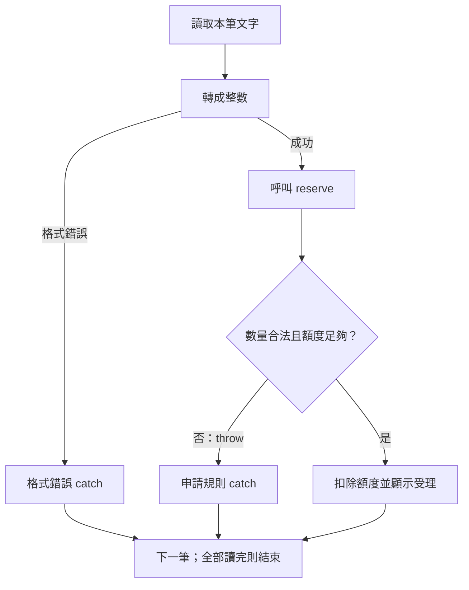

# 第 12 週教材生成規劃（Codex 版本）

初稿由 Codex 製作。規劃日期：2026-11-19。本文件保留教材生成前的設計與原型證據；同日已依使用者「開始生成」指示完成正式講義、40 頁投影片、學生起始碼及教師解答，入口見 [README](README.md)，本次正式驗證見 [verification](verification.md)。下文關於尚未生成、原型與預定交付的敘述，均為原規劃階段紀錄，現況以這兩份文件為準。

## 一、本週定位：以獨立情境教授例外處理與執行緒

依課綱，第 12 週主題為「例外處理與執行緒基礎：AI 生成例外處理程式碼除錯練習」，日期區間為 11/29～12/05，實際上課日另填。本週採「校園列印額度與背景工作」情境，三節各 50 分鐘，休息另計，時間為備課估計。

依本次指示，與第 11 週的泛型主題、樣本群組及探測車實作脫鉤：

- 從空白的 `java-12` 專案開始，提供本週需要的全部檔案，不複製第 11 週的程式。
- 不使用 `SampleGroup`、`SampleSource`、`Rover`、泛型上限或前週作業成果；未完成第 11 週仍可參與。
- 共同先備只有分支、普通迴圈、字串、陣列、方法、基本類別與介面閱讀；開場補上本例需要的操作，不考前週名詞。
- 本週不修改第 11 週原有 handoff；其中空群組、非法索引的建議入口不採為本週教學起點。

先用熟悉的操作提問：「在 C# 的文字方塊輸入 abc，轉成數量會發生什麼？顯示錯誤之後，還能處理下一筆嗎？」再轉到 Java 的文字轉整數與方法呼叫。這是情境對照，不假設學生已學過 C# 例外處理。

## 二、學習目標與內容取捨

| 本週結束時可觀察的能力 | 學生證據 |
|---|---|
| 追蹤例外發生後跳過的敘述、被選中的 catch，以及下一筆資料如何繼續 | 一份正常／格式錯誤／規則拒絕的流程追蹤 |
| 區分方法內的 `throw` 與呼叫端的 `try/catch`，失敗時保持物件狀態 | 自寫的額度方法與呼叫端，拒絕前後額度相同 |
| 依例外的繼承關係排列 catch，區分格式錯誤與申請不合法 | `abc` 與 `0` 顯示不同原因；能解釋 catch 順序 |
| 以具名 `Runnable` 建立兩個有限工作，使用 `start()` 與 `join()` | 工作名稱、實際執行緒名稱、各自步驟與最後結束訊息 |
| 用反例審查 AI 程式，完成最小修正及同案例重測 | 錯誤版、狀態證據、修改位置與修正後結果 |

必做核心是 `try/catch`、`throw`、常見非受檢例外，以及 `Runnable`、`Thread`、`start()`、`join()` 的最小使用。`join()` 的 `InterruptedException` 用來短示範受檢例外；恢復中斷旗標與退出等待流程的處理由教師提供並解釋，不要求學生自行設計取消機制。

`throw` 是現在拋出一個例外；`throws` 是方法宣告可能往外傳遞哪些例外，不是捕捉。主線的 `reserve` 使用非受檢例外，不必加上 `throws`；教師以 `join()` 的方法宣告對照受檢例外，說明編譯器為何要求處理或宣告。

`finally` 安排為教師閱讀補充：可用短片段追蹤正常及例外路徑共用的收尾位置，不能拿來扣額度或印「受理成功」。不把「一定執行」當成涵蓋 JVM 被終止等情況的保證。自訂例外、例外鏈、檔案 I/O、try-with-resources、執行緒同步、執行緒池、Future、虛擬執行緒及 Lambda 留待延伸，不列本週必做。

## 三、情境與責任：先處理申請，再獨立觀察工作執行

課堂使用固定字串陣列模擬六筆申請，避免同時加入互動輸入迴圈、輸入緩衝及結束指令。這是額度規則的教學模型，不連接真實印表機、不讀檔，也不計算費用。

| 部分／檔案 | 責任 | 狀態與資料 |
|---|---|---|
| `PrintQuota.java` | 保存剩餘額度，驗證一次申請並扣除 | 每個新物件初始 10 頁，欄位 private |
| `PrintQuotaDemo.java` | 逐筆轉換文字、呼叫方法、顯示受理或拒絕 | 同一批共用一個額度物件；catch 放在迴圈內 |
| `PrintTask.java` | 實作 `Runnable`，輸出一份講義的三個模擬步驟 | 每個工作自己的標籤；迴圈變數為區域變數 |
| `ThreadStartDemo.java` | 建立兩個工作、啟動並等待結束 | 不持有 `PrintQuota`，不扣額度、不共用計數器 |

兩組各兩個 Java 檔，分開操作，以 VS Code 為主要環境；不因整週合計四檔就要求學生建立四檔共同相依的專案。IntelliJ IDEA 可沿用既有操作，本週不另排雙 IDE 重做活動。



執行緒部分是另一個獨立入口，用相同校園情境降低故事理解成本。它不把額度物件交給背景工作，也不宣稱解決了多台印表機的排程或共用額度安全問題。

## 四、例外處理主線的完整契約

### 1. 方法與輸入

`PrintQuota` 提供無參數建構子、`int getRemaining()` 及 `void reserve(int copies)`。建構子與 getter 由教師提供，學生負責申請規則。

| 條件 | 指定處理 | 額度變化 |
|---|---|---|
| 文字轉換 | 呼叫端以 `Integer.parseInt(raw.trim())` 轉換；`raw` 約定非 null | 轉換失敗不呼叫 reserve |
| 空字串、abc、超過 int 範圍 | 捕捉 `NumberFormatException`，顯示「請輸入整數」 | 不變 |
| `copies < 1` 或 `copies > 5` | reserve 拋出 `IllegalArgumentException("每筆限 1～5 頁")` | 不變 |
| 數量在 1～5，但超過剩餘額度 | reserve 拋出 `IllegalArgumentException("剩餘額度不足")` | 不變 |
| 數量符合上述所有規則 | 扣除本次頁數，正常返回 | 減少 copies |
| 額度為 0 後又有申請 | 仍逐筆處理，依上述規則拒絕；不提早中止批次 | 維持 0 |

先檢查單筆範圍，再檢查剩餘額度，全部通過才扣除；同時違反兩項時，優先顯示單筆範圍錯誤。這裡用同一種 `IllegalArgumentException` 表達兩種不被此方法接受的數量，以訊息區分原因，是本例的簡化設計，不宣稱所有業務失敗都應使用這個例外。

空白採 trim 後再解析，因此 `" 2 "` 可接受，純空白屬格式錯誤。小數字串不接受；不另外設計正規表示式或完整數字輸入工具。沒有使用者結束指令，陣列讀完就是停止點。

`NumberFormatException` 是 `IllegalArgumentException` 的子類別，兩個 catch 必須先放格式錯誤，再放較廣的參數錯誤。先做編譯預測，再由教師在隔離副本交換順序，觀察後一個 catch 不可到達的編譯診斷。正式程式不捕捉籠統的 `Exception`，也不以空 catch 忽略錯誤。

### 2. 固定資料與可逐行核對的結果

每次執行建立新物件，輸入為 `{"3", "abc", "0", "5", "4", "2"}`。正確版完整輸出預定如下：

```text
輸入=[3] 受理=3 頁 剩餘=7
輸入=[abc] 拒絕：請輸入整數 剩餘=7
輸入=[0] 拒絕：每筆限 1～5 頁 剩餘=7
輸入=[5] 受理=5 頁 剩餘=2
輸入=[4] 拒絕：剩餘額度不足 剩餘=2
輸入=[2] 受理=2 頁 剩餘=0
批次結束 剩餘=0
```

不用 Java 原生例外訊息當固定中文驗收文字；`parseInt` 的失敗訊息由呼叫端翻成教學用中文，方法自行拋出的兩則訊息才由 `getMessage()` 顯示。Java 類別名稱與原生編譯診斷保留原文。

### 3. 學生工作與支援碼界線

- A1：先追蹤單一轉換短例，預測 `parseInt("abc")` 後方的敘述會不會執行；比較未捕捉與捕捉後的流程。
- A2：完成 reserve 的兩項驗證、拋出例外與成功後扣除。教師不先填好條件或 throw，學生由契約撰寫。
- A3：在批次迴圈內完成 try 與兩個 catch；成功訊息放在 reserve 正常返回之後。教師提供陣列、初始物件及輸出格式要求，不預填完整處理流程。
- A4：填寫逐筆「執行前額度／發生位置／選中 catch／是否扣除／下一筆是否處理」，再跑固定案例與一組自選邊界資料。

支援碼可提供 `Integer.parseInt`、`trim`、`getMessage` 的短用法。這些 API 是本週先介紹的工具，不把學生以前見過字串變數視為已會使用它們。先保留明確的 if 驗證，再以 throw 將失敗交給呼叫端；不教用例外代替一般的迴圈結束判斷。

## 五、執行緒小實驗：兩項有限工作與完成條件

兩份講義分別為「講義A」「講義B」，對應的執行緒名稱為「工作A」「工作B」。每個 `PrintTask` 只依序輸出步驟 1、2、3，每一步是一行；沒有 `sleep`、隨機等待、檔案處理或共用可變業務資料。

```text
main：印開始 → start A → start B → join A → join B → 印兩項工作皆已結束
工作A：步驟1 → 步驟2 → 步驟3 → 結束
工作B：步驟1 → 步驟2 → 步驟3 → 結束
```

箭頭只表示各列本身的先後；A 與 B 的步驟可有不同排列。先啟動兩者再等待，不能寫成「start A、join A、start B、join B」後宣稱已觀察兩個工作同時具備執行機會。

學生實作分成兩項：

- B1：在已提供標籤欄位、建構子及 `public void run()` 簽名的 `PrintTask implements Runnable` 中，自行完成三步迴圈。輸出每步的工作標籤、`Thread.currentThread().getName()` 與步驟。教師先用圖說明 Runnable 描述工作，Thread 提供執行該工作的執行緒，不使用 Lambda 或匿名類別。
- B2：建立兩個不同的 PrintTask 與 Thread，依流程加入兩次 start 及兩次 join。教師提供 join 外層的 try/catch 與中斷處理，學生標出誰在等待誰，再以副本把 start 改成直接呼叫 run，比較實際執行緒名稱。

教師提供的中斷支援段固定為：

```java
catch (InterruptedException e) {
    Thread.currentThread().interrupt();
    System.out.println("等待被中斷，本次不宣告兩項工作皆已結束");
    return;
}
```

這裡被中斷的是等待中的 main，不等於取消兩個工作；這兩個有限工作仍會自然結束。支援段的角色是恢復中斷旗標並離開後續宣告，不假裝等待已成功完成。正常路徑最後印「兩項工作皆已結束」；join 保證的是執行緒終止，不能據此推論一般業務工作一定成功。工作執行緒的未捕捉例外也不會由 main 的 join catch 自動接住。

| 必做觀察 | 判定方式 |
|---|---|
| 一次正確執行的完整結果 | 共 8 行：開始 1 行、兩份工作各 3 行、結束 1 行 |
| 工作在哪裡執行 | 講義A 的三行執行緒名稱皆為工作A；講義B 皆為工作B |
| 有保證的順序 | 各工作內部皆為 1→2→3；結束訊息位於六行步驟之後 |
| 不要求的順序 | 不要求 A 先出現，也不要求 A、B 交替；A 全部完成才看到 B 仍可能是合法結果 |
| 直接呼叫 run 的副本 | 兩份工作的六行都由 main 執行，不會因此建立新的執行緒 |

不以「跑五次有沒有不同」作為學生通過標準，也不比較耗時或宣稱本例必定加速。先看實際執行緒名稱，再談排程與交錯的不確定性。共享額度需要另設同步規則，本週不把未教的並行安全藏進作業。

## 六、150 分鐘教學安排

| 節次 | 時間分配 | 最低產出 |
|---|---|---|
| 第 1 節：失敗後程式去哪裡 | 10 分鐘情境與先備診斷；15 分鐘文字轉換短例、未捕捉／捕捉對照；15 分鐘方法拋出與呼叫端接住、額度流程；10 分鐘學生完成 A2 | 三條路徑的預測、自己寫出的驗證與 throw |
| 第 2 節：讓一批資料走完 | 10 分鐘對照契約與 catch 順序；20 分鐘完成 A3、固定案例及 A4 追蹤；15 分鐘 AI 錯誤的反例、最小修正與重測；5 分鐘自選邊界與同儕說明 | 七行結果、拒絕前後額度證據、一筆 AI 修正紀錄 |
| 第 3 節：工作與執行緒 | 10 分鐘 Runnable／Thread 圖解及 start／run 對照；15 分鐘 B1、B2；10 分鐘檢查名稱、順序與 join，口頭解釋受檢例外；15 分鐘保存、遠端核對與取回重編譯 | 兩份有限工作、兩版執行緒名稱比較與可取回成果 |

第一節先看獨立短例，再進兩檔額度主線；第三節另開兩檔工作實驗。finally 閱讀補充放教師附錄，不占必做實作時間。若第二節落後，縮短教師額外示例與選做討論，保留逐筆處理、額度不變、AI 同案例重測；第三節可使用教師提供的步驟輸出格式，仍由學生完成迴圈、建立及啟動兩個工作，不刪除執行緒基本體驗與最後保存時間。

## 七、AI 協作：捕捉到錯誤，不代表狀態沒有被破壞

先保存人工版，再寫三至五句需求：每筆數量限制、額度不足怎麼辦、失敗不得扣額度、後續資料要繼續，以及輸出要顯示什麼。教師提供明標「模擬 AI 錯誤」的副本，保留單筆數量檢查，卻把不足判斷移到扣除之後：

```java
// 模擬 AI 錯誤片段：前方已檢查 copies 在 1～5。
remaining -= copies;
if (remaining < 0) {
    throw new IllegalArgumentException("剩餘額度不足");
}
```

活動步驟：

1. 學生先預測：剩餘 2 頁、申請 4 頁，catch 印出拒絕時，額度會是多少？
2. 在 `ai-check/` 的隔離副本執行同一組六筆固定資料。第五筆雖顯示拒絕，剩餘額度卻為 -2；第六筆繼續遭拒，最後為 -4。
3. 指出例外不會自動還原已修改的欄位；catch 能讓批次繼續，也不能把錯誤狀態變正確。
4. 最小修正是先比較 copies 與剩餘額度、需要時 throw，全部通過後才扣除。不要在 catch 猜測扣了幾頁再補回，也不要改初始額度掩蓋反例。
5. 以原六筆資料重跑，逐行回到七行正確結果；另測恰好用完及用完後再申請。

紀錄限「需求／預測、錯誤證據、修改位置與理由、同案例重測／採納決定」。真實 AI 對話另記工具及本人驗證；未使用真實 AI 仍可用模擬案例完成活動。不能把教師預算或本規劃的原型結果當成學生本人實測。

## 八、課後作業與評量

必做約 25～35 分鐘：把已完成的單筆處理抽成 `boolean processOne(PrintQuota quota, String raw)`，由此方法完成轉換、呼叫、兩種 catch 及一行結果輸出。成功回 true，拒絕回 false；外層迴圈只依回傳值累計「受理筆數／拒絕筆數」，批次結束後加印摘要。學生自行設計方法內的正常與例外回傳路徑，不在教師骨架預填答案。

這份作業回收已學的方法、布林值與累計，不新增其他 API。它要求區分「處理過一筆」與「成功受理一筆」，可抓出把累計放在 finally、或 catch 後仍回 true 的錯誤。

最低驗收包含：

- 原固定六筆：受理 3 筆、拒絕 3 筆、剩餘 0 頁，原本六行逐筆結果不變。
- 自選一批，同時包含格式錯誤、規則拒絕與正常資料，並讓拒絕後至少有一筆成功；先寫期望與原因再執行。
- 恰好用完與額度為 0 後再申請；失敗不得改額度，每筆只計一次，受理＋拒絕等於輸入筆數。
- 空陣列：受理 0、拒絕 0、剩餘 10，不必製造例外。

執行緒部分以課堂 B1、B2 為必交成果，不再另出共享資料題。選做擇一：把工作改為四步並說明哪些順序仍有保證，或做 finally 的正常／例外路徑追蹤；都不要求另外設計大型系統。

| 評量面向 | 比例 | 判定依據 |
|---|---|---|
| 例外流程與狀態規則 | 35% | catch 位置與順序正確，成功才扣額度，失敗不改狀態且能繼續 |
| 驗證與 AI 修正 | 25% | 正常、邊界、拒絕、連續資料與空批次證據；反例及同案例重測 |
| 執行緒基本操作 | 25% | 工作有界，正確使用 start／join，能解釋 run 對照與輸出順序 |
| 方法整理、解釋與保存 | 15% | processOne 回傳與統計一致，可說明程式並取回重編譯 |

## 九、後續教材交付與檔案安排

正式製作範圍限定 `week12/codex版本/`，預計交付：

| 項目 | 製作要求 |
|---|---|
| `README.md` | 強調獨立起點、先備診斷、兩組入口與停止規則 |
| `examples/` | 文字轉換的獨立短例、執行方式與預期；未捕捉／catch 順序實驗用隔離副本 |
| `starter/quota/`、`starter/threads/` | 每組兩檔；保留核心 TODO，分開執行，不依賴第 11 週任何檔案 |
| `teacher/quota/`、`teacher/threads/` | 完整解答；作業解答另放隔離子目錄；註解說明驗證時機、狀態及等待條件 |
| `student_lab.md` | A1～A4、B1～B2，保留預測、操作、實際、差異、修正與本人證據欄位 |
| `teacher_notes.md` | 對應每題答案、常見錯誤、落後處理與中斷支援碼解釋 |
| `assignment.md`、`AI_USAGE_template.md` | 統一摘要契約、評分、繳交；AI 範本附明標虛構的精簡示例 |
| `ai/`、`tools/` | 模擬錯誤副本與教師驗證工具，不提前要求 JUnit |
| `diagrams/` | 例外流程、類別責任、三條執行緒時間線，保留可編輯原稿與輸出圖 |
| `week12_slides_codex.md`／`.html` | Marp 延續前週版式；先情境與短例、再 TODO，附操作檔名、預期結果及講者備註 |
| `handoff.md`、`verification.md` | 本週能力、下一週非強制入口、實測與未驗證範圍 |

起始碼預設可編譯、安全結束，main 先明示「尚未完成」，依講義逐段接上學生實作；不執行仍未完成的演示，也不把初始額度或空 run 當成已通過功能。故意失敗的編譯案例不放正式 src。教師答案與 starter 分開編譯，不混放同名類別。

學生路徑沿用：

```text
115_1_Java/YYYY_MM_DD/
  LAB_REPORT.md
  AI_USAGE.md
  java-12/
    src/           PrintQuota.java、PrintQuotaDemo.java；作業方法加入此入口
    threads/       PrintTask.java、ThreadStartDemo.java
    examples/      獨立短例
    ai-check/      模擬錯誤的隔離副本
```

日期換成實際上課日；兩組各自有 main。後續 README 要分別給出工作目錄、檔案與輸出目錄的操作，不要求學生把不同活動合成同一入口。以 GitHub Desktop 檢查差異、commit、push、遠端核對，再到 repo 外取回重編譯；不建巢狀 repo，不提交 `.class`、編譯輸出及錯誤實驗副本。

製作順序為：固定上述契約與輸出 → 教師版及驗證工具 → starter 與學生完成路徑 → 講義、作業及教師筆記 → 圖解、投影片與 HTML → 實際版面檢查及交接紀錄。

## 十、驗收與本次規劃的查核範圍

正式教材生成後，至少檢查：

| 案例 | 預期結果 |
|---|---|
| 固定六筆 | 七行完整輸出一致；最後剩餘 0 |
| 新物件各自申請 1、5 | 分別剩餘 9、5；不得共用 static 額度 |
| 0、-1、6 | 單筆範圍拒絕，額度不變 |
| abc、空字串、純空白、超出 int 範圍 | 格式拒絕，之後的合法資料仍能處理 |
| 前後空白的 2 | trim 後受理，剩餘 8 |
| 5、5；再申請 1 | 先恰好剩餘 0，再拒絕且仍為 0 |
| 同時數量超限且額度不足 | 優先單筆範圍訊息，狀態不變 |
| catch 順序交換副本 | 編譯拒絕；學生能指出父類別 catch 已涵蓋子類別 |
| AI 錯誤／修正 | 同一六筆資料重現 -2、最終 -4；修正後回到七行正確結果 |
| 正確執行緒版 | 8 行完整結果、工作與執行緒名稱對應、各自步驟遞增、結束訊息最後 |
| 直接 run 對照 | 六行工作輸出的實際執行緒皆為 main |
| 中斷處理支援碼 | 檢查恢復旗標與 return；若另作可控制的中斷實驗，分開記錄，不以自然排程碰運氣 |
| 作業摘要 | 成功才計受理、拒絕不扣額度、空批次與自選案例正確 |
| 全套配套 | TODO、講義、答案、中文輸出、main 入口、連結、匯出物及驗收一致 |

本次實際已讀課綱、共用課程脈絡與驗證規範，以及第 11 週 README、學生講義、教師群組／展示程式及 handoff。開始時第 12、13 週尚無教材目錄，也沒有 PROJECT_MEMORY.md；後續只依課綱留入口，不假稱已核對不存在的程式。本次未修改第 10、11 週既有工作區內容。

2026-11-19 以 Windows、OpenJDK `22+36-2370`、`javac 22`，在暫存目錄建立最小原型並實際查核：

- 以 UTF-8、`-Xlint:all` 編譯額度原型、錯誤／修正副本與執行緒原型，成功版本無警告；未加入固定 `--release`、`-source` 或 `-target`，不鎖定課堂 JDK。
- 固定六筆的七行完整輸出符合上列預算；另查核 10 組資料：1、5、0、-1、6、空字串、前後空白的 2、2147483648、5→5、5→5→1。這 10 組以每組最後額度核對，不冒稱已完成正式教材全部逐行輸出驗收。
- 模擬 AI 副本重現第五筆剩餘 -2、最後 -4；實際恢復先驗證後扣除，再以原六筆核對七行完整結果。
- 交換 catch 順序的隔離副本確實被 javac 拒絕。
- 正確執行緒原型執行 5 次，各次均有完整 8 行、正確名稱、各工作內的 1→2→3 及最後結束訊息；直接 run 的副本六行工作均在 main。未要求五次出現不同排程。

原型只用於核對可行性，未作為正式教材檔案交付；暫存檔已隨原型流程清除。正式 starter 完成路徑、作業摘要程式、全部邊界的完整輸出、中斷實驗、HTML 匯出與視覺檢查、IDE GUI、真實 GitHub、真實 AI 及學生試教尚未驗證。本次只新增規劃文件，尚未提交或推送。

## 十一、第 13 週入口與來源

第 13 週依課綱為 Lambda 與 Stream。若需要，可重新提供本週 PrintTask 的最小完成版，對照「只有一個抽象方法的介面如何用 Lambda 表達」，不要求先完成本週作業；Stream 自行提供固定資料，不以共享額度或多執行緒串接為先備。這只是未來可選的連結，本週學習與驗收完整獨立。

已核對本專案 Deitel《Java How to Program, Early Objects》11e EPUB 目錄：例外處理參考第 11 章，主線對應 §11.3、§11.4、§11.5、§11.7、§11.10；finally 參考 §11.6，自訂例外 §11.9 與資源管理 §11.12 不列必做。並行概念參考第 23 章 §23.1、§23.2；書中 §23.3 使用 Executor Framework，本週為控制負擔，另採兩個傳統 Thread 的最小實驗，不把它說成教科書原例。不猜紙本頁碼、不複製教科書全文。

官方規則於 2026-11-19 查核：

- [JLS §11.2：編譯期例外檢查](https://docs.oracle.com/javase/specs/jls/se25/html/jls-11.html#jls-11.2)：受檢／非受檢例外與處理或宣告的依據。
- [JLS §14.18、§14.20：throw 與 try](https://docs.oracle.com/javase/specs/jls/se25/html/jls-14.html#jls-14.20)：流程轉移、catch 與 finally 的語意。
- [Integer.parseInt](https://docs.oracle.com/en/java/javase/25/docs/api/java.base/java/lang/Integer.html#parseInt(java.lang.String))、[NumberFormatException](https://docs.oracle.com/en/java/javase/25/docs/api/java.base/java/lang/NumberFormatException.html)：解析失敗及例外繼承關係。
- [Thread API](https://docs.oracle.com/en/java/javase/25/docs/api/java.base/java/lang/Thread.html)：start、run、join、目前執行緒及中斷的規則；採用基本平台執行緒 API，不使用新版建構器或預覽功能。

文件版本用來查核規則，不代表要求學生安裝 JDK 25。以上來源與本次 JDK 22 原型互相核對；教學時間與學生熟練度仍屬規劃，待實際授課確認。
